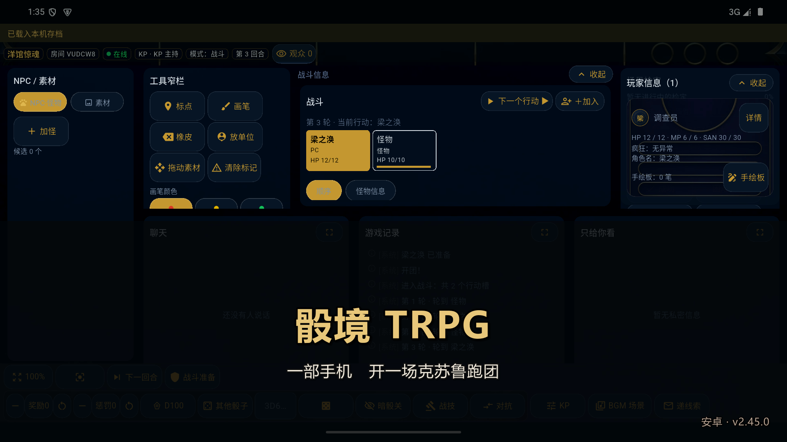
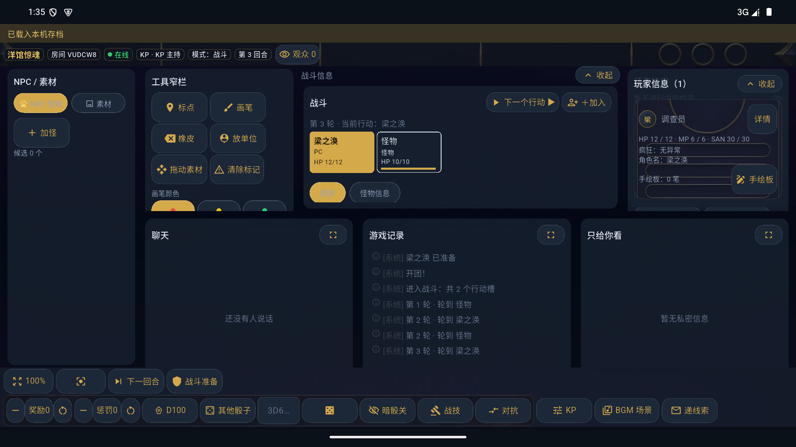

# 骰境 TRPG

> 把克苏鲁的呼唤（CoC 7 版）跑团的整套流程装进手机和平板：车卡 → 开团 → 判定 → 战斗 → 存档续玩。

一部手机当 KP，把房间号发给同伴，所有人进入同一个房间实时同步。**不需要注册账号，默认不联网**，只有你自己配置了服务器才会走公网。



---

## 功能

### 角色卡

- **流程向导**：基础资料、属性、技能、背景、装备、资产、战斗、规则、总结，九步可回退
- **一键出卡**：随机生成一张完整可用的角色卡
- **AI 车卡**：接入任意 OpenAI 兼容接口，用自然语言描述想要的角色
- **角色档案 / 英灵殿**：在役角色与已退场（死亡、永久疯狂）角色分开归档
- **导入导出**：角色卡支持 JSON 导入导出，方便迁移和分享

| 首页（暗色） | 首页（亮色） |
|---|---|
|  |  |

### 跑团房间

- **三种开房方式**：本机（不联网）、局域网（同 WiFi 自动广播）、公网（房间号 + 中继服务器）
- **加入**：房间号、附近的房间、深链三种入口；断线重连复用原座位
- **KP 工具**：要求检定、成败阈值、对抗、检定编辑器、定向指令、存档槽、音乐控制台
- **定向指令 8 项**：造成伤害、临时状态、给物品、SAN Check、治愈疯狂、治愈重伤、急救/医学、SAN 大失败追加
- **战斗**：参战单位、行动顺序、攻击对抗、伤害结算、重伤与濒死；怪物数值仅 KP 可见
- **舞台**：公开素材、白板、标记、实时笔迹、手绘板、全屏、缩放、拖动素材
- **信息流**：递线索（只给指定玩家）、私密栏、公开记录、历史导出
- **关键事件全屏提示**：陷入疯狂、获得新疯狂症、死亡、永久疯狂（撕卡）、进入战斗、战斗结束；多人连发时按序依次弹出，一条不丢
- **存档**：开房即存、每 10 分钟、每次推回合自动保存；续玩列表可回到原进度



### 其它

- 手机 / 平板自适应：平板横屏为三列网格，手机为单列，窄屏折叠为方块
- 两套皮肤：暗色「深渊」与亮色「羊皮卷」，各配一整套美术素材
- BGM 音乐控制台（仅本机播放），结团/结束房间自动停止

---

## 快速开始

### 环境

- Flutter 3.x（Dart 3）
- Android SDK（targetSdk 36 / minSdk 24）
- 仅构建 Android，未适配 iOS

### 运行

```bash
flutter pub get
flutter run
```

### 打包

```bash
flutter build apk --release
# 产物：build/app/outputs/flutter-apk/app-release.apk
```

> 当前仓库的构建脚本 `tool/build_apk.sh` 里含作者本机的代理与路径设置，
> 直接使用前请按你的环境修改；不想改就用上面的 `flutter build apk` 原生命令。

### 测试

```bash
flutter test
```

---

## 服务器（可选）

应用**默认完全不联网**。设置页里的两项地址留空时，不会向任何服务器发送数据。

| 配置项 | 用途 | 形如 |
|---|---|---|
| 分享服务 `shareBase` | 分享角色卡（生成可访问的链接） | `https://你的域名/coc` |
| 房间中继 `roomBase` | 公网开团（异地玩家用房间号加入） | `https://你的域名/room` |

两者的部署方式、接口契约与最小实现说明见 **[docs/server-setup.md](docs/server-setup.md)**。

即使不部署服务器，**本机开房**与**局域网开房**依然可用。

---

## 项目结构

```
lib/
  domain/        规则层：属性、技能、检定、疯狂、战斗结算（纯 Dart，无 Flutter 依赖）
  net/           网络层：局域网、公网中继、分享客户端
  repo/          持久化：角色卡、设置、房间存档（JSON 文件）
  ui/            界面：首页、车卡向导、角色卡、房间（大厅 / 游戏页 / 各类面板）
  theme.dart     双皮肤与配色
assets/          美术素材（背景、横幅、事件底图、图标）
test/            自动化测试
tool/            构建与校验脚本
```

---

## 隐私

- **没有账号体系**，不收集任何个人信息
- 角色卡、设置、存档都保存在**本机**
- AI 车卡的接口地址/模型/密钥只存在本机，不随导出或分享上传
- 只有你主动配置了服务器，且主动使用分享/公网开团时，才会与那台服务器通信
- 公网中继只转发消息，不做内容留存以外的用途；具体策略取决于你自己部署的服务器

---

## 已知限制

- 安装包为 debug 签名，可侧载但**不能上架应用商店**
- 仅支持 Android；屏幕最小 320dp 宽
- 公网开团依赖你自己部署的中继服务
- 规则数据面向 CoC 7 版；其它规则系统在界面上标注为「未开放」

---

## 致谢与声明

- 《克苏鲁的呼唤》（Call of Cthulhu）相关规则与名词版权归 Chaosium Inc. 所有，本项目为非商业的个人实现
- 本项目仅用于朋友之间跑团自用，请勿用于商业发行
