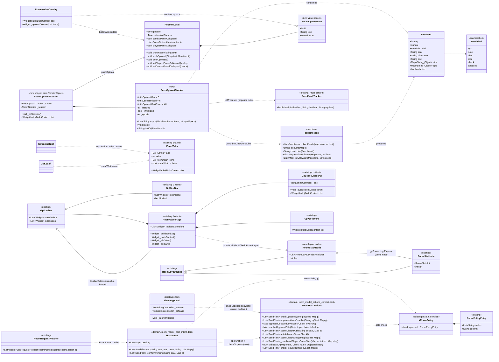
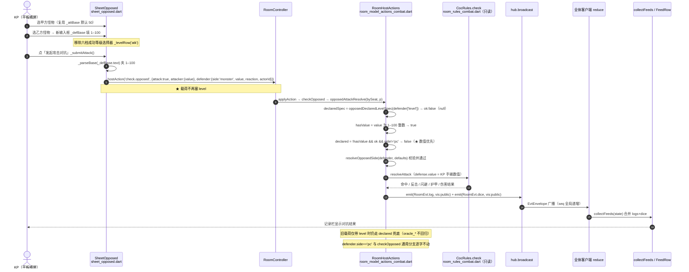
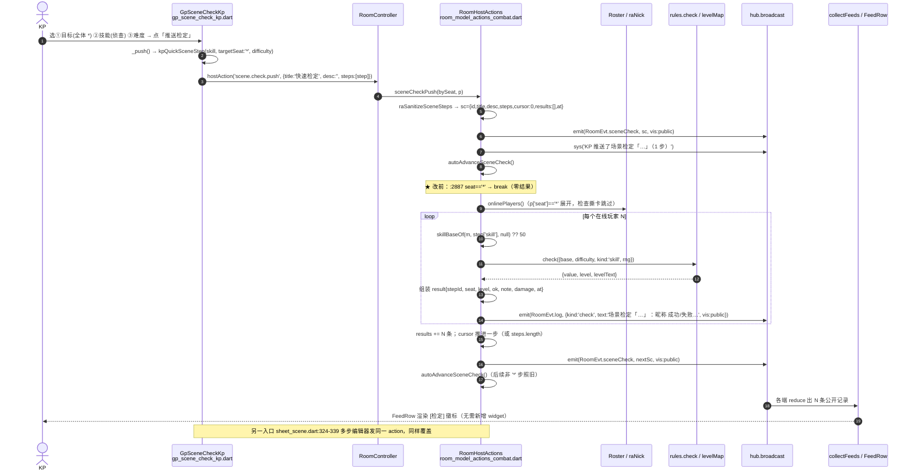
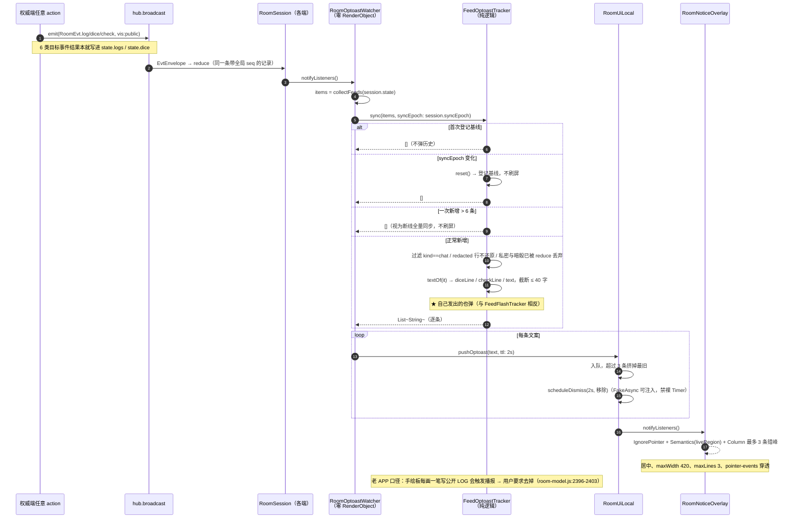
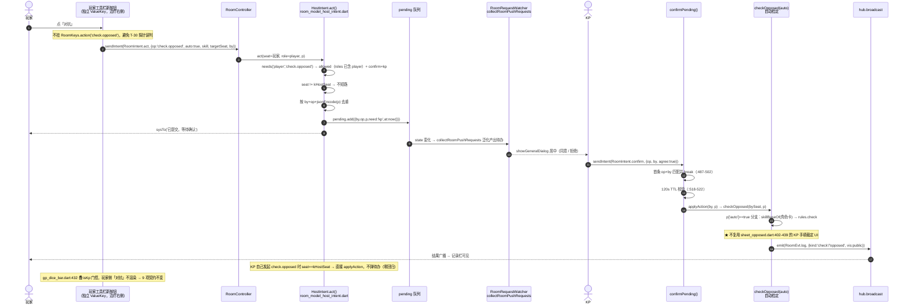
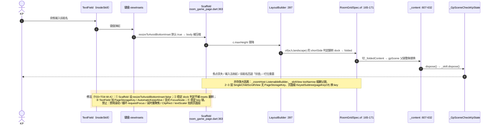
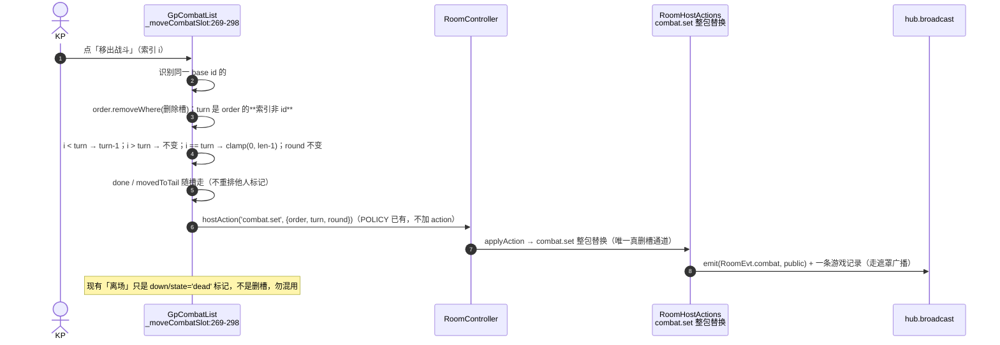
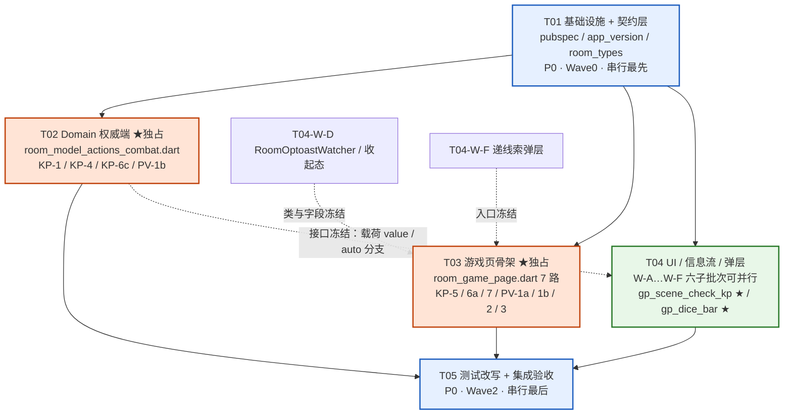

# 骰境 TRPG v2.34.0+104 增量系统设计与任务分解（P11 / 第 8 期）

> 架构师：高见远（software-architect） · 阶段：只读调研 + 设计 + 施工单 · 全程中文
> 源码根：`C:/Users/60965/WorkBuddy/2026-10-08-18-34-17/dice-realm`（下文简称 **ROOT**，均为绝对路径）
> 老 APP 参考：`C:/Users/60965/WorkBuddy/2026-11-08-13-25-14/_oldapp_ref/web`
> 版本：`2.33.0+103` → `2.34.0+104` · 视角：KP = 平板横屏；玩家 = 非平板横屏（手机竖/横、平板横屏布局相同）
> **本阶段只写本文档，未改任何 `.dart` / 测试文件，未运行 flutter，未改 `pubspec.lock`。**
> 本期范围：16 条需求全量推进；**不出 APK**，只交付源码 + 测试 + 升版本号。
> 文档版本：**v1.1**（已按 QA #22 对账结论修订；修订清单见文末「v1.1 修订记录」）。

---

## 0. 架构师只读复核结论（含 5 条新增发现）

### 0.1 契约计数实测（逐项数过，注释过时，以实测为准）

| 契约 | 实测值 | 源码位置 | 过时注释 | 结论 |
|---|---|---|---|---|
| `kRoomPolicy.length` | **62** | `lib/domain/room_types.dart:248-328`（逐项数得 62 个唯一 key） | `:243` 写「61 个唯一 action / 源码 62 行」；`room_model_actions_combat.dart:1065`、`gp_combat_list.dart:98` 写「61 条」 | **62 正确**，本期不新增 action |
| `RoomEvt.values.length` | **28** | `room_types.dart:162-192` | `:121` 写「恰好 27 项」 | 28 正确，本期不新增事件 |
| `RoomIntent.values.length` | **13** | `room_types.dart:213-227` | — | 13 正确，本期不新增意图 |

> 施工方自检：`room_coverage_test.dart:108-128`、`room_ui_permission_test.dart:353`、`room_actions_test.dart:194` 等 6+ 处逐字钉死这三个数，**改完必须保持 62 / 28 / 13 逐字不变**。
> 顺带发现：`board.self` 在本版本源码中**只出现一次**（`:253`），注释里「定义两次」也已过时；不要照注释去"删重复行"。

### 0.2 KP-2 第 6 色调研结论（老 APP 无第 6 色）

- 老 APP 色板唯一定义在 `_oldapp_ref/web/js/ui/room-panels.js:46`：
  `var DRAW_COLORS = ['#e0605a', '#d4a94a', '#46b9a8', '#8a7de0', '#e8eef7'];` → **仅 5 色，没有第 6 色**。
- 且这 5 个色值与 Flutter `kDrawColors`（`room_theme.dart:11-17`：`#e74c3c/#f1c40f/#2ecc71/#3498db/#9b59b6`）**完全不同**。也就是说 `room_theme.dart:10` 注释「与旧版 drawColors 同序」本来就只表示「5 个的顺序语义」，色值早已漂移，追加第 6 色不会进一步破坏任何协议/存档语义。
- `DRAW_COLORS.forEach` 消费点两处（`:1452`、`:5642`），均只遍历数组，无硬编码 5；`room-model.js:2330/2374` 的 `color` 默认值 `#e74c3c` 与色板无关，是笔触默认色。
- **结论**：旧版无第 6 色可沿用 → 本期给建议值并列入「待明确事项」。**建议值 `#e67e22`（Flat-UI carrot 橙）**：与现有红/黄/绿/蓝/紫同族、在浅色羊皮卷与暗色星云底图上均有区分度、不与红色 `#e74c3c` 混淆。该值只影响 `kDrawColors` 一个常量，**不阻塞施工**（可先落地，用户后续改色值只改一行）。

### 0.3 版本号链路（实测：`app_version_test.dart` 无需改）

- `pubspec.yaml:19` = `version: 2.33.0+103`；`lib/app_version.dart:15` = `const String kAppVersion = '2.33.0';`、`:18` = `const int kAppBuildNumber = 103;`。
- `test/app_version_test.dart` **不含任何版本号字面量**：`:20-38` 用正则从 `pubspec.yaml` 读出 `x.y.z+n`，再与 `kAppVersion` / `kAppBuildNumber` 逐字比对；`:41-44` 只验标签拼接公式。
- **结论**：本任务只需改 `pubspec.yaml:19` + `app_version.dart:15,18` 三处，**测试文件不动即自动绿**。禁止往测试里写死 `2.34.0`（会破坏"单一真源"语义）。

### 0.4 ★ 关键风险 R1：`check.opposed` 改 roles 会撞「骰子条 9 项契约」

- `room_types.dart:308` 现为 `'check.opposed': RoomPolicyEntry(<String>[RoomRole.kp], null)`。
- `gp_dice_bar.dart:432-441` 有 `if (gate.can('check.opposed')) RoomTap(key: RoomKeys.action('check.opposed'), label:'对抗', onTap: () => showOpposedSheet(context))`。
- 一旦按 PV-1b 把 roles 改成 `[kp, player]`，`gate.can('check.opposed')` 对**玩家**由 false 变 true → 该「对抗」按钮会**结构性地对玩家新渲染一个按钮**，且 `onTap` 打开的是 KP 裁定弹层（`sheet_opposed.dart`，明确不复用）。这既可能造成 `GpDiceBar` 条目数漂移（硬约束 3：`diceBalancedRowSizes(9,3)==[3,3,3]`、9 项契约），又会让玩家看到不该用的裁定 UI。
- **架构裁决（必须写进施工单）**：
  1. `room_types.dart:308` 改为 `RoomPolicyEntry(<String>[RoomRole.kp, RoomRole.player], RoomConfirm.kp)`（改 roles + confirm，**不加 action、不加枚举**）；
  2. `gp_dice_bar.dart:432` 的渲染条件叠加 `&& isKp`（`RoomRole.kp`），**保持玩家侧该按钮不渲染**，9 项契约逐字不动；
  3. 玩家主动对抗另起**独立 `ValueKey` 新按钮**，放在 `room_game_page.dart` 主组「治疗」右侧（PV-1b），走 `RoomIntent.act` + `check.opposed` 的 pending 链路；
  4. `act()`（`room_model_host_intent.dart:303-306`）已实现「`confirm == kp && seat == kHostSeat` → 直接 `applyAction`」→ **KP 自己发起对抗不弹待办，KP 现有流程零回归**。
- **★ v1.1 补充：T-30 探针实测裁决（回应 QA #22 对账的「R1 门控与探针可能相撞」）**。只读核实 `room_ui_permission_test.dart:81-166 / 267-306 / 315-365 / 426-442 / 574-643` 后结论如下：
  1. **`scanAnchors()` 是静态源码扫描**（`:81-166`）：只解析 `lib/ui/room/**/*.dart` 里 `RoomKeys.action(...)` 的**字面量**（去注释后），产出 `op → 位置表`。`&& isKp` 不改该字面量 → `:332 table.length == 28`、`:353 kRoomPolicy.length == 62`、`:361 noAnchor == kFrozenNoAnchor`、`:363 有锚点+无锚点 == 62` **全部零漂移**。新玩家对抗按钮用独立 `ValueKey`（非 `act/` 前缀）也不进静态表。
  2. **`actEnabled()` 只扫运行时已渲染的 `RoomTap` 且 key 以 `act/` 开头**（`:267-277`）；`expectGateEquivalence`（`:285-306`）约束的是 **`enabled` 恰好等于 `gate.can(op)`**（P17 修订 `&& !locked`）。`gp_dice_bar.dart:16-22` 的 T-30 契约管的同样是 **`enabled`**，**不是渲染条件**。R1 的 `&& isKp` 改的是 `if (...)` 渲染条件，`enabled:` 表达式逐字不动 ⇒ **不违反 T-30 契约，门控本身不会造成探针假红**（QA 担心的方向反了，但提醒非常必要）。
  3. **真正会红的是 T-22 组 `:591` 的前提断言**：`structuralKpOnly`（`:574-577`）含 `'check.opposed'`，玩家视角用例 `:591` 断言 `f.controllerOf('p1').gate.can(op) isFalse`。改 roles 后该值变 **true** → **必红**，且这是**产品契约真变**（PV-1b 就是让玩家能发起对抗），**不是脚本异常假红**。必须按「更强或等价」改写（见 §7.4 模板 D），归 **T05 独占** —— 这是 v1.0 的实质遗漏（原 §2.2 误列为「核，不改」），v1.1 已修正。
  4. `:426-442`（三视角 `expectGateEquivalence`）、`:455-464`（旁观零 `act/` 锚点）、`:598-613`（旁观 T-22）、`:615-643`（KP T-22 `findsOneWidget`）在 `isKp` 门控 + 独立 `ValueKey` 新按钮下**全部零变化**；旁观者仍不在 `[kp,player]` roles 内。
  5. **施工单措辞（T04-W-B 必读）**：R1 门控是**结构渲染条件**，不是 `enabled` 条件；动手前 Grep 一次 `structuralKpOnly` / `scanAnchors()` 锚点表同步口径，**禁止**为过探针去改 `enabled:` 表达式、删 `RoomKeys.action` 锚点或把 `findsNothing` 降级。
- 附加核实点：`hostAction('check.opposed', …)` 路径需确认是否经过 `act()`；若经过，KP 由 `seat == kHostSeat` 短路直接执行，同样不回归。施工方动手前用 Grep 复核一次。

### 0.5 ★ 关键结论 R2：KP-4 的 domain 改动可以最小化（保住 `oracle_*`）

- 实测 `room_model_actions_combat.dart:2203-2205`：
  ```dart
  final declaredSpec = opposedDeclaredLevelSpec(asMap(p['defender'])['level']);
  final declared = declaredSpec['ok'] == true && asMap(p['defender'])['side'] != 'pc';
  ```
  只要载荷带合法 `level` 且 `side != 'pc'`，`declared` 恒真，`:2246` / `:2302` 就把 `declaredSpec['base']`（100 或 1）写成 `defender['value']`，覆盖任何手输值。
- 但 **`:1512-1518` 的 `resolveOpposedSide` 已经完整校验怪物 `spec['value']` 为 1–100 整数并直接产出 `value`**；`:2251-2267`（fromRequest）与 `:2307-2317`（直发）两条「非 declared」分支也已能正确吃 `value`。
- **结论**：UI 去掉 `level` 后，理论上一行 domain 都不改也能走通。但为满足「**有 value 就用 value**」成为明确契约（防旧客户端/旧存档/其它调用点仍带 level 时覆盖数值），只需改 `declared` 判定一行，加 `hasValue` 前置优先级：
  ```dart
  final defSpec = asMap(p['defender']);
  final v = raFinite(defSpec['value']);
  final hasValue = v != null && v >= 1 && v <= 100 && v == v.roundToDouble();
  final declared = !hasValue &&
      declaredSpec['ok'] == true &&
      defSpec['side'] != 'pc';
  ```
  → 新载荷（有 value）用数值；旧载荷（只有 level）仍走 `declared` 兜底；**`opposedDeclaredLevelSpec` 函数体、`checkOpposed` 通用分支、`defender.side=='pc'` 玩家路径、通用对抗全部逐字不动**，`oracle_*` 契约用例零风险。
- 全库 Grep `declaredLevel|declaredSpec` 在 `oracle_*` 中零命中（调研结论复核有效）→ QA 必须补三类新用例（见 T05）。

### 0.6 ★ 关键结论 R3：KP-6c 缺失点精确定位

- `sceneCheckPush`（`:2851-2874`）组装 `sc={id,title,desc,steps,cursor:0,results:[],at}` → `emit(RoomEvt.sceneCheck, public)` → `sys(...)` → `autoAdvanceSceneCheck()`。
- `autoAdvanceSceneCheck`（`:2877-2896`）在 `:2887` `if (seat.isEmpty || seat == '*') break;` → **推全体（`targetSeat == '*'`）永远不产生结果**。
- 结果真正生成在 `sceneCheckStep`（`:2941-3070`）：`:2969-3001` 算 level（自动分支用 `skillBaseOf` + `rules.check` + `diceRoll`）、`:3009-3018` 组装 result、`:3036-3052` 写回 `results` 并推 cursor、`:3053-3067` 发 `RoomEvt.log` `kind:'check'` PUBLIC（含 `raNick` 昵称 + `rules.levelMap` 等级文案 + 伤害）、`:3068` 再 `autoAdvanceSceneCheck()`。
- 渲染侧不需新增 widget：`feed_view.dart:103-141` `collectFeeds` 合并 logs+dice → `FeedItem`（`:19-56`），`_logKind:79-86` 把 `kind:'check'` 映射 `[检定]` 徽标，`gp_feeds.dart:585-664` `FeedRow` 直接渲染 text。
- **结论**：修复点落在 `sceneCheckPush` / `autoAdvanceSceneCheck` 层，新增一个**内部私有方法**（不是新 action/事件/意图）做 `* → roster.onlinePlayers()` 展开并按每玩家 `skillBaseOf` 立即掷骰，产出 N 条 result + N 条 `kind:'check'` PUBLIC log + 一次 `RoomEvt.sceneCheck` 更新。现成口径：`checkRequest:1328-1344`（全体展开 + 撕卡跳过）、`skipSceneStep:2899-2938`、`sceneCheckStep:2969-2995`（掷骰）、`skillBaseOf:1817-1828`、`raNick`（`room_model_actions_room.dart:157`）。

---

## 1. 实现方案与框架选型

### 1.1 技术栈（沿用，**不引任何新依赖**）

| 层 | 选型 | 理由 |
|---|---|---|
| UI | Flutter / Dart（Material 3，`RoomTapTile` / `SectionBox` / `PanelTabs` 现有组件族） | 现有 80 个 `lib/ui/room/**` dart 已成型，骨架默认不动，新增按钮复用 `RoomTap`/`RoomTapTile` + `clampBtnText` |
| 状态 | `RoomScope`（`InheritedNotifier<RoomSession>`）+ `RoomUiLocal`（`ChangeNotifier`，纯本地态）+ `ListenableBuilder` 局部重建 | 现有双层订阅范式；PV-1a watcher 挂同层、零 RenderObject，避免整页重算 |
| 权威端 | `lib/domain/room_model_actions_*.dart`（纯 Dart 状态机 + `List<SendPlan>` 出站计划） | 所有规则/结果必须在权威端生成，客户端只 reduce；KP-4 / KP-6c / PV-1b 自动检定都落这里 |
| 视图派生 | `lib/ui/room/view/*.dart`（纯 Dart，零 Flutter 依赖） | `collectFeeds` / `collectPrivates` / `RoomGridSpec` 可被纯 Dart 单测逐条钉死 |
| 传输 | WS + `hub.broadcast`，`EvtEnvelope{k:'evt',seq,t,p}` | 协议零改动（见 1.2） |
| 测试 | `flutter_test` + `FakeAsync`（`gp_feeds.dart:113-116` 同款） | 2 秒定时必须走 `RoomUiLocal.scheduleDismiss` 注入，禁止裸 `Timer` |

### 1.2 为什么协议层 / 网络层 / 服务端零改动

1. **PV-1a 的 6 类目标事件结果本就以 PUBLIC 记录落库**：`room_model_reduce.dart:85-96/98-140/253-295` 把 `RoomEvt.log/dice/check` 写进 `state['logs']`/`state['dice']`；`room_model_host_core.dart:378` 默认 `SendPlan('*', EvtEnvelope)` → `cloud_room.dart:479` `hub.broadcast` → 各端 `room_model_client.dart:80-121` reduce 出同一条带全局 `seq` 的记录（`room_model_log.dart:37-46` `RoomLog.push`）。**缺的只有"从共享 state 派生播报内容"的 diff 层**，纯客户端纯逻辑即可补齐。
2. **PV-1b 复用既有审批链路**：`RoomConfirm.kp` + `pending` + `RoomIntent.confirm` + `RoomRequestWatcher` 全部现成（`room_types.dart:82-91/248-328`、`room_model_host_intent.dart:288-343/476-528`、`room_request_watcher.dart:173-242/371-414/487-496`），无需新增信封类型。
3. **KP-4 / KP-6c / KP-1 都是既有 action 的载荷或内部结算变化**：`combat.set`、`check.opposed`、`scene.check.push` 三个 action 已存在，`kRoomPolicy` 保持 62 条。
4. **硬约束 8**：令牌 / deviceId 绝不进存档、导出、日志；云端全量存档只走 hostToken-only 的 `/backup`；房间消息仍走 WS + `hub.broadcast`。本期不碰这些通道，天然不违规。

### 1.3 架构模式

- **权威端单一真源（Host-authoritative）+ 客户端 reduce 投影**：UI 只发意图 / 只读派生，绝不直接改 `state`；所有结果（KP-4 对抗数值、KP-6c 检定结果、PV-1b 自动检定）由 `lib/domain/` 生成并 PUBLIC 广播。
- **纯逻辑与渲染分离**：`FeedOptoastTracker`（纯 Dart 判据）/ `diceBalancedRowSizes`（纯 Dart 切行）/ `collectFeeds`（纯 Dart 派生）与 widget 分开，便于单测逐条钉死。
- **本地 UI 态隔离**：KP-5 收起态、PV-1a 播报队列放 `RoomUiLocal`，不进 `state`、不进存档、不同步（对齐老 APP `UI_STATE`，`room-panels.js:53-57`）。

### 1.4 本期五条主线（按改动性质归类）

| 主线 | 需求 | 性质 |
|---|---|---|
| A. 权威端结算 | KP-1、KP-4、KP-6c、PV-1b（自动检定部分） | domain 状态机内部逻辑 + 载荷字段 |
| B. 布局与输入稳定性 | KP-5、KP-6a、KP-3、KP-2 | `lib/ui/room` 布局骨架（**仅 KP-5 授权改骨架**）+ textScaler 钳制 |
| C. 按钮增删改 | KP-6b、KP-7、PV-1b（按钮）、PV-2 | 工具栏/弹层按钮，不动 `GpDiceBar` 9 项 |
| D. 信息流与播报 | PV-1a、PV-3、GL-2a、GL-2b | 新增 diff 层 + 全屏订阅式贴底 |
| E. 交互细节 | GL-1 | 调用点节流参数 |

### 1.5 已拍板口径 → 落地对照

| 拍板项 | 落地位置 | 硬绑定 |
|---|---|---|
| 需求 4：数值优先、移除六档；甲方复用 `_attBase`、乙方新增输入框；domain「有 value 就用 value」；`defender.side=='pc'` 与通用对抗逐字不动 | `sheet_opposed.dart` + `room_model_actions_combat.dart:2204-2205` | R2 方案（0.5） |
| 需求 7：递线索挂 `GpToolbar.extensions`、与 `GpDiceBar` 平级 | `room_game_page.dart:1175` 的 `...widget.toolbarExtensions` | 保持骰子条 9 项；独立 `ValueKey`，不用 `RoomKeys.action('scene.clue')` |
| 二.1：玩家主动对抗复用 `RoomConfirm.kp` + pending + `RoomRequestWatcher`；KP 同意后按角色卡技能值自动检定 | `room_types.dart:308` + `room_model_actions_combat.dart` `checkOpposed` auto 分支 | 不新增 action；R1 门控（0.4）；不复用 `sheet_opposed.dart:402-439` 裁定 UI |
| 本期 16 条全推进、**不出 APK** | 全部 | 只交付源码 + 测试 + 升版本号 |
| 遮罩广播老 APP 口径 | `FeedOptoastTracker` + `RoomOptoastWatcher` + `RoomUiLocal` 队列 + `RoomNoticeOverlay` | KP+全体玩家都弹；只取公开 logs/dice；不含聊天/暗骰/私密；同屏最多 3 条错峰；单条 2s；40 字截断；穿透点击；自己做的也弹；首次不弹历史；一次涌入 >6 条视为全量同步不刷屏 |
| KP-5 两栏叠放共 rect + 玩家信息栏可收起 | `room_layout.dart` 新增 `RoomStackNode`；`room_game_page.dart` 接线 | 收起只控制 `GpKpPlayers` 子树，**绝不卸载 `GpSceneCheckKp`** |
| 推送检定权威端按每玩家技能值立即掷骰并出 N 条结果 | `sceneCheckPush` / `autoAdvanceSceneCheck` 新增内部展开方法 | 见 0.6 |
| 全屏「更新」按钮保留但改自动实时 | 信息流弹层内订阅 + 贴底；**不动 `room_sheet.dart` 全局壳** | 18+ 调用点共用 |
| 移出战斗**真删槽** | `combat.set` 整包替换 + turn 索引重映射 | 唯一真删槽通道 |
| 冷却 500ms + 置灰 | `gp_pl_char_card.dart` 调用点传 `window:`；`gp_combat_list.dart` 补 `combat.next` | **不动 `throttle` 默认 400ms** |
| 用户主动上滚不抢位置（P0-06） | `gp_feeds.dart` `FeedList._tailChanged` / `_atBottom` 口径保留 | 只在贴底时跟随 |

---

## 2. 完整文件清单

> 改动类型：`改` = 修改、`增` = 新增、`删` = 删除、`核` = 只读核对（不产生 diff）、`禁` = 明令禁止改动。
> 热点：★ = 单文件承载 ≥2 条需求或为共享件，**必须单 worker 独占**。

### 2.1 改动 / 新增文件总表

| # | 绝对路径 | 需求编号 | 类型 | 热点 | 归属任务 | 改动摘要 |
|---|---|---|---|---|---|---|
| 1 | `C:/Users/60965/WorkBuddy/2026-10-08-18-34-17/dice-realm/pubspec.yaml` | 版本 | 改 | — | T01 | `:19` → `2.34.0+104`；依赖段不动 |
| 2 | `C:/Users/60965/WorkBuddy/2026-10-08-18-34-17/dice-realm/lib/app_version.dart` | 版本 | 改 | — | T01 | `:15` → `'2.34.0'`，`:18` → `104` |
| 3 | `C:/Users/60965/WorkBuddy/2026-10-08-18-34-17/dice-realm/lib/domain/room_types.dart` | PV-1b | 改 | ★契约 | T01 | `:308` `check.opposed` → `[kp,player] + RoomConfirm.kp`；**不加条目、不加枚举成员** |
| 4 | `C:/Users/60965/WorkBuddy/2026-10-08-18-34-17/dice-realm/lib/domain/room_model_actions_combat.dart` | KP-1 / KP-4 / KP-6c / PV-1b | 改 | ★★最高热 | T02 | 删槽 turn 重映射；`declared` 数值优先；全体展开立即掷骰；`checkOpposed` auto 分支 |
| 5 | `C:/Users/60965/WorkBuddy/2026-10-08-18-34-17/dice-realm/lib/domain/room_model_actions_room.dart` | KP-7 / KP-6c / PV-1b | 核 | — | T02 | `sceneClue:1164-1185`、`raNick:157`、`checkRequest` 参考；原则上不产生 diff |
| 6 | `C:/Users/60965/WorkBuddy/2026-10-08-18-34-17/dice-realm/lib/domain/room_model_host_intent.dart` | PV-1b | 核 | — | T02 | `act:288-343`、`confirmPending:476-528` 泛化链路只读核对 |
| 7 | `C:/Users/60965/WorkBuddy/2026-10-08-18-34-17/dice-realm/lib/domain/room_model_reduce.dart` | PV-1a | 核 | — | T02 | `:85-96/98-140/253-295` 公开记录落库口径 |
| 8 | `C:/Users/60965/WorkBuddy/2026-10-08-18-34-17/dice-realm/lib/ui/room/room_game_page.dart` | KP-5 / KP-6a / KP-7 / PV-1a / PV-1b / PV-2 / PV-3 | 改 | ★★最高热 | T03 | 7 路共改，单 worker 独占一次改完（详见 T03） |
| 9 | `C:/Users/60965/WorkBuddy/2026-10-08-18-34-17/dice-realm/lib/ui/room/widgets/room_layout.dart` | KP-5 | 改 | ★ | T03 | 新增 `RoomStackNode`；`roomDockPlanOf` 右列改叠放；`buildRoomLayout` 新分支 |
| 10 | `C:/Users/60965/WorkBuddy/2026-10-08-18-34-17/dice-realm/lib/ui/room/view/room_view.dart` | KP-6a | 改 | — | T03 | `RoomGridSpec.of`（`:165-171` dock 判定）抗键盘抖动 |
| 11 | `C:/Users/60965/WorkBuddy/2026-10-08-18-34-17/dice-realm/lib/ui/room/room_controller.dart` | GL-1 / PV-1b | 改 | — | T03 | `throttle` **调用点**传 500ms；`sendIntent` 核对；**默认值 400ms 不动** |
| 12 | `C:/Users/60965/WorkBuddy/2026-10-08-18-34-17/dice-realm/lib/ui/room/room_entry_page.dart` | PV-1a | 核 | — | T03 | `:1194-1205` overlay 挂载覆盖三视角，只读核对 |
| 13 | `C:/Users/60965/WorkBuddy/2026-10-08-18-34-17/dice-realm/lib/ui/room/widgets/gp_scene_check_kp.dart` | KP-5 / KP-6a / KP-6b / KP-6c | 改 | ★★最高热 | T04-W-A | 4 改动单 worker 独占一次改完（详见 T04-W-A） |
| 14 | `C:/Users/60965/WorkBuddy/2026-10-08-18-34-17/dice-realm/lib/ui/room/widgets/room_button_size.dart` | KP-6b | 改 | — | T04-W-A | `:76-83`「gpScene 8 个」注释 + `sceneTile` 校准依据同步 |
| 15 | `C:/Users/60965/WorkBuddy/2026-10-08-18-34-17/dice-realm/lib/ui/room/widgets/gp_dice_bar.dart` | PV-2 / PV-1b / 9 项契约 | 改 | ★★最高热 | T04-W-B | `:432` 叠 `isKp` 门控（R1）；**9 项条目数逐字不动** |
| 16 | `C:/Users/60965/WorkBuddy/2026-10-08-18-34-17/dice-realm/lib/ui/room/widgets/gp_toolbar.dart` | PV-2 | 改 | ★共用 | T04-W-B | `mainActions`(:214) / `extensions`(:218-224) 挪「治疗」；**不改骨架算术** |
| 17 | `C:/Users/60965/WorkBuddy/2026-10-08-18-34-17/dice-realm/lib/ui/room/widgets/gp_kp_left.dart` | KP-3 | 改 | — | T04-W-B | `:96-107` 用 `LayoutBuilder` 均分宽度 + 传 `equalWidth: true` |
| 18 | `C:/Users/60965/WorkBuddy/2026-10-08-18-34-17/dice-realm/lib/ui/room/widgets/room_panel_kit.dart` | KP-3 | 改 | ★共用 | T04-W-B | `PanelTabs`（`:256-300`）**只加可选参数** `equalWidth = false`；`gp_combat_list.dart:147-152` 另一使用点零影响 |
| 19 | `C:/Users/60965/WorkBuddy/2026-10-08-18-34-17/dice-realm/lib/ui/room/widgets/gp_privates.dart` | PV-3 / GL-2b | 改 | ★ | T04-W-C | `:170-193` 主页 + `:239-264` 全屏改订阅式贴底；不传 rows 快照 |
| 20 | `C:/Users/60965/WorkBuddy/2026-10-08-18-34-17/dice-realm/lib/ui/room/widgets/gp_feeds.dart` | PV-3 / GL-2a / GL-2b | 改 | ★ | T04-W-C | 删 `:335-341`「最新 4 条」文案；`FeedList` 贴底三条疑似失效点修复；**保留 P0-06** |
| 21 | `C:/Users/60965/WorkBuddy/2026-10-08-18-34-17/dice-realm/lib/ui/room/view/feed_view.dart` | PV-1a / PV-3 | 核 | — | T04-W-C | `FeedItem` / `collectFeeds` / `diceLine` / `checkLine` / `privRowsOf` 复用，原则上不改 |
| 22 | `C:/Users/60965/WorkBuddy/2026-10-08-18-34-17/dice-realm/lib/ui/room/room_ui_local.dart` | KP-5 / PV-1a / KP-2 | 改 | ★ | T04-W-D | 新增 optoast 队列 + `playersPanelCollapsed`；`:49`「5 色」注释同步为 6 色 |
| 23 | `C:/Users/60965/WorkBuddy/2026-10-08-18-34-17/dice-realm/lib/ui/room/widgets/room_notice_overlay.dart` | PV-1a | 改 | ★ | T04-W-D | 渲染最多 3 条错峰 `Column` + gap；保留 `IgnorePointer` / `Semantics(liveRegion)` / maxWidth:420 |
| 24 | `C:/Users/60965/WorkBuddy/2026-10-08-18-34-17/dice-realm/lib/ui/room/feed_optoast_tracker.dart` | PV-1a | **增** | ★新 | T04-W-D | 纯 Dart diff 判据（接口见 §3.1） |
| 25 | `C:/Users/60965/WorkBuddy/2026-10-08-18-34-17/dice-realm/lib/ui/room/room_optoast_watcher.dart` | PV-1a | **增** | ★新 | T04-W-D | 零 RenderObject 订阅式 watcher（接口见 §3.1） |
| 26 | `C:/Users/60965/WorkBuddy/2026-10-08-18-34-17/dice-realm/lib/ui/room/room_feed_flash.dart` | PV-1a | 核 | — | T04-W-D | `FeedFlashTracker.check:58-76` 是**反例**（自己发的不闪），不得复用其判据 |
| 27 | `C:/Users/60965/WorkBuddy/2026-10-08-18-34-17/dice-realm/lib/ui/room/widgets/gp_kp_tools.dart` | KP-2 | 改 | — | T04-W-E | `:564-593` 5 chip → 6 chip「3+3 两排」+ 标签「画笔颜色」独占一行 + 整组 `clampBtnText` |
| 28 | `C:/Users/60965/WorkBuddy/2026-10-08-18-34-17/dice-realm/lib/ui/room/room_theme.dart` | KP-2 | 改 | ★纯 Dart | T04-W-E | `kDrawColors`（`:11-17`）追加第 6 色；`:10` / `RoomTheme` 注释同步；`drawColor` 越界夹取自动适配 |
| 29 | `C:/Users/60965/WorkBuddy/2026-10-08-18-34-17/dice-realm/lib/ui/room/widgets/gp_kp_players.dart` | KP-5 | 改 | — | T04-W-E | 去 `const GpKpPlayers()`；自带 `ListenableBuilder(local)` 读收起态；`SectionBox.trailing` toggle |
| 30 | `C:/Users/60965/WorkBuddy/2026-10-08-18-34-17/dice-realm/lib/ui/room/widgets/gp_pl_mates.dart` | KP-5 | 核 | — | T04-W-E | `:40-76` `SectionBox.trailing` toggle 范式参考 |
| 31 | `C:/Users/60965/WorkBuddy/2026-10-08-18-34-17/dice-realm/lib/ui/room/widgets/gp_pl_char_card.dart` | GL-1 | 改 | — | T04-W-E | `:365-370` 调用点传 `window: const Duration(milliseconds: 500)` |
| 32 | `C:/Users/60965/WorkBuddy/2026-10-08-18-34-17/dice-realm/lib/ui/room/widgets/gp_combat_list.dart` | KP-1 / GL-1 | 改 | ★ | T04-W-E | `_moveCombatSlot:269-298` swap/turn 重映射范例；`:216-223` `combat.next` 补节流；`:147-152` PanelTabs 使用点核对 |
| 33 | `C:/Users/60965/WorkBuddy/2026-10-08-18-34-17/dice-realm/lib/ui/room/widgets/gp_combat_strip.dart` | KP-1 | 核 | — | T04-W-E | `:96-119` 同一 base id 的 `#n` 多行动槽识别 |
| 34 | `C:/Users/60965/WorkBuddy/2026-10-08-18-34-17/dice-realm/lib/ui/room/painter/stroke_painter.dart` | KP-2 | 核 | — | T04-W-E | `:31` 只取 index 0，追加色不影响 |
| 35 | `C:/Users/60965/WorkBuddy/2026-10-08-18-34-17/dice-realm/lib/ui/room/widgets/gp_map_stage.dart` | KP-2 | 核 | — | T04-W-E | `:55` 只取 index 0 |
| 36 | `C:/Users/60965/WorkBuddy/2026-10-08-18-34-17/dice-realm/lib/ui/room/sheets/sheet_opposed.dart` | KP-4 | 改 | ★ | T04-W-F | `:372-381` 乙方加 `_baseField`(默认 50)、删 `_levelRow`；`:729-739` 载荷塞 `value` 不塞 `level`；`:98-118` 六档常量核其它引用后移除 |
| 37 | `C:/Users/60965/WorkBuddy/2026-10-08-18-34-17/dice-realm/lib/ui/room/sheets/sheet_scene.dart` | KP-6c / KP-7 | 改 | ★ | T04-W-F | `:347-399` 递线索 9 项能力收拢到新按钮；`:324-339` 多步编辑器 `scene.check.push` 口径；`:85-114` `kKpSceneModes` 复用保留 |
| 38 | `C:/Users/60965/WorkBuddy/2026-10-08-18-34-17/dice-realm/lib/ui/room/sheets/room_sheet.dart` | GL-2b / PV-3 | **禁改全局壳** | ★共用 | T04-W-F | `:51-61` 默认注入刷新按钮、`:14-21` `refreshTopSheet()` 全库 3 处引用：**按拍板不动全局壳**，只在信息流弹层内做订阅+贴底；`:121-142` `showFullscreenReader` AppBar 只读核对 |
| 39 | `C:/Users/60965/WorkBuddy/2026-10-08-18-34-17/dice-realm/lib/ui/room/sheets/sheet_misc.dart` | PV-1b | 核 | — | T04-W-F | `:336-360` 治愈申请链路参考 |
| 40 | `C:/Users/60965/WorkBuddy/2026-10-08-18-34-17/dice-realm/lib/ui/room/room_request_watcher.dart` | PV-1b | 核 | — | T04-W-F | `collectRoomPushRequests:173` 已泛化，不写死治愈 op；`:371-414/487-496` 只读核对 |
| 41 | `C:/Users/60965/WorkBuddy/2026-10-08-18-34-17/dice-realm/test/p10_t6_layout_test.dart` | KP-5 / KP-6b | 改 | ★测试热 | T05 | `:298-356` 9 项/行数断言保留；`:498-534` 几何断言按「更强或等价」改写；`:563-564` 六档引用 |
| 42 | `C:/Users/60965/WorkBuddy/2026-10-08-18-34-17/dice-realm/test/p16_button_unify_test.dart` | KP-6b / 9 项契约 | 改 | ★测试热 | T05 | `:223-227/583-598/896-898` 六档断言改写；`:464-471` `diceBalancedRowSizes(9,3)==[3,3,3]` **逐字保留** |
| 43 | `C:/Users/60965/WorkBuddy/2026-10-08-18-34-17/dice-realm/test/room_ui_kp_test.dart` | KP-6b | 改 | ★测试热 | T05 | `:66-68/727-790` 六档断言改写 |
| 44 | `C:/Users/60965/WorkBuddy/2026-10-08-18-34-17/dice-realm/test/qa_p5_priv_probe_test.dart` | KP-6b | 改 | ★测试热 | T05 | `:216-240` 六档断言改写 |
| 45 | `C:/Users/60965/WorkBuddy/2026-10-08-18-34-17/dice-realm/test/p10_t7_c_feeds_test.dart` | GL-2a / PV-3 | 改 | ★测试热 | T05 | `:146-147` 文案断言改写为「不存在」；`:294-403` 补全屏贴底断言（先写复现用例） |
| 46 | `C:/Users/60965/WorkBuddy/2026-10-08-18-34-17/dice-realm/test/p11_kp4_opposed_value_test.dart` | KP-4 | **增** | — | T05 | 三类：怪物防守 value 生效 / 玩家防守等价 / 六档旧行为不回归 |
| 47 | `C:/Users/60965/WorkBuddy/2026-10-08-18-34-17/dice-realm/test/p11_kp6c_scene_push_results_test.dart` | KP-6c | **增** | — | T05 | 推全体 → N 条 result + N 条 `kind:'check'` PUBLIC log |
| 48 | `C:/Users/60965/WorkBuddy/2026-10-08-18-34-17/dice-realm/test/p11_pv1a_optoast_tracker_test.dart` | PV-1a | **增** | — | T05 | 首次不弹 / 自己发的也弹 / 排除 chat / >6 不刷屏 / 40 字截断 / syncEpoch reset |
| 49 | `C:/Users/60965/WorkBuddy/2026-10-08-18-34-17/dice-realm/test/p11_pv3_fullscreen_tail_test.dart` | PV-3 | **增** | — | T05 | 「打开全屏后 `position.pixels ≈ maxScrollExtent`」复现 + 修复后验绿 |
| 50 | `C:/Users/60965/WorkBuddy/2026-10-08-18-34-17/dice-realm/test/p11_pv1b_approval_test.dart` | PV-1b | **增** | — | T05 | 玩家发起入 pending / KP 同意自动检定 / KP 自己发起不弹待办 / 9 项契约不变 |
| 51 | `C:/Users/60965/WorkBuddy/2026-10-08-18-34-17/dice-realm/test/p11_kp1_remove_slot_test.dart` | KP-1 | **增** | — | T05 | 真删槽 + turn 重映射四分支 + `#n` 槽一并删 + 写记录 + 广播 |
| 52 | `C:/Users/60965/WorkBuddy/2026-10-08-18-34-17/dice-realm/test/p11_kp6a_focus_test.dart` | KP-6a | **增** | — | T05 | 键盘弹起 / textScaler 1.3·1.5·2.0 下 `_skill` 不回退、焦点不丢、父链不换 |
| 53 | `C:/Users/60965/WorkBuddy/2026-10-08-18-34-17/dice-realm/test/room_ui_permission_test.dart` | PV-1b / T-22 | 改 | ★测试热 | T05 | **v1.1 新增**：`:574-596` `structuralKpOnly` 与 `:591` `gate.can isFalse` 前提按「更强或等价」改写（§7.4 模板 D）；`:332`/`:353`/`:363` 三个契约计数断言逐字保留 |

### 2.2 只读核对 / 明令不动文件（本期不产生 diff；需改者已移入 §2.1 总表）

| 绝对路径 | 结论 |
|---|---|
| `C:/Users/60965/WorkBuddy/2026-10-08-18-34-17/dice-realm/test/app_version_test.dart` | **不改**（不含版本字面量，见 0.3） |
| `C:/Users/60965/WorkBuddy/2026-10-08-18-34-17/dice-realm/test/room_coverage_test.dart` | 核：`:108-128` 62 / 28 / 13 逐字不变 |
| `C:/Users/60965/WorkBuddy/2026-10-08-18-34-17/dice-realm/test/room_ui_permission_test.dart` | **已移出本表**：本期需改，见 §2.1 #53 / §0.4 补充 / §7.4 模板 D，归 **T05 独占**；`:332` 锚点数 28、`:353` POLICY 62、`:363` 铺满 62 三条逐字保留 |
| `C:/Users/60965/WorkBuddy/2026-10-08-18-34-17/dice-realm/test/room_actions_test.dart` | 核：`:194` 契约计数 |
| `C:/Users/60965/WorkBuddy/2026-10-08-18-34-17/dice-realm/test/room_session_test.dart` / `room_ui_shell_test.dart` | 核：`:339-357` / `:384-396` throttle 默认 400ms 不变 |
| `C:/Users/60965/WorkBuddy/2026-10-08-18-34-17/dice-realm/test/room_ui_feeds_test.dart` | 核：`:353-354` `rows.last` 正序不变 |
| `C:/Users/60965/WorkBuddy/2026-10-08-18-34-17/dice-realm/test/p12_emoji_a_test.dart` | 核：`:150` `Icons.refresh` 是分享面板「更新为当前版本」，**与本期无关，勿误改** |
| `C:/Users/60965/WorkBuddy/2026-10-08-18-34-17/dice-realm/test/oracle_*` | **禁改，逐字不动** |
| `C:/Users/60965/WorkBuddy/2026-10-08-18-34-17/dice-realm/lib/domain/data/skills.dart` | **GENERATED FILE，禁手改** |
| `C:/Users/60965/WorkBuddy/2026-10-08-18-34-17/dice-realm/lib/domain/data/occupations.dart` | **GENERATED FILE，禁手改** |
| `C:/Users/60965/WorkBuddy/2026-10-08-18-34-17/dice-realm/lib/domain/room_rules_combat.dart` | **只读红线**（`_check:183-188`），KP-4 不复制判定式 |
| `C:/Users/60965/WorkBuddy/2026-10-08-18-34-17/dice-realm/lib/domain/room_model_host_core.dart` / `room_model_log.dart` / `room_model_client.dart` / `room_model_state.dart` / `lib/ui/room/room_net_factory.dart` / `lib/ui/room/room_session*.dart` / `lib/ui/room/cloud_room.dart`（若存在） | 协议 / 网络 / 服务端，**零改动**（1.2） |

---

## 3. 数据结构与接口

### 3.1 新增类 / 常量接口草案（全部纯 Dart 或轻量 widget）

```dart
// ── 新增文件：lib/ui/room/feed_optoast_tracker.dart（纯 Dart，零 Flutter 依赖）──
/// 遮罩广播判据。与 FeedFlashTracker 的关键差异：**自己发的也要弹**、逐条产出、按 seq 基线。
class FeedOptoastTracker {
  static const int kOptoastMax       = 3;   // 同屏最多错峰 3 条
  static const int kOptoastFlood     = 6;   // 一次新增 > 6 视为全量同步，不刷屏
  static const int kOptoastMaxChars  = 40;  // 单条文案截断
  static const Duration kOptoastTtl  = Duration(seconds: 2);

  int? _lastSeq;
  bool _initialized = false;
  int? _epoch;

  /// 每次 session 变化调用；返回**逐条**要播报的文案（已过滤 / 已截断），空表 = 不弹。
  /// [items] = collectFeeds(state)；[syncEpoch] = RoomSession.syncEpoch，变化即 reset。
  /// 规则：首次登记基线不弹历史；seq 回退不弹；排除 chat / redacted；
  ///      一次新增 > kOptoastFlood 视为全量补拉不刷屏；包含自己发出的记录。
  List<String> sync(List<FeedItem> items, {required int syncEpoch});

  void reset();                     // 换房间 / syncEpoch 变化
  int? get lastSeq;                 // 测试诊断用
  bool get initialized;

  /// 文案：kind==dice → diceLine(it.dice ?? {})；kind==opposed → checkLine(it)；
  /// 其余 → it.text；redacted 恒取 it.text 且不还原。统一 ≤ kOptoastMaxChars 字截断。
  static String textOf(FeedItem it);
}
```

```dart
// ── 新增文件：lib/ui/room/room_optoast_watcher.dart ──
/// 挂 room_game_page.dart:345 同层（RoomScope 之下、内容区之上）。
/// 零 RenderObject：build 返回 SizedBox.shrink()，只在 didChangeDependencies /
/// session 监听回调里跑纯逻辑并调 local.pushOptoast。**不自己起裸 Timer**。
class RoomOptoastWatcher extends StatefulWidget {
  const RoomOptoastWatcher({super.key});
  // State: FeedOptoastTracker _tracker; RoomSession? _session; int? _epoch;
  //   void _onSession() { ... _tracker.sync(collectFeeds(s.state), syncEpoch: s.syncEpoch)
  //        .forEach((t) => local.pushOptoast(t, ttl: FeedOptoastTracker.kOptoastTtl)); }
  //   initState/didChangeDependencies 订阅；dispose 退订 + local.clearOptoasts()
}
```

```dart
// ── 修改：lib/ui/room/room_ui_local.dart（新增，不动现有 notice 单条语义）──
/// 为什么不把 `String? notice` 直接改成 List：全库 20+ 处 `showNotice(String)` 调用点
/// 与大量断言依赖单条语义；改成 List 会一次性破坏这批用例（违反硬约束 6）。
/// 采用「新增独立队列字段」：现有 notice / showNotice / clearNotice 逐字不动。
class RoomOptoastItem {
  const RoomOptoastItem(this.id, this.text, this.at);
  final int id; final String text; final DateTime at;
}
// RoomUiLocal 内新增：
//   final List<RoomOptoastItem> optoasts = <RoomOptoastItem>[];
//   int _optoastSeq = 0;
//   bool playersPanelCollapsed = false;          // KP-5：与 combatPanelCollapsed 语义隔离
//   void pushOptoast(String text, {Duration ttl = const Duration(seconds: 2)});
//        // 入队；超过 kOptoastMax 挤掉最旧；每条用 scheduleDismiss(ttl, ...) 定时移除
//        // ★ 必须走可注入的 scheduleDismiss（FakeAsync 2 秒口径）
//   void clearOptoasts();                        // 换房间 / syncEpoch reset
//   void setPlayersPanelCollapsed(bool v);       // 变了才 notifyListeners
```

```dart
// ── 修改：lib/ui/room/widgets/room_notice_overlay.dart ──
// build 内 ListenableBuilder 同时读 local.notice 与 local.optoasts：
//   · optoasts 渲染 Column(mainAxisSize.min, 间距 gap) 最多 3 条，逐条 Container
//   · 保留 IgnorePointer（穿透点击）、Semantics(liveRegion: true)、
//     maxLines:3、BoxConstraints(maxWidth:420)、居中 Align
//   · 现有 notice 单条渲染逻辑保留（兼容全部既有用例）
//   · 新增稳定 key：RoomNoticeKeys.optoast(int id) = ValueKey('roomNotice/optoast/$id')
```

```dart
// ── 新增：lib/ui/room/widgets/room_layout.dart 内 RoomStackNode（KP-5 叠放节点）──
/// 右列两格合并为「共 rect」的 Stack；保留 RoomSlot.gpScene / gpPlayers 命名与 DFS 机制。
class RoomStackNode extends RoomLayoutNode {
  const RoomStackNode(this.children, {required this.flex});
  final List<RoomLayoutNode> children;   // [RoomSlotNode(gpScene), RoomSlotNode(gpPlayers)]
  final int flex;                        // = 26，外层仍由 Expanded(flex:26) 占位
}
// roomDockPlanOf(isKp:true) 右列（原 :136-143 的 RoomSplitNode vertical 56/44）改为：
//   RoomStackNode(flex: 26, children: <RoomLayoutNode>[
//     const RoomSlotNode(RoomSlot.gpScene),    // 底层常驻，Positioned.fill
//     const RoomSlotNode(RoomSlot.gpPlayers),  // 上层可收起，Positioned.fill
//   ])
// buildRoomLayout 新增分支：
//   case RoomStackNode: return Stack(children: [
//     for (final c in node.children) Positioned.fill(child: build(c, slotView)),
//   ]);
// ⇒ 两格 Rect 逐边相等；叠放层 bottom == gpMap.bottom 不变；总高度不变。
// 收起：GpKpPlayers 内部按 playersPanelCollapsed 只留一条 28dp 标题行
//       （复用 _combatHeader / combatHeaderHeight=28 的 MediaQuery.withClampedTextScaling 范式），
//       用 Offstage / 条件渲染其 body；**绝不卸载 GpSceneCheckKp**（KP-6a 红线）。
```

```dart
// ── 修改：room_panel_kit.dart PanelTabs（KP-3）──
const PanelTabs({
  super.key, required this.tabs, required this.index, required this.onChanged,
  this.icons,
  this.equalWidth = false,          // ★ 新增可选参数，默认 false → 另一使用点零影响
});
final bool equalWidth;
// equalWidth == true 时用 LayoutBuilder 读 constraints.maxWidth：
//   final w = (constraints.maxWidth - 2 * 6) / tabs.length;  // gap = Wrap spacing 6
//   每个 ActionChip 包 SizedBox(width: w, child: ...)；不写死像素。
// ⚠️ 实测 ActionChip 在紧约束下能否填满；必要时该处（仅 gp_kp_left.dart）换 RoomTapTile。
```

```dart
// ── 新增稳定 Key（命名规则见 §7.1）──
// RoomGamePage 内：
//   static const Key clueQuickKey      = ValueKey<String>('roomGame/clueQuick');   // KP-7
//   static const Key playerOpposedKey  = ValueKey<String>('roomGame/playerOpposed'); // PV-1b
// GpFeedsKeys 内移除 latestHint（GL-2a 删文案，key 常量一并移除，别留孤儿）
// OpposedSheetKeys 内新增 defenderBase（KP-4 乙方数值框）
```

### 3.2 修改类 / 方法 / 常量签名

| 位置 | 现状 | 改后 |
|---|---|---|
| `room_types.dart:308` | `'check.opposed': RoomPolicyEntry([kp], null)` | `RoomPolicyEntry([kp, player], RoomConfirm.kp)` |
| `room_theme.dart:11-17` | `kDrawColors` 5 色 | 追加第 6 色（建议 `#e67e22`）；`:10` 与 `room_ui_local.dart:49` 注释「5 色」→「6 色」 |
| `gp_scene_check_kp.dart:51,62-69,148-150,331-347` | `kSceneCheckLevels` / `kKpSceneLevels` / `GpSceneCheckKeys.level(int)` / 6 档 tile | **删除 6 档**；`:301-312` 的 `kKpSceneModes` 四档检定方式**保留**；`sceneCheckStepPayload`（`:111-122`）与 domain `scene.check.step` POLICY / `sceneCheckStep` **保留**（`autoAdvanceSceneCheck` 仍调用） |
| `gp_scene_check_kp.dart:288-296` | `TextField(key: modeSkill, controller: _skill)` 无 focusNode / PageStorageKey / KeepAlive | 加 `PageStorageKey` + `AutomaticKeepAliveClientMixin`（或等价的稳定 key 链）+ 显式 `FocusNode`；`_skill` 不随父链替换而 dispose；**根因修复在 T03 的 Scaffold/LayoutBuilder 层** |
| `gp_scene_check_kp.dart:201-218` `_push` | `hostAction('scene.check.push', {title,desc,steps})` | 载荷保持字段一致（`kpQuickSceneStep` 已带 `skill/targetSeat/difficulty`）；**不新增 action**；结果生成由 T02 domain 侧承担 |
| `sheet_opposed.dart:372-381` | 乙方怪物只有 `_reactionRow` + `_levelRow` | 删 `_levelRow`，加 `_baseField(key: OpposedSheetKeys.defenderBase, ctl: _defBase, label:'防守方对抗值（1–100）')`，默认 `'50'` |
| `sheet_opposed.dart:729-739` | 载荷只塞 `level` | 塞 `'value': _parseBase(_defBase.text)`（夹 1–100），**不再塞 `level`** |
| `room_model_actions_combat.dart:2204-2205` | `declared = declaredSpec.ok && side != 'pc'` | 加 `hasValue` 优先（见 0.5 代码）；`opposedDeclaredLevelSpec` 函数体不动 |
| `room_model_actions_combat.dart:2851-2896` | `autoAdvanceSceneCheck` 遇 `'*'` break | 新增内部方法 `List<SendPlan> _resolveAllPlayersSceneStep(...)`，在 push / autoAdvance 里对 `targetSeat == '*'` 展开 `roster.onlinePlayers()`，按 `skillBaseOf(m, step['skill'], null) ?? 50` + `rules.check` 立即掷骰，产出 N 条 result 与 N 条 `kind:'check'` PUBLIC log |
| `room_model_actions_combat.dart:1611+` `checkOpposed` | 通用 + 攻击分支 | 开头新增 `p['auto'] == true` 分支（PV-1b）：按 `skillBaseOf` 自动取值 → `rules.check` → 发 PUBLIC 结果 log；**现有非 auto 分支逐字不动** |
| `room_game_page.dart:361-363` | `Scaffold` 未设 `resizeToAvoidBottomInset`（默认 true） | 设 `resizeToAvoidBottomInset: false`（根因之一）；配合 `RoomGridSpec.of` 的 dock 判定不再被键盘 `viewInsets` 翻转 |
| `room_game_page.dart:895` | `const GpKpPlayers()` | 去 `const`，改非 const 实例（否则元素树按 identical 跳过更新，收起态不刷新） |
| `room_game_page.dart:1133-1146` | 「治疗」在 `mainActions` | PV-2：挪到 `GpDiceBar` 的 `tailGroup`（**只挪按钮、不动骨架**） |
| `room_game_page.dart:1148-1176` | `extensions` 含 `GpDiceBar` + KP 按钮 | KP-7：经 `:1175 ...widget.toolbarExtensions` 注入「递线索」；PV-1a：挂 `RoomOptoastWatcher`（同层）；PV-1b：玩家对抗按钮放主组「治疗」右侧 |
| `gp_dice_bar.dart:432` | `if (gate.can('check.opposed'))` | `if (gate.can('check.opposed') && isKp)`（R1 门控，9 项契约不变） |
| `gp_feeds.dart:335-341 / :96-97` | `Text('最新 4 条', key: GpFeedsKeys.latestHint)` | 删文案 + 删 key 常量；**不动 `feedCap=120` / `chatCap=60` / `_tail()` 取数逻辑** |
| `gp_privates.dart:239-264` | 全屏传 `rows` 快照 | 改订阅 `RoomScope` + 贴底列表（复用 `FeedList` 口径）；保留 P0-06 |
| `gp_pl_char_card.dart:365-370` | `throttle('madness.advance')` | `throttle('madness.advance', window: const Duration(milliseconds: 500))` |
| `gp_combat_list.dart:216-223` | `combat.next` 无节流 | 补 `throttle('combat.next', window: const Duration(milliseconds: 500))` + 置灰 |

### 3.3 Mermaid 类图



> 注：`GpKpLeft` / `GpCombatList` 为简写参与者，完整路径见 §2.1 #17 / #32。

---

## 4. 程序调用流程（Mermaid 时序图）

### 4.1 KP-4｜攻击对抗「数值优先」链（P0）



### 4.2 KP-6c｜推送检定结果生成链（P0，当前结果从未生成）



### 4.3 PV-1a｜遮罩广播链（协议零改动）



### 4.4 PV-1b｜玩家主动对抗审批链（复用治愈链路，不新增 action）



### 4.5 补充｜KP-6a 输入框失焦根因链（P0，修根因不兜底）



### 4.6 补充｜KP-1 移出战斗真删槽链



---

## 5. ★ 有序任务列表（施工单，最重要）

### 5.0 分批原则 / 串行并行矩阵 / 文件零重叠校验

**硬规则**：
- 主任务共 **5 个**（T01…T05），**文件集两两零重叠**；任一文件只能归属一个任务、一个 worker。
- 依赖链刻意做浅：`T01 → {T02, T03, T04} → T05`。
- **★ 热点文件独占**：`room_game_page.dart`（7 路）、`gp_scene_check_kp.dart`（4 路）、`room_model_actions_combat.dart`（4 路）、`gp_dice_bar.dart` 各自**只能由 1 个 worker 串行、一次改完**，禁止拆给多人、禁止多批次穿插。
- 跨任务允许「同一需求落在多个文件」（如 KP-5 落在 T03 的 layout/game_page 与 T04 的 scene_check/kp_players/ui_local），但必须按 §5.8 的**接口冻结清单**先对齐再联调。

| 任务 | 与 T01 | 与 T02 | 与 T03 | 与 T04 | 与 T05 | 可并行对象 |
|---|---|---|---|---|---|---|
| T01 基础设施+契约 | — | T02 依赖 | T03 依赖 | T04 依赖 | T05 间接依赖 | 必须最先，串行 |
| T02 Domain 权威端 | 依赖 | — | **文件零重叠 → 可并行** | **文件零重叠 → 可并行** | T05 依赖 | T03、T04 |
| T03 游戏页骨架 | 依赖 | 可并行 | — | **文件零重叠 → 可并行** | T05 依赖 | T02、T04 |
| T04 UI/信息流/弹层 | 依赖 | 可并行 | 可并行 | — | T05 依赖 | T02、T03（内部 6 子批次亦互不重叠可并行） |
| T05 测试+验收 | 依赖 | 依赖 | 依赖 | 依赖 | — | 必须最后，串行 |

**必须串行**：① T01 → Wave1 → T05 的任务级顺序；② 每个 ★ 热文件内部的多个需求改动（单 worker 一次改完）；③ T02 的 domain 载荷契约**冻结**后，T04-W-F 的 `sheet_opposed.dart` 才能联调（KP-4）；④ T02 的 `checkOpposed auto` 分支冻结后，T03 的玩家对抗按钮才能联调（PV-1b）；⑤ T05 的「先写复现用例」必须先于对应修复用例验绿（PV-3 / KP-6a）。

**可并行**：T02 / T03 / T04 三批次之间；T04 内部 W-A…W-F 六个子批次之间（见下表逐组文件互不重叠）。

### 5.1 T01｜项目基础设施 + 契约层（P0 · Wave 0 · 无依赖）

- **归属文件集（精确绝对路径）**：
```
C:/Users/60965/WorkBuddy/2026-10-08-18-34-17/dice-realm/pubspec.yaml
C:/Users/60965/WorkBuddy/2026-10-08-18-34-17/dice-realm/lib/app_version.dart
C:/Users/60965/WorkBuddy/2026-10-08-18-34-17/dice-realm/lib/domain/room_types.dart
C:/Users/60965/WorkBuddy/2026-10-08-18-34-17/dice-realm/test/app_version_test.dart   （只读核对，不改）
```
- **依赖前序**：无（必须最先）。
- **对应需求**：版本升级、PV-1b（契约层）。
- **验收要点**：
  1. `pubspec.yaml:19 = 2.34.0+104`；`app_version.dart:15 = '2.34.0'`、` :18 = 104`；`app_version_test.dart` **零 diff 且通过**。
  2. `room_types.dart:308` = `RoomPolicyEntry(<String>[RoomRole.kp, RoomRole.player], RoomConfirm.kp)`。
  3. 契约计数 **62 / 28 / 13 逐字不变**；`room_coverage_test.dart` / `room_actions_test.dart` 全绿；`room_ui_permission_test.dart` 的 `:332`/`:353`/`:363` 三个计数断言逐字保留（其 T-22 组改写归 T05，本任务不改测试）。
  4. `pubspec.yaml` 依赖段、`analysis_options.yaml`、`pubspec.lock` 零改动。
- **风险提示**：`check.opposed` 改 roles 会触发 R1（0.4）——**T04-W-B 必须配套加 `isKp` 门控，否则 9 项契约破**；同时 `room_ui_permission_test.dart:591` 的 `gate.can isFalse` 前提会**真红**（产品契约真变），已归入 T05 按 §7.4 模板 D 改写。本任务先只改契约，不碰 UI / 测试；提交信息写明「R1 待 T04-W-B 闭环、T-22 待 T05 改写」。

### 5.2 T02｜Domain 权威端独占批次（P0 · Wave 1 · 依赖 T01）

- **归属文件集（精确绝对路径）**：
```
C:/Users/60965/WorkBuddy/2026-10-08-18-34-17/dice-realm/lib/domain/room_model_actions_combat.dart   （★单 worker 独占，4 需求一次改完）
C:/Users/60965/WorkBuddy/2026-10-08-18-34-17/dice-realm/lib/domain/room_model_actions_room.dart    （只读核对）
C:/Users/60965/WorkBuddy/2026-10-08-18-34-17/dice-realm/lib/domain/room_model_host_intent.dart   （只读核对）
C:/Users/60965/WorkBuddy/2026-10-08-18-34-17/dice-realm/lib/domain/room_model_reduce.dart       （只读核对）
C:/Users/60965/WorkBuddy/2026-10-08-18-34-17/dice-realm/lib/domain/data/skills.dart             （GENERATED，禁改）
C:/Users/60965/WorkBuddy/2026-10-08-18-34-17/dice-realm/lib/domain/data/occupations.dart        （GENERATED，禁改）
```
- **依赖前序**：T01（契约 roles/confirm）。
- **对应需求**：KP-1、KP-4（domain 侧）、KP-6c、PV-1b（auto 自动检定）。
- **改动清单（单文件内 4 路，串行一次改完）**：
  1. **KP-1**：`combat.set` 整包替换分支接受 UI 传来的 `{order,turn,round}`；若 domain 需兜底，实现 turn 索引重映射四条（见 4.6）；写一条游戏记录并走遮罩广播。
  2. **KP-4**：`:2204-2205` 加 `hasValue` 优先（0.5 代码）；`opposedDeclaredLevelSpec` 函数体、`checkOpposed` 通用分支、`side=='pc'` 路径**逐字不动**。
  3. **KP-6c**：新增内部方法 `_resolveAllPlayersSceneStep`，在 `sceneCheckPush` / `autoAdvanceSceneCheck` 对 `targetSeat=='*'` 展开 `roster.onlinePlayers()`，撕卡跳过，按 `skillBaseOf(m, skill, null) ?? 50` + `rules.check` 立即掷骰，产出 N 条 result + N 条 `kind:'check'` PUBLIC log + 一次 `RoomEvt.sceneCheck` 更新；复用 `checkRequest:1328-1344` / `skipSceneStep` / `sceneCheckStep:2969-2995` 口径。
  4. **PV-1b**：`checkOpposed` 开头加 `p['auto']==true` 分支（按 `skillBaseOf` 自动取值 → `rules.check` → PUBLIC log）；**非 auto 分支逐字不动**；不新增 action / 事件 / 意图。
- **验收要点**：`oracle_*` 逐字不动且全绿；`kRoomPolicy.length` 仍 62；KP-4 三类新用例（T05 #46）在请 QA 前先自测通过；KP-6c 推全体产生 N 条结果且每人技能值不同；`room_rules_combat.dart` 零 diff。
- **风险提示**：`declared` 判定改动必须**同时**保住「旧载荷只有 level」的向后兼容，否则 oracle 用例会红；`sceneCheckStep` 每次会改 cursor 并 `autoAdvanceSceneCheck()`，循环调用会互相覆盖 state，**必须一次性组装 N 条 result 再统一写回**（不要 for 循环调 `sceneCheckStep`）。

### 5.3 T03｜游戏页骨架独占批次（P0 · Wave 1 · 依赖 T01；与 T02/T04 可并行）

- **归属文件集（精确绝对路径）**：
```
C:/Users/60965/WorkBuddy/2026-10-08-18-34-17/dice-realm/lib/ui/room/room_game_page.dart        （★单 worker 独占，7 路一次改完）
C:/Users/60965/WorkBuddy/2026-10-08-18-34-17/dice-realm/lib/ui/room/widgets/room_layout.dart （KP-5 RoomStackNode）
C:/Users/60965/WorkBuddy/2026-10-08-18-34-17/dice-realm/lib/ui/room/view/room_view.dart
C:/Users/60965/WorkBuddy/2026-10-08-18-34-17/dice-realm/lib/ui/room/room_controller.dart
C:/Users/60965/WorkBuddy/2026-10-08-18-34-17/dice-realm/lib/ui/room/room_entry_page.dart      （只读核对）
```
- **依赖前序**：T01；联调依赖 T02（PV-1b auto 分支）、T04-W-D（`RoomOptoastWatcher` 类）、T04-W-F（`sheet_scene.dart` 递线索弹层）、T04-W-E（`GpKpPlayers` 非 const）。
- **对应需求**：KP-5、KP-6a、KP-7、PV-1a、PV-1b、PV-2、PV-3。
- **改动清单（`room_game_page.dart` 7 路，单 worker 串行一次改完，禁止拆人）**：
  1. **KP-6a 根因（P0）**：`:361-363` `Scaffold` 设 `resizeToAvoidBottomInset: false`；配合 `room_view.dart` 让 `RoomGridSpec.of` 的 dock 判定不再被键盘 `viewInsets` 翻转；`:890-893` `_bodyOf` 的 `GpSceneCheckKp` 走稳定 key 链。**禁止**禁用滚动 / 循环 requestFocus / 延时重聚焦 / ClipRect / textScaler 抬到页面层。
  2. **KP-5**：`:895` `const GpKpPlayers()` → 非 const；`_dockContent` / `_slotView` / `_bodyOf` 接线 `RoomStackNode`；叠放标题行复用 `_combatHeader`（`combatHeaderHeight=28`、已带 `MediaQuery.withClampedTextScaling`）；**收起只控制 `GpKpPlayers` 子树，绝不卸载 `GpSceneCheckKp`**。
  3. **KP-7**：经 `:1175 ...widget.toolbarExtensions` 注入「递线索」按钮（独立 `ValueKey`，与 `GpDiceBar` 平级）。
  4. **PV-1a**：在 `:345` 同层挂 `RoomOptoastWatcher`（`RoomScope` 之下、内容区之上）。
  5. **PV-1b**：主组「治疗」右侧加玩家对抗按钮（独立 `ValueKey`），发 `RoomIntent.act` + `check.opposed` + `auto:true`。
  6. **PV-2**：`:1133-1146`「治疗」挪进 `GpDiceBar` 的 `tailGroup`；**只挪按钮、不动骨架**；如实记录「少一行做不到，实际行数可能持平或 +1」。
  7. **PV-3**：折叠档全屏路径（`:763-771` → `openRoomSlotFullscreen` → `showFullscreenReader`）接线订阅式贴底。
- **验收要点**：KP-6a 在 textScaler 1.3 / 1.5 / 2.0 + 键盘弹起实测焦点不丢、技能名不回退；`p10_t6_layout_test.dart` 几何断言按「更强或等价」改写后全绿；`RoomSlot` / `RoomKeys` / 共用 gap 机制 / dock-folded 档位判定原则不被推翻；`toolbarExtensions` 注入后 `GpDiceBar` 仍 9 项。
- **风险提示**：**本文件是 7 路共改的最高热点，必须独占串行**；`KeyedSubtree(pageKeyOf(role,inGame))` 是第二条独立换 key 路径（`gp_feeds.dart:794-804` 同类事故），改动时一并核对；KP-5 与 T04 跨任务，几何口径必须先冻结（§5.8）。

### 5.4 T04｜UI 组件 / 信息流 / 弹层独占批次（P0/P1 · Wave 1 · 依赖 T01；与 T02/T03 可并行）

> T04 内部按**文件集互不重叠**再分 6 个独占 worker 子批次（W-A…W-F），彼此可并行。
> `gp_scene_check_kp.dart`（W-A）与 `gp_dice_bar.dart`（W-B）为 ★ 热文件，各自单 worker 独占。

#### W-A｜场景检定栏（★ 单文件 4 改动一次改完，不可拆人）
```
C:/Users/60965/WorkBuddy/2026-10-08-18-34-17/dice-realm/lib/ui/room/widgets/gp_scene_check_kp.dart
C:/Users/60965/WorkBuddy/2026-10-08-18-34-17/dice-realm/lib/ui/room/widgets/room_button_size.dart
```
- 需求：KP-5（外层 `SectionBox` / 高度约束）、KP-6a（TextField 稳定性）、KP-6b（删 6 档）、KP-6c（`_push` 载荷）。
- 要点：删 `:51/62-69/148-150/331-347` 六档；**保留** `:96-101` `kKpSceneModes` 四档、`:111-122` `sceneCheckStepPayload`、domain `scene.check.step`；`:288-296` `TextField` 加 `PageStorageKey` + `AutomaticKeepAliveClientMixin` + 显式 `FocusNode`，`_skill` 不随父链 dispose；`room_button_size.dart:76-83` 注释与 `sceneTile` 校准依据同步；`_push` 载荷字段不变（结果生成在 T02）。
- 验收：textScaler 1.3/1.5/2.0 下稳定；删档后 `roomTapWrap2` 由 8 个变 2 个（推送/编辑器），按「更强或等价」补正向断言。
- 风险：**别误删 `kKpSceneModes`**（`sheet_scene.dart:85-114` 复用）；收起态不得卸载本组件（KP-6a）。

#### W-B｜骰子条 + 工具栏 + 三按钮等宽（★ `gp_dice_bar.dart` 单 worker 独占）
```
C:/Users/60965/WorkBuddy/2026-10-08-18-34-17/dice-realm/lib/ui/room/widgets/gp_dice_bar.dart
C:/Users/60965/WorkBuddy/2026-10-08-18-34-17/dice-realm/lib/ui/room/widgets/gp_toolbar.dart
C:/Users/60965/WorkBuddy/2026-10-08-18-34-17/dice-realm/lib/ui/room/widgets/gp_kp_left.dart
C:/Users/60965/WorkBuddy/2026-10-08-18-34-17/dice-realm/lib/ui/room/widgets/room_panel_kit.dart
```
- 需求：R1 门控（PV-1b）、PV-2（治疗移位）、KP-3（三按钮等宽）、9 项契约。
- 要点：`:432` 叠 `isKp`（R1，**9 项条目数逐字不动**）；**该门控是 `if` 结构渲染条件、不是 `enabled` 条件 —— `enabled: gate.can('check.opposed') && !locked` 表达式逐字不动**（`gp_dice_bar.dart:16-22` 的 T-30 契约只管 `enabled`；动手前 Grep `structuralKpOnly` / `scanAnchors()` 同步口径，详见 §0.4 补充第 5 条，禁止为过探针改 `enabled`）；`gp_toolbar.dart` 挪「治疗」进 `tailGroup` 但不改 `Wrap` / `width:double.infinity` 骨架算术；`PanelTabs` **只加** `equalWidth=false` 可选参数（另一使用点 `gp_combat_list.dart:147-152` 零影响）；`gp_kp_left.dart:96-107` 用 `LayoutBuilder` 动态均分 `w=(maxWidth-2*gap)/3`，不写死像素。
- 验收：`diceBalancedRowSizes(9,3)==[3,3,3]`、`(9,4)==[3,3,3]`、4 行 = 4/3/3/3 断言逐字保留；`PanelTabs` 默认参数下 `gp_combat_list.dart` 用例全绿；KP-3 三按钮等宽在窄栏不溢出（textScaler 1.3/1.5/2.0 实测）。
- 风险：`ActionChip` 紧约束下可能填不满，必要时**仅** `gp_kp_left.dart` 处换 `RoomTapTile`；`gp_toolbar.dart` 是 18+ 共用件，`mainActions`/`extensions` 结构不许全局改。

#### W-C｜信息流与私密栏（★ `gp_privates.dart` + `gp_feeds.dart` 独占）
```
C:/Users/60965/WorkBuddy/2026-10-08-18-34-17/dice-realm/lib/ui/room/widgets/gp_privates.dart
C:/Users/60965/WorkBuddy/2026-10-08-18-34-17/dice-realm/lib/ui/room/widgets/gp_feeds.dart
C:/Users/60965/WorkBuddy/2026-10-08-18-34-17/dice-realm/lib/ui/room/view/feed_view.dart   （只读核对）
```
- 需求：PV-3、GL-2a、GL-2b。
- 要点：`gp_privates.dart:239-264` 全屏改订阅 `RoomScope` + 贴底列表（不传 rows 快照）；修 `gp_feeds.dart:497-499` 三条疑似失效点（`:497` 在 `addPostFrameCallback` **之前**置 `_initialJumpDone=true`、`:499` 首帧 `!_sc.hasClients` 后不再补跳、懒构建低估 `maxScrollExtent`）；**保留 P0-06**（`_tailChanged` / `_atBottom` 只在贴底时跟随）；`gp_feeds.dart:335-341/96-97` 删「最新 4 条」文案与 key；**不动 `feedCap`/`chatCap`/`_tail()`**；`room_sheet.dart:66` 外层 `SingleChildScrollView` 掩盖内层贴底的问题在弹层内解，不动全局壳。
- 验收：先写 `p11_pv3_fullscreen_tail_test.dart` 复现「打开全屏后 `position.pixels ≈ maxScrollExtent`」再修；用户主动上滚后新消息不抢位置。
- 风险：`collectPrivates` 正序、`rows.last` 最新（`room_ui_feeds_test.dart:353-354`）口径**不许改**；文案断言改写必须是「不存在」而非降级（硬约束 6）。

#### W-D｜遮罩广播（★ `room_ui_local.dart` + `room_notice_overlay.dart` 独占 + 2 个新增文件）
```
C:/Users/60965/WorkBuddy/2026-10-08-18-34-17/dice-realm/lib/ui/room/room_ui_local.dart
C:/Users/60965/WorkBuddy/2026-10-08-18-34-17/dice-realm/lib/ui/room/widgets/room_notice_overlay.dart
C:/Users/60965/WorkBuddy/2026-10-08-18-34-17/dice-realm/lib/ui/room/feed_optoast_tracker.dart        （新增）
C:/Users/60965/WorkBuddy/2026-10-08-18-34-17/dice-realm/lib/ui/room/room_optoast_watcher.dart      （新增）
C:/Users/60965/WorkBuddy/2026-10-08-18-34-17/dice-realm/lib/ui/room/room_feed_flash.dart           （只读，反例）
```
- 需求：PV-1a、KP-5（收起态字段）。
- 要点：按 §3.1 接口实现；`RoomUiLocal` **保留 `notice` 单条语义**，新增独立 `optoasts` 队列 + `playersPanelCollapsed`；2 秒定时**必须**走可注入 `scheduleDismiss`（`FakeAsync` 口径，禁裸 Timer）；`RoomOptoastWatcher` 零 RenderObject；overlay 渲染最多 3 条错峰 `Column`，保留 `IgnorePointer` / `Semantics(liveRegion)` / maxWidth 420 / maxLines 3 / 居中；播报范围严格绑「新产生的公开记录 / 公开骰条目」，排除 `chat`、redacted 行不还原、非 PUBLIC 的 DICE 已被 reduce 丢弃；`:49`「5 色」注释同步。
- 验收：`p11_pv1a_optoast_tracker_test.dart` 六项（首次不弹 / 自己发的也弹 / 排除 chat / >6 不刷屏 / 40 字截断 / syncEpoch reset）全绿；`showNotice` 既有 20+ 调用点与断言零回归。
- 风险：**不得复用 `FeedFlashTracker.check` 判据**（它「自己发的不闪」，与本需求相反）；不要把 `notice` 改成 `List`（会破坏大量既有断言）。

#### W-E｜KP 工具 / 角色卡 / 战斗列表散件
```
C:/Users/60965/WorkBuddy/2026-10-08-18-34-17/dice-realm/lib/ui/room/widgets/gp_kp_tools.dart
C:/Users/60965/WorkBuddy/2026-10-08-18-34-17/dice-realm/lib/ui/room/room_theme.dart
C:/Users/60965/WorkBuddy/2026-10-08-18-34-17/dice-realm/lib/ui/room/widgets/gp_kp_players.dart
C:/Users/60965/WorkBuddy/2026-10-08-18-34-17/dice-realm/lib/ui/room/widgets/gp_pl_mates.dart        （只读参考）
C:/Users/60965/WorkBuddy/2026-10-08-18-34-17/dice-realm/lib/ui/room/widgets/gp_pl_char_card.dart
C:/Users/60965/WorkBuddy/2026-10-08-18-34-17/dice-realm/lib/ui/room/widgets/gp_combat_list.dart
C:/Users/60965/WorkBuddy/2026-10-08-18-34-17/dice-realm/lib/ui/room/widgets/gp_combat_strip.dart    （只读参考）
C:/Users/60965/WorkBuddy/2026-10-08-18-34-17/dice-realm/lib/ui/room/painter/stroke_painter.dart   （只读参考）
C:/Users/60965/WorkBuddy/2026-10-08-18-34-17/dice-realm/lib/ui/room/widgets/gp_map_stage.dart     （只读参考）
```
- 需求：KP-2、KP-5（`GpKpPlayers`）、GL-1、KP-1（UI 侧）。
- 要点：`kDrawColors` 追加第 6 色（建议 `#e67e22`，见 0.2）；`gp_kp_tools.dart:564-593` 标签改「画笔颜色」独占一行 + 6 chip 定宽 3+3 两排 + 整组子树 `clampBtnText`（**只包该控件子树**）；`GpKpPlayers` 去 const + 自带 `ListenableBuilder(local)` 读 `playersPanelCollapsed`，`SectionBox.trailing` toggle；`gp_pl_char_card.dart` 调用点传 `window: 500ms`；`gp_combat_list.dart:216-223` `combat.next` 补节流 + 置灰；`_moveCombatSlot:269-298` 按 4.6 实现真删槽（含 `#n` 槽 + turn 重映射）。
- 验收：第 6 色在 textScaler 1.3/1.5/2.0 下不撑破窄栏（`SectionBox` mainAxisSize.min + `SingleChildScrollView`，**档位只看宽度，不触发 dock/folded 翻档**）；`room_theme.dart` 保持纯 Dart 零 Flutter 依赖；`throttle` 默认 400ms 不变（`room_session_test.dart:339-357` / `room_ui_shell_test.dart:384-396` 全绿）。
- 风险：`RoomTheme.drawColor` 越界夹取会自动适配 6 色，不要另写夹取；`stroke_painter.dart:31` / `gp_map_stage.dart:55` 只取 index 0，别误改成动态索引。

#### W-F｜弹层（对抗 / 场景 / 递线索）
```
C:/Users/60965/WorkBuddy/2026-10-08-18-34-17/dice-realm/lib/ui/room/sheets/sheet_opposed.dart
C:/Users/60965/WorkBuddy/2026-10-08-18-34-17/dice-realm/lib/ui/room/sheets/sheet_scene.dart
C:/Users/60965/WorkBuddy/2026-10-08-18-34-17/dice-realm/lib/ui/room/sheets/room_sheet.dart        （禁改全局壳，只读核对）
C:/Users/60965/WorkBuddy/2026-10-08-18-34-17/dice-realm/lib/ui/room/sheets/sheet_misc.dart       （只读参考）
C:/Users/60965/WorkBuddy/2026-10-08-18-34-17/dice-realm/lib/ui/room/room_request_watcher.dart    （只读核对）
```
- 需求：KP-4（UI 侧）、KP-6c（多步口径）、KP-7、GL-2b。
- 要点：`sheet_opposed.dart:372-381` 删 `_levelRow('atk')`、加 `_baseField(defenderBase)` 默认 50；`:729-739` 载荷塞 `value` 不塞 `level`；`:98-118` `kOpposedLevelValues` / `opposedLevelText` 移除前先 Grep 全库其它引用；`sheet_scene.dart:347-399` 递线索 9 项能力逐项收拢进新按钮（**不用** `RoomKeys.action('scene.clue')`，用独立 `ValueKey`；原「递出」移除后该 key 才释放，须保证全局 `findsOneWidget`）；`:85-114` `kKpSceneModes` 保留；`:324-339` 多步编辑器定义「M 步 × N 人」口径（推荐按当前 cursor 首步）；**`room_sheet.dart` 全局壳不动**（18+ 调用点共用，全屏「更新」按钮保留但改自动实时在 W-C 弹层内实现）。
- 验收：9 项能力（SectionBox / UnitPickerField `SceneSheetKeys.clueSeat` / 标题 / 正文 / `递出` 等价动作 / 4 个状态 + dispose / 2 个稳定 key / domain `sceneClue` / POLICY `scene.clue=[kp]`）逐项不丢；`p12_emoji_a_test.dart:150` 的 `Icons.refresh` 不被误改。
- 风险：KP-4 载荷契约需与 T02 **先冻结再联调**；`sheet_opposed.dart:402-439` 的 KP 裁定 UI 是另一套，**PV-1b 明确不复用**；`room_sheet.dart:14-21` `refreshTopSheet()` 全库仅 3 处引用，别全局改。

### 5.5 T05｜测试集改写 + 集成验收（P0 · Wave 2 · 依赖 T02/T03/T04）

- **归属文件集（精确绝对路径）**：
```
C:/Users/60965/WorkBuddy/2026-10-08-18-34-17/dice-realm/test/p10_t6_layout_test.dart
C:/Users/60965/WorkBuddy/2026-10-08-18-34-17/dice-realm/test/p16_button_unify_test.dart
C:/Users/60965/WorkBuddy/2026-10-08-18-34-17/dice-realm/test/room_ui_kp_test.dart
C:/Users/60965/WorkBuddy/2026-10-08-18-34-17/dice-realm/test/qa_p5_priv_probe_test.dart
C:/Users/60965/WorkBuddy/2026-10-08-18-34-17/dice-realm/test/p10_t7_c_feeds_test.dart
C:/Users/60965/WorkBuddy/2026-10-08-18-34-17/dice-realm/test/p11_kp4_opposed_value_test.dart             （新增）
C:/Users/60965/WorkBuddy/2026-10-08-18-34-17/dice-realm/test/p11_kp6c_scene_push_results_test.dart     （新增）
C:/Users/60965/WorkBuddy/2026-10-08-18-34-17/dice-realm/test/p11_pv1a_optoast_tracker_test.dart       （新增）
C:/Users/60965/WorkBuddy/2026-10-08-18-34-17/dice-realm/test/p11_pv3_fullscreen_tail_test.dart       （新增）
C:/Users/60965/WorkBuddy/2026-10-08-18-34-17/dice-realm/test/p11_pv1b_approval_test.dart            （新增）
C:/Users/60965/WorkBuddy/2026-10-08-18-34-17/dice-realm/test/p11_kp1_remove_slot_test.dart          （新增）
C:/Users/60965/WorkBuddy/2026-10-08-18-34-17/dice-realm/test/p11_kp6a_focus_test.dart              （新增）
C:/Users/60965/WorkBuddy/2026-10-08-18-34-17/dice-realm/test/room_ui_permission_test.dart          （改：T-22 断言，见 §7.4 模板 D）
```
- **依赖前序**：T02、T03、T04（业务代码全部落地）。
- **对应需求**：全部 16 条的验收 + 硬约束 6（测试不许为变绿放宽断言）。
- **验收要点**：
  1. **逐字保留**的核心不变量：`kRoomPolicy.length == 62` / `RoomEvt.values.length == 28` / `RoomIntent.values.length == 13`；`diceBalancedRowSizes(9,3)==[3,3,3]`、`(9,4)==[3,3,3]`；「每行 ≥2、无孤行、4 行 = 4/3/3/3」；**`p10_t6_layout_test.dart:298-381` 的 widget 层反孤行双层不变量（`_rowCount<=4`、centerY 6.0 分组、`rowCounts.every(n>=2)`、`peers>=1`、四边不越 `gpDiceBar`）—— QA #22 补入 A 组，与纯函数层 `diceBalancedRowSizes(9,3/4)` 共同钉死 9 项契约，逐字不动**；`oracle_*` 全绿；`rows.last` 正序；throttle 默认 400ms。
  2. **「更强或等价」改写**：KP-5 几何（§7.4 模板 A）、KP-6b 删档（模板 C，注意 `level(int)` 一并删除后必须硬编码 `ValueKey`）、GL-2a 文案（模板 B，改为 `findsNothing` + 保留 `feedCap/chatCap`）、`p10_t7_c_feeds_test.dart:294-403` 补全屏贴底断言、**`room_ui_permission_test.dart` T-22 组（模板 D：`findsNothing` 逐字保留 + 玩家 `gate.can isTrue` + 新按钮 `findsOneWidget` 两条正向断言 + 旁观集合不放宽）**。
  3. **新增正向断言**：KP-4 三类、KP-6c N 条结果、PV-1a tracker 六项、PV-1b 审批四项、KP-1 删槽四分支、KP-6a 三档 textScaler + 键盘。
  4. 全量 `flutter test` 绿；**无 skip、无 `findsOneWidget`→`findsWidgets` 降级、无恒真改写、无删用例**。
  5. **`pubspec.lock` 交付态逐字节还原**（v1.1 按 QA #22 实测订正）：本机 `flutter test` 的 pub get **一定会改写** 82 处 `pub.dev` URL，还会改 `android_file_picker` 版本 `2.1.5→2.1.6` 与 sha256（整份 diff 334 行、文件 sha256 `fa69e596…→7def6376…`）。故口径不是「不许跑」而是「**跑完必须 `cp` 逐字节恢复 + `cmp -s` 验证**，核对 sha256 前缀 `fa69e596…` 与 82 处 `pub.dev`」。本期设计/施工阶段不跑 flutter，只有 T05 / QA 需要跑（本机先 `source /d/dev/env.sh`）。
- **风险提示**：`p10_t6_layout_test.dart` / `p16_button_unify_test.dart` / `room_ui_kp_test.dart` / `p10_t7_c_feeds_test.dart` / **`room_ui_permission_test.dart`** 被多条需求改写且**归属本任务独占**，禁止其它 worker 同时改这 5 个文件；`test/app_version_test.dart` 不在本任务内（不需改）。

### 5.6 任务依赖图（Mermaid）



### 5.7 建议 worker 分批方案（团队现有 5 engineer + 1 QA）

| Wave | Engineer | 任务 | 说明 |
|---|---|---|---|
| Wave 0 | E1 | **T01** | 串行最先，约 30 分钟；完成后立刻广播「契约已冻结」 |
| Wave 1 | E2 | **T02** | 1 人独占 `room_model_actions_combat.dart`，4 路一次改完 |
| Wave 1 | E3 | **T03** | 1 人独占 `room_game_page.dart`，7 路一次改完（最重，建议配最长工时） |
| Wave 1 | E4 | **T04-W-A + W-B** | 2 个 ★ 热文件由 1 人串行（先 A 后 B），避免两人同时碰 `gp_scene_check_kp.dart` / `gp_dice_bar.dart` |
| Wave 1 | E5 | **T04-W-C + W-D + W-E + W-F** | 4 个散件子批次，文件互不重叠，1 人按序做 |
| Wave 2 | QA + E1 | **T05** | QA 主导断言改写与新增用例；E1 协助跑全量、核对契约计数 |

> 若 team-lead 希望进一步压缩 Wave 1，可把 E5 的 W-D（含 2 个新增文件）单独交给第 6 人；**任何情况下 `room_game_page.dart`、`gp_scene_check_kp.dart`、`room_model_actions_combat.dart`、`gp_dice_bar.dart` 四个文件都不得由两人同时改**。

### 5.8 跨任务接口冻结清单（联调前必须对齐，否则会返工）

| 接口 | 生产方 | 消费方 | 冻结内容 |
|---|---|---|---|
| `check.opposed` POLICY | T01 | T02 / T03 / T04-W-B | `[kp, player] + RoomConfirm.kp`；R1 门控由 W-B 配套（改 `if` 不改 `enabled`） |
| T-22 权限契约 | T01 | T05 | roles 含 player 后 `:591` `gate.can isFalse` 前提必红，按 §7.4 模板 D 改写；`findsNothing` 逐字保留 + 2 条正向断言；旁观断言集合不放宽；`:332/353/363` 计数逐字不变 |
| KP-4 载荷 | T04-W-F | T02 | `defender: {side:'monster', value:int 1..100, reaction, actorId}`，**不含 `level`**；domain `hasValue` 优先 |
| PV-1b auto 载荷 | T03 | T02 | `{op:'check.opposed', auto:true, skill, targetSeat, by}`；`checkOpposed` 识别 `auto` |
| KP-6c 结果形状 | T02 | T05 | `results` 追加 N 条 `{stepId,seat,level,ok,note,damage,at}`；N 条 `kind:'check'` PUBLIC log |
| KP-5 叠放节点 | T03 | T04-W-A / W-E | `RoomStackNode(flex:26, children:[gpScene, gpPlayers])` 两格共 rect；`playersPanelCollapsed` 只控制 `GpKpPlayers` body；`GpSceneCheckKp` 常驻不卸载 |
| PV-1a 队列接口 | T04-W-D | T03 | `RoomOptoastWatcher` 构造函数 + `RoomUiLocal.pushOptoast/clearOptoasts` 命名 |
| KP-7 弹层入口 | T04-W-F | T03 | `showSceneClueQuickSheet(context)` 等价入口 + 独立 `ValueKey` |
| GL-2a 文案 | T04-W-C | T05 | `GpFeedsKeys.latestHint` 移除；断言改为 `findsNothing` |
| 遮罩广播口径 | T04-W-D | T01（记录侧） | KP-1 写一条游戏记录并走遮罩广播，格式与 `FeedOptoastTracker.textOf` 一致 |

---

## 6. 依赖包清单

**本期不新增任何依赖。** 现有 `pubspec.yaml:30-51` 依赖段（flutter、cupertino_icons、path_provider、share_plus、file_picker、audioplayers、flutter_test、flutter_lints）全部保持逐字不动。

| 能力 | 复用现有 | 不引新依赖的理由 |
|---|---|---|
| 遮罩浮层 | `IgnorePointer` / `Semantics(liveRegion)` / `Material` / `Timer`（Flutter SDK） | 老 APP 是 DOM + CSS，Flutter 已有 `RoomNoticeOverlay` 等价件 |
| 2 秒定时与测试 | `RoomUiLocal.scheduleDismiss`（可注入）+ `FakeAsync` | 引入 `async`/定时器包会破坏现有 fake-async 用例 |
| 纯逻辑判据 | 纯 Dart class（`FeedOptoastTracker`） | 无需 rxdart / state_notifier |
| 布局叠放 | `Stack` + `Positioned.fill`（Flutter SDK） | 无需第三方布局库 |
| 贴底列表 | 现有 `FeedList` / `ScrollController` | 无需 scroll_to_index 之类插件 |

> 若确需新增依赖（当前评估**不需要**）：风险为 `pubspec.yaml` 属冻结区，加插件要重过一次原生构建、改写 `pubspec.lock`，且本期「不出 APK」无法验证真机构建；必须先经 team-lead + 用户明确授权，不得由施工方自行决定。

---

## 7. 共享知识 / 跨文件约定

### 7.1 新增 Key 命名规则

- **只开本机弹层、不发 intent 的按钮不挂 `RoomKeys.action(op)`**（与「治疗」`RoomGamePage.treatKey` 同款）：避免 T-30 探针误判、避免与既有 action key 撞 `findsOneWidget`。
  ```
  RoomGamePage.clueQuickKey     = ValueKey<String>('roomGame/clueQuick')       // KP-7 递线索
  RoomGamePage.playerOpposedKey = ValueKey<String>('roomGame/playerOpposed')   // PV-1b 玩家对抗
  GpSceneCheckKeys.*            = 'gpSceneCheckKp/…'（沿用前缀；★ 类名是 GpSceneCheckKeys，
                                   全库无 GpSceneCheckKpKeys，见 v1.1 修订）
  GpKpPlayersKeys.toggle        = ValueKey<String>('gpKpPlayers/toggle')      // ★ KP-5 本期新增：
                                   现有成员仅 root/detail(seat)/board(seat)/avatar(seat)，无 toggle
  RoomNoticeKeys.optoast(int id)= ValueKey<String>('roomNotice/optoast/$id')
  OpposedSheetKeys.defenderBase = 'opposed/defenderBase'（KP-4）
  ```
- **禁止**用 `RoomKeys.action('scene.clue')` 给新按钮（原「递出」移除后 key 才释放，且必须保证全局唯一）。
- 删除 key 时同步删常量，不留孤儿（`GpFeedsKeys.latestHint`）。

### 7.2 消息 kind / 广播口径

- 6 类目标事件结果一律以 **PUBLIC** `RoomEvt.log` / `dice` / `check` 落 `state['logs']` / `state['dice']`；`kind:'check'` 由 `feed_view.dart:_logKind:79-86` 映射 `[检定]` 徽标。
- PV-1a 播报范围 **严格绑「新产生的公开记录 / 公开骰条目」**：排除 `chat`；`redacted:true` 行只取 `text` 不还原；非 PUBLIC 的 DICE 已被 `room_model_reduce.dart:106-112` 丢弃；秘密检定只落 `redacted:true`。
- 老 APP `room-model.js:2396-2403` 明确「手绘板每画一笔写公开 LOG 会触发播报，用户要求去掉」→ 本期**不新增**任何「画笔/清屏」公开 log。
- 令牌 / deviceId 绝不进存档、导出、日志；云端全量存档只走 hostToken-only `/backup`；房间消息仍走 WS + `hub.broadcast`（协议零改动）。

### 7.3 textScaler 钳制写法（硬约束 7）

**唯一允许写法**：`MediaQuery.withClampedTextScaling(maxScaleFactor: 1.0)` **包该控件子树**（现有 `clampBtnText` 就是此范式）。

```dart
// ✅ 正例：只包定宽控件子树
clampBtnText(
  Wrap(
    children: [ for (final c in kDrawColors) ActionChip(label: Text('●', ...)) ],
  ),
);

// ✅ 正例：标题行沿用 _combatHeader 的写法
MediaQuery.withClampedTextScaling(
  maxScaleFactor: 1.0,
  child: SizedBox(height: combatHeaderHeight, child: Text(...)),
);

// ❌ 反例（全部禁止）
// ClipRect(...)                                  硬裁
// MediaQuery(... 抬到页面/Theme 层)              影响整页
// 改 ThemeData.textTheme 或全局 textScaleFactor
```

- 所有 `SizedBox + Text` 定宽控件必须在 **textScaler 1.3 / 1.5 / 2.0** 三档验证（KP-2 六 chip、KP-3 三按钮、KP-6b 删档后网格、KP-5 标题行）。
- 档位判定只看**宽度**（`room_game_page.dart:813`），KP-2 加一行不触发 dock/folded 翻档，但会变成需滚动（`SectionBox` mainAxisSize.min + `SingleChildScrollView`）。

### 7.4 测试断言「更强或等价」改写模板（硬约束 6）

**总原则**：产品行为真变时，口径必须**更强或等价** = 保留核心不变量逐字断言 + 新增正向断言。**禁止**：删用例、`skip`、`findsOneWidget → findsWidgets`、改恒真。

```dart
// ── 模板 A：几何变化（KP-5 叠放）────────────────────────────
// 改前（★ v1.1：以下为 p10_t6_layout_test.dart:528-534 的实测原文，
//       不再是示意；验收/反向证伪以实测原文为准）
expect(players.top, greaterThan(scene.bottom));
expect(players.bottom, moreOrLessEquals(map.bottom, epsilon: 0.6));
expect(scene.top, moreOrLessEquals(map.top, epsilon: 0.6));
expect(scene.height / players.height, closeTo(56 / 44, 0.02));

// 改后（更强：逐边相等 + 双底端对齐 + 新增「收起不卸载」正向断言）
expect(sceneRect.left,   playersRect.left);
expect(sceneRect.top,    playersRect.top);
expect(sceneRect.right,  playersRect.right);
expect(sceneRect.bottom, playersRect.bottom);        // 两格 Rect 逐边相等
expect(playersRect.bottom, moreOrLessEquals(mapRect.bottom, epsilon: 0.6));
expect(sceneRect.bottom,   moreOrLessEquals(mapRect.bottom, epsilon: 0.6));
expect(sceneRect.height,   greaterThan(prevSceneHeight)); // 拉长：正向断言
// 新增正向断言（收起态仍保留场景检定栏）
await tester.tap(find.byKey(GpKpPlayersKeys.toggle));  // ★ 本期新增 key，见 §7.1
await tester.pump();
expect(find.byKey(GpSceneCheckKeys.modeSkill), findsOneWidget);
expect(find.byKey(GpSceneCheckKeys.root),      findsOneWidget);
// ★ v1.1：类名是 GpSceneCheckKeys（gp_scene_check_kp.dart:125 起）；
//   全库 Grep `GpSceneCheckKpKeys` 零命中，写错会编译失败。

// ── 模板 B：文案删除（GL-2a「最新 4 条」）──────────────────
// 改前
expect(find.text('最新 4 条'), findsOneWidget);
// 改后（更强：断言不存在 + 正向断言取数未变）
expect(find.text('最新 4 条'), findsNothing);
expect(find.byKey(GpFeedsKeys.latestHint), findsNothing);
expect(RoomTheme.feedCap, 120);                    // 保留核心不变量
expect(RoomTheme.chatCap, 60);                     // room_view_test.dart:701-702 已有逐字断言，复用不重建
expect(collectFeeds(state).length, lessThanOrEqualTo(120));

// ── 模板 C：按钮删除（KP-6b 六档）───────────────────────────
// 改前（★ 仅示意，不可照抄进改后代码：kSceneCheckLevels 与
//       GpSceneCheckKeys.level(int) 本期会一并删除）
for (final lv in kSceneCheckLevels) {
  expect(find.byKey(GpSceneCheckKeys.level(lv)), findsOneWidget);
}
// 改后（等价强度：逐个断言不存在 + 保留四档检定方式 + 保留 9 项契约）
// ★ v1.1：必须硬编码 ValueKey，引用已删符号会编译失败 = 脚本异常假红（QA #22 提醒）
for (final lv in <int>[5, 4, 3, 2, 0, -1]) {
  expect(find.byKey(ValueKey<String>('gpSceneCheckKp/level/$lv')), findsNothing);
}
for (final m in kKpSceneModes) {
  expect(find.byKey(GpSceneCheckKeys.mode(m.value)), findsOneWidget); // 正向：四档仍在
}
expect(diceBalancedRowSizes(9, 3), <int>[3, 3, 3]);   // 核心不变量逐字保留
expect(diceBalancedRowSizes(9, 4), <int>[3, 3, 3]);
expect(find.byKey(GpSceneCheckKeys.quickPush), findsOneWidget);  // 正向：推送仍在

// ── 模板 D：权限契约真变（PV-1b / T-22，v1.1 新增）──────────
// 文件 room_ui_permission_test.dart，归 T05 独占。
// 改前（:574-596 玩家视角「KP 专属锚点」组）
const List<String> structuralKpOnly = <String>[
  'combat.next',
  'check.opposed',        // roles 改为 [kp,player] 后不再是 KP 专属
];
for (final String op in structuralKpOnly) {
  expect(f.controllerOf('p1').gate.can(op), isFalse);   // ★ 改 roles 后必红（产品契约真变）
  expect(find.byKey(RoomKeys.action(op)), findsNothing);
}
// 改后（更强或等价：findsNothing 逐字保留 + 2 条新增正向断言 + 旁观集合不放宽）
const List<String> structuralKpOnly = <String>['combat.next'];  // 仅权限仍 KP 专属者
const String kRenderHiddenOp = 'check.opposed';
// 玩家视角：
expect(f.controllerOf('p1').gate.can(kRenderHiddenOp), isTrue,
    reason: 'PV-1b：roles 已含 player，玩家确有 check.opposed 权限');
expect(find.byKey(RoomKeys.action(kRenderHiddenOp)), findsNothing,
    reason: 'R1 门控：骰子条的 KP 裁定入口仍结构性隐藏（9 项契约）');
expect(find.byKey(RoomGamePage.playerOpposedKey), findsOneWidget,
    reason: '正向：玩家主动对抗走独立 ValueKey 新按钮 + RoomConfirm.kp 审批');
// 旁观视角：把 kRenderHiddenOp 显式加回，断言集合不放宽（spectator 仍不在 roles 内）
for (final String op in <String>[
  ...structuralKpOnly, kRenderHiddenOp, 'combat.roll', 'aid.apply'
]) {
  expect(f.controllerOf('sp1').gate.can(op), isFalse);
  expect(find.byKey(RoomKeys.action(op)), findsNothing);
}
// KP 视角 :629-634 的 gate.can isTrue + findsOneWidget 逐字不动；
// :332 锚点数 28 / :353 POLICY 62 / :361 无锚点清单 / :363 铺满 62 全部逐字不动。
```

### 7.5 载荷字段契约（跨 T02 / T03 / T04 冻结）

| 契约 | 字段 | 备注 |
|---|---|---|
| KP-4 `check.opposed`（攻击对抗） | `attacker:{side,value,skill,...}`、`defender:{side:'monster', value:int(1..100), reaction, actorId}` | **不含 `level`**；`defender.side=='pc'` 与通用对抗逐字不动 |
| KP-6c `scene.check.push` | `{title, desc, steps:[{id,title,skill,targetSeat,difficulty}]}` | 字段不变；`targetSeat=='*'` 由 domain 展开 N 人 |
| PV-1b `RoomIntent.act` | `{op:'check.opposed', auto:true, skill, targetSeat, by}` | 走 `RoomConfirm.kp` pending；KP 同意后 `applyAction` |
| KP-1 `combat.set` | `{order, turn, round}` 整包 | `turn` 是 `order` 的**索引非 id**；载荷须带齐三键 |
| `RoomIntent.confirm` | `{op, by, agree}` | 契约逐字不动（`room_model_host_intent.dart:494-498`） |

### 7.6 版本号同步

- 三处：`pubspec.yaml:19`、`lib/app_version.dart:15`、`:18`。`test/app_version_test.dart` 不含字面量、不改。
- 交付物：源码 + 测试 + 升版本号；**不出 APK**（用户未选「出包」）。

---

## 8. 待明确事项（「用户没反馈」≠「用户接受」，逐条标注是否阻塞施工）

| # | 事项 | 背景 / 建议口径 | 是否阻塞施工 |
|---|---|---|---|
| Q1 | **KP-2 第 6 色色值** | 老 APP `room-panels.js:46` `DRAW_COLORS` 仅 5 色且色值与 Flutter 全不同 → **旧版无第 6 色可沿用**。建议 `#e67e22`（Flat-UI carrot 橙），与现有 5 色同族、与红/黄区分度够。注释「与旧版 drawColors 同序」改为「6 色，前 5 色沿用既有顺序语义」。 | **不阻塞**：可先用建议值落地，用户后续改色值只改 `kDrawColors` 一行 |
| Q2 | **KP-5「空隙」截图** | 「公开素材栏」= `RoomSlot.gpMap`（`room_game_page.dart:94-95`、`room_layout.dart:618-620`），但 `gp_kp_left.dart:140` 也有「公开素材 N」字样 —— 用户所指「空隙」究竟是右列两格之间、还是 `gpMap` 与右列之间，需截图确认。推荐方案（右列两格合并共 rect Stack）基于「右列内部」假设。 | **阻塞 T03 的 KP-5 几何定稿**；其余 7 路可先施工。**需 team-lead 向用户取截图** |
| Q3 | **二.2「少一行」目标（PV-2）** | 代码算术不支持：当前 4 行 = 主行 4 个 + 骰子条 3 行；「治疗」搬进 `tailGroup` 后条目 9→10，`per=3` 档 `[3,3,2,2]`（5 行，+1）、`per=4` 档 `[4,3,3]`（持平）。**按拍板只挪按钮、不动骨架，如实写明「少一行做不到」**。若要真减行，需用户授权改 `gp_toolbar.dart` 的 `extensions` 嵌套 `Wrap` / `GpDiceBar` 的 `width:double.infinity` —— 与硬约束 1 冲突。 | **不阻塞**（按已拍板口径施工）；但**需向用户明确告知实际行数可能持平或 +1**，不能默认用户接受 |
| Q4 | **PV-1b 自动检定的具体参数来源** | 待定：① 目标（选谁 / 是否全体）；② 攻击还是反击类型；③ 怪物技能值是否沿用 KP-4 新输入框；④ 玩家技能值读角色卡（`skillBaseOf`）还是手填。推荐：`skillBaseOf(角色卡技能值)` + `rules.check` 自动，怪物侧沿用 `defender.value`，`targetSeat` 由玩家在弹层选（或默认全体）。 | **阻塞 T02 的 `checkOpposed auto` 分支定稿 + T03 按钮载荷**；其它 15 条可先施工。**需用户拍板** |
| Q5 | **KP-6c「M 步 × N 人」口径** | 另一入口 `sheet_scene.dart:324-339` 多步编辑器也发 `scene.check.push`。推荐**按当前 cursor 首步**展开 N 人并立即结算，其余步保留待 KP 手动推进；若用户要 M 步全部展开，需定义刷屏上限（与 PV-1a `>6 条不刷屏` 口径冲突）。 | **不阻塞单步快速检定**（`gp_scene_check_kp.dart` 只发 1 步）；**阻塞多步编辑器口径定稿**。需用户确认 |
| Q6 | **KP-5 收起态字段是否独立** | team-lead 建议复用 `RoomUiLocal.combatPanelCollapsed`（:39/125-130），但该字段语义绑定「素材舞台格里的战斗信息栏」，共用会让两处同时收起。架构建议**新增 `playersPanelCollapsed` 独立字段**，只复用 `_combatHeader` / `SectionBox.trailing` 的**范式**。 | **不阻塞**（字段命名属内部实现）；若 team-lead 坚持复用，W-D 与 T03 对齐即可 |
| Q7 | **PV-1a 队列化是否改 `notice` 语义** | team-lead 建议「把 `RoomUiLocal` 从单 `String? notice` 扩成队列」。架构建议**保留 `notice` 单条 + 新增独立 `optoasts` 队列**，避免破坏 20+ 处 `showNotice(String)` 调用点与既有断言（硬约束 6）。 | **不阻塞**（按架构建议施工）；需 team-lead 知悉此偏差及理由 |
| Q8 | **是否出 APK** | 用户未选「出包」→ 已定 **不出**，只交付源码 + 测试 + 升版本号。 | **不阻塞**（已拍板） |
| Q9 | **`hostAction` 是否经过 `act()`** | R1 的前提之一：若 `hostAction('check.opposed')` 走 `act()`，KP 由 `seat==kHostSeat` 短路直接执行；若不走，需另核。施工方动手前用 Grep 复核一次。 | **不阻塞**（施工方 5 分钟自查即可闭环） |
| Q10 | **PV-1b 新按钮与 `check.opposed` 弹层文案** | `room_model_host_intent.dart:316/335` 对 `op=='madness.cure'` 有特判文案，其它 op 走通用「已提交，等待确认」。玩家对抗会看到通用文案，语义可接受但不贴切；是否加特判需确认（改 domain 会增加 T02 改动面）。 | **不阻塞**（建议保持通用文案，避免扩 T02 改动面） |

---

## 9. 显式约束清单（施工方逐条自检 checklist）

> 每完成一个任务，在提交说明里逐条打勾；任一条未满足即退回重做。

- [ ] **C1 骨架**：`lib/ui/room/**` 布局骨架默认不动；本期**唯一授权**改骨架的是 **KP-5**（场景检定栏 / 玩家信息栏层级与尺寸，经 `RoomStackNode`）。未推翻 dock/folded 档位判定、未改 `RoomSlot` / `RoomKeys` 命名、未改共用 gap 机制。
- [ ] **C2 契约计数**：`kRoomPolicy.length == 62`（**不是 61**，源码注释过时）、`RoomEvt.values.length == 28`、`RoomIntent.values.length == 13` 逐字不变；**未新增** POLICY action / 事件 / 意图类型；玩家主动对抗只改既有 `check.opposed` 的 roles + confirm 或复用既有 `RoomIntent.confirm`/`act`。
- [ ] **C3 骰子条 9 项**：`diceBalancedRowSizes(9,3)==[3,3,3]`、`(9,4)==[3,3,3]` 逐字保留；「每行 ≥2、无孤行、4 行 = 4/3/3/3」不变；**未把任何按钮插成 `GpDiceBar` 第 10 项**；R1 门控（`gp_dice_bar.dart:432` 叠 `isKp`）已闭环，且**只改 `if` 渲染条件、`enabled:` 表达式逐字未动**。
- [ ] **C4 PanelTabs 共用件**：只加**可选参数 `equalWidth` 默认 false**（或仅在 `gp_kp_left.dart` 内另起定宽行）；`gp_combat_list.dart:147-152` 另一使用点零影响；未全局改。
- [ ] **C5 GENERATED + oracle**：`lib/domain/data/skills.dart` / `occupations.dart` 未手改；`oracle_*` 契约用例逐字不动且全绿；KP-4 走「只改 `declared` 判定一行 + 保旧载荷兜底」的最小 domain 改动。
- [ ] **C6 测试不许放宽**：未删用例、未 `skip`、未把 `findsOneWidget` 降级成 `findsWidgets`、未改恒真；产品行为真变处按 §7.4「更强或等价」模板（保留核心不变量逐字断言 + 新增正向断言）改写。
- [ ] **C7 固定尺寸控件**：所有 `SizedBox + Text` 在 textScaler **1.3 / 1.5 / 2.0** 三档验证；修法只用 `MediaQuery.withClampedTextScaling(maxScaleFactor: 1.0)` **包该控件子树**；未用 `ClipRect` 硬裁、未抬到页面/Theme 层。
- [ ] **C8 安全与协议**：令牌 / deviceId 未进存档、导出、日志；云端全量存档只走 hostToken-only `/backup`；房间消息仍走 WS + `hub.broadcast`；协议 / 网络 / 服务端零改动；**`pubspec.lock` 交付态逐字节还原**（跑完 `cp` 恢复 + `cmp -s` 验证，sha256 前缀 `fa69e596…`、82 处 `pub.dev`）。
- [ ] **C9 待确认 ≠ 默认同意**：§8 的 Q1–Q10 未被当作「用户已接受」；Q2（KP-5 截图）、Q4（PV-1b 参数）、Q5（M×N 口径）已显式上报 team-lead 并标注阻塞范围；Q3「少一行做不到」已如实告知，未默认用户接受；Q8「不出 APK」按已拍板执行。

**附加自检（架构师新增）**：
- [ ] C10：`room_game_page.dart` / `gp_scene_check_kp.dart` / `room_model_actions_combat.dart` / `gp_dice_bar.dart` 四个 ★ 热文件各由**单 worker 独占、一次改完**，无两人同时写。
- [ ] C11：`test/app_version_test.dart` **未改**（不含版本字面量）；版本号三处同步为 `2.34.0` / `104`。
- [ ] C12：`room_sheet.dart` 全局壳未改（18+ 调用点共用）；`throttle` 默认 400ms 未改（只改调用点传 500ms）。
- [ ] C13：收起态**只控制 `GpKpPlayers` 子树**，未卸载 `GpSceneCheckKp`（KP-6a 红线）；`const GpKpPlayers()` 已去 const。
- [ ] C14：老 APP 第 6 色调研结论已记录（旧版仅 5 色，无第 6 色可沿用），建议值列入 Q1 待用户确认。
- [ ] **C15 T-22 权限契约真变已闭环**：`room_ui_permission_test.dart` 归 T05 独占并按 §7.4 模板 D 改写（`findsNothing` 逐字保留 + 玩家 `gate.can isTrue` + 新按钮 `findsOneWidget` 两条正向断言 + 旁观集合不放宽）；`scanAnchors()` 锚点数 28 / POLICY 62 / 无锚点清单三项逐字不变；R1 门控未改 `enabled:` 表达式、未删 `RoomKeys.action` 锚点。

---

## 10. 验收总表

| 需求 | 主责任务 | 关键验收 |
|---|---|---|
| KP-1 真删槽 | T02 / T04-W-E / T05 | `combat.set` 整包、turn 四分支、`#n` 槽、写记录 + 广播；新增 `p11_kp1_remove_slot_test.dart` |
| KP-2 第 6 色 | T04-W-E | 6 chip 3+3 两排、`clampBtnText`、三档 textScaler、注释同步；Q1 待确认 |
| KP-3 三按钮等宽 | T04-W-B | `equalWidth` 默认 false、`LayoutBuilder` 动态均分、另一使用点零影响 |
| KP-4 数值优先（P0） | T02 / T04-W-F / T05 | 乙方 value 生效、玩家防守等价、六档旧行为不回归；`oracle_*` 全绿 |
| KP-5 叠放+收起 | T03 / T04-W-A/W-D/W-E / T05 | 两格 Rect 逐边相等、底端对齐 map、收起不卸载场景检定栏；Q2 截图待确认 |
| KP-6a 失焦（P0） | T03 / T04-W-A / T05 | 修根因（Scaffold + dock 判定 + TextField 稳定键），三档 textScaler + 键盘实测；无任何兜底手法 |
| KP-6b 删 6 档 | T04-W-A / T05 | 六档 key 全部 `findsNothing`、四档检定方式仍在、`sceneTile` 注释同步 |
| KP-6c 推送出结果（P0） | T02 / T04-W-A/W-F / T05 | 推全体 N 条 result + N 条 `kind:'check'` PUBLIC log；Q5 多步口径待确认 |
| KP-7 递线索 | T03 / T04-W-F | 挂 `toolbarExtensions` 与 `GpDiceBar` 平级、独立 `ValueKey`、9 项能力不丢 |
| PV-1a 遮罩广播 | T04-W-D / T05 | 老 APP 口径 11 项全满足、协议零改动、`FakeAsync` 2s、零 RenderObject watcher |
| PV-1b 玩家主动对抗 | T01 / T02 / T03 / T05 | `RoomConfirm.kp` + pending + 同意自动检定；R1 门控（只改 `if`）；**T-22 断言按模板 D 改写**；Q4 参数待确认 |
| PV-2 治疗移位 | T03 / T04-W-B | 只挪按钮不动骨架；如实告知「少一行做不到」（Q3） |
| PV-3 栏位滚动 | T03 / T04-W-C / T05 | 全屏订阅式贴底、三条失效点修复、保留 P0-06、先写复现用例 |
| GL-1 冷却 500ms | T03 / T04-W-E | 两处调用点传 `window:`、置灰、默认 400ms 不变 |
| GL-2a 删「最新 4 条」 | T04-W-C / T05 | 文案 `findsNothing`、取数/上限逻辑不动 |
| GL-2b 全屏自动实时 | T04-W-C | 全局壳不动、弹层内订阅 + 贴底、按钮保留 |
| 版本号 2.34.0+104 | T01 | 三处同步、`app_version_test.dart` 零 diff 且绿、**不出 APK** |

---

---

## 附录：v1.1 修订记录（依据 QA #22 对账结论）

> 触发：`software-qa-engineer-2` 完成改动前基线后反馈三处模板细节 + 两处确认项；架构师逐条只读复核源码/测试后修订。**未改任何 `.dart` / 测试文件**。

| # | 修订点 | v1.0 问题 | v1.1 处理 |
|---|---|---|---|
| 1 | §7.4 模板 A `GpSceneCheckKpKeys.root` | 全库零命中，工程师照抄会**编译失败** | 改为 `GpSceneCheckKeys.root`（`gp_scene_check_kp.dart:125` 起），并加注 |
| 2 | §7.4 模板 A `GpKpPlayersKeys.toggle` | 该类现有成员仅 `root/detail/board/avatar`，无 `toggle` | §7.1 明确把 `GpKpPlayersKeys.toggle` 列为**本期新增 key**，模板自洽 |
| 3 | §7.4 模板 A「改前」块 | `closeTo(map.bottom, 1)` / `closeTo(56/44, 0.05)` 与实测原文不符 | 改为 `p10_t6_layout_test.dart:528-534` 实测原文 `moreOrLessEquals(..., epsilon: 0.6)` / `closeTo(56/44, 0.02)`，并注明「验收以实测原文为准」 |
| 4 | §5.5 第 5 点 / §9 C8 `pubspec.lock` | 写「未被改写」与 QA 实测不符（pub get 必改 82 处 URL + 2 处版本/sha256，diff 334 行） | 改为「**跑完必须 `cp` 逐字节恢复 + `cmp -s` 验证**，核对 sha256 前缀 `fa69e596…` 与 82 处 `pub.dev`」；本期设计/施工不跑 flutter |
| 5 | **§0.4 / §2.1 #53 / §2.2 / §5.5 / §5.8 / §7.4 模板 D / §9 C15 / §10** | **v1.0 实质遗漏**：把 `room_ui_permission_test.dart` 列为「核，不改」，但 roles 改后 `:591` 的 `gate.can('check.opposed') isFalse` 前提**必红**（产品契约真变） | 新增 T-22 断言改写（模板 D，`findsNothing` 逐字保留 + 2 条正向断言 + 旁观集合不放宽），文件归 **T05 独占**；同步 §5.5 文件集/验收/风险、§5.8 冻结表、§9 C15、§10 验收行 |
| 6 | §0.4 补充：T-30 探针裁决 | QA 担心 `&& isKp` 与 `scanAnchors()` / `:16-22` 契约相撞 | 实测裁决：探针静态只扫 `RoomKeys.action(...)` 字面量、运行时只管 `enabled`；R1 改的是 `if` 渲染条件、**不动 `enabled:`** ⇒ 不假红。真正会红的是 `:591`，已在第 5 条闭环。§5.4 W-B 与 §5.1 补充施工措辞 |
| 7 | §7.4 模板 C「改前」块 | 未注明 `level(int)` 会随六档删除 | 加注「仅示意，改后必须硬编码 `ValueKey`」（QA #22 已据此修订其 B-2） |
| 8 | §7.4 模板 B | 未注明 `feedCap/chatCap` 已有逐字断言 | 加注 `room_view_test.dart:701-702` 复用不重建 |
| 9 | KP-4 口径确认（QA 问题 1） | — | **确认与 T02 施工单一致**：新载荷有合法 `value` 直接用；旧载荷只有 `level` 仍走 declared 六档兜底；`defender.side=='pc'` 与通用分支逐字不动；F1「去掉 `!hasValue &&` ⇒ 用例 1 必红」成立 |

> **文档结束**。本阶段仅产出本文档；未修改任何 `.dart` / 测试文件，未运行 flutter，未改 `pubspec.lock`。
> 请 team-lead 据 §5 派发施工单，并优先向用户收取 Q2 截图 / Q4 参数 / Q5 口径三项确认（Q1/Q3/Q6/Q7/Q9/Q10 不阻塞）。
> **v1.1 新增派工提醒**：`room_ui_permission_test.dart` 已加入 T05 文件集（第 5 个热测试文件），T05 风险提示中的「4 个文件」已改为 5 个；T01 提交信息须写明「R1 待 T04-W-B 闭环、T-22 待 T05 改写」。
