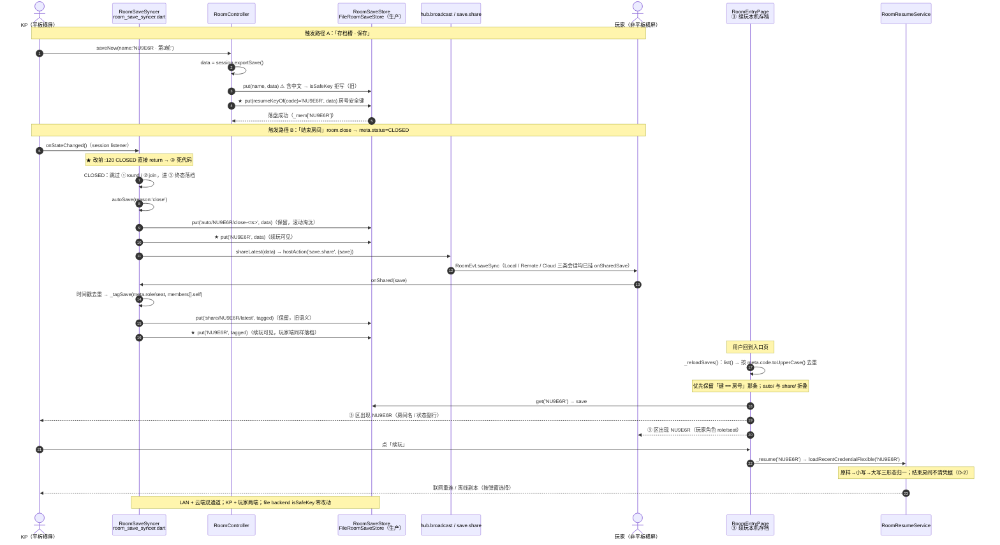
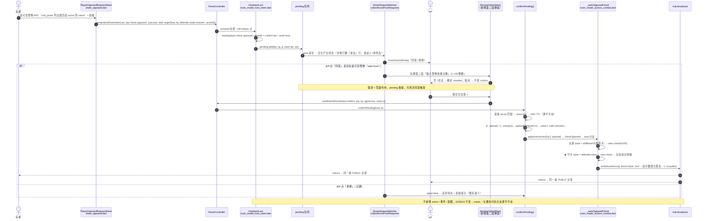
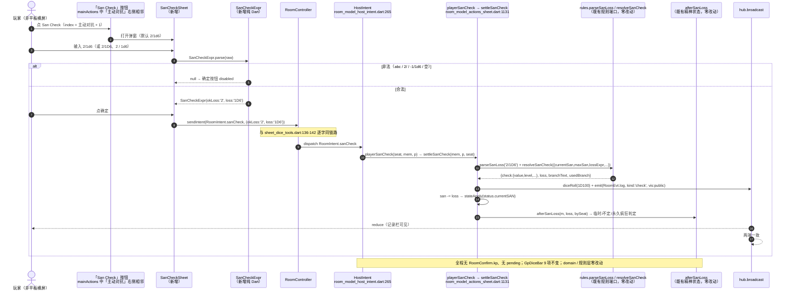
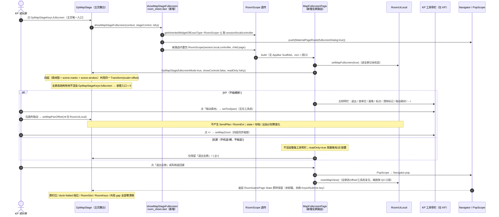
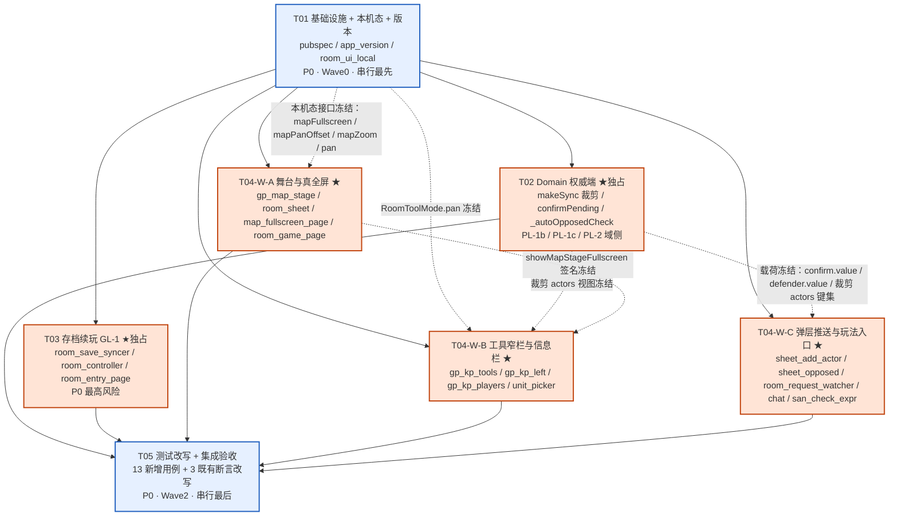

# 骰境 TRPG v2.35.0+105 增量系统设计与任务分解（P12 / 第 9 期）

> 架构师：高见远（software-architect） · 阶段：只读调研 + 增量设计 + 施工单 · 全程中文
> 源码根：`C:/Users/60965/WorkBuddy/2026-10-08-18-34-17/dice-realm`（下称 **ROOT**，全部绝对路径）
> 版本：`2.34.0+104` → **`2.35.0+105`** · 视角：KP = 平板横屏；玩家 = 非平板横屏（手机竖/横、平板竖布局一致）
> 上游契约：`ROOT/docs/p12_incremental_prd.md`（20 条编号需求 KP-1a…GL-1，验收口径为本期契约）
> 上期参考：`ROOT/docs/p11_incremental_design.md`（v1.1，62/28/13 契约、T-30 锚点表、RoomStackNode 叠放、oracle 边界）
> 工作日志：`2026-11-15.md`（P11 交付 / 9 条踩坑）、`2026-11-14.md`（P20 联网房间 / 云端全量存档）
> 文档版本：**v1.1**（2026-11-15，按主理人转达的用户裁决固化 Q-A / Q-B / Q14 改判；修订清单见文末「v1.1 修订记录」）
> **纪律声明**：本阶段**只读调研 + 写文档**；未改任何 `.dart` / 测试文件 / `pubspec.lock` / 版本号；未运行 `flutter` / `dart` 命令。测试统一留 QA 阶段（本机有并发 build 缓存 `errno=183` 坑，且需先 `source /d/dev/env.sh`）。v1.1 修订同样只改本文档一个文件。
> **交付边界（v1.1 改判）**：本期**出 APK + 推 GitHub**（推翻 PRD Q14「默认不出」）；源码 + 测试 + 升版本号之外，收尾交付阶段增加 APK 构建、AOT 重编校验、`_manual_test_checklist.md` 指纹、备份仓库 commit/tag 与 Release 附 APK（见 §7.8）。**源码/测试施工与全量回归仍按原 T01–T05 施工单，顺序不变**。

---

## 0. 架构师只读复核结论（主理人 10 条线索逐条裁定）

> 判定口径：**对** = 线索与源码逐字吻合；**部分对** = 方向正确但落点 / 语义需修正；**错** = 文件指错或结论不成立。
> 所有行号均为本次实地读取所得，非照抄上期文档。

### 0.1 线索 1（KP-1a / PL-3a 公开素材不随缩放）—— **对，但「四层」是产品语义而非四个代码图层**

| 项 | 实测 |
|---|---|
| 文件 | `ROOT/lib/ui/room/widgets/gp_map_stage.dart` |
| 底图落点 | `:325` `if (cover != null) _coverImage(cover),` —— 在 `Stack` 里、`Transform` **外面** |
| 变换落点 | `:326-396` `Positioned.fill(child: Transform.scale(scale: _zoom, alignment: center, child: GestureDetector(...)))` |
| `_coverImage` 实现 | `:463-482`，返回 `Positioned.fill(child: Image.memory(..., fit: BoxFit.contain))` |
| 缩放写入 | `:203` `double _zoom = 1.0;`（**State 内部字段，不在 `RoomUiLocal`**）、`:207-211` `_setZoom` 夹 `[0.5, 3.0]`、`:408/:422` ×1.25 / ÷1.25 |
| 稳定 Key | `:122-132` `GpMapStageKeys`：`stage/canvas/empty/zoomIn/zoomOut/reset/fullscreen` 七个，全部实测存在 |
| 工具态枚举 | `:33` `enum MapStageMode { none, stroke, erase, mark, placeActor, placePlayer }` |

**修正点（重要）**：PRD §5.1 说的「四层 = 素材图 / 单位标记 / 笔迹 / 标点」在**权威端数据模型里其实只有 3 个集合**：

- `scene.assets`（`publicAssets(state)`，`view/scene_view.dart:94-95`）→ 素材图，`gp_map_stage.dart:302-303` 取 `assets.last` 作 `cover`；
- `scene.strokes`（`strokesOf`，`:102-105`）→ 笔迹，`StrokesPainter`（`:355`）；
- `scene.marks`（`marksOf`，`:97-100`）→ **标点 + 单位标记 + 玩家标记共用同一集合**，`MarksPainter`（`:358-362`）。

后两者在 `:351-364` **同一个 `CustomPaint`** 里（`painter: StrokesPainter` + `foregroundPainter: MarksPainter`），本来就在同一个 `Transform.scale` 内。「单位标记 / 玩家标记」不是独立集合：`room_game_page.dart:1110-1146` 的 `_placeActor` / `_placePlayer` → `_placeMark(kind:'actor'|'player', label:...)` → `hostAction('map.mark', {...})`，落进 `scene.marks`，由 `kind` 区分（`room_model_actions_room.dart:905` `mapMark` 只认 `x/y/kind/label/assetId/revealed` 六键）。

> **结论**：KP-1a / PL-3a 的**最小修复 = 把 `:325` 的 `_coverImage(cover)` 移进 `:326` 的同一个 `Transform`**（笔迹 / 标点层已在其内），使 `scene.assets` 与 `scene.strokes`/`scene.marks` 共享同一 `Transform(scale + offset)`。不必新建四个图层，也不改任何 domain 集合。
> **验收补强**：PRD §6.1 KP-1a 要求「读四层 RenderBox rect 比值」，实测只能取到 2 个可区分图层（底图 `Image` + 笔迹/标点 `CustomPaint`）；QA 应按「底图 rect 随 zoom 变化 + 笔迹/标点层 rect 同量变化」两条正向断言落地，并把「单位标记与标点同属 `marks`」写进用例说明（不必为了凑四层去拆分 `CustomPaint`，那会改 painter 契约）。

**附带发现（必须写进施工单）**：`_zoom` 是 `_GpMapStageState` 的私有字段（`:203`），而 `RoomUiLocal.zoom`（`room_ui_local.dart:97-100`，夹 `[0.6,1.0]`、`zoomSteps=[60,70,80,90,100]`）是**另一套「页面整体缩放」**，两者语义不同、互不引用。**主页舞台与全屏舞台会各建一份 `_zoom`** → 进全屏归 1.0、退出也归 1.0。PRD §2.3 #7 要求「全屏态 / 工具激活态 / 拖动 offset 一律放 `RoomUiLocal`」，故本期需把舞台 `_zoom` 上提为 `RoomUiLocal.mapZoom`（见 §3.1），否则「退出全屏恢复原档位」无从谈起。

### 0.2 线索 2（KP-1b/1c、PL-3b/3c 全屏里还有全屏按钮 + 半屏弹层）—— **对，且另有 3 个隐藏矛盾**

| 项 | 实测 |
|---|---|
| `_openFullscreen` | `gp_map_stage.dart:484-494`：`showRoomSheet<void>(context, title:'素材舞台（只读）', body: (_) => GpMapStage(controller: widget.controller, readOnly: true, showControls: true))` |
| 嵌套根因 | 弹层内第二个 `GpMapStage` 又带 `showControls: true` → `:397-433` 再渲染一整套含 `GpMapStageKeys.fullscreen`（`:424-430`）的控件 → 点它再弹一层 |
| `showControls` 契约 | `:195-196` 注释「全屏弹层里也显示」；`:397` `if (widget.showControls)` |
| `readOnly` | `:188-189` 「全屏只读 / 玩家侧：禁画笔、禁标点、禁放置」；`_onTap:214` / `_onPanStart:241` 均在 readOnly 时早退 |

**新发现的 3 个矛盾（主理人线索未覆盖）**：

1. **KP 全屏被硬编码成只读**（`:490` `readOnly: true`）。而 PRD §5.1 / KP-1c 要求「KP 全屏态左侧挂工具窄栏，能在大画面上直接做标记（放单位 / 画笔 / 标点 / 清除标记 / 拖动素材）」→ **KP 侧全屏必须非 readOnly**，只有玩家侧才 `readOnly: true`（PL-3c「舞台保持只读」）。不能只把弹层换成真全屏而保留 `readOnly: true`。
2. **`showRoomSheet` 是半屏弹层**（`sheets/room_sheet.dart`：18+ 调用点共用的全局壳，P11 明令禁改）→ 舞台 rect 不可能 ≈ 视口，KP-1c / PL-3c 的 rect 验收不可能通过。
3. **`RoomScope` 作用域边界**：`RoomScope` 挂在 `_RoomShell`（`room_entry_page.dart:1033+`），是页面路由**内部**。`sheet_chat_composer.dart:8-10` 明确记载「弹层/新路由是页面路由的兄弟，直接读 RoomScope 会命中断言」。但 `sheets/room_sheet.dart:121-142` 的 `showFullscreenReader` **已给出正确范式**：`:127` 先 `context.getInheritedWidgetOfExactType<RoomScope>()` 取出 scope，`:133-138` 在新 `MaterialPageRoute` 里重新包一层 `RoomScope(session/local/controller, child: page)`。

> **裁决（真全屏方案，见 §1.3 / §4.4）**：仿 `showFullscreenReader` 的 **RoomScope 透传**模式，新增 `showMapStageFullscreen`（`MaterialPageRoute(fullscreenDialog:true)` + 无 AppBar 全屏 Scaffold），把 `MapStageControl` 作为参数显式传入；**不再用 `showRoomSheet`**。全屏态内 `GpMapStage` 传 `showControls: false`（或用新增 `fullscreenMode: true`）→ 结构性地不渲染 `GpMapStageKeys.fullscreen`，KP-1b / PL-3b 的「全屏态内全屏入口 = 0」由渲染条件保证，而不是靠文案替换。退出用 `Navigator.pop` + `PopScope`，底层 `RoomGamePage` 的 State 与 `KeyedSubtree` 键链不被卸载 → **原栏位 / dock-folded 档位 / `RoomSlot` / `RoomKeys` / 共用 gap 全部零漂移**（这是比「页面内 Stack 覆盖层」更稳的一点：它天然不触碰布局骨架）。

### 0.3 线索 3（KP-2a/2b/2c 工具窄栏 + 本机态）—— **对，且「清除标记」可零 domain 改动**

| 项 | 实测 |
|---|---|
| 主体文件 | `ROOT/lib/ui/room/widgets/gp_kp_tools.dart`（692 行） |
| 「放玩家」 | `:534-552` `RoomTapTile(roomKey: GpKpToolsKeys.placePlayer, label:'放玩家', ...)`；常量 `:61`；`onTap` 走 `showUnitPicker` → `beginPlace(playerSeat:)` → `RoomToolMode.placePlayer` |
| 「放单位」 | `:515-533`（`GpKpToolsKeys.placeActor:60`） |
| 「清除笔迹」 | `:553-561` `ConfirmTwice(key: GpKpToolsKeys.clear, label:'清除笔迹', confirmLabel:'再点一次清除', onConfirmed: () => ctl.hostAction('map.clear', {'strokesOnly': true}))` |
| 第二套工具态枚举 | `room_ui_local.dart:19` `enum RoomToolMode { none, mark, draw, erase, placeActor, placePlayer }`（**也有 `placePlayer`**，是「放玩家」重复按钮的第二个源头） |
| 本机态落点 | `room_ui_local.dart:40-323` `RoomUiLocal extends ChangeNotifier`：`toolMode:68` / `setTool:242-247` / `pendingActors:78` / `zoom:97` / `playersPanelCollapsed:65` / `combatPanelCollapsed:56` |
| 网络隔离 | `room_scope.dart:21-32` `RoomScope` 持有 `local`；`RoomUiLocal` 注释 `:1-10` 明写「不进 state、不进存档、不参与任何规则」 |

**★ 关键结论（新发现，可省掉整个 domain 改动）**：`map.clear` 的权威实现 `room_model_actions_room.dart:1101-1112`：

```dart
List<SendPlan> mapClear(Map<String, Object?> p) {
  final s = ensureScene();
  final marks = jsTruthy(p['strokesOnly']) ? asList(s['marks']) : <Object?>[];
  return _roomPush(emit(RoomEvt.scene, {
    'scene': sceneWith(s, {'strokes': <Object?>[], 'marks': marks}),
  }, vis: RoomVis.public));
}
```

- `strokesOnly:true` → 只清 `scene.strokes`（现状工具窄栏）；
- `strokesOnly:false` → 清 `scene.strokes` + `scene.marks`，**不碰 `scene.assets`（素材图）**。
- 而 `scene.marks` 正是「标点 + 单位标记 + 玩家标记」的合集（见 0.1）→ **`strokesOnly:false` 恰好等于「清笔迹 + 单位标记 + 标点三类，素材集合不变」**，与 KP-2c 验收口径逐字吻合。
- 且 `gp_kp_left.dart:156-166` 已有第二处调用：`ConfirmTwice(key: GpKpLeftKeys.clear, label:'清除笔迹与标记', onConfirmed: () => hostAction('map.clear', {'strokesOnly': false}))`。

> **裁决**：KP-2c **domain / `room_model_actions_room.dart` 零改动**；只需把 `gp_kp_tools.dart:553-561` 的 `label` 改「清除标记」、payload 改 `strokesOnly:false`、`confirmLabel` 明确列出三类。
> **⚠️ 但撞车风险 R1（见 0A）**：`gp_kp_left.dart:158` 的「清除笔迹与标记」若也改成「清除标记」，会出现 `find.text('清除标记') == 2`，直接打破 PRD §6.1 KP-2c 的 `findsOneWidget` 断言；而 PRD 又要求 `find.text('清除笔迹与标记') → findsNothing`。必须给左窄栏另起一个**既不含「清除笔迹」子串、又不等于「清除标记」**的文案（推荐「清空标记层」），且 `clampBtnText` 已包住该按钮（`gp_kp_left.dart:153-166`），新文案更短、×2.0 只会更安全。

### 0.4 线索 4（KP-3 聊天输入框焦点）—— **部分对：文件指错，真实落点有两处；且不得动 `resizeToAvoidBottomInset`**

| 项 | 实测 |
|---|---|
| `sheets/sheet_chat_composer.dart`（247 行） | 是**「编辑发言」全屏编辑器** `ChatComposerPage`（`:75-247`），**不是聊天输入行**。`:168` `Scaffold(resizeToAvoidBottomInset: true)`（P17 KP-5 修真机「发送按钮被键盘挤走」的手段，注释 `:154-165` 逐条说明），`:196-210` `TextField(autofocus:true, expands:true, maxLines:null)` |
| 真正的聊天输入行 | `ROOT/lib/ui/room/widgets/gp_feeds.dart:826-1024` `ChatInputRow`；`TextField` 在 `:957-975`，`:958` `key: RoomKeys.gpChatInput`，**没有 `onTapOutside`**；`:972` `onTap: writable ? () => _openComposer(context) : null`（点输入框立即推全屏编辑器，所以输入行本身几乎不长期持焦） |
| P11 的 `resizeToAvoidBottomInset:false` | `room_game_page.dart:428`（主游戏页 `Scaffold`），注释 `:419-426` 明写「改前默认 true 导致 dock→folded 翻档、技能名输入框失焦」，与 `sheet_chat_composer.dart:168` 的 `true` 是**两个独立 Scaffold、两条独立路由，互不冲突** |
| 项目已有失焦范式 | `gp_dice_bar.dart:375-376` `onTapOutside: (_) => FocusScope.of(context).unfocus()`；`gp_pl_notes.dart:110` 同款；`gp_scene_check_kp.dart:196-206` 用显式 `FocusNode` + `AutomaticKeepAliveClientMixin` 的稳定 key 链 |

> **裁决**：KP-3 的施工对象是 `ChatComposerPage`（PRD §6.1 验收口径明确写「`sheet_chat_composer.dart` 挂载 + 多位置 tap 参数化」）。修法分两层：
> ① `TextField` 加 `onTapOutside: (_) => FocusScope.of(context).unfocus()`（与项目既有 2 处逐字同款）；
> ② 若 `onTapOutside` 在 `SingleChildScrollView` 空白区不触发（该回调要求 pointer down 被某个 hit target 接收），在 `Scaffold` 外层补一个 `GestureDetector(behavior: HitTestBehavior.translucent, onTap: () => FocusScope.of(context).unfocus(), child: Scaffold(...))` 兜底（AppBar 在 Scaffold 内、body 手势与子 `TextField` 竞争时子胜，不影响输入）。
> **绝不改 `:168` 的 `resizeToAvoidBottomInset: true`**（会打穿 P17 KP-5），**绝不回退 `room_game_page.dart:428` 的 `false`**（PRD §6.1 红线）。`FocusScope.unfocus()` 是焦点层操作，与布局层 `viewInsets` 无耦合；失焦后输入法自动收起，`viewInsets.bottom == 0` 由框架保证。
> 附带：`ChatInputRow` 的输入框也应补 `onTapOutside`（用户「点输入框以外任意位置」在主页场景同样成立），归同一子批次、`gp_feeds.dart` 独占。

### 0.5 线索 5（KP-4 收起后场景检定栏不可点）—— **对，根因比「透明遮罩」更精确：`Card` 材质 + `Positioned.fill`**

| 项 | 实测 |
|---|---|
| 叠放节点 | `room_layout.dart:87-94` `RoomStackNode`；`:371-384` `buildRoomLayout` 的 `case RoomStackNode: return Stack(fit: StackFit.expand, children: [for (final child in children) Positioned.fill(child: buildRoomLayout(...))])` |
| 子节点顺序 | `room_layout.dart:163-169` `RoomStackNode(flex:26, children:[RoomSlotNode(gpScene, flex:56), RoomSlotNode(gpPlayers, flex:44)])` → **gpPlayers 是后添加的 child = Stack 最上层** |
| 收起态实现 | `gp_kp_players.dart:126-139`：`SectionBox(key: GpKpPlayersKeys.root, title, trailing: 28dp toggle, child: Offstage(offstage: collapsed, child: Column(...)))` |
| `SectionBox` | `room_panel_kit.dart:50-105`：根节点 `Card`（`:68`，`margin: panelGap/2`）→ `Padding` → `Column`（标题 Row + `SizedBox(height:8)` + body） |
| `GpSceneCheckKp` | 底层 `gpScene` 槽位常驻（P11 `RoomStackNode` 裁决），`room_game_page.dart:895` 附近接线，P11 明令「绝不卸载」 |

**精确根因**：Stack 的 `hitTestChildren` 按 children **倒序**遍历，第一个 `hitTest` 返回 true 即停止。上层 `gpPlayers` 的 `Positioned.fill` 给出与 Stack 完全相同的紧约束 → `SectionBox` 的 `Card` 铺满整格且带不透明 `Material` 表面（`hitTestSelf == true`）→ **即使 body 被 `Offstage` 隐藏（Offstage 只让子树不绘制/不命中，管不到 `Card` 自己），整格所有 pointer 仍被上层吸收** → 底层 `gpScene`（`GpSceneCheckKp`）的按钮、拖动条永远拿不到命中。这不是「残留透明遮罩」那种偶发叠层，而是 `RoomStackNode` 的 `Positioned.fill` + `Card` 的**结构性遮挡**。

> **裁决（最小改动，不动布局骨架、不卸载 `GpSceneCheckKp`）**：改动**只落在 `gp_kp_players.dart` 的收起分支**，`room_layout.dart` / `buildRoomLayout` / `RoomStackNode` / DFS / flex 路径 / Rect 几何断言**全部零 diff**：
> 收起态（`collapsed == true`）时，`_panel` 不再返回撑满整格的 `SectionBox`，而返回
> ```dart
> Align(
>   key: GpKpPlayersKeys.root,           // 保留稳定 key
>   alignment: Alignment.topLeft,
>   child: SizedBox(
>     height: 28, width: double.infinity,
>     child: MediaQuery.withClampedTextScaling(maxScaleFactor: 1.0,
>              child: /* 原标题行（title + collapseToggle） */),
>   ),
> )
> ```
> `Align`（`RenderPositionedBox`）默认 `deferToChild`、自身 `hitTestSelf == false`；点击标题行**以下**区域时子 `SizedBox` 不在该位置 → 上层整支 `hitTest` 返回 false → Stack 继续测下一个 child → 命中底层 `GpSceneCheckKp`。展开态仍用 `SectionBox`（保持 P11 叠放语义与视觉），`GpSceneCheckKp` 常驻不卸载，`playersPanelCollapsed` 仍只在 `RoomUiLocal`。
> **验收**：PRD §6.1 KP-4 的 `RoomStackNode` Rect 断言、`find.byKey(GpSceneCheckKeys.*)`、`hitTest` 命中控件类型、回调计数四类断言全部可在零布局改动下通过。

### 0.6 线索 6（KP-6 检定推送「来自/座位」）—— **对**

| 项 | 实测 |
|---|---|
| 文件 | `ROOT/lib/ui/room/room_request_watcher.dart`（纯 Dart 派生，零权威端引用） |
| `_detailLabels` | `:100-114`：`'by':'发起人'`、`'from':'发起人'`、`'seat':'座位'`、`'skill':'技能'`… |
| `_detailsOf` | `:145-166`：扫 `raw` / `raw['p']` / `raw['payload']` 三层，产出 `标签：值`，`extra` 先入 `out`（`:149`） |
| 「来自」行 | `:206` `extra: <String>[by.isEmpty ? '来自房间待办' : '来自 $by']`（KP 待确认 pending）；`:220` `extra: <String>['来自 ${entry.key}']`（状态变更请求，`entry.key` 是 seat） |
| 「发起人」值 | `_detailsOf` 对 `by`/`from` 取 `_fmt(src[e.key])` → 直接是 seat 字符串，无角色名解析 |
| 玩家侧调用 | `:235` `_detailsOf(r)`（无 extra），不受「来自」影响 |

**角色名数据源（本线索延伸核实）**：`members[].charName` 是权威端角色名单一真源 —— `room_model_actions_room.dart:156-170` `raNick()`（`:158` `if (jsTruthy(m['charName'])) return jsStr(m['charName'])`，优先角色名、其次昵称）、`room_model_host_intent.dart:42-44`、`room_model_rollback.dart:353-355` 三处同口径；`unit_picker.dart:14` 注释「charName → sheet.name → nickname → 玩家」；`room_history_export.dart:101-111` Reverse（昵称优先）。PRD Q11 要「角色名优先，缺失回退昵称 → 座位号，且不出空行」，与 `raNick` 口径一致但回退链更长。

> **裁决**：`collectRoomPushRequests` 是纯 Dart 派生，改这里即可（PRD 白名单 #4）。做法：
> ① 两处 `extra` 改传 `const <String>[]`（删「来自」整行），`_detailsOf` 的 `extra` 参数保留（其它调用点零影响）；
> ② 新增纯函数 `String pushInitiatorOf(Map<String,Object?> state, String seat)`：`members` 按 seat 找 → `charName` → `nickname` → `seat`，空则不出该行；在 `collectRoomPushRequests` 里构造 `nameBySeat` 或在 `_detailsOf` 增可选 `String? initiatorName` 参数，把 `by`/`from` 行的值替换成角色名（**`seat:'座位'` 行逐字保留**）。
> ③ 不删 `_detailLabels` 任何条目（避免锚点/契约漂移），不改 `RoomPushRequest.payload`（`:209` 仍是 `{op, by}`，domain `confirmPending` 靠它定位）。

### 0.7 线索 7（KP-7 玩家角色名上角色卡）—— **部分对：主改动在 KP 侧卡片，玩家侧卡片已有角色名**

| 项 | 实测 |
|---|---|
| `gp_pl_char_card.dart`（537 行） | `:94` 已有 `roomText(me?['charName']).isNotEmpty` 判定（玩家侧卡片已读 `charName`）；`view/sheet_view.dart:177-178` 卡面「角色名」取 `sh['name']` |
| `gp_kp_players.dart:143-243` `_row` | `:151-154` `name = nickname.isEmpty ? seat : nickname`；`:191` `Text(name)`；**没有渲染 `charName`** |
| 数据源 | `playersOf(state)`（`view/room_view.dart`）返回成员 map，含 `charName` |

> **裁决**：KP-7 的改动落在 `gp_kp_players.dart` 卡片子树（在 `Text(name)` 附近补一行 `角色名：${m['charName']}`，缺失时不渲染该行、不出空串），与玩家侧 `gp_pl_char_card.dart` 的 `me['charName']` **同源**（同为 `members[].charName`）。玩家侧卡片**零改动**。长角色名用 `maxLines:1 + overflow: ellipsis` 并包 `clampBtnText`（×2.0 不溢出，PRD §6.1 KP-7）。稳定 Key 新增 `GpKpPlayersKeys.charName(seat)`。

### 0.8 线索 8（PL-1a/1b/1c 怪物显示给玩家 + 对抗结算）—— **部分对：裁剪态不在 `lan_server.dart`；且 auto 分支已支持 `defender.value` 但未做真正对抗结算**

| 项 | 实测 |
|---|---|
| `sheets/sheet_add_actor.dart`（224 行） | `:91-104` `_payload()` 返回 6 字段 `{name, kind, dex, hp, actionsPerRound, armor}`；`:27-41` `AddActorSheetKeys`；`:49-57` `openAddActorSheet` 契约「只返回草稿、不写 RoomUiLocal、不发包」 |
| 候选怪阶段 | `gp_kp_tools.dart:325-350` `addLocalActor()` 写 `RoomUiLocal.pendingActors`（本机候选池，`:78`）；`gp_kp_left.dart:172+` NPC tab 渲染候选列表 |
| **裁剪态实际落点** | `lan_server.dart:7` 注释明写「**不做裁剪、不做鉴权、不做业务判断**」；`:183` 只转发 `SendPlan.toJson()`（已裁剪的出站信封），`:221` 取「按 seat 裁剪后的全量」。**真正裁剪在 `lib/domain/room_model_host_core.dart`**：`:499-523` `combatFor(seat)`（非 KP 移除 `secret`/`kpOnly`/`attrs`、按 `hpPublic` 移除 hp）、`:533-561` `makeSync(seat)` 组装全量视图 |
| `makeSync` 的 view 键集 | `:542-559`：`meta/members/chats/logs/dice/scene/combat/privates/rewind/requests/board/seq/version` —— **没有 `actors` 键**，`state['actors']` 根本不下发到客户端视图 |
| 目标枚举 | `unit_picker.dart:120-149` `collectUnitOptions` 枚举 `combat.order`（`:132`）+ `state['actors']`（`:141`）；`sheet_opposed.dart:980-990` 玩家主动对抗目标用 `UnitPickerField` |
| 玩家申请载荷 | `sheet_opposed.dart:931-948` 冻结为 `{op:'check.opposed', auto:true, skill, targetSeat, by}`，`targetSeat` 经 `unitValueToSeat` 剥前缀 |
| 审批链路 | `room_model_host_intent.dart:476-528` `confirmPending(seat, p)`：按 `op+by` 首条匹配（`:484-503`）→ `pending.removeAt(idx)`（`:509`）→ 120s TTL（`:518-522`）→ **`return applyAction(jsStr(entry['by']), asMap(entry['p']))`（`:527`）** |
| auto 分支 | `room_model_actions_combat.dart:1699-1768` `_autoOpposedCheck`：`p['auto']==true` 时短路（`:1775-1777`）；`:1716` `skillBaseOf(mem, skill, null) ?? 50` → `rules.check` → **一条** PUBLIC `kind:'check'` log（`:1760-1766`）；`:1750-1758` **已读 `p['defender']['value']`（1–100 整数）**，但只把它拼进文案 `（守方对抗值 N）`，**没有做双方对抗判定** |

**★ 两条架构结论（v1.1：Q-A / Q-B 已由用户拍板，按此施工；见 R5 / R7）**：

1. **PL-1c 的「KP 同意后补值」无法在不改 domain 的前提下闭环**：`confirmPending` 的 confirm 载荷契约是 `{op, by, agree}`（`:494-498` 注释逐字钉死，三个 UI 调用点 `RoomController.dangerAction` / `gp_status.dart` / `gp_combat_list.dart` 同款），且 `applyAction` 用的是 **pending 入队时的 `entry['p']`**，confirm 的 `p` 只取 `op/by/agree`，**不合并**。因此 KP 在第二段弹窗输入的 1–100 值没有任何现成通道进入 `checkOpposed`。→ **Q-A 已批准**在 `:527` 合并可选 `value` 打通该通道（见 §1.4）。
2. **「不新增 action/事件/意图」已裁决为可行且必须遵守**，两处最小 domain 扩展（都在既有函数体内组合，不加枚举、不加 POLICY 条目）已获批准：见 §1.4 / §4.2。**白名单外延（主理人 2026-11-15 批准，Q-A）**：`lib/domain/room_model_host_intent.dart` 允许改 `confirmPending:527` **函数体**；PRD 白名单第 8 项据此扩为「`room_model_actions_*.dart` / `room_rules_*` / `rules_coc7.dart` / `madness_state.dart` / `room_madness_coc.dart` **+ `room_model_host_intent.dart` 的 `confirmPending` 函数体**」，其余文件与枚举一律不放宽。

**玩家裁剪态方案（PL-1b）**：`makeSync` 新增一个**裁剪后的 `actors` 视图键**：非 KP 时只保留 `visibleToPlayers == true` 的记录，且每条只留 `{id, name}`（**断言无 hp/skill/value/attr 等键**，与 PRD §6.2 PL-1b 逐字吻合）；未勾选者完全不下发 → `unit_picker.collectUnitOptions` 自然把它们列进目标列表且可点，未勾选者不出现。`combatFor` 里对 `combat.order` 的怪物槽按同一 `visibleToPlayers` 标志过滤（避免玩家从战斗列表反向看到未公开怪）。**注意 `makeSync` view 键集变化可能影响 `room_session_test.dart` 等键集断言，QA 需按「更强或等价」补正向断言（R7）。**

### 0.9 线索 9（PL-2 San Check）—— **部分对：规则文件存在，但更关键的是「整条链路已存在」；客户端不需要碰规则函数**

| 项 | 实测 |
|---|---|
| 规则文件 | `lib/domain/rules_coc7.dart`、`lib/domain/madness_state.dart`、`lib/domain/room_madness_coc.dart` **三个都真实存在**（另有 `room_rules_combat.dart` / `room_rules_opposed.dart` / `madness.dart`） |
| **`RoomIntent.sanCheck` 已存在** | `room_types.dart:210` `static const String sanCheck = 'sancheck';`；`:213-227` `RoomIntent.values` **13 项含 `sanCheck`**（`:225`）→ 本期零改动即守住 13 契约 |
| 既有 UI 入口 | `sheets/sheet_dice_tools.dart:128-144`：`SectionBox(title:'SAN Check')` → `RoomTap(key: DiceToolsKeys.sanCheck, label:'SAN Check')` → `ctl.sendIntent(RoomIntent.sanCheck, {'okLoss':'1D6','loss':'1D10'})` |
| 意图分发 | `room_model_host_intent.dart:265-267` `case RoomIntent.sanCheck: out.addAll(playerSanCheck(seat, mem, p))`；`room_model_actions_combat.dart:3370-3382` `playerSanCheck` → `settleSanCheck(mem, p, seat)` |
| **`settleSanCheck`** | `room_model_actions_sheet.dart:1131-1215`：`okExpr = raNormLossPart(p['okLoss'],'0')`、`failExpr = raNormLossPart(p['loss'],'1D6')`、`lossExpr='$okExpr/$failExpr'` → `rules.parseSanLoss` → `rules.resolveSanCheck({currentSan, maxSan, lossExpr, ...})` → `diceRoll(1D100)` → PUBLIC `kind:'check'` log → `san -= loss` → `stateApply` → **`afterSanLoss(m, loss, bySeat)`（`:1212`，`:1218+` 自动疯狂判定）** |
| 是否需 KP 同意 | **否**：`RoomIntent.sanCheck` 直接走 `playerSanCheck`，不经过 `pending` / `RoomConfirm.kp` |

> **★ 决定性结论（PRD Q9 的修正）**：`2/1d6` 的「成功扣固定值 / 失败掷骰扣骰结果 + 掉 san 后按房间规则结算精神状态 + PUBLIC 广播 + 无需 KP 同意」**权威端已完整实现**。本期 PL-2 **domain / 规则层零改动**，只需：
> ① 在工具栏「主动对抗」**右侧相邻**加一个按钮（独立 `ValueKey`）；
> ② 新增一个纯 Dart 表达式解析器（容错 `2/1D6`、`2 / 1d6`、空格、大小写；非法 `abc`/`2/`/`-1/1d6` 禁用确定），把 `2/1d6` 拆成 `{okLoss:'2', loss:'1D6'}`；
> ③ `sendIntent(RoomIntent.sanCheck, 上述载荷)` —— 与 `sheet_dice_tools.dart:136-142` 逐字同链路。
> **不必**在客户端复用 `rules_coc7.dart` / `madness_state.dart` / `room_madness_coc.dart`（PRD Q9 建议的「在其外层组合」其实已在权威端 `settleSanCheck` 完成）；客户端碰规则函数反而会造成「两端各算一次」的一致性与 oracle 风险。
> `GpDiceBar` 9 项、`diceBalancedRowSizes(9,3)==[3,3,3]` 一律不动（PRD Q10）。

**按钮落点（实地）**：`room_game_page.dart:1204-1269` `_buildToolbar`：`mainActions`（`:1217`）玩家侧有「更多工具」（`:1218-1231`）与「主动对抗」（`:1252-1268`，`RoomGamePage.playerOpposedKey:292-293`）；`extensions`（`:1270+`）是 `GpDiceBar` + KP 专属按钮。**「主动对抗」在 `mainActions` 的扁平 `Wrap` 里**，所以 San Check 必须同样注入 `mainActions` 且紧跟其后才能满足 §6.2 PL-2 的 `index = 主动对抗 + 1`。⚠️ 见 R6（主组 4→5 个按钮的行数影响）。

### 0.10 线索 10（GL-1 联机续玩存档丢失）—— **对，但主理人给的「状态跳变」只是第一层；决定性根因在文件后端白名单**

先给实测清单：

| 项 | 实测 |
|---|---|
| `room_save_syncer.dart`（295 行） | `:116-152` `onStateChanged`；`:162-200` `autoSave`；`:203-208` `shareLatest`；`:225-259` `onShared`；`:264-281` `_tagSave` |
| 构造期挂回调 | `:55-65` `session.onSharedSave = (save) { onShared(save); onStateChanged(); }` —— P20 N-3 已把回调**统一挂到所有会话**（`room_session.dart:229-235` 基类字段；`room_session_local.dart:249-252` / `room_session_remote.dart:186-189` / `room_session_cloud.dart:214-217` 三处 `RoomEvt.saveSync` 分支实测存在）；`room_entry_page.dart:1092-1098` 仅对 `LocalLoopbackSession` 覆盖为同语义回调 |
| 自动档键 | `:78` `autoKeyPrefix(code) => 'auto/$code/'`；`:168` `name = '${autoKeyPrefix(code)}$reason-${_now()}'`；`:176` `store.put(name, data)` |
| 玩家分享档键 | `:236` `prefix = 'share/$code/'`；`:252` `store.put('${prefix}latest', tagged)` |
| 生产存档后端 | `main.dart:58-66` `_installRoomSaves()` → `FileRoomSaveStore(dir)` + `loadSync()` + `installRoomSaveStore(store)` |
| 测试存档后端 | `room_boot.dart:91` `RoomSaveStoreMutable roomSaveSlots = InMemoryRoomSaveStore();`（`:98` `installRoomSaveStore(store)` 可替换） |
| 续玩列表派生 | `room_entry_page.dart:205-210` `_reloadSaves() { final keys = <String>[..._store.list()]; keys.sort(); _saves = keys.reversed.toList(); }` —— **直接枚举 `list()` 全部键，无前缀过滤**；`:951-976` `_resumeSection`、`:978-1019` `_saveRow`（显示 `meta.name` / 副行 `key · meta.code · meta.status`）；`:453-535` `_resume(key)` → `_store.get(key)` → `meta.code` → `loadRecentCredentialFlexible(code)` |
| 「存档槽保存」 | `sheet_save_slots.dart:106-114` `_save()` → `controller.saveNow(name:)`；`room_controller.dart:131-149` `saveNow`：`key = (name==null||name.isEmpty) ? session.code : name`、`store.put(key, data)`；`sheet_save_slots.dart:80-85` 默认名 `'${code} · 第${round}轮'`（**含中文 / 空格 / 间隔号**） |
| 凭据 | `repo/recent_room_credential.dart:239-279` `saveRecentCredential`（`_safeKey` 白名单 `:147-150`）、`:283-295` `loadRecentCredential`、`:304-319` **`loadRecentCredentialFlexible` 已做「原样 → 小写 → 大写」三形态归一**（P20 注释 `:297-303` 明写云端房号小写 / LAN 大写） |
| 结束房间 | `room_exit.dart:73-113` `roomExitOf` 是纯判据；`_RoomShellState.dispose()`（`room_entry_page.dart:1108-1133`）D-2 **不清持久化凭据**（`:1125-1127`） |

---

#### ★★ GL-1 确切根因（三层，逐层给出精确 `文件:行号`）

**第 1 层｜KP「结束房间」触发点是死代码（KP 侧终态档从未生成）**
`room_save_syncer.dart:116-152` `onStateChanged()`：

```
:117  if (!isKp || _busy) return;                       // 玩家侧不跑触发器
:120  if (jsStr(meta['status']) == RoomStatus.closed) return;   // ★ CLOSED 直接短路
:122-129  ① round 触发
:131-140  ② 成员加入触发
:142-151  ③ 结束房间 / 结团触发：
            if (_lastStatus != null && key != _lastStatus &&
                (status == RoomStatus.closed || ended)) { await autoSave(...); }
```

`:120` 位于 ③ **之前**且无条件 `return` → `status == closed` 时 ③ 永远不执行 → **`close` 分支是死代码**。主理人线索说的「结束房间存档依赖 `_lastStatus` 状态跳变」只说对一半：跳变判据本身写得出来，但被前置 return 截断；只有 `meta.ended == true` 且 status 仍非 CLOSED（结团）时才可能触发。后果：关房时 **KP 不 `autoSave` → 不 `shareLatest` → 玩家端也收不到终态快照**（玩家侧 `onShared` 全靠 KP 的 `save.share` 广播）。

**第 2 层｜决定性根因：槽键含 `/`，被生产文件后端白名单静默拒绝；测试内存后端无校验 → 测试绿、真机全丢**

`repo/file_room_save_store.dart:91-96`：

```dart
static bool isSafeKey(String key) {
  if (key.isEmpty || key.length > 64) return false;
  if (!RegExp(r'^[A-Za-z0-9_\-]+$').hasMatch(key)) return false;  // 只允许字母数字 _ -
  if (_reservedNames.contains(key.toUpperCase())) return false;
  return true;
}
```

`put()` `:145-154`：`if (!isSafeKey(code)) { lastError = ArgumentError('非法存档槽键：$code'); return; }` —— **静默拒绝、不抛、不写 `_mem`**；`loadSync()` `:118` 同样 `if (!isSafeKey(key)) continue;`。

而 `RoomSaveSyncer` 的两个槽键：
- KP 自动档 `auto/<code>/<reason>-<ts>`（`:78/:168`）—— 含 **2 个 `/`**；
- 玩家分享档 `share/<code>/latest`（`:236/:252`）—— 含 **2 个 `/`**。

→ 生产 `FileRoomSaveStore` 对这两类键**一律拒写**：`_mem` 无该键 → `list()`（`:164` 直接返回 `_mem.keys`）不返回 → `_reloadSaves()`（`:206`）枚举不到 → ③ 区「续玩本机存档」列表**永远看不到任何联网 / 云端房间档**（KP 的自动档与玩家的分享档同时中招，LAN / 云端双通道 × KP / 玩家两端全覆盖中招）。

**为什么缺陷能长期存活**：测试默认 `InMemoryRoomSaveStore`（`room_boot.dart:91`）的 `put`（`room_save_store.dart:50-53`）**没有任何键校验** → 单元测试里 `auto/…`、`share/…` 全进 `list()`、续玩列表全绿；只有真机 `FileRoomSaveStore` 会丢。P20 日志 `2026-11-14.md:14` 记载的「`onSharedSave` 只挂 LocalLoopbackSession → 联网玩家从不落 `share/<code>/latest`」已在 P20 修好（构造期统一挂回调，本次实测三处会话分支都在），**但修完落盘后仍被第 2 层白名单吃掉**，所以用户仍报「联机续玩没有条目」。

**第 3 层｜「存档槽保存」路径同样会被拒（自定义名含中文）**
`saveNow(name:)` 把 `name` 直接当槽键（`room_controller.dart:142`），而 `sheet_save_slots.dart:83-85` 的默认名 `房间号 · 第N轮` 含中文 / 空格 / `·` → `isSafeKey` 拒写。只有无 name 的 `saveNow()`（`room_entry_page.dart:235` 创建即存、`sheet_kp_panel.dart:395` KP 面板）用纯房号 `NU9E6R`（6 位大写字母数字）才能落盘。→ 用户点「存档槽 · 保存」也经常白存，PRD GL-1 把这条列为触发路径之一是有源码依据的。

**第 4 层（补充风险，非主因）｜列表刷新时机**
`_reloadSaves()` 只在 `initState`（`room_entry_page.dart:192`）与创建成功后（`:239`）调用。若从房间返回时 `RoomEntryPage` 实例被复用而非重建，即便前 3 层修好，`_saves` 仍是旧快照 → 列表不刷新。需在 `_openRoom` 返回后 / `didPopNext` 刷新（R12）。

**凭据层结论**：`saveRecentCredential` 的写入点 P20 已下沉到 `room_boot.dart` / `room_net_factory.dart` / `room_resume.dart`（`main.dart:74-75` 注释实测），`loadRecentCredentialFlexible` 已做大小写三形态归一，`_RoomShellState.dispose()` 明确「关房不清凭据」（D-2）。→ **GL-1 不需要新建凭据写入点，也不需要改 `cloud_room_backup.dart`**（P20 D-5「末次 `/backup` 再 `/suspend`」只在 `!_exit.shouldLeave && CloudHostingSession` 分支，关房不涉及）。缺的只是「存档本体」能进 `list()`。

> **最小修复裁决（详见 §1.5 / §4.1）**：**不动 `FileRoomSaveStore.isSafeKey`**（I/O 白名单是路径穿越防线，放宽会引入编码兼容与旧档风险；PRD 白名单也倾向「既有分层内改动」）。改为在 `RoomSaveSyncer` 增加一条**以房号为键的「续玩可见」扁平槽**（键本身符合 `isSafeKey`，`meta.code` 天然存在，`_resume()` 链路零改造）：
> - 新增 `String resumeKeyOf(String code)`（返回 `code.toUpperCase()` 归一，参见 R8；房号本身即安全键）；
> - `autoSave()` 在保留 `auto/$code/…`（滚动淘汰 + 既有测试零 diff）之外，额外 `store.put(resumeKeyOf(code), data)`；
> - `onShared()` 在保留 `share/$code/latest`（时间戳去重 + 既有测试零 diff）之外，额外 `store.put(resumeKeyOf(code), tagged)`；
> - `onStateChanged()` 去掉 `:120` 的 CLOSED 短路，改为「CLOSED 时跳过 ①②，直接进入 ③ 终态落档」；
> - `saveNow(name:)` 额外落一份房号键档（自定义名保留给内存后端 / 存档槽 UI）；
> - `_reloadSaves()` 按 `meta.code.toUpperCase()` 去重（PRD Q12），优先保留房号键那条，并对 `auto/` `share/` 前缀在内存后端下产生的重复条目做折叠；
> - 结束房间**不清凭据**（沿用 D-2，零改动）。

### 0.11 契约计数与硬约束实测（本期零改动 → 计数零漂移）

| 契约 | 实测 | 位置 | 本期动作 |
|---|---|---|---|
| `RoomIntent.values.length` | **13**（含 `sanCheck`，`:225`） | `lib/domain/room_types.dart:213-227` | **零改动**（PL-2 复用既有 `sanCheck`） |
| `kRoomPolicy.length` | **62** | `lib/domain/room_types.dart:248-328`（P11 §0.1 实测） | **零改动**（PL-1c 不新增 action） |
| `RoomEvt.values.length` | **28** | `lib/domain/room_types.dart:162-192`（P11 §0.1 实测） | **零改动**（对抗结果仍走 `RoomEvt.log` PUBLIC） |
| `GpDiceBar` 9 项 / `diceBalancedRowSizes(9,3)==[3,3,3]` | 9 项 | `lib/ui/room/widgets/gp_dice_bar.dart` + `room_button_size.dart` | **零改动** |
| `RoomKeys.action(...)` 静态锚点表 / `kFrozenNoAnchor` | T-30 / `room_ui_permission_test.dart:332` | `test/room_ui_permission_test.dart` | **零改动**：本期新增按钮一律用独立 `ValueKey`，不挂 `act/` 锚点；`GpMapStageKeys.fullscreen` / `GpKpToolsKeys.placePlayer` 等**常量保留**（删符号 = 编译期失败，P11 踩坑 #3） |
| GENERATED FILE | `lib/domain/data/skills.dart` / `occupations.dart` | — | **禁改**（本期无需搜索词表） |
| `oracle_*` | 逐字节比对旧 JS | `test/oracle_*` | **禁改**；`settleSanCheck` / `checkOpposed` 的既有分支逐字不动，只在新增分支内组合 |
| `FROZEN = 4` | P11 门禁 | — | **不许改大** |
| 版本三处 | `pubspec.yaml:19 = 2.34.0+104`；`lib/app_version.dart:15 = '2.34.0'`、`:18 = 104` | 本次 Read 实测 | 改 `2.35.0` / `105`；`test/app_version_test.dart` **零 diff**（P11 §0.3 实测不含字面量） |
| `pubspec.lock` | `fa69e596…` / 82 处 `pub.dev` / 0 镜像 | P11 踩坑 #4 / P20 | **全程不跑 `flutter pub get`**；QA 阶段跑 `flutter test --no-pub -j 1`，若跑过普通 pub get 必须逐字节恢复 + `cmp -s` |
| textScaler | `SizedBox(W,H)+Text` 必测 1.3/1.5/2.0 | P11 §7.3 | 修法**只允许** `MediaQuery.withClampedTextScaling(maxScaleFactor:1.0)` 包**该控件子树**；禁 `ClipRect` 硬裁、禁抬到页面 / Theme 层 |

---

## 0A. 关键风险 R1–R12 与架构裁决

> 「关键风险」指本次勘察**新发现**、可能导致施工单返工 / 契约漂移 / 验收不可行的点；每条给出**裁决**（施工方按裁决执行，需主理人拍板者已标注）。

| # | 风险 | 精确依据 | 裁决 |
|---|---|---|---|
| **R1** | **KP-2c 文案撞车**：`gp_kp_left.dart:158` 已有「清除笔迹与标记」+ `strokesOnly:false`。若两处都改「清除标记」→ `find.text('清除标记') == 2`，破 PRD §6.1 `findsOneWidget`；若左栏不改 → 破 `find.text('清除笔迹与标记') → findsNothing` | 见 0.3 | 工具窄栏改「清除标记」；左窄栏改「**清空标记层**」（不含「清除笔迹」子串、不等于「清除标记」），payload 保持 `strokesOnly:false` 不变。测试按「更强或等价」把两处新文案都加 `findsOneWidget` 正向断言 |
| **R2** | **真全屏与 `RoomScope` 作用域冲突**：`RoomScope` 在页面路由内部；裸 `Navigator.push` 会让全屏页读不到 `session/local/controller` → 断言崩 | `sheet_chat_composer.dart:8-10`；`room_sheet.dart:127-138` 已给正解 | 仿 `showFullscreenReader` 透传 `RoomScope`（`getInheritedWidgetOfExactType` → 新路由内重新包一层）。**禁止**裸 push、**禁止**改 `RoomScope` 本身、**禁止**用 `showRoomSheet` 半屏壳 |
| **R3** | **KP-3 落点指错 + 两个 Scaffold 的 `resizeToAvoidBottomInset` 语义相反** | 见 0.4 | 改 `sheet_chat_composer.dart`（`onTapOutside` + 外层 `GestureDetector` 兜底）+ `gp_feeds.dart` `ChatInputRow`；**两处 `resizeToAvoidBottomInset` 都逐字不动** |
| **R4** | **KP-4 结构性遮挡**：`RoomStackNode` 的 `Positioned.fill` + `Card` 不透明材质吸收整格命中 | 见 0.5 | 只改 `gp_kp_players.dart` 收起分支为 `Align + SizedBox(height:28)`；`room_layout.dart` / `buildRoomLayout` / DFS / flex / Rect 断言**零 diff**；`GpSceneCheckKp` 常驻不卸载 |
| **R5** | **PL-1c 的 `confirmPending` 载荷通道不存在**：`applyAction` 用 `entry['p']`，confirm 的 `p` 只取 `op/by/agree`；第二段弹窗的值进不了 `checkOpposed`。且 `room_model_host_intent.dart` **不在 PRD 白名单第 8 项列举的文件里** | `room_model_host_intent.dart:476-528`、`:494-498` | **★ 已裁决 · 按此施工（Q-A 批准，主理人 2026-11-15）**：批准白名单外延，`confirmPending` 允许 confirm 载荷**可选** `value`（1–100 整数），在 `:527` 合并进 `entry['p']['defender']` 后再 `applyAction`；**不改 `{op,by,agree}` 三键契约、不改 pending 结构、不新增 action/事件/意图、62/28/13 不变**。配合 **Q-B 裁决**：`_autoOpposedCheck` 守方值合法时跑真胜负判定（仍 1 条 PUBLIC log），未补值 / 值非法走既有分支。原「替代口径 / 退路」全部作废 |
| **R6** | **PL-2 按钮加入 `mainActions` 破坏行数契约**：玩家侧主组现为「缩放×2 + 更多工具 + 主动对抗」= 4 个（`room_game_page.dart:1213-1214` 实测「4 行 = 4/3/3/3」），加 San Check 变 5 个 → 第 1 行排不下 → `p10_t6_layout_test.dart` / `p16_button_unify_test.dart` 几何断言真红 | `room_game_page.dart:1204-1269`；P11 §5.5 | 产品行为真变，按「**更强或等价**」改写：保留 `diceBalancedRowSizes(9,3)==[3,3,3]`、`(9,4)==[3,3,3]`、9 项条目数、「每行 ≥2、无孤行」等核心不变量**逐字不动**，只放宽主组行数断言并新增「San Check 紧跟主动对抗（index+1）」正向断言。**不得**把 San Check 塞进 `extensions`（会失「相邻」）、**不得**插成 `GpDiceBar` 第 10 项 |
| **R7** | **裁剪态新增 `actors` 键可能撞键集断言**：`makeSync` view 键集（13 键）被 `room_session_test.dart` 等钉死；且 `combatFor` 已有裁剪语义 | `room_model_host_core.dart:542-559`、`:499-523` | 新增键是必要且最小的；QA 按「更强或等价」把「键集恰好 13」改为「包含 13 个既有键 + 新键，且玩家态 `actors` 每条**仅** `id`/`name`」的正向断言。禁止为过断言把可见怪塞进 `combat.order` 的 `attrs`（会泄露属性） |
| **R8** | **房号大小写归一**：`cloudRoomCode()` 云端小写、`normalizeRoomCode()` LAN/UI 大写；混用会导致 public 加入 404。续玩列表「以房号为键去重」若不去归一会产生两条 | `recent_room_credential.dart:297-303`；P20 日志 | `resumeKeyOf(code)` 统一 `code.toUpperCase()`；`_reloadSaves()` 去重键用 `meta.code.toUpperCase()`；凭据查询继续用既有 `loadRecentCredentialFlexible`（三形态归一，零改动）。`cloud_room.dart` / `cloudRoomCode()` **零改动** |
| **R9** | **删符号 = 编译期失败（假红）**：本期要删「放玩家」按钮、改「清除笔迹」文案、改「全屏」→「手绘板」；若连带删 `GpKpToolsKeys.placePlayer` / `GpMapStageKeys.fullscreen` / `RoomToolMode.placePlayer` 等常量，既有测试 import 直接编译失败 | P11 踩坑 #3；`gp_kp_tools.dart:52-54,60-61` | **所有 Key 常量与枚举成员一律保留**（`placePlayer`、`fullscreen` 等只失去 UI 使用点）。KP-1b 的「全屏态内全屏入口 = 0」靠**渲染条件**（全屏路由内 `showControls:false`）实现，不靠删 key。测试用硬编码 `ValueKey` 字面量断言 `findsNothing`，不引用被删符号 |
| **R10** | **固定尺寸控件 ×2.0 溢出**：新增「拖动素材」「清除标记」「手绘板」「San Check」、工具窄栏按钮、KP-7 角色名长文本 | P11 踩坑 #7 / §7.3；`gp_kp_left.dart:149-166` 已有 `clampBtnText` | 一律 `clampBtnText`（=`MediaQuery.withClampedTextScaling(maxScaleFactor:1.0)`）**只包该按钮子树**；`FittedBox(scaleDown)` + padding 归零沿用 P11 口径；textScaler 1.3 / 1.5 / 2.0 三档都验（PRD §6.0 只写 ×1.0/×2.0，按硬约束取更严的三档） |
| **R11** | **「四层同 Transform」的坐标换算**：`stageNormOf`（`gp_map_stage.dart:38-42`）注释 `:12-14` 明写「缩放只在绘制层发生，绝不参与坐标换算 —— Transform 会把指针位置自动变换回未缩放本地系」；把底图移进 `Transform` 后，`GestureDetector` 仍在 `Transform` 内 → 落点自动逆变换仍正确 | 见 0.1 | 底图 `Image` 与 `GestureDetector` 必须是**同一 `Transform` 的兄弟**（底图在下、手势层在上，`HitTestBehavior.opaque` 保持 `:332`）；**禁止**给底图单独套 `Transform`（会二次变换、落点漂移）；拖动用 `Transform.translate` 同样自动逆变换，归一化坐标口径零改动 |
| **R12** | **续玩列表刷新时机 + 去重**：`_reloadSaves()` 只在 initState / 创建后调用；内存后端下 `auto/`、`share/`、`房号键` 三条同 code 会同时出现在列表 | `room_entry_page.dart:192,205-210,239` | ① `_openRoom` 返回后 / `didPopNext` 补一次 `_reloadSaves()`；② `_reloadSaves()` 按 `meta.code.toUpperCase()` 去重，优先保留「键 == 房号」那条（保证 `_resume()` 走的正是续玩可见档），其余同 code 折叠；③ 去重后 `_saves.length` 变化属产品行为真变，QA 补正向断言 |

---

## 1. 实现方案与框架选型

### 1.1 技术栈（沿用，**不引任何新依赖**）

| 层 | 选型 | 理由 |
|---|---|---|
| UI | Flutter / Material 3，`RoomTap` / `RoomTapTile` / `SectionBox` / `ConfirmTwice` / `clampBtnText` 现有组件族 | 现有 `lib/ui/room/**` 90+ dart 已成型，布局骨架默认不动；新增按钮复用既有组件与钳制范式 |
| 状态 | `RoomScope`（`InheritedNotifier<RoomSession>`）+ `RoomUiLocal`（`ChangeNotifier`，纯本机态）+ `ListenableBuilder` 局部重建 | P11 双层订阅范式；全屏态 / 工具激活态 / 拖动 offset / zoom 一律放 `RoomUiLocal`，不进 state / 存档 / 出站 `SendPlan` |
| 真全屏 | `MaterialPageRoute(fullscreenDialog:true)` + `RoomScope` 透传（仿 `showFullscreenReader`）+ `PopScope` | 不碰 `RoomScope`、不碰布局骨架、不用半屏 `showRoomSheet`；`Navigator.pop` 后底层页面 State 原样保留 |
| 权威端 | `lib/domain/room_model_*.dart`（纯 Dart 状态机 + `List<SendPlan>`） | 所有结果仍在权威端生成并 PUBLIC 广播，客户端只 reduce；本期只在既有函数体内组合，不加 action / 事件 / 意图 |
| 视图派生 | `lib/ui/room/view/*.dart` + `room_request_watcher.dart`（纯 Dart，零 Flutter 依赖） | `collectUnitOptions` / `collectRoomPushRequests` / 新表达式解析器可被纯 Dart 单测逐条钉死 |
| 存储 | `RoomSaveStore` 端口 + `FileRoomSaveStore`（生产）/ `InMemoryRoomSaveStore`（测试）+ `RecentCredentialStorage` | 端口冻结；GL-1 只增「房号键」写法，不改 I/O 白名单、不改凭据格式 |
| 测试 | `flutter_test` + `FakeAsync`（沿用 `RoomUiLocal.scheduleDismiss` 可注入口径） | 本期无新定时逻辑；QA 阶段 `flutter test --no-pub -j 1` |

### 1.2 为什么协议层 / 网络层 / 服务端零改动

1. **PL-1c / PL-2** 全部复用既有意图：`RoomIntent.act` + `check.opposed`（`RoomConfirm.kp` + pending）、`RoomIntent.confirm`、`RoomIntent.sanCheck`；结果走既有 `RoomEvt.log`(`vis:public`) / `RoomEvt.dice`，`room_model_reduce.dart` 已把公开记录写进 `state['logs']`/`state['dice']`。**62 / 28 / 13 逐字不变**。
2. **GL-1** 是**客户端本机落档键名**问题，与 WS / `hub.broadcast` / `/backup` 端点无关；P20 已把 `onSharedSave` 挂到 Local / Remote / Cloud 三类会话（本次实测三处 `RoomEvt.saveSync` 分支），凭据写入点与大小写归一也已闭环。服务端 `room_server.py` 零改动。
3. **PL-1b 裁剪态**在 `RoomHost.makeSync/combatFor`（domain 权威端视图组装）内完成，`lan_server.dart` 只转发已裁剪信封（`:7` 注释），网络层零改动。
4. **硬约束**：令牌 / deviceId 绝不进存档 / 导出 / 日志；云端全量存档只走 hostToken-only `/backup`；本期不碰这些通道。

### 1.3 架构模式与五条主线

- **权威端单一真源（Host-authoritative）+ 客户端 reduce 投影**：UI 只发意图 / 只读派生，绝不直接改 `state`；怪物可见性、对抗补值、San Check 结果全部由 `lib/domain/` 生成并 PUBLIC 广播。
- **本机 UI 态隔离**：全屏态、互斥工具态、拖动 offset、舞台 zoom 全放 `RoomUiLocal`（PRD §2.3 #7）；fake session 断言「出站计划数量 / 键集不变」。
- **纯逻辑与渲染分离**：新增 `SanCheckExpr`（纯 Dart 解析）、`resumeKeyOf`（纯 Dart 键归一）、`pushInitiatorOf`（纯 Dart 角色名回退）三个可单测纯函数。
- **布局骨架零漂移**：真全屏走独立路由（不改 `RoomGridSpec.of` / `RoomSlot` / `RoomKeys` / gap / dock-folded 判定）；KP-4 命中修复只改 `GpKpPlayers` 收起分支（不动 `RoomStackNode`）。

| 主线 | 需求 | 性质 |
|---|---|---|
| A. 数据正确性 | GL-1 | `room_save_syncer` / `room_controller` / `room_entry_page` 触发点 + 键名 + 去重 |
| B. 权威端结算与裁剪 | PL-1b / PL-1c / PL-2 的 domain 侧 | `makeSync` 裁剪视图、`confirmPending` 可选值合并、`_autoOpposedCheck` 对抗判定 |
| C. 舞台与全屏 | KP-1a/1b/1c、PL-3a/3b/3c、KP-2b | 四层同 `Transform`、真全屏路由、本机拖动态 |
| D. 工具窄栏与信息栏 | KP-2a/2c、KP-4、KP-5、KP-7 | 删按钮 / 改文案 / 命中修复 / 角色名上卡 |
| E. 交互细节与玩法入口 | KP-3、KP-6、PL-1a、PL-1c UI、PL-2 | 失焦、推送详情、加怪勾选、第二段弹窗、San Check 弹窗 |

### 1.4 PL-1c「不新增协议」的精确调用链（★ 已裁决 · 按此施工；Q-A + Q-B）

```
玩家：sheet_opposed.dart PlayerOpposedRequestSheet._submit
      → RoomIntent.act {op:'check.opposed', auto:true, skill, targetSeat, by,
                        defender:{side:'monster', actorId}}      ← 载荷扩展（I5 增 defender 可选袋，不改 5 个既有键）
      → HostIntent.act(): needs(player,'check.opposed') 已含 player（P11 已改）
        + confirm==kp + seat!=kHostSeat → pending.add({by,op,p,need,at})
KP：  RoomRequestWatcher.collectRoomPushRequests → showGeneralDialog（同意 / 拒绝）
      → 「同意」回调：若该 pending 的 p.defender.side=='monster' 且 p.auto==true
          先弹【第二段窗】输入 1–100 整数（空 / 非法禁用确定；取消 = 不发 confirm，pending 保留）
        → sendIntent(RoomIntent.confirm, {op, by, agree:true, value:int})   ← 可选第 4 键
      → HostIntent.confirmPending():
          首条 op+by 匹配 / removeAt / 120s TTL（逐字不动）
          ★ :527 改为：payload = {...entry['p']}；若 p['value'] 是 1–100 整数，
             payload['defender'] = {...payload['defender'], 'value': v, 'side':'monster'}
             return applyAction(entry['by'], payload)
      → RoomHostActions.checkOpposed → p['auto']==true → _autoOpposedCheck
          ★ 守方值合法时：按 defender.value 再算一次 rules.check，与玩家 chk 比较成功等级
            → 产出【一条】PUBLIC kind:'check' log（含双方数值与胜负）
            → 两端 reduce 出同一条记录（不新增 RoomEvt 成员）
取消：不发 confirm → pending 不动 → 可再次同意重新触发（PL-1c 验收「申请不丢」）
```

**★ 裁决落地约束（Q-A + Q-B，主理人 2026-11-15 转达用户拍板，替代口径全部作废）**：

1. **Q-A（白名单外延）**：`RoomIntent.confirm` 的**既有三键 `{op,by,agree}` 逐字不动**（只是可选扩展 `value`；三个既有 UI 调用点不传该键 → 零回归）；`pending` 结构不变；`kRoomPolicy` 62 / `RoomEvt` 28 / `RoomIntent` 13 不变。`lib/domain/room_model_host_intent.dart` 的 `confirmPending` 函数体列入 PRD 白名单第 8 项外延（见 §0.8）。
2. **Q-B（真胜负判定，用户明确选择）**：守方 `defender.value` **合法（1–100 整数）**时，`_autoOpposedCheck` 按该值**也跑一次 `rules.check`**，与玩家成功等级比较，产出 **1 条**含双方数值 + 胜负的 PUBLIC `kind:'check'` log，两端 reduce 一致。**守方未补值 / 值非法时走既有分支，不得误判胜负**（只展示玩家单方检定结果，不产出胜负结论）。胜负比较**只在新增分支内组合**，**不新增 `RoomEvt` 成员**；`defender.side=='pc'`、`checkOpposed` 通用 / 攻击分支、`oracle_*`、`lib/domain/room_rules_combat.dart` **逐字不动**。
3. 施工自检：T02 提交说明须逐条写明「Q-A / Q-B 已按裁决施工」；QA 的 `test/p12_pl1c_opposed_value_test.dart` 必须覆盖「补值合法 → 1 条 PUBLIC + 胜负」「未补值 / 非法值 → 既有分支、无胜负误判」两组。

### 1.5 GL-1 最小修复口径（LAN + 云端 × KP + 玩家 × 双触发）

| 触发路径 | 现状 | 修复后 |
|---|---|---|
| KP 自动档（回合 / 10min / 加入） | `auto/$code/…` 被文件后端拒 | 保留 `auto/$code/…`（滚动淘汰、测试零 diff）**+** 额外 `store.put(resumeKeyOf(code), data)` |
| KP 结束房间 / 结团 | `onStateChanged:120` CLOSED 短路 → ③ 死代码 | 去掉短路：CLOSED 时跳过 ①②，进 ③ `autoSave(reason:'close')` → 落房号键 + `shareLatest` |
| 玩家收到 `save.share` | `share/$code/latest` 被文件后端拒 | 保留 `share/$code/latest`（时间戳去重、测试零 diff）**+** 额外 `store.put(resumeKeyOf(code), tagged)` |
| 「存档槽 · 保存」 | `saveNow(name)` 默认名含中文被拒 | `RoomController.saveNow` 额外落一份 `store.put(resumeKeyOf(session.code), data)`；`name` 槽保留 |
| 续玩列表 | `_reloadSaves()` 枚举全键、无去重、刷新时机不足 | 按 `meta.code.toUpperCase()` 去重（优先房号键）+ `_openRoom` 返回后刷新 |
| 凭据 | P20 已写入、D-2 结束房间不清 | **零改动**（`loadRecentCredentialFlexible` 已归一大小写） |

`resumeKeyOf(code)` = `code.trim().toUpperCase()`（房号 6 位大写字母数字，天然过 `isSafeKey`；云端小写房号统一成大写键，`_resume()` 查凭据仍走 `loadRecentCredentialFlexible` 三形态兜底）。**不改 `FileRoomSaveStore` / `recent_room_credential.dart` / `cloud_room_backup.dart` / 服务端**。

---

## 2. 完整文件清单（按波次 / 文件集切分，★ = 热点文件必须单人独占）

> 改动性质：**增** = 新增文件 / 新增函数；**改** = 修改函数体或常量；**核** = 只读核对（零 diff）；**禁** = 明令禁止改动。
> 「热点」定义：单文件承载 ≥2 条需求，或为多处共用的共享件 → **同一批文件只能一个 worker 动**。
> 波次与任务号对应 §5。

### Wave 0 · T01 基础设施（配置 + 版本 + 本机态底座）

| 相对路径 | 需求 | 性质 | 热点 | 摘要 |
|---|---|---|---|---|
| `pubspec.yaml` | 版本 | 改 | — | `:19` → `2.35.0+105`；依赖段 / `analysis_options.yaml` 不动 |
| `lib/app_version.dart` | 版本 | 改 | — | `:15` → `'2.35.0'`，`:18` → `105` |
| `lib/ui/room/room_ui_local.dart` | KP-1c / KP-2b / PL-3c | 改 | ★本机态 | 新增 `mapFullscreen` / `mapPanOffset` / `mapZoom` / `panArmed`（或扩 `RoomToolMode.pan`）/ `setMapFullscreen` / `setMapPanOffset` / `setMapZoom` / `resetMapView()`；**保留** `zoom`（页面整体缩放）语义不动、`notice` 单条语义不动 |
| `lib/domain/room_types.dart` | 契约 | **禁改** | ★契约 | 核 62 / 28 / 13；本期不新增 action / 事件 / 意图 |
| `test/app_version_test.dart` | 版本 | 核 | — | 不含版本字面量，零 diff 自动绿（**禁止写死 `2.35.0`**） |
| `pubspec.lock` | — | **禁改** | — | `fa69e596…` / 82 处 pub.dev / 0 镜像 |

### Wave 1 · T02 权威端结算 + 裁剪态（★ 单人独占 `room_model_actions_combat.dart` / `room_model_host_intent.dart`）

| 相对路径 | 需求 | 性质 | 热点 | 摘要 |
|---|---|---|---|---|
| `lib/domain/room_model_host_core.dart` | PL-1b | 改 | ★ | `makeSync`（`:533-561`）新增裁剪态 `actors` 视图（非 KP 仅 `visibleToPlayers==true` 的 `{id,name}`）；`combatFor`（`:499-523`）按同标志过滤怪物槽；**既有 13 个 view 键逐字不动** |
| `lib/domain/room_model_actions_combat.dart` | PL-1c | 改 | ★★最高热 | `_autoOpposedCheck`（`:1708-1768`）在 `defender.value` 合法时做双方对抗判定，仍产出 **1 条** PUBLIC log；`checkOpposed` 非 auto 分支、`opposedAttackResolve`、`oracle_*` 相关判定逐字不动 |
| `lib/domain/room_model_host_intent.dart` | PL-1c | 改 | ★白名单外延 | `confirmPending:527` 合并可选 `value` 进 `entry['p']['defender']`；**三键契约 / TTL / 首条匹配逐字不动**（**主理人 2026-11-15 批准 Q-A**，R5；见 §0.8 / §1.4 / §8.2） |
| `lib/domain/room_model_actions_sheet.dart` | PL-2 | 核 | — | `settleSanCheck:1131-1215` / `afterSanLoss:1218+` 复用，**零 diff** |
| `lib/domain/room_model_actions_room.dart` | KP-2c | 核 | — | `mapClear:1101-1112` 复用 `strokesOnly:false`，**零 diff** |
| `lib/domain/room_types.dart` | 契约 | 核 | ★ | 与 T01 共享只读核对（不产生 diff） |
| `lib/domain/data/skills.dart` / `occupations.dart` | — | **禁改** | — | GENERATED FILE |

### Wave 1 · T03 存档 / 续玩链路 GL-1（★ 单人独占 `room_save_syncer.dart` / `room_entry_page.dart`）

| 相对路径 | 需求 | 性质 | 热点 | 摘要 |
|---|---|---|---|---|
| `lib/ui/room/room_save_syncer.dart` | GL-1 | 改 | ★★最高热 | ① 新增纯函数 `resumeKeyOf(code)`；② `autoSave:162` 额外落房号键；③ `onShared:225` 额外落房号键；④ `onStateChanged:116-152` 去掉 `:120` CLOSED 短路、让 ③ 终态落档生效；`auto/` `share/` 前缀与滚动淘汰 / 时间戳去重口径逐字不动 |
| `lib/ui/room/room_controller.dart` | GL-1 | 改 | ★ | `saveNow:131-149` 自定义 name 时额外落 `resumeKeyOf(session.code)` 一份；`openSave` / `throttle` 默认值零改动 |
| `lib/ui/room/room_entry_page.dart` | GL-1 | 改 | ★★最高热 | `_reloadSaves:205-210` 按 `meta.code.toUpperCase()` 去重（优先房号键）；`_openRoom` 返回后补刷新；`_resume:453` / `_saveRow:978` / `dispose:1108`（D-2 不清凭据）**零改动** |
| `lib/ui/room/sheets/sheet_save_slots.dart` | GL-1 | 核 | — | 默认名与 `_save()` 不改（兜底在 `saveNow`）；只读核对 |
| `lib/repo/file_room_save_store.dart` | GL-1 | 核 | — | `isSafeKey:91-96` / `put:145` / `loadSync:107` **零改动**（R 裁决：不放宽白名单） |
| `lib/repo/room_save_store.dart` | GL-1 | 核 | — | `RoomSaveStore` 端口三方法零改动 |
| `lib/repo/recent_room_credential.dart` | GL-1 | 核 | — | `saveRecentCredential` / `loadRecentCredentialFlexible` 零改动 |
| `lib/net/cloud_room_backup.dart` | GL-1 | 核 | — | P20 D-5 末次备份口径零改动 |
| `lib/ui/room/room_exit.dart` | GL-1 | 核 | — | `roomExitOf` 纯判据零改动 |

### Wave 1 · T04 UI 层（3 个互不重叠子批次；★ 热文件各自单 worker 独占）

#### W-A 舞台 / 真全屏 / 工具栏接线（★ `gp_map_stage.dart` + `room_game_page.dart` 两人不得同时写，建议同一 worker 串行）

| 相对路径 | 需求 | 性质 | 热点 | 摘要 |
|---|---|---|---|---|
| `lib/ui/room/widgets/gp_map_stage.dart` | KP-1a/1b/1c、KP-2b、PL-3a/3b/3c | 改 | ★★最高热 | ① `:325` `_coverImage` 移进 `:326` 同一 `Transform(scale+offset)`（R11）；② `_zoom` 上提 `RoomUiLocal.mapZoom`、`offset` 读 `mapPanOffset`；③ 新增 `fullscreenMode` 参数（或复用 `showControls:false`）→ 全屏态不渲染 `fullscreen` 键；④ `_openFullscreen:484` 改调 `showMapStageFullscreen`（KP 非 readOnly / 玩家 readOnly）；⑤ `GpMapStageKeys` 七个常量**全部保留**；⑥ 新增 GpMapStageKeys 成员：拖动激活 / 退出全屏（见 §7.1） |
| `lib/ui/room/sheets/room_sheet.dart` | KP-1c / PL-3c | 增 | ★共用 | 新增 `showMapStageFullscreen<T>({context, stageControl, isKp})`：仿 `showFullscreenReader:121-142` 透传 `RoomScope`；**`room_sheet.dart` 全局壳（`:51-61` 默认刷新按钮、`refreshTopSheet()`）逐字不动**（P11 C12） |
| `lib/ui/room/map_fullscreen_page.dart` | KP-1c / PL-3c | **增** | ★新文件 | 全屏页：无 AppBar `Scaffold` + `PopScope`；KP 侧左侧工具窄栏（退出 / 放单位 / 画笔 / 标点 / 清除标记 / 拖动素材 / `-` `+`），玩家侧仅「退出 + 缩放」且舞台只读；舞台 rect ≈ 视口；退出复位 `RoomUiLocal` 全屏/拖动/工具态 |
| `lib/ui/room/room_game_page.dart` | 全屏接线 / PL-2 按钮 | 改 | ★★最高热 | ① `_mapStage:1031` 接线全屏入口；② `mainActions:1217` 在「主动对抗」`:1252-1268` **右侧相邻**注入 San Check 按钮（独立 `ValueKey`，`if(!isKp)` + `enabled:!locked`，`clampBtnText` 包裹）；③ 其余 7 路骨架（`Scaffold:428` `resizeToAvoidBottomInset:false`、`_dockContent` / `_slotView` / `_bodyOf` / `toolbarExtensions`）**逐字不动** |
| `lib/ui/room/widgets/room_layout.dart` | KP-4 | 核 | ★ | `RoomStackNode` / `buildRoomLayout:371-384` / `roomLayoutSlotsOf` / `roomLayoutFlexPathsOf` / `RoomGridSpec.of` **零改动**（R4 裁决只改 `gp_kp_players.dart`） |

#### W-B 工具窄栏 / 玩家信息栏 / 单位枚举

| 相对路径 | 需求 | 性质 | 热点 | 摘要 |
|---|---|---|---|---|
| `lib/ui/room/widgets/gp_kp_tools.dart` | KP-2a/2b/2c | 改 | ★ | ① 删 `:534-552`「放玩家」`RoomTapTile`（**保留** `GpKpToolsKeys.placePlayer:61`）；② 原位置新增「拖动素材」按钮（互斥工具态，写 `RoomUiLocal`）；③ `:553-561` 「清除笔迹」→「清除标记」+ `strokesOnly:false` + 确认文案列三类；④ `addLocalActor:325-350` 增可选 `visibleToPlayers`（PL-1a 候选池同口径）；⑤ 6 色 chip / `clampBtnText` 逐字不动 |
| `lib/ui/room/widgets/gp_kp_left.dart` | KP-2c / PL-1a | 改 | — | ① `:158`「清除笔迹与标记」→「清空标记层」（R1）；② NPC tab 候选怪列表增「是否显示给玩家」切换（写回 `pendingActors[].visibleToPlayers`）；`:149-166` `clampBtnText` 保留 |
| `lib/ui/room/widgets/gp_kp_players.dart` | KP-4 / KP-5 / KP-7 | 改 | ★ | ① 收起分支改 `Align + SizedBox(height:28)`（R4，**不动展开态 `SectionBox`**）；② `:225-235` 卡片按钮「全屏」→「手绘板」+ 图标改 `Icons.draw`/`Icons.gesture`（功能仍 `showFullscreenReader`）；③ 卡片补 `角色名：${m['charName']}` 行（缺则不渲染、`clampBtnText`）；④ 新增 `GpKpPlayersKeys.charName(seat)` |
| `lib/ui/room/widgets/unit_picker.dart` | PL-1b | 改 | — | `collectUnitOptions:120-149` 对玩家裁剪态 `state['actors']`（只含 `{id,name}`）自然枚举；补一条「玩家态只列可见怪」的纯函数判据便于单测；`unitValueToSeat:253` 零改动 |
| `lib/ui/room/widgets/gp_pl_char_card.dart` | KP-7 | 核 | — | `me['charName']`（`:94`）同源，零 diff |

#### W-C 弹层 / 推送 / 输入框 / 新纯逻辑

| 相对路径 | 需求 | 性质 | 热点 | 摘要 |
|---|---|---|---|---|
| `lib/ui/room/sheets/sheet_add_actor.dart` | PL-1a | 改 | — | 新增「是否显示给玩家」勾选（**默认不勾**）+ 新 Key；`_payload():91-104` 增 `visibleToPlayers:bool`（第 7 字段，既有 6 键逐字不动）；`openAddActorSheet` 契约「只返回草稿」不变 |
| `lib/ui/room/sheets/sheet_opposed.dart` | PL-1b / PL-1c | 改 | ★ | ① `PlayerOpposedRequestSheet._submit:934-948` 载荷增可选 `defender:{side:'monster', actorId}`（目标为可见怪时）；② **新增**第二段弹窗 `showMonsterValueSheet`（1–100 整数、空/非法禁用、取消不结算），由 `RoomRequestWatcher` 同意回调调起；③ `sheet_opposed.dart:402-439` KP 裁定 UI 零改动 |
| `lib/ui/room/room_request_watcher.dart` | KP-6 / PL-1c | 改 | ★ | ① `_detailsOf:145` 增可选 `initiatorName`；② `:206` / `:220` `extra` 改空表（删「来自」行）；③ 新增 `pushInitiatorOf(state, seat)`（charName → nickname → seat，空不出行）；`seat:'座位'` 行保留；④ 「同意」回调对「目标为可见怪的 auto 对抗」先弹第二段窗再发 `confirm` 带可选 `value`；⑤ `payload:{op,by}` 不变、`_seen`/`_queued`/`_drain` 去重语义不变 |
| `lib/ui/room/sheets/sheet_chat_composer.dart` | KP-3 | 改 | — | `TextField:196-210` 加 `onTapOutside` + `Scaffold` 外层 `GestureDetector` 兜底；**`:168` `resizeToAvoidBottomInset:true` 逐字不动**；`ChatComposerKeys` 五个 key 不变 |
| `lib/ui/room/widgets/gp_feeds.dart` | KP-3 | 改 | ★共用 | `ChatInputRow` 的 `TextField:957-975` 补 `onTapOutside`；`kChatInputRowHeight` / `collectFeeds` / `FeedList` 贴底口径零改动 |
| `lib/ui/room/san_check_expr.dart` | PL-2 | **增** | ★新文件 | 纯 Dart：`SanCheckExpr.parse(String raw) → SanCheckExpr?`（`2/1d6`、`2/1D6`、`2 / 1d6` 容错；`abc`/`2/`/`-1/1d6` 返回 null）；`toIntentPayload() → {'okLoss':String,'loss':String}`；零 Flutter 依赖 |
| `lib/ui/room/sheets/sheet_san_check.dart` | PL-2 | **增** | ★新文件 | San Check 弹层：输入 + 实时校验（非法禁用确定）+ `sendIntent(RoomIntent.sanCheck, expr.toIntentPayload())`；`clampBtnText` 包定宽控件；无 `RoomConfirm.kp`、无 pending |
| `lib/ui/room/widgets/gp_toolbar.dart` | PL-2 | 核 | ★共用 | `mainActions` / `extensions` 两个插槽与 `Wrap` 骨架**零改动**（按钮由 `room_game_page.dart` 注入）；`GpToolbarKeys` 不变 |
| `lib/ui/room/widgets/gp_dice_bar.dart` | 9 项契约 | **禁改** | ★ | 9 项 / `diceBalancedRowSizes(9,3)==[3,3,3]` 逐字不动 |
| `lib/domain/data/skills.dart` / `occupations.dart` / `test/oracle_*` | — | **禁改** | — | 规则契约 |

### Wave 2 · T05 测试集改写 + 集成验收（QA 主导，独占全部测试文件）

| 相对路径 | 需求 | 性质 | 摘要 |
|---|---|---|---|
| `test/p12_gl1_resume_list_test.dart` | GL-1 | **增** | 内存 `RoomSaveStore` + 内存 `RecentCredentialStorage` + 假 `CloudBackupService`；**双触发 × LAN/云端 × KP/玩家**；断言 `meta.code=='NU9E6R'` 条目存在、`parseSave` 可解、列表出现房号且点击进续玩；结束房间不清凭据 |
| `test/p12_gl1_file_key_test.dart` | GL-1 | **增** | 用 `FileRoomSaveStore` + 临时目录复现「`auto/`、`share/` 被拒、房号键可落盘」，证伪第 2 层根因（改动前真红） |
| `test/p12_kp1_stage_transform_test.dart` | KP-1a / PL-3a | **增** | 底图与笔迹/标点层 rect 随 `zoomIn/zoomOut` 同量变化（×1.25 / ÷1.25） |
| `test/p12_kp1_fullscreen_test.dart` | KP-1b/1c / PL-3b/3c | **增** | 全屏态内 `GpMapStageKeys.fullscreen` `findsNothing`；舞台 rect ≈ 视口；KP 有窄栏 / 玩家无窄栏且只读；退出后 `RoomGridSpec.of` 前后一致 |
| `test/p12_kp2_tools_test.dart` | KP-2a/2b/2c | **增** | 「放玩家」`findsNothing`；「清除标记」`findsOneWidget` + 三类集合清零 / 素材集合不变 + 二次确认；拖动四层 offset 同步 + 出站计划键集不变 + 退出复位 |
| `test/p12_kp3_focus_test.dart` | KP-3 | **增** | 多位置 tap 参数化 + `FocusNode.hasFocus==false` + `viewInsets.bottom==0` + 连续 tap 不复焦；×1.3/1.5/2.0 |
| `test/p12_kp4_hittest_test.dart` | KP-4 | **增** | 收起后场景检定栏按钮回调计数 ≥1、`hitTest` 命中控件类型、`GpSceneCheckKp` 仍在树中、`RoomStackNode` Rect 不变 |
| `test/p12_kp5_kp7_card_test.dart` | KP-5 / KP-7 | **增** | 卡片内「手绘板」`findsOneWidget` /「全屏」`findsNothing`；角色名落卡片子树；×2.0 无溢出 |
| `test/p12_kp6_push_details_test.dart` | KP-6 | **增** | 纯 Dart：无「来自」开头行、含 `发起人：<角色名>`、含 `座位：<seat>`；角色名缺失回退链 |
| `test/p12_pl1_actor_visible_test.dart` | PL-1a/1b | **增** | 加怪勾选默认不勾、候选态可切；玩家裁剪态 `actors` 每条**仅** `id`/`name`（断言无 hp/skill/value/attr）；目标列表出现该名字可点、未勾选者不出现 |
| `test/p12_pl1c_opposed_value_test.dart` | PL-1c | **增** | domain 单测：1–100 校验、提交后 **1 条** PUBLIC、两端 reduce 一致、取消不结算且 pending 保留、`defender.side!='pc'` 与通用分支零回归 |
| `test/p12_pl2_san_check_test.dart` | PL-2 | **增** | 纯 Dart 参数化（注入 `diceRoll` 替身）覆盖成功 -2 / 失败固定骰值 -k / 边界；按钮顺序 index+1、非法格式禁用、`GpDiceBar` 9 项不变、pending 长度不变 |
| `test/p12_san_expr_test.dart` | PL-2 | **增** | `SanCheckExpr` 解析容错与非法输入表驱动 |
| `test/p10_t6_layout_test.dart` / `test/p16_button_unify_test.dart` / `test/room_ui_kp_test.dart` | R6 / R1 | 改 | 按「更强或等价」改写主组行数 / 清除文案 / 全屏文案断言；**9 项契约、`diceBalancedRowSizes(9,3)`、`(9,4)`、锚点数 28 / POLICY 62 / 铺满 62 三条逐字保留** |
| `test/room_ui_permission_test.dart` | T-30 锚点 | 核 | `scanAnchors()` / `kFrozenNoAnchor` / `:332`/`:353`/`:363` 逐字不动；本期新增按钮全用独立 `ValueKey`，不进静态表 |
| `test/app_version_test.dart` | 版本 | 核 | **零 diff 自动绿** |

---

## 3. 数据结构与接口

### 3.1 新增 / 修改的字段与类型（落点精确到文件）

```dart
// ── 修改：lib/ui/room/room_ui_local.dart（★ T01 独占；全部纯本机态）──
class RoomUiLocal extends ChangeNotifier {
  // ... 既有字段逐字不动（含 zoom / notice / optoasts / playersPanelCollapsed）...

  /// KP-1c / PL-3c：是否处于「素材舞台真全屏」覆盖层。
  /// 不进 state、不进存档、不广播。退出全屏 / 页面销毁复位。
  bool mapFullscreen = false;

  /// KP-2b：拖动素材的本机平移量（逻辑像素）。四层共用同一 Transform.translate。
  /// 最小可见比例钳制由舞台渲染侧做；退出全屏 / 切场景 / 再次点击按钮复位。
  Offset mapPanOffset = Offset.zero;

  /// 舞台自身缩放（由 _GpMapStageState._zoom 上提），夹 [0.5, 3.0]。
  /// ★ 与既有 `zoom`（页面整体缩放，夹 [0.6,1.0]）严格隔离，不复用、不互相赋值。
  double mapZoom = 1.0;

  /// KP-2b：「拖动素材」是否激活（与 mark/draw/erase/placeActor 互斥）。
  bool get panArmed => toolMode == RoomToolMode.pan;

  void setMapFullscreen(bool v);        // 变了才 notifyListeners
  void setMapPanOffset(Offset v);       // 夹最小可见比例后写入
  void setMapZoom(double v);            // 夹 [0.5,3.0]
  void resetMapView();                  // mapFullscreen=false + offset 归零 + zoom=1.0 + pan 复位
}
// enum RoomToolMode 追加一个成员：{ none, mark, draw, erase, placeActor, placePlayer, pan }
// ★ placePlayer 保留（R9：删符号会让既有测试编译失败），只是失去 UI 使用点。
```

```dart
// ── 新增：lib/ui/room/san_check_expr.dart（纯 Dart，零 Flutter 依赖）──
class SanCheckExpr {
  const SanCheckExpr(this.okLoss, this.loss);
  final String okLoss;   // 成功扣值，如 '2'（也接受骰式）
  final String loss;     // 失败扣骰式，如 '1D6'（统一大写 D）

  /// 接受 '2/1d6' / '2/1D6' / '2 / 1d6'（大小写、空格容错）。
  /// 非法（'abc' / '2/' / '-1/1d6' / 空、缺失任一段）返回 null。
  static SanCheckExpr? parse(String raw);

  /// → RoomIntent.sanCheck 载荷，与 sheet_dice_tools.dart:138-141 同键名。
  Map<String, Object?> toIntentPayload() =>
      <String, Object?>{'okLoss': okLoss, 'loss': loss};
}
```

```dart
// ── 新增：lib/ui/room/room_save_syncer.dart 内纯函数（T03 独占）──
/// 续玩可见槽键：房号本身即 FileRoomSaveStore.isSafeKey 允许的安全键。
/// 云端小写 / LAN 大写统一成大写，避免同房号产生两条（R8）。
String resumeKeyOf(String code) => code.trim().toUpperCase();
```

```dart
// ── 新增：lib/ui/room/room_request_watcher.dart 内纯函数（T04-W-C 独占）──
/// 发起人显示名：charName → nickname → seat；全缺返回 ''（调用方不出空行）。
/// 与 room_model_actions_room.dart:158 raNick 同源同口径，回退链更长（PRD Q11）。
String pushInitiatorOf(Map<String, Object?> state, String seat);
```

```dart
// ── 新增：怪物可见性字段（PL-1a/1b，落在数据记录里，不是新类）──
// RoomUiLocal.pendingActors[i] / state['actors'][i] / combat.order[i]：
//   'visibleToPlayers': bool   // 默认 false（PRD Q6，防泄露）
// KP 侧全量态含该键 + 全部属性；玩家裁剪态 makeSync 新增的 'actors' 视图里
//   每条只保留 {'id': String, 'name': String}（属性一律不下发）。
```

```dart
// ── 新增稳定 Key（命名规则见 §7.1，一律 ValueKey<String>，不挂 act/ 锚点）──
// gp_map_stage.dart / GpMapStageKeys：
//   static const Key exitFullscreen = ValueKey('gpMapStage/exitFullscreen');
//   static const Key panTool        = ValueKey('gpMapStage/panTool');
//   static const Key coverLayer     = ValueKey('gpMapStage/coverLayer');   // 四层 rect 断言用
// gp_kp_players.dart / GpKpPlayersKeys：
//   static Key charName(String seat) => ValueKey('gpKpPlayers/charName/$seat');
// sheet_add_actor.dart / AddActorSheetKeys：
//   static const Key visibleToPlayers = ValueKey('addActorSheet/visibleToPlayers');
// sheet_opposed.dart（第二段弹窗）：
//   class MonsterValueSheetKeys { root / field / submit / cancel }
// sheet_san_check.dart：
//   class SanCheckSheetKeys { root / field / submit / cancel }
// room_game_page.dart：
//   static const Key sanCheckKey = ValueKey('roomGame/sanCheck');
// map_fullscreen_page.dart：
//   class MapFullscreenKeys { root / toolRail / exit / zoomIn / zoomOut }
```

### 3.2 修改类 / 方法 / 常量签名对照

| 位置 | 现状 | 改后 |
|---|---|---|
| `gp_map_stage.dart:325-326` | `_coverImage` 在 `Transform` 外 | 移进同一 `Transform(scale: mapZoom, translate: mapPanOffset)`，`GestureDetector` 仍在内（R11） |
| `gp_map_stage.dart:203` | `double _zoom = 1.0` | 改读 `RoomScope.of(ctx).local.mapZoom`（`_setZoom` 转调 `setMapZoom`），主页 / 全屏共享 |
| `gp_map_stage.dart:175-196` | `GpMapStage({controller, readOnly, onPlaceActor, onPlacePlayer, showControls})` | 增可选 `bool fullscreenMode = false`、`bool panMode = false`（默认 false，既有调用点零影响） |
| `gp_map_stage.dart:484-494` | `_openFullscreen` 用 `showRoomSheet` + `readOnly:true` + `showControls:true` | 改调 `showMapStageFullscreen(context, stageControl, isKp)`；KP 非只读 / 玩家只读；全屏态 `showControls:false` |
| `room_sheet.dart` | `showFullscreenReader:121-142` | **新增** `showMapStageFullscreen`（同款 `RoomScope` 透传）；全局壳 `:51-61` 不动 |
| `room_model_host_core.dart:542-559` | `makeSync` 13 键 view | 增 `'actors': <裁剪后仅 id+name>`（非 KP）；既有 13 键不动 |
| `room_model_host_core.dart:499-523` | `combatFor` 移除 secret/kpOnly/attrs | 增「按 `visibleToPlayers` 过滤未公开怪物槽」 |
| `room_model_host_intent.dart:527` | `return applyAction(by, asMap(entry['p']))` | 合并 confirm 可选 `value` 到 `entry['p']['defender']` 后再 `applyAction`（R5） |
| `room_model_actions_combat.dart:1708-1768` | `_autoOpposedCheck` 只把守方值写进文案 | 守方值合法时做双方等级比较，仍 1 条 PUBLIC log |
| `gp_kp_tools.dart:534-552` | 「放玩家」按钮 | 删除渲染；常量 / 枚举保留 |
| `gp_kp_tools.dart:553-561` | 「清除笔迹」+ `strokesOnly:true` | 「清除标记」+ `strokesOnly:false` + 确认文案列三类 |
| `gp_kp_left.dart:158` | 「清除笔迹与标记」 | 「清空标记层」（R1） |
| `gp_kp_players.dart:126-139` | 收起态仍返回 `SectionBox` | 收起态返回 `Align + SizedBox(height:28)`（R4）；展开态不动 |
| `gp_kp_players.dart:225-235` | `label:'全屏'` / `Icons.fullscreen` | `label:'手绘板'` / `Icons.draw`；`onTap` 仍 `showFullscreenReader` |
| `room_request_watcher.dart:206/220` | `extra: ['来自 …']` | `extra: const <String>[]` |
| `room_request_watcher.dart:145` | `_detailsOf(raw, {extra})` | 增可选 `String? initiatorName`（默认 null = 旧行为） |
| `sheet_add_actor.dart:91-104` | 6 字段 | 增 `'visibleToPlayers': bool`（默认 false） |
| `sheet_opposed.dart:934-948` | 5 键载荷 | 增可选 `defender` 袋（仅目标为可见怪时）；既有 5 键不动 |
| `room_controller.dart:131-149` | `store.put(key, data)` | 额外 `store.put(resumeKeyOf(session.code), data)` |
| `room_entry_page.dart:205-210` | `_reloadSaves` 全键倒序 | 按 `meta.code.toUpperCase()` 去重（优先房号键）+ 返回时刷新 |
| `room_game_page.dart:1217-1269` | `mainActions` 玩家 4 个 | 「主动对抗」后紧接 San Check 按钮（R6） |
| `pubspec.yaml:19` / `app_version.dart:15,18` | `2.34.0+104` | `2.35.0+105`（Q13） |

### 3.3 Mermaid 类图

```mermaid
classDiagram
    direction LR

    class RoomUiLocal {
        <<existing, ChangeNotifier>>
        +int leftTab
        +double zoom
        +bool playersPanelCollapsed
        +RoomToolMode toolMode
        +List~Map~ pendingActors
        +String notice
        +bool mapFullscreen
        +Offset mapPanOffset
        +double mapZoom
        +bool panArmed
        +void setMapFullscreen(bool v)
        +void setMapPanOffset(Offset v)
        +void setMapZoom(double v)
        +void resetMapView()
        +void setTool(RoomToolMode m)
        +void showNotice(String text)
    }
    class RoomToolMode {
        <<enumeration>>
        none
        mark
        draw
        erase
        placeActor
        placePlayer
        pan
    }
    class RoomScope {
        <<existing, InheritedNotifier>>
        +RoomSession session
        +RoomUiLocal local
        +RoomController controller
        +static RoomScope of(BuildContext ctx)
        +static RoomScope read(BuildContext ctx)
    }
    class MapStageControl {
        <<existing>>
        +MapStageMode mode
        +void beginStroke(String color, double width)
        +void beginErase()
        +void beginMark(String kind, String label, bool revealed)
        +void beginPlace(String actorName, String playerSeat)
        +void cancel()
        +bool awaitingTap
    }
    class GpMapStage {
        <<existing widget, modified>>
        +MapStageControl controller
        +bool readOnly
        +bool showControls
        +bool fullscreenMode
        +bool panMode
        +Widget build(BuildContext ctx)
        +void _openFullscreen(BuildContext ctx)
        +Widget _coverImage(Map a)
    }
    class MapFullscreenPage {
        <<new widget>>
        +MapStageControl stageControl
        +bool isKp
        +Widget build(BuildContext ctx)
    }
    class showMapStageFullscreen {
        <<new function, room_sheet.dart>>
        +Future~T~ call(BuildContext ctx, MapStageControl ctl, bool isKp)
    }
    class RoomUiLocalKeys {
        <<note>>
        GpMapStageKeys_7_constants_preserved
    }

    class SanCheckExpr {
        <<new pure Dart>>
        +String okLoss
        +String loss
        +static SanCheckExpr parse(String raw)
        +Map~String_Object~ toIntentPayload()
    }
    class SanCheckSheet {
        <<new widget>>
        +Widget build(BuildContext ctx)
    }
    class RoomIntent {
        <<existing, 13 values>>
        +sanCheck
        +act
        +confirm
    }
    class HostIntent {
        <<existing domain>>
        +List~SendPlan~ act(String seat, Map mem, String role, Map p)
        +List~SendPlan~ confirmPending(String seat, Map p)
        +List~Map~ pending
    }
    class RoomHostActionsCombat {
        <<existing domain, modified>>
        +List~SendPlan~ checkOpposed(String bySeat, Map p)
        +List~SendPlan~ _autoOpposedCheck(String bySeat, Map p)
        +List~SendPlan~ playerSanCheck(String seat, Map mem, Map p)
    }
    class RoomHostActionsSheet {
        <<existing domain, untouched>>
        +List~SendPlan~ settleSanCheck(Map m, Map p, String bySeat)
        +List~SendPlan~ afterSanLoss(Map m, num loss, String bySeat)
    }
    class RoomHostCore {
        <<existing domain, modified>>
        +Map~String_Object~ combatFor(String seat)
        +SyncEnvelope makeSync(String seat, Object scene, Object board)
        +SyncEnvelope syncFor(String seat)
    }
    class RoomRequestWatcher {
        <<existing, modified>>
        +List~RoomPushRequest~ collectRoomPushRequests(RoomSession s)
        +String pushInitiatorOf(Map state, String seat)
        +List~String~ _detailsOf(Map raw, List extra, String initiatorName)
    }
    class RoomSaveSyncer {
        <<existing, modified>>
        +String resumeKeyOf(String code)
        +Future~bool~ autoSave(String reason)
        +Future~void~ onShared(Map save)
        +Future~void~ onStateChanged()
        +Future~void~ shareLatest(Map data)
        +String autoKeyPrefix(String code)
    }
    class RoomSaveStore {
        <<existing port, frozen>>
        +void put(String code, Map data)
        +Map~String_Object~ get(String code)
        +List~String~ list()
    }
    class FileRoomSaveStore {
        <<existing, untouched>>
        +static bool isSafeKey(String key)
    }
    class RoomEntryPage {
        <<existing, modified>>
        +void _reloadSaves()
        +Future~void~ _resume(String key)
        +Widget _saveRow(ThemeData t, String key)
    }
    class RoomController {
        <<existing, modified>>
        +Future~bool~ saveNow(String name)
    }
    class GpKpPlayers {
        <<existing widget, modified>>
        +Widget _panel(BuildContext ctx)
        +Widget _row(BuildContext ctx, Map m)
    }
    class GpKpTools {
        <<existing widget, modified>>
        +Widget build(BuildContext ctx)
    }
    class GpToolbar {
        <<existing, untouched>>
        +List~Widget~ mainActions
        +List~Widget~ extensions
    }

    RoomScope *-- RoomUiLocal
    RoomScope *-- RoomSaveSyncer : holds session
    RoomUiLocal --> RoomToolMode
    GpMapStage --> MapStageControl
    GpMapStage ..> RoomUiLocal : reads mapZoom / mapPanOffset
    GpMapStage ..> showMapStageFullscreen : _openFullscreen
    showMapStageFullscreen ..> RoomScope : re-wraps scope
    showMapStageFullscreen --> MapFullscreenPage
    MapFullscreenPage --> GpMapStage
    MapFullscreenPage ..> RoomUiLocal : resetMapView on exit
    MapFullscreenPage *-- GpKpTools : KP tool rail
    GpKpTools ..> RoomUiLocal : setTool(pan)
    SanCheckSheet ..> SanCheckExpr : parse
    SanCheckSheet ..> RoomIntent : sendIntent(sanCheck)
    RoomIntent --> HostIntent : dispatch
    HostIntent --> RoomHostActionsCombat : checkOpposed / playerSanCheck
    HostIntent --> RoomHostActionsSheet : settleSanCheck
    RoomHostActionsCombat ..> RoomHostCore : emit public log
    RoomRequestWatcher ..> HostIntent : confirm with optional value
    RoomSaveSyncer --> RoomSaveStore : put(resumeKeyOf, data)
    RoomController --> RoomSaveStore : put(resumeKeyOf, data)
    RoomSaveStore <|.. FileRoomSaveStore
    RoomEntryPage --> RoomSaveStore : list / get
    GpKpPlayers ..> RoomUiLocal : playersPanelCollapsed
    GpToolbar o-- GpKpTools : not used (toolbar untouched)
```



---

## 4. 程序调用流程（Mermaid 时序图）

### 4.1 GL-1｜联机 / 云端房间落档 → 续玩列表（双触发 × 双通道 × 两端）



### 4.2 PL-1c｜KP 同意后补输怪物技能点数 → 自动结算 + PUBLIC 广播



### 4.3 PL-2｜San Check（免审批，复用既有 `RoomIntent.sanCheck`）



### 4.4 真全屏｜进入 / 退出（KP 与玩家）



---

## 5. ★ 有序任务列表（施工单，可直接派工）

### 5.0 分批原则 / 串行并行矩阵 / 文件零重叠校验

**硬规则**（遵循架构师角色约束：≤5 个任务，每任务 ≥3 文件，第一个是基础设施，按功能层次分组）：
- 主任务共 **5 个**（T01…T05），**文件集两两零重叠**；任一文件只归属一个任务、一个 worker。
- 依赖链刻意做浅：`T01 → {T02, T03, T04} → T05`。
- **★ 热点文件独占**：`room_model_actions_combat.dart`、`room_model_host_intent.dart`、`room_save_syncer.dart`、`room_entry_page.dart`、`gp_map_stage.dart`、`room_game_page.dart`、`gp_kp_players.dart`、`gp_kp_tools.dart`、`room_request_watcher.dart`、`room_sheet.dart` 各自**只能由 1 个 worker 串行、一次改完**。
- T04 内部再分 **W-A / W-B / W-C 三个子批次**，文件集互不重叠，可并行；但 W-A 内 `room_game_page.dart` + `gp_map_stage.dart` 建议**同一 worker 串行**（两文件有全屏接口联调）。

| 任务 | 与 T01 | 与 T02 | 与 T03 | 与 T04 | 与 T05 | 可并行对象 |
|---|---|---|---|---|---|---|
| T01 基础设施 + 本机态 | — | T02 依赖 | T03 依赖 | T04 依赖 | T05 间接依赖 | 必须最先，串行 |
| T02 Domain 权威端 | 依赖 | — | 零重叠 → 可并行 | 零重叠 → 可并行 | T05 依赖 | T03、T04 |
| T03 存档 / 续玩 GL-1 | 依赖 | 可并行 | — | 零重叠 → 可并行 | T05 依赖 | T02、T04 |
| T04 UI 层（W-A/B/C） | 依赖 | 可并行 | 可并行 | — | T05 依赖 | T02、T03（内部 W-A/B/C 亦互不重叠） |
| T05 测试 + 验收 | 依赖 | 依赖 | 依赖 | 依赖 | — | 必须最后，串行 |

**必须串行**：① T01 → Wave1 → T05 的任务级顺序；② 每个 ★ 热文件内部多路改动单 worker 一次改完；③ T01 的 `RoomUiLocal` 字段**冻结**后 T04-W-A/W-B 才能接线（全屏态 / pan / mapZoom 命名）；④ T02 的 `confirmPending` 可选 `value` 与 `_autoOpposedCheck` 载荷**冻结**后 T04-W-C 的第二段弹窗才能联调；⑤ T02 的 `makeSync` 裁剪 `actors` 视图**冻结**后 T04-W-B 的 `unit_picker` / W-C 的 `sheet_add_actor` 才能联调；⑥ T05 的「先写复现用例」必须先于对应修复验绿。

### 5.1 主任务表（任务号 | 需求编号 | 文件集 | 依赖 | 实施顺序 | 独占要求）

| 任务号 | 需求编号（逐条映射，20 条全覆盖） | 文件集（相对路径，见 §2） | 依赖 | 实施顺序 / 波次 | 独占要求 |
|---|---|---|---|---|---|
| **T01** | 版本号（Q13）；为 KP-1c/PL-3c（全屏态）、KP-2b（拖动 offset / mapZoom）、PL-3c（本机态隔离）提供底座；契约核对（62/28/13） | `pubspec.yaml`、`lib/app_version.dart`、`lib/ui/room/room_ui_local.dart`、`lib/domain/room_types.dart`(核)、`test/app_version_test.dart`(核)、`pubspec.lock`(禁) | 无 | **Wave 0 · 第 1 顺位（串行最先）** | `room_ui_local.dart` ★ 单 worker 独占；完成后立即广播「本机态接口已冻结」 |
| **T02** | PL-1b（裁剪态仅 name）、PL-1c（补值结算 + 广播）、PL-2（domain 侧核对零改动）、KP-2c（domain 侧核对零改动）、契约 62/28/13 | `lib/domain/room_model_host_core.dart`、`lib/domain/room_model_actions_combat.dart`★、`lib/domain/room_model_host_intent.dart`★、`lib/domain/room_model_actions_sheet.dart`(核)、`lib/domain/room_model_actions_room.dart`(核)、`lib/domain/room_types.dart`(核)、`lib/domain/data/*`(禁) | T01 | **Wave 1 · 与 T03/T04 并行** | `room_model_actions_combat.dart` + `room_model_host_intent.dart` 同一 worker 独占串行；`oracle_*` / `room_rules_combat.dart` 逐字不动 |
| **T03** | **GL-1**（双触发 × LAN/云端 × KP/玩家） | `lib/ui/room/room_save_syncer.dart`★、`lib/ui/room/room_controller.dart`★、`lib/ui/room/room_entry_page.dart`★、`lib/ui/room/sheets/sheet_save_slots.dart`(核)、`lib/repo/file_room_save_store.dart`(核)、`lib/repo/room_save_store.dart`(核)、`lib/repo/recent_room_credential.dart`(核)、`lib/net/cloud_room_backup.dart`(核)、`lib/ui/room/room_exit.dart`(核) | T01 | **Wave 1 · 与 T02/T04 并行** | 3 个 ★ 文件同一 worker 独占；`FileRoomSaveStore.isSafeKey` / 凭据 / 服务端零改动 |
| **T04** | **W-A**：KP-1a/1b/1c、KP-2b、PL-3a/3b/3c、PL-2（按钮接线）<br>**W-B**：KP-2a/2c、KP-4、KP-5、KP-7、PL-1a（候选态）、PL-1b（目标枚举）<br>**W-C**：KP-3、KP-6、PL-1a（加怪勾选）、PL-1c（第二段弹窗）、PL-2（弹窗 + 解析器） | W-A：`widgets/gp_map_stage.dart`★、`sheets/room_sheet.dart`★、`map_fullscreen_page.dart`(增)、`room_game_page.dart`★、`widgets/room_layout.dart`(核)<br>W-B：`widgets/gp_kp_tools.dart`★、`widgets/gp_kp_left.dart`、`widgets/gp_kp_players.dart`★、`widgets/unit_picker.dart`、`widgets/gp_pl_char_card.dart`(核)<br>W-C：`sheets/sheet_add_actor.dart`、`sheets/sheet_opposed.dart`★、`room_request_watcher.dart`★、`sheets/sheet_chat_composer.dart`、`widgets/gp_feeds.dart`★、`san_check_expr.dart`(增)、`sheets/sheet_san_check.dart`(增)、`widgets/gp_toolbar.dart`(核)、`widgets/gp_dice_bar.dart`(禁) | T01；联调依赖 T02（载荷冻结）、T03 无耦合 | **Wave 1 · W-A/W-B/W-C 三批次可并行** | 每个 ★ 文件单 worker 独占；W-A 内 `gp_map_stage.dart` 与 `room_game_page.dart` 建议同一人；`room_sheet.dart` 全局壳禁改（只新增函数）；`gp_dice_bar.dart` 9 项禁改 |
| **T05** | 全部 20 条验收 + 硬约束（测试不许为变绿放宽断言） + 版本链路 + `pubspec.lock` 交付态 | `test/p12_*`(13 个新增)、`test/p10_t6_layout_test.dart`、`test/p16_button_unify_test.dart`、`test/room_ui_kp_test.dart`(改)、`test/room_ui_permission_test.dart`(核)、`test/app_version_test.dart`(核) | T02、T03、T04 | **Wave 2 · 串行最后** | 5 个既有测试文件归本任务独占；`oracle_*` / `app_version_test.dart` 零 diff；跑 `flutter test --no-pub -j 1` |

### 5.2 需求编号 → 任务映射自检（20 条零遗漏）

| 编号 | 任务 | 编号 | 任务 | 编号 | 任务 |
|---|---|---|---|---|---|
| KP-1a | T04-W-A | KP-1b | T04-W-A | KP-1c | T04-W-A（+T01 底座） |
| KP-2a | T04-W-B | KP-2b | T04-W-A/W-B（+T01 底座） | KP-2c | T04-W-B（+T02 核对） |
| KP-3 | T04-W-C | KP-4 | T04-W-B | KP-5 | T04-W-B |
| KP-6 | T04-W-C | KP-7 | T04-W-B | PL-1a | T04-W-B/W-C |
| PL-1b | T02 + T04-W-B/W-C | PL-1c | T02 + T04-W-C | PL-2 | T01 无 / T02 核 + T04-W-A/W-C |
| PL-3a | T04-W-A | PL-3b | T04-W-A | PL-3c | T04-W-A（+T01 底座） |
| GL-1 | T03（+T05 验收） | 版本 Q13 | T01 | 契约 62/28/13 | T01 核 / T02 改而不增 |

### 5.3 任务依赖图（Mermaid）



### 5.4 建议 worker 分批（团队现有 engineer + QA）

| Wave | 角色 | 任务 | 说明 |
|---|---|---|---|
| Wave 0 | E1 | **T01** | 串行最先；完成即广播「本机态 + 契约 + 版本已冻结」 |
| Wave 1 | E2 | **T02** | 1 人独占 3 个 domain 文件，`oracle_*` 零改动 |
| Wave 1 | E3 | **T03** | 1 人独占 GL-1 三文件（最高风险，建议配最长工时 + 先写复现用例） |
| Wave 1 | E4 | **T04-W-A** | 1 人独占 `gp_map_stage.dart` + `room_game_page.dart`（最重，串行一次改完） |
| Wave 1 | E5 | **T04-W-B + W-C** | 两批次文件互不重叠，1 人按序做（或拆两人，但 `room_request_watcher.dart` / `gp_kp_players.dart` 各自独占） |
| Wave 2 | QA + E1 | **T05** | QA 主导断言改写与新增用例；E1 协助跑全量、核对 62/28/13 与 `pubspec.lock` |

> 任何情况下 `room_game_page.dart` / `gp_map_stage.dart` / `room_save_syncer.dart` / `room_entry_page.dart` / `room_model_actions_combat.dart` 五个文件都不得由两人同时改。Wave1 全员**禁跑** `flutter`/`dart`（撞 build 缓存 `errno=183` + 污染 lock）。
>
> **Wave 3（收尾交付，v1.1 新增 · Q14 改判）**：在 T05 全量回归全绿 + `pubspec.lock` 交付态核对之后，由主理人执行出包与 GitHub 推送（清单见 §7.8）。**不改 T01–T05 的任务级顺序、不新增施工任务、不给 Wave 1 / Wave 2 加任何源码改动**；Wave 1/2 的「禁跑 flutter/dart」纪律不变（`tool/build_apk.sh` 属 Wave 3 独占窗口）。

### 5.5 跨任务接口冻结清单（联调前必须对齐）

| 接口 | 生产方 | 消费方 | 冻结内容 |
|---|---|---|---|
| 本机态字段 | T01 | T04-W-A/W-B | `RoomUiLocal.mapFullscreen / mapPanOffset / mapZoom / panArmed / setMapFullscreen / setMapPanOffset / setMapZoom / resetMapView`；`RoomToolMode.pan`；`zoom`（页面缩放）语义不变 |
| 全屏入口 | T04-W-A | T04-W-A（内部） | `showMapStageFullscreen<T>({context, stageControl, isKp})`；`RoomScope` 透传；`fullscreenMode` / `panMode` 参数默认值 false |
| 裁剪 `actors` 视图 | T02 | T04-W-B / W-C / T05 | `makeSync` 新键 `actors`：非 KP 仅 `visibleToPlayers==true` 的 `{id,name}`；`combatFor` 同标志过滤；既有 13 键逐字不动 |
| `confirm` 可选值 | T02 | T04-W-C | `RoomIntent.confirm` 载荷 `{op,by,agree}` + 可选 `value:int(1..100)`；`confirmPending` 合并到 `entry['p']['defender']` |
| 玩家申请载荷 | T04-W-C | T02 | `{op:'check.opposed', auto:true, skill, targetSeat, by}` + 可选 `defender:{side:'monster', actorId}`；既有 5 键不动 |
| 怪物可见性字段 | T04-W-B/W-C | T02 | `'visibleToPlayers': bool`，默认 false，落 `pendingActors` / `state['actors']` / `combat.order` 槽 |
| `resumeKeyOf` | T03 | T05 | `code.trim().toUpperCase()`；房号键即续玩可见档，`meta.code` 原样保留 |
| 角色名回退 | T04-W-C | T05 | `pushInitiatorOf(state, seat)`：charName → nickname → seat，空不出行；`seat:'座位'` 行保留 |
| San Check 载荷 | T04-W-C | T02（仅核对） | `RoomIntent.sanCheck` + `{okLoss, loss}`，与 `sheet_dice_tools.dart:138-141` 同键名 |
| 稳定 Key | T04 各批次 | T05 | 全部独立 `ValueKey<String>`，不挂 `act/` 锚点；既有 key 常量一律保留（§7.1） |
| 版本号 | T01 | T05 | 三处 `2.35.0` / `105`；`app_version_test.dart` 零 diff |

---

## 6. 依赖包清单

**本期不新增任何依赖。** 现有 `pubspec.yaml:30-51` 依赖段（flutter、cupertino_icons、path_provider、share_plus、file_picker、audioplayers、flutter_test、flutter_lints 等）逐字不动，`pubspec.lock` 保持 `fa69e596…` / 82 处 `pub.dev` / 0 镜像。

| 能力 | 复用现有 | 不引新依赖的理由 |
|---|---|---|
| 真全屏路由 | `MaterialPageRoute(fullscreenDialog:true)` + `RoomScope`（`room_sheet.dart:121-142` 现成范式）+ `PopScope` | SDK 自带；引路由包会破坏既有 18+ 弹层调用点 |
| 四层同步变换 / 拖动 | `Transform.scale` + `Transform.translate` + `GestureDetector` + `ClipRect`（SDK） | 无需第三方手势 / 变换库；坐标归一化靠 Transform 自动逆变换（R11） |
| 本机态 | `RoomUiLocal extends ChangeNotifier` + `ListenableBuilder` | 无需 rxdart / state_notifier |
| 表达式解析 | 纯 Dart `SanCheckExpr`（正则 + `String.split`） | 无需表达式解析包；权威端 `rules.parseSanLoss` 已负责合法性终判 |
| 存档 / 续玩 | `RoomSaveStore` 端口 + `FileRoomSaveStore` + `RecentCredentialStorage`（可注入） | 端口冻结；新增依赖会改写 `pubspec.lock` |
| 定时 / 测试 | `RoomUiLocal.scheduleDismiss`（可注入）+ `flutter_test` `FakeAsync` | 本期无新定时逻辑；禁裸 `Timer` |

> 若确需新增依赖（当前评估**不需要**）：`pubspec.yaml` 属冻结区，加插件要重过原生构建并改写 `pubspec.lock`；本期虽已改判出 APK（Q14），仍**不得**借出包之名新增依赖（会破坏 82 处 `pub.dev` / `fa69e596…` 交付态与 AOT 校验基线）；必须先经 team-lead + 用户明确授权，不得由施工方自行决定。

---

## 7. 共享知识 / 跨文件约定

### 7.1 新增 Key 命名规则（沿用 P11 §7.1）

- **只开本机弹层 / 不发 intent 的按钮不挂 `RoomKeys.action(op)`**（与 `RoomGamePage.playerOpposedKey` 同款）：避免 `scanAnchors()` 静态表漂移、避免与既有 action key 撞 `findsOneWidget`。
- 全部用 `ValueKey<String>`，命名空间沿用所属组件前缀：
  ```
  GpMapStageKeys.exitFullscreen = 'gpMapStage/exitFullscreen'
  GpMapStageKeys.panTool        = 'gpMapStage/panTool'
  GpMapStageKeys.coverLayer     = 'gpMapStage/coverLayer'      // 四层 rect 断言
  GpKpPlayersKeys.charName(seat)= 'gpKpPlayers/charName/$seat'
  AddActorSheetKeys.visibleToPlayers = 'addActorSheet/visibleToPlayers'
  MonsterValueSheetKeys.{root,field,submit,cancel}  = 'monsterValueSheet/…'
  SanCheckSheetKeys.{root,field,submit,cancel}     = 'sanCheckSheet/…'
  RoomGamePage.sanCheckKey      = 'roomGame/sanCheck'
  MapFullscreenKeys.{root,toolRail,exit,zoomIn,zoomOut} = 'mapFullscreen/…'
  ```
- **★ 既有 Key 常量与枚举成员一律保留，禁止删除**（R9）：`GpMapStageKeys.fullscreen`（主页唯一入口仍用它）、`GpKpToolsKeys.placePlayer`、`RoomToolMode.placePlayer`、`MapStageMode.placePlayer`、`GpKpToolsKeys.clear`、`GpKpLeftKeys.clear`、`ChatComposerKeys.*`、`SaveSlotsKeys.*`。删除符号 = 编译期失败（假红），P11 踩坑 #3。
- 若确需让某个旧 key 从 UI 消失，靠**渲染条件**（如全屏态 `showControls:false`），测试用**硬编码字面量** `ValueKey<String>('gpMapStage/fullscreen')` 断言 `findsNothing`，不引用被删符号。

### 7.2 本机态隔离口径（PRD §2.3 #7 / §6.0）

- `mapFullscreen` / `mapPanOffset` / `mapZoom` / `panArmed` / `toolMode` **只写 `RoomUiLocal`**。
- **绝不**写 `session.state`、**绝不**进 `exportSave()` / 存档 JSON、**绝不**进 `SendPlan` / `hostAction` / `sendIntent` 载荷、**绝不**广播。
- fake session 断言：拖动前后出站计划**数量与键集不变**；`state` 深比较相等；存档 JSON 不含 offset / fullscreen 键。
- `RoomUiLocal.mapZoom`（舞台 0.5–3.0）与 `RoomUiLocal.zoom`（页面整体 0.6–1.0）**严格隔离**，不互相赋值、不共字段名。
- 退出全屏 / 切场景 / 页面销毁 → `resetMapView()`；切到其它工具（画笔 / 标点 / 放单位）→ `panArmed=false` 但**保留** offset（PRD §5.2 状态机：Dragging → Armed 保留 offset）。

### 7.3 裁剪态键集（PL-1b）

- KP 全量态：怪物记录含 `visibleToPlayers` + 全部属性。
- 玩家裁剪态 `makeSync` 新增 `actors` 视图：**每条只允许 `id` + `name` 两个键**（断言无 `hp/hpMax/dex/skill/value/armor/attrs/secret/kpOnly` 等）。
- 只有 `visibleToPlayers == true` 的记录进入该视图；未勾选者**完全不下发**（不是下发后过滤）。
- `combatFor(seat)` 对 `combat.order` 怪物槽按同一标志过滤；`secret` / `kpOnly` / `attrs` 的既有移除逻辑逐字不动。
- 既有 LAN `lan_server.dart` 只转发 `SendPlan.toJson()`，**不做二次裁剪**（`:7` 注释）；避免「增量收到的」与「全量同步拿到的」不是同一套（`:527-528` 注释）。

### 7.4 textScaler / 固定尺寸控件（硬约束）

- **唯一允许写法**：`MediaQuery.withClampedTextScaling(maxScaleFactor: 1.0)`（项目 `clampBtnText` 即此范式）**只包该控件子树**。
- 禁止：`ClipRect` 硬裁、把钳制抬到页面 / Theme 层、改 `ThemeData.textTheme`、全局 `textScaleFactor`。
- 新增 / 改动的固定尺寸控件（「拖动素材」「清除标记」「手绘板」「San Check」、工具窄栏按钮、KP-7 角色名行、第二段弹窗输入框）必须在 `textScaler` **1.3 / 1.5 / 2.0** 三档验证 `tester.takeException()` 无 `RenderFlex overflowed`（PRD §6.0 只列 ×1.0/×2.0，取更严的三档）。
- `FittedBox(scaleDown)` + `padding/labelPadding` 归零沿用 P11 踩坑 #7；档位判定只看宽度（`room_game_page.dart:813`），工具窄栏加按钮不触发 dock/folded 翻档。

### 7.5 测试口径（哪些零 diff、哪些「更强或等价」）

**逐字零 diff / 零改动**：
- `test/app_version_test.dart`（不含版本字面量，改三处即自动绿）；
- `test/oracle_*`（规则契约，逐字节比对旧 JS）；
- `test/room_ui_permission_test.dart` 的 `:332` 锚点数 28 / `:353` POLICY 62 / `:361` 无锚点清单 / `:363` 铺满 62；`scanAnchors()` / `kFrozenNoAnchor` 零漂移；
- `diceBalancedRowSizes(9,3)==[3,3,3]`、`(9,4)==[3,3,3]`、「每行 ≥2、无孤行」、9 项条目数；
- `room_layout` 的 `roomLayoutSlotsOf` / `roomLayoutFlexPathsOf` / `RoomStackNode` Rect 逐边相等断言（R4 零改动）；
- `RoomUiLocal.zoom` / `throttle` 默认 400ms / `showNotice` 单条语义 / `collectPrivates` 正序 / `rows.last`；
- `pubspec.lock` 交付态（跑完 `cp` 恢复 + `cmp -s`，核对 `fa69e596…` 与 82 处 `pub.dev`）。

**产品行为真变 →「更强或等价」改写**（保留核心不变量逐字 + 新增正向断言；**禁止**删用例 / `skip` / `findsOneWidget→findsWidgets` / 改恒真 / 放宽断言）：
- R1 清除文案：`清除笔迹` / `清除笔迹与标记` → `findsNothing` + `清除标记` `findsOneWidget` + `清空标记层` `findsOneWidget`；
- R6 主组行数：玩家侧 4→5 个按钮的几何断言放宽，新增「San Check index = 主动对抗 + 1」正向断言；
- R7 裁剪态键集：「恰好 13 键」→「含 13 既有键 + 新 `actors`，且每条仅 id/name」；
- R9 「放玩家」按钮 `findsNothing`（硬编码 `ValueKey` 字面量，不引用删符号）；
- KP-5 卡片「全屏」→「手绘板」（卡片子树内限定查找，避免误伤舞台全屏入口）；
- GL-1 ③ 区条目数 / 去重后 `_saves.length` 变化，补「房号键优先保留」正向断言；
- 既有 `p10_t6_layout_test.dart` / `p16_button_unify_test.dart` / `room_ui_kp_test.dart` 归 **T05 独占**，禁止其它 worker 同时改。

**反向证伪**：GL-1（第 2 层）与 KP-1a 必须先写「改动前断言真红」（断言失败而非脚本异常），三态哈希 H2 == H0；QA 阶段统一 `flutter test --no-pub -j 1`（普通 `flutter test` 会 pub get 污染 lock，使 `p20_offline_no_regression_test.dart` 假红，P11 踩坑 #4）。

### 7.6 版本号链路

- 三处：`pubspec.yaml:19` = `2.35.0+105`、`lib/app_version.dart:15` = `'2.35.0'`、`:18` = `105`。
- `test/app_version_test.dart` 用正则从 `pubspec.yaml` 读 `x.y.z+n` 再比对，**零 diff 自动绿**；**禁止往测试写死 `2.35.0` / `105`**。
- 本期**出 APK + 推 GitHub**（v1.1 改判 Q14）：交付物除源码 / 测试 / 版本号外，还包括 `dice-realm-v2.35.0.apk`、AOT 重编校验、`_manual_test_checklist.md` 指纹、`android/local.properties` 同步、备份仓库 commit/tag 与 Release 附 APK。**完整清单与前置条件见 §7.8**；属 Wave 3 收尾交付，不改 T01–T05 顺序。

### 7.7 载荷字段契约（跨 T02 / T04 冻结）

| 契约 | 字段 | 备注 |
|---|---|---|
| 玩家主动对抗 `RoomIntent.act` | `{op:'check.opposed', auto:true, skill, targetSeat, by}` + 可选 `defender:{side:'monster', actorId}` | 既有 5 键逐字不动；`targetSeat` 经 `unitValueToSeat` 剥离前缀 |
| `RoomIntent.confirm` | `{op, by, agree}` + **可选** `value:int(1..100)` | 三键契约逐字不动；三个既有 UI 调用点不传 `value` → 零回归 |
| `RoomIntent.sanCheck` | `{okLoss: String, loss: String}` | 与 `sheet_dice_tools.dart:138-141` 同键名；权威端 `settleSanCheck` 零改动 |
| `map.clear`（KP-2c） | `{'strokesOnly': false}` | 清 `scene.strokes` + `scene.marks`，不动 `scene.assets`；domain 零改动 |
| 怪物记录 | `'visibleToPlayers': bool`（默认 false） | KP 全量态含属性；玩家裁剪态 `actors` 仅 `{id,name}` |
| `save.share` / `RoomEvt.saveSync` | 现有快照形状 + `_tagSave` 的 `meta.role/seat` / `members[].self` | 20 键结构不动，不新增存档键 |

---

### 7.8 出包与 GitHub 交付清单（v1.1 新增 · Q14 改判）

> **性质**：**收尾交付阶段（Wave 3）**，在 T05 全量回归全绿 + `pubspec.lock` 交付态核对之后由主理人执行。**源码 / 测试施工与全量回归仍按原 T01–T05 施工单，顺序不变**；本小节不新增施工任务、不给 Wave 1/2 加任何源码改动。下列文件**不进入 §2 的 T01–T05 源码施工文件集**（与热点独占无冲突）。

**交付物（逐项可验收）**

| # | 交付物 | 验收口径 |
|---|---|---|
| 1 | APK `dice-realm-v2.35.0.apk` | `bash tool/build_apk.sh`（timeout 600s）；debug 签名；记录字节数 + SHA256 |
| 2 | **AOT 重编校验** | 三 ABI `libapp.so`（arm64 / armv7 / x86_64）SHA **与 v2.34.0 全不同**；包内 UTF-16LE 字节级搜索命中本期新文案（如「清除标记」「拖动素材」「手绘板」「San Check」） |
| 3 | `_manual_test_checklist.md` 指纹 | 顶部新增 v2.35.0 的 R-1…R-n 真机待测项 + 新 APK SHA / 字节数 |
| 4 | `android/local.properties` | 与新 APK 指纹同步 |
| 5 | 备份仓库 commit / tag | 私有仓库 `zhuliu127/DiceRealm-TRPG`，commit + lightweight tag `v2.35.0` |
| 6 | GitHub Release | tag `v2.35.0`，**附 APK 二进制** |

**前置依赖（缺一不可，需主理人向用户取）**

- **PAT**：用户提供 GitHub Personal Access Token，供 **Release API 认证**（建 Release / 上传 APK asset）用；不得写进仓库、日志或存档。
- **SSH 专用 ed25519 密钥**：推送走 SSH 专用密钥（与 P20 部署用的 `~/deploy/deploy_key` 不是同一把，勿混用）。
- **目标仓库锁定**：**`zhuliu127/DiceRealm-TRPG`（私有）**；**绝不可推旧网页版 `DiceLens-TRPG`** —— 推送前必须 `git remote -v` 复核一次，仓库名不符立即停手。

**执行顺序（Wave 3）**

1. T05 全量回归绿（`flutter test --no-pub -j 1`）+ `pubspec.lock` 逐字节核对 `fa69e596…` / 82 处 `pub.dev` / 0 镜像；
2. 三处版本号已为 `2.35.0` / `105`；
3. `bash tool/build_apk.sh`（脚本自带「lock 与 t7bak 比对 + `libapp.so` 强制校验 + 出包后 lock 复核」）；
4. AOT 重编校验 + 包内新文案字节级搜索；
5. 指纹写回 checklist / `android/local.properties`；
6. `git add` → commit → tag `v2.35.0` → push `main` + tag；
7. Release API 建 Release + 上传 APK；
8. 收尾复核 `pubspec.lock` 交付态未被出包改写。

**上期出包踩坑（P11 日志 `2026-11-15.md`，本期必须直接避开）**

- `android/gradle.properties` 的 `proxyPort=9194` 需临时改 `8899`（当前环境 `HTTP_PROXY=http://127.0.0.1:8899`）；**`sed -i` 会改行尾符导致整文件 diff**，必须用 Python 字节级 `replace(b"proxyPort=9194", b"proxyPort=8899")`；且**别在改过之后再备份当基准**（会 `cmp -s` 假 PASS）。
- `_manual_test_checklist.md` 用 Python 文本模式写入会把 LF 变 CRLF（整文件 diff），必须 `open(p,"rb")` 读 + 字节级 replace + `open(p,"wb")` 写。
- **`docs/` 同步只做「新增 / 更新」，绝不 `--delete`**：备份仓库 `docs/` 存有 128 个历史归档（P17/P10 施工单与报告），源码工程 `docs/` 只有十余个，用 `--delete` 会误删 121 个归档。
- 出包阶段允许跑 `flutter build`（经 `tool/build_apk.sh`），与 Wave 1/2「禁跑 flutter/dart」纪律不冲突；但出包后仍须逐字节复核 `pubspec.lock` 交付态。

> **纪律边界**：本小节只描述收尾交付流程，**不授权施工方在 T01–T05 内跑 `flutter` / `dart`，也不放宽任何硬约束**（契约计数、oracle、测试不放宽断言、textScaler、本机态隔离一律不变）。

---

## 8. 待明确事项（「用户没反馈」≠「用户接受」，逐条标注是否阻塞）

### 8.1 PRD Q1–Q14 复核结论

| 编号 | 架构复核（v1.1 已按裁决更新） | 裁决状态 |
|---|---|---|
| Q1 真全屏退出 | 采纳：左上「退出全屏」+ 系统返回键（`PopScope`），点画布空白不退出 | **不阻塞**（按推荐） |
| Q2 KP 窄栏按钮集 | 采纳：退出 / 放单位 / 画笔 / 标点 / 清除标记 / 拖动素材 / `-` `+`；不含「放玩家」「全屏」；玩家侧整条不渲染 | **不阻塞** |
| Q3 缩放与拖动同一变换 | 采纳，且实测「四层」= 3 个集合（见 0.1）；底图移进同一 `Transform` 即闭环 | **不阻塞**，但验收口径需按 0.1 修正为「底图 + 笔迹/标点层 rect 同量变化」 |
| Q4 拖动边界 / offset 存哪里 | 采纳：最小可见比例钳制 + `RoomUiLocal.mapPanOffset`，退出复位 | **不阻塞** |
| Q5 「清除标记」范围 | 采纳，且实测 `map.clear{strokesOnly:false}` 已精确等价 → **domain 零改动** | **不阻塞**；但 R1 文案撞车需按裁决执行 |
| Q6 怪物可见性默认 / 玩家看到什么 | 采纳：默认 false；裁剪态仅 `{id,name}` | **不阻塞** |
| Q7 KP 补值范围 / 取消 | 采纳：1–100 整数，取消不发 confirm → pending 保留 | **不阻塞** |
| Q8 是否新增协议 | 采纳「不新增」，**必须**改 `confirmPending:527` 一行合并可选值（R5） | **已裁决（Q-A 批准，主理人 2026-11-15）**：白名单外延已写入 §0.8 / §1.4 / §2；按此施工 |
| Q9 San Check 规则口径 | **修正**：权威端 `settleSanCheck` + `afterSanLoss` 已完整实现，客户端**不需要**碰 `rules_coc7.dart` / `madness_state.dart` / `room_madness_coc.dart`（三个文件实测存在，本期零改动） | **不阻塞**，但需向产品同步「实现路径比 PRD 设想更短、更安全」 |
| Q10 San Check 落位 | 采纳挂「主动对抗」右侧相邻（`mainActions`），不进 `GpDiceBar` | **不阻塞**，但 R6 行数断言需改写 |
| Q11 角色名 / 「座位」行 | 采纳：`charName → nickname → seat`，删「来自」行、保留「座位」行 | **不阻塞** |
| Q12 GL-1 覆盖 | 采纳双通道 × 双触发 × 两端；房号去重按 `toUpperCase()` 归一（R8） | **不阻塞** |
| Q13 版本号 | 采纳 `2.35.0+105` 三处同步 | **不阻塞** |
| Q14 是否出 APK | **v1.1 改判**：用户选「出包 + 推 GitHub」，推翻 PRD / 设计 v1.0 的「默认不出」；交付清单见 §7.8 | **已裁决（用户拍板）**：Wave 3 收尾交付阶段执行，**不改 T01–T05 施工顺序** |

### 8.2 主理人 / 用户裁决记录（v1.1 已闭环）

| # | 事项 | 背景 / 建议口径 | 阻塞范围 |
|---|---|---|---|
| **Q-A** | **`room_model_host_intent.dart` 的白名单外延**（R5） | **★ 已裁决 · 批准（主理人 2026-11-15 转达用户拍板）**：在 `room_model_host_intent.dart:527` 合并 confirm 载荷**可选** `value`（1–100 整数）到 `entry['p']['defender']` 后再 `applyAction`。理由：这是完成 PL-1c 的唯一干净通道，且严格满足「不改 `{op,by,agree}` 三键契约、不改 pending 结构、不新增 action/事件/意图、62/28/13 不变」。**PRD 白名单第 8 项外延**已写入 §0.8 / §1.4 / §2，标注「主理人 2026-11-15 批准」。原替代口径（`agree:false` 清 pending / 把补值提前到玩家提交）**全部作废**。 | **阻塞已解除**：T02 的 `confirmPending` 与 T04-W-C 的第二段弹窗按裁决联调 |
| **Q-B** | **PL-1c 的「自动结算」深度** | **★ 已裁决 · 采纳「真胜负判定」（用户明确选择，推荐口径转正）**：守方 `defender.value` 合法（1–100 整数）时，`_autoOpposedCheck` 按该值**也跑一次 `rules.check`**，与玩家成功等级比较，产出 **1 条**含双方数值 + 胜负的 PUBLIC `kind:'check'` log，两端 reduce 一致。**守方未补值 / 值非法时走既有分支，不得误判胜负**；胜负比较只在新增分支内组合，**不新增 `RoomEvt` 成员**；`defender.side=='pc'`、`checkOpposed` 通用 / 攻击分支、`oracle_*`、`room_rules_combat.dart` **逐字不动**。详见 §1.4 裁决落地约束。 | **阻塞已解除**：T02 的 `_autoOpposedCheck` 按此定稿施工 |
| **Q-C** | **KP-3 的作用对象** | 主理人线索与 PRD §6.1 指定 `sheet_chat_composer.dart`（全屏编辑器），但主页 `ChatInputRow`（`gp_feeds.dart`）是另一处聊天输入框且 `onTap` 直接开全屏编辑器。已按「**两处都补 `onTapOutside`**」设计（更严、无副作用） | **不阻塞**（按架构建议施工）；需 team-lead 知悉此扩展 |
| **Q-D** | **KP-1a 验收「四层 rect」口径** | 实测单位标记与标点同属 `scene.marks`、共用一个 `CustomPaint`，代码里只有 2 个可区分 RenderBox 图层。已给替代口径（0.1） | **不阻塞**（QA 按替代口径写用例）；但需向产品同步「不为凑四层拆 painter」 |
| **Q-E** | **续玩列表去重后条目数变化** | 内存后端下 `auto/` `share/` `房号键` 三条同 code 会被折叠成一条；既有测试若断言条目数会真红（产品行为真变） | **不阻塞**（T05 按「更强或等价」改写）；需 QA 先写复现用例 |

### 8.3 其它新技术风险（已在 0A 给出裁决，此处汇总索引）

R1 文案撞车 · R2 `RoomScope` 透传 · R3 KP-3 落点 · R4 KP-4 结构性遮挡 · R5 `confirmPending` 通道 · R6 主组行数 · R7 裁剪态键集 · R8 大小写归一 · R9 删符号假红 · R10 textScaler · R11 坐标逆变换 · R12 列表刷新时机。

---

## 9. 显式约束清单（施工方逐条自检 checklist）

- [ ] **C1 骨架**：`lib/ui/room/**` 的 dock/folded 档位判定、`RoomSlot` / `RoomKeys` 命名、共用 gap、`RoomGridSpec.of` 纯函数语义一律未推翻；真全屏走独立路由（不碰骨架），KP-4 只改 `gp_kp_players.dart` 收起分支（`room_layout.dart` 零 diff）。
- [ ] **C2 契约计数**：`kRoomPolicy.length == 62`、`RoomEvt.values.length == 28`、`RoomIntent.values.length == 13` 逐字不变；未新增 POLICY action / 事件 / 意图；`RoomKeys.action(...)` 静态锚点表零漂移；既有 Key 常量与枚举成员一个没删。
- [ ] **C3 骰子条 9 项**：`diceBalancedRowSizes(9,3)==[3,3,3]`、`(9,4)==[3,3,3]`、9 项条目数逐字保留；未把 San Check 插成 `GpDiceBar` 第 10 项。
- [ ] **C4 共用件**：`room_sheet.dart` 全局壳（`:51-61` / `refreshTopSheet()`）未改，只新增 `showMapStageFullscreen`；`gp_toolbar.dart` 的 `mainActions`/`extensions` 结构未全局改；`GpToolbar.locked` 语义不变。
- [ ] **C5 GENERATED + oracle**：`skills.dart` / `occupations.dart` 未手改；`oracle_*` 契约用例逐字不动且全绿；`settleSanCheck` / `checkOpposed` 通用分支 / `opposedAttackResolve` / `defender.side=='pc'` 路径逐字不动；`FROZEN = 4` 未改大；**Q-B 裁决**：真胜负判定只在 `_autoOpposedCheck` 新增分支内组合，守方未补值 / 值非法走既有分支、无胜负误判，未新增 `RoomEvt` 成员，`room_rules_combat.dart` 零 diff。
- [ ] **C6 测试不许放宽**：未删用例、未 `skip`、未 `findsOneWidget → findsWidgets`、未改恒真；产品行为真变处按 §7.5「更强或等价」改写（保留核心不变量逐字 + 新增正向断言）。
- [ ] **C7 固定尺寸控件**：所有 `SizedBox + Text` 在 textScaler 1.3 / 1.5 / 2.0 三档验证；修法只用 `MediaQuery.withClampedTextScaling(maxScaleFactor:1.0)` 包**该控件子树**；未用 `ClipRect` 硬裁、未抬到页面 / Theme 层。
- [ ] **C8 本机态隔离**：拖动 offset / 全屏态 / 工具激活态 / `mapZoom` 未出现在 `state`、存档 JSON 与出站 `SendPlan`；fake session 断言出站计划数量 / 键集不变。
- [ ] **C9 安全与协议**：令牌 / deviceId 未进存档 / 导出 / 日志；玩家裁剪态 `actors` 每条仅 `id`/`name`；云端全量存档只走 hostToken-only `/backup`；`lan_server.dart` / 服务端零改动；`FileRoomSaveStore.isSafeKey` 未放宽。
- [ ] **C10 版本链路**：`pubspec.yaml:19` + `app_version.dart:15,18` 三处同步为 `2.35.0` / `105`；`test/app_version_test.dart` 零 diff；未往测试写死版本号。
- [ ] **C11 `pubspec.lock`**：交付态 `fa69e596…` / 82 处 `pub.dev` / 0 镜像；设计与 Wave 1/2 施工阶段不跑 `flutter`/`dart`；QA 阶段用 `flutter test --no-pub -j 1`，若跑过普通 pub get 必须逐字节恢复 + `cmp -s`。出包走 `tool/build_apk.sh` 属 Wave 3 独占窗口（脚本自带 lock 与 t7bak 比对 + `libapp.so` 强制校验 + 出包后 lock 复核），出包后仍须逐字节复核交付态。
- [ ] **C12 待确认 ≠ 默认同意（v1.1 已闭环）**：Q-A / Q-B 已由用户拍板、经主理人 2026-11-15 固化进本文档（§0.8 / §1.4 / §2 / §8.1 / §8.2 / R5），施工按裁决执行；Q14 已改判「出 APK + 推 GitHub」（§7.8），属 Wave 3 收尾交付；Q-C / Q-D / Q-E 三条偏差按原裁决执行、无需改口径。
- [ ] **C13 热点独占**：`room_game_page.dart` / `gp_map_stage.dart` / `room_save_syncer.dart` / `room_entry_page.dart` / `room_model_actions_combat.dart` / `room_model_host_intent.dart` / `gp_kp_players.dart` / `gp_kp_tools.dart` / `room_request_watcher.dart` 各由单 worker 独占、一次改完，无两人同时写。
- [ ] **C14 GL-1 双触发双通道两端**：`room_save_syncer.dart:120` CLOSED 短路已修；`autoSave` / `onShared` / `saveNow` 三条路径都落 `resumeKeyOf(code)` 房号键；`_reloadSaves` 按 `meta.code.toUpperCase()` 去重 + 返回时刷新；结束房间不清凭据（D-2）。
- [ ] **C15 真全屏**：不再用 `showRoomSheet`；新路由内 `RoomScope` 透传；KP 非只读 + 左侧窄栏、玩家只读 + 无窄栏；全屏态内 `GpMapStageKeys.fullscreen` 入口数 = 0；`Navigator.pop` 后原栏位 / dock-folded / `RoomSlot` / `RoomKeys` / gap 零漂移。

---

> **交付边界再申明（v1.1）**：本文档为增量系统设计 + 施工单（只读调研结论、文件级改动清单、数据结构、调用流程、任务分解、共享知识、待明确事项、出包交付清单）。**本阶段（含 v1.1 修订）未改任何源码或测试**，未运行 `flutter` / `dart`，未改 `pubspec.lock` 与版本号。源码实现归 T01–T04，测试用例设计与全量回归归 T05 / QA，出包与 GitHub 推送归 Wave 3 收尾交付（§7.8）。

---

## 附录｜v1.1 修订记录（2026-11-15）

> 触发：主理人齐活林转达用户裁决，要求把 **Q-A / Q-B / Q14 改判**固化进设计文档。**只改 `ROOT/docs/p12_incremental_design.md` 一个文档文件**；未改任何源码 / 测试 / `pubspec.lock` / 版本号，未运行 `flutter` / `dart`。工程师已并行开工，本次修订**不阻塞施工**，T01–T05 施工单与顺序零变化。

| # | 裁决 | 修订段落 | 落地要点 |
|---|---|---|---|
| 1 | **Q-A 批准（白名单外延）** | 文档头部（版本与交付边界）、§0.8、0A 的 R5、§2 文件清单 T02 行、§1.4（标题 + 裁决落地约束）、§8.1 Q8 行、§8.2 Q-A 行、§9 C12、附录 | 批准 `room_model_host_intent.dart:527` 合并 confirm 载荷**可选** `value`（1–100 整数）到 `entry['p']['defender']` 后再 `applyAction`；PRD 白名单第 8 项外延写入文档并标注「**主理人 2026-11-15 批准**」；严格不改 `{op,by,agree}` 三键契约 / pending 结构 / 62·28·13；原「需主理人确认」「替代口径 / 退路」全部作废 |
| 2 | **Q-B 采纳「真胜负判定」** | §1.4（裁决落地约束第 2 条）、0A 的 R5、§8.2 Q-B 行、§2 T02 行、§9 C5 补充、附录 | 守方 `defender.value` 合法时按该值**也跑一次 `rules.check`**、与玩家成功等级比较、产出 **1 条**含双方数值 + 胜负的 PUBLIC `kind:'check'` log；未补值 / 值非法走既有分支、不得误判胜负；只在新增分支内组合、不新增 `RoomEvt` 成员；`defender.side=='pc'` / 通用·攻击分支 / `oracle_*` / `room_rules_combat.dart` 逐字不动；由「推荐」改为「**已裁决 · 按此施工**」 |
| 3 | **Q14 改判：出 APK + 推 GitHub** | 文档头部交付边界、§1.1 尾注、§5.4（Wave 3）、§6 依赖包尾注、§7.6、**新增 §7.8**、§8.1 Q14 行、§9 C11 / C12、文末交付边界、附录 | 新增「出包与 GitHub 交付清单」：APK + AOT 重编校验 + `_manual_test_checklist.md` 指纹 + `android/local.properties` + 备份仓库 commit/tag + Release 附 APK；写明依赖用户提供 **PAT**（Release API 认证）、走 **SSH 专用 ed25519 密钥**、目标**私有仓库 `zhuliu127/DiceRealm-TRPG`**、**绝不可推 `DiceLens-TRPG`**；复用 P11 四条出包踩坑；明确属 **Wave 3 收尾交付**，源码/测试施工与全量回归仍按原施工单、顺序不变 |
| 4 | 同步更新 | 文档头部版本行、§8.1 表头、§8.2 标题、§9 C12、文末 | 版本升 **v1.1** + 修订清单；§8.2 标题由「需裁决」改为「裁决记录（已闭环）」；Q-C / Q-D / Q-E 三条偏差按原裁决执行、口径不变 |

> **施工方注意**：v1.1 只改了**裁决口径与交付范围**，未改任何实现方案、文件清单的源码归属、T01–T05 任务划分与依赖图；若已按 v1.0 开工，只需按 §1.4 / §7.8 对齐 PL-1c 结算深度与收尾交付，无需返工。
