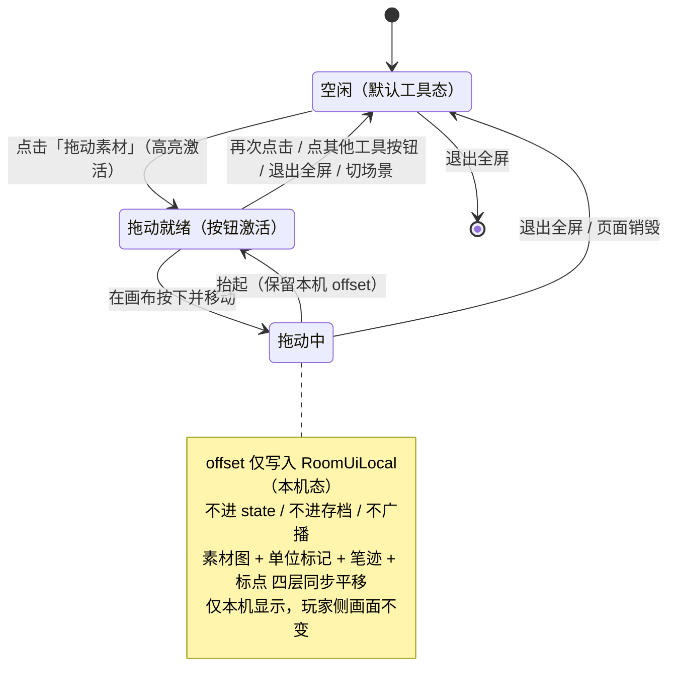
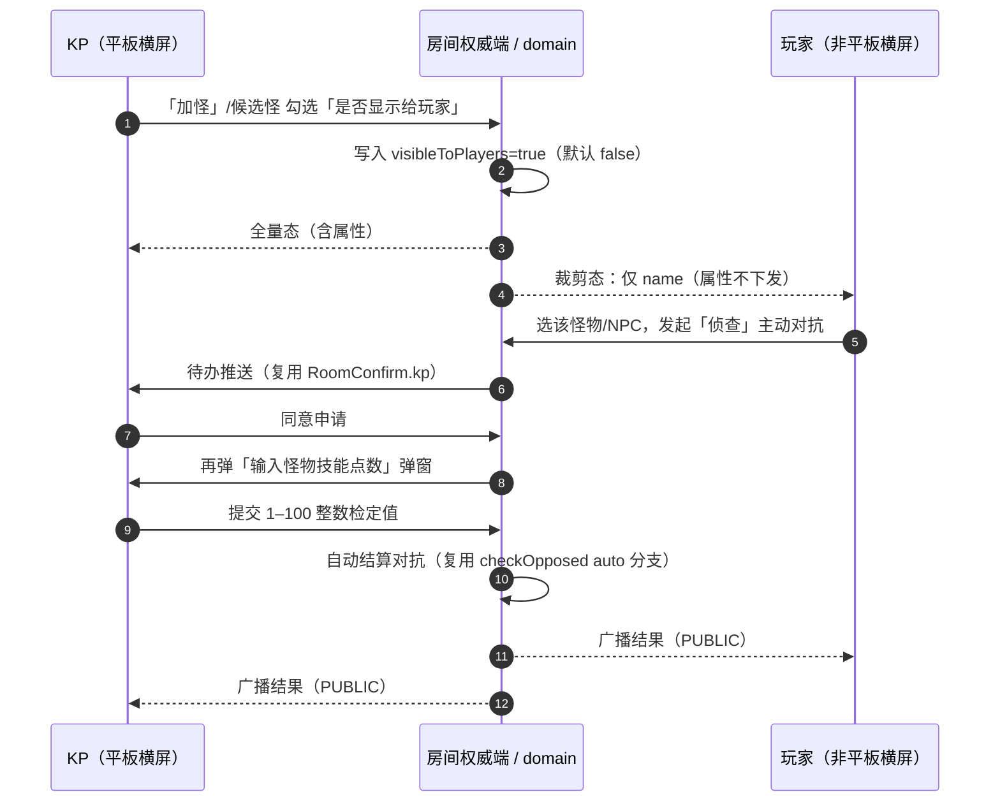
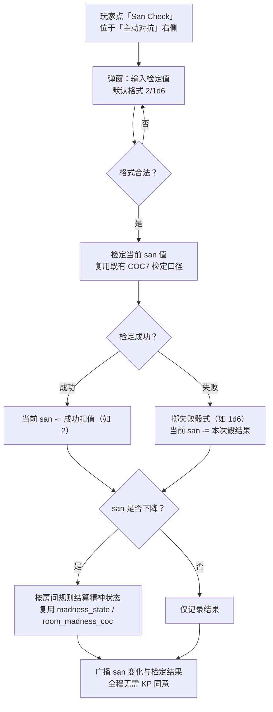

# 骰境 TRPG v2.35.0 增量 PRD（P12 / 第 9 期）

> 产品经理：许清楚（software-product-manager） · 全程中文 · 阶段：增量 PRD（只描述变更部分）
> 版本：`2.34.0+104` → **`2.35.0`**（build 号建议 `+105`，见 §7 Q13）
> 视角约定：**KP = 平板横屏；玩家 = 非平板横屏**（手机竖屏 / 手机横屏 / 平板竖屏布局保持一致）
> 工程根：`C:/Users/60965/WorkBuddy/2026-10-08-18-34-17/dice-realm`（下称 **ROOT**）
> 参考：`ROOT/docs/p11_incremental_design.md`（P11 架构设计 / 契约计数 / 踩坑清单）、`.workbuddy/memory/2026-11-15.md`（P11 交付日志）
> 本期范围：用户点名的 **11 项需求**（KP 7 项 / 玩家 3 项 / 全局 1 项），全部纳入交付
> **本阶段只写本文档**：未改任何 `.dart` / 测试文件，未运行 `flutter` / `dart`，未改 `pubspec.lock`
> 本文档只定义「做什么 / 做到什么程度 / 怎么验」，**不含源码改动与任务分解**（由架构师承接）

---

## 1. 产品目标

本期围绕「**舞台看得全、标记用得顺、联机数据进行得下去**」三条主线修复 2.34.0 的体验缺口：把公开素材舞台补齐为四层同步缩放 + 真全屏 + KP 侧工具窄栏，并新增纯本机「拖动素材」让放大后能查看画面外区域；修掉聊天框焦点、玩家信息栏收起后场景检定栏不可点、全屏嵌套入口三个阻断性交互缺陷；把玩家信息栏与检定推送的「座位号」口径统一为「角色名 / 手绘板」语义；在玩家侧开放「对可见怪物/NPC 发起主动对抗（KP 补输检定值后自动结算）」与「免审批 San Check」两项核心玩法；最后修复联机/云端房间结束或存档后不进「续玩本级存档」列表的数据丢失问题。所有改动限定在点名区域，房间布局骨架、既有契约计数与规则契约测试保持零漂移。

---

## 2. 视角与范围边界

### 2.1 设备 / 视角适用

| 视角 | 适用设备 | 本期涉及的需求 | 一致性要求 |
|---|---|---|---|
| **KP（主持人）** | 平板横屏 | 一.1 ~ 一.7（7 项） | 仅平板横屏交付；真全屏舞台、左侧工具窄栏按横屏宽度设计 |
| **玩家** | 非平板横屏：**手机竖屏 / 手机横屏 / 平板竖屏** | 二.1 ~ 二.3（3 项） | 三种形态**布局与行为一致**，不得只在某一形态生效；玩家全屏舞台无 KP 工具窄栏 |
| **全局** | 全部设备 / 全部视角 | 三.1（1 项） | 联机（LAN / 云端）双通道、KP 与玩家两端都覆盖 |

### 2.2 本期允许改动的区域（白名单）

> 硬约束：**房间 UI 布局骨架默认不动**。下列区域仅做局部调整，不得借机重构。

**UI 区域（用户明确点名）**

| # | 区域 | 允许改动内容 |
|---|---|---|
| 1 | 公开素材舞台（`widgets/gp_map_stage.dart` 及其全屏宿主） | 缩放层级、真全屏化、去掉嵌套全屏入口、KP 左侧工具窄栏、拖动态渲染 |
| 2 | KP 工具窄栏（`widgets/gp_kp_tools.dart` / `widgets/gp_kp_left.dart`） | 删「放玩家」、增「拖动素材」、「清除笔迹」改「清除标记」及清除范围 |
| 3 | 玩家信息栏 / 角色卡（`widgets/gp_kp_players.dart` / `widgets/gp_pl_char_card.dart`） | 收起态命中修复、卡片按钮文案与图标、角色名上卡 |
| 4 | 检定推送详情（`room_request_watcher.dart` 纯 Dart 派生） | 发起人改角色名、删「来自」行 |
| 5 | 玩家工具栏（`widgets/gp_toolbar.dart`） | 「主动对抗」右侧新增「San Check」按钮与弹窗入口 |

**为完成点名需求所必需的既有分层内改动（非骨架）**

| # | 区域 | 允许改动内容 |
|---|---|---|
| 6 | 聊天输入框（`sheets/sheet_chat_composer.dart`） | 外部点击释放焦点；**不回退** P11 KP-6a 的 `resizeToAvoidBottomInset:false` 抗抖动口径 |
| 7 | 存档 / 续玩链路（`room_save_syncer.dart`、`room_exit.dart`、`sheets/sheet_save_slots.dart`、`repo/*`、续玩列表 UI） | 结束房间 / 存档槽保存两条路径落本机档并进续玩列表 |
| 8 | 权威端结算（`lib/domain/room_model_actions_*.dart`、`room_rules_*`、`rules_coc7.dart`、`madness_state.dart` / `room_madness_coc.dart`） | 怪物玩家可见性字段、对抗补值结算、San Check 结算；**只能在既有函数外层组合** |

### 2.3 本期硬约束（不可越界，下游必须遵守）

1. **布局骨架**：不得推翻 `dock / folded` 档位判定、`RoomSlot` / `RoomKeys` 命名、共用 `gap` 机制；`RoomGridSpec.of` 的纯函数语义保持不变。收起态只控制子树显隐/命中，**绝不卸载**场景检定栏（沿用 P11 `RoomStackNode` 叠放裁决）。
2. **契约计数**：`kRoomPolicy` 62 / `RoomEvt` 28 / `RoomIntent` 13 **默认逐字不动**；本期不新增 action、事件、意图（San Check、怪物可见性、对抗补值均复用既有链路）。若架构师裁定必须新增，需单独说明理由并同步静态锚点表。
3. **GENERATED FILE 禁改**：`lib/domain/data/skills.dart`、`lib/domain/data/occupations.dart` 一律禁止手改，也不得因「对齐规则书」重新生成。
4. **`oracle_*` 规则契约**：逐字节比对旧 JS 的规则契约，**不得为对齐规则书而改动**；San Check / 对抗结算复用既有规则函数，不改 oracle 数据与期望值。
5. **测试纪律**：**不许为变绿放宽断言**（禁止 `findsOneWidget` → `findsNothing`、删锚点、降级等价断言、改期望常量）。全量回归用 `flutter test --no-pub -j 1`（普通 `flutter test` 会 pub get 污染 `pubspec.lock`，使 `p20_offline_no_regression_test.dart` 假红 —— P11 踩坑 #4）。
6. **字体放大**：新增 / 改动的固定尺寸控件（「拖动素材」「清除标记」「手绘板」「San Check」、工具窄栏按钮）必须在系统 `textScaler` ×1.0 / ×2.0 两档**不出现黄黑条溢出**；沿用 P11 的 `FittedBox(scaleDown)` + `clampBtnText` + padding 归零口径（P11 踩坑 #7）。
7. **本地态隔离**：全屏态、工具激活态、拖动 offset 一律放 `RoomUiLocal`，**不进 `state`、不进存档、不广播**；拖动画面仅本机显示（需求 2b 明确要求）。
8. **权限分族**：玩家侧可见的怪物/NPC **只下发名字**，属性不得进入裁剪态（沿用 `lib/net/lan_server.dart` 的分族权限口径）。
9. **本期不出 APK**（默认，见 §7 Q14）：只交付源码 + 测试 + 升版本号。

### 2.4 不在本期范围

- 房间 UI 布局骨架、dock/folded 档位、骰子条 `GpDiceBar` 9 项条目数与 `diceBalancedRowSizes(9,3)==[3,3,3]` 契约。
- 规则书数值调整、`oracle_*` 期望值、`skills.dart` / `occupations.dart` 内容。
- 聊天、暗骰、私密信息流、遮罩播报（P11 PV-1a）等既有能力的重构。
- 全屏舞台的协同编辑 / 玩家侧标记能力（玩家全屏舞台保持只读）。

---

## 3. 用户故事（按 11 项分组）

### 一、KP 视角（平板横屏）

1. **公开素材栏** — 作为 KP，我希望点「+」「-」时公开素材（背景图 / 线索图）与单位标记、画笔笔迹、标点一起同步缩放，以便放大后所有图层仍然对得上；我希望全屏弹窗里不再出现第二个「全屏」按钮，以便不误触重复入口；我希望点全屏后素材舞台是真正的全屏显示，并且左侧挂一条工具窄栏，以便在大画面上直接做标记而不用退出全屏。
2. **工具窄栏** — 作为 KP，我希望删掉与「放单位」完全重复的「放玩家」按钮，以便工具栏不冗余；我希望在原位置新增「拖动素材」，点击激活后可把素材、单位标记、笔迹、标点一起拖动，以便放大后查看未显示的区域，且拖动只影响我本机画面、不干扰玩家；我希望「清除笔迹」改叫「清除标记」并在确认后一次清掉全部笔迹、单位标记和标点，以便语义与实际行为一致。
3. **聊天框焦点** — 作为 KP，我希望点击输入框以外的任何位置都能让聊天输入框失去焦点、收起输入法，以便我做其他操作时不再被反复拉回输入框。
4. **玩家信息栏层级** — 作为 KP，我希望收起玩家信息栏之后仍能点击和拖动场景检定栏的所有按钮，以便收起态不会让下半屏功能整体失效。
5. **玩家信息栏 - 卡片按钮** — 作为 KP，我希望玩家卡片右下角那个实际打开「手绘板」的按钮文字改成「手绘板」、图标也换成手绘板语义，以便按钮名副其实、不再误以为是舞台全屏。
6. **检定推送** — 作为 KP，我希望玩家发起的待确认检定推送里发起人显示「角色名」而不是「座位号」，并删掉与「座位」行重复的「来自」那一行，以便一眼认出是谁申请的、信息不冗余。
7. **玩家信息栏** — 作为 KP，我希望玩家的角色名直接显示在角色卡上，以便不用来回对照座位号就知道这张卡是谁。

### 二、玩家视角（非平板横屏；手机竖/横、平板竖一致）

1. **主动对抗可选怪物/NPC** — 作为 KP，我希望「加怪」时多一个「是否显示给玩家」勾选项，且在候选怪物/NPC 阶段也能改，以便按需控制哪些怪对玩家可见；作为玩家，我希望看到被标记为可见的怪物/NPC 的**名字**（看不到属性）并在发起主动对抗时能选它，以便能对怪物/NPC 使用技能检定；作为 KP，我希望同意这类申请后再弹一个窗让我输入该怪物对应技能的点数，确定后系统自动结算对抗结果并广播，以便怪物没有角色卡也能完成对抗。
2. **玩家工具栏 - San Check** — 作为玩家，我希望「主动对抗」按钮右边有「San Check」按钮，点开输入 `2/1d6` 这样的检定值后自动按「成功扣固定值 / 失败掷骰扣骰结果」结算当前 san，并在掉 san 后按房间规则结算精神状态，且**不需要 KP 同意**，以便跑团节奏不被审批打断。
3. **公开素材栏** — 作为玩家，我希望点「+」「-」时公开素材也同步缩放、全屏弹窗里不再嵌套全屏按钮、点全屏后是素材舞台真全屏显示（不需要 KP 工具窄栏），以便和 KP 侧看到一致的舞台内容。

### 三、全局

1. **联机续玩存档丢失** — 作为 KP / 玩家，我希望联机（云端）房间在「结束房间」或「存档槽保存」之后，能在双方各自的「续玩本级存档」列表里看到该房间号（如 `NU9E6R`）并点进去续玩，以便一局跑团不会因关房而丢档。

---

## 4. 需求池

> 优先级口径：本期 11 项均为用户点名的交付范围，**P0/P1 表示阻断程度与实施顺序，不表示可裁剪**。
> **P0** = 数据正确性 / 阻断性缺陷 / 核心玩法；**P1** = 文案 · 图标 · 信息结构等展示层优化；**P2** = 本期无（可延后细节统一收进 §7 默认值）。
> 「影响端」中的 `全局` 指权威端结算 / 存储 / 广播，需两端一致。

| 编号 | 需求 | 优先级 | 影响端 | 验收要点 |
|---|---|---|---|---|
| **KP-1a** | 「+」「-」缩放时公开素材与单位标记 / 笔迹 / 标点**同步缩放** | P0 | KP（舞台共用） | 四层同一变换；素材 rect 随 ×1.25 / ÷1.25 变化 |
| **KP-1b** | 去掉全屏态内嵌的重复「全屏」入口 | P0 | KP | 全屏态内「全屏」入口计数 = 0；半屏弹层不再嵌套第二个 stage |
| **KP-1c** | 全屏改为**素材舞台真全屏**，左侧挂 KP 工具窄栏 | P0 | KP | 舞台 rect ≈ 视口；左侧窄栏存在且可命中；退出后恢复原栏位与 dock/folded |
| **KP-2a** | 删除「放玩家」按钮（与「放单位」功能完全相同） | P1 | KP | 「放玩家」`findsNothing`；「放单位」及 `map.mark` 落点零回归 |
| **KP-2b** | 原位置新增「拖动素材」：激活后可同步拖动**素材 + 单位标记 + 笔迹 + 标点**；**仅本机显示、不同步玩家** | P0 | KP | 按钮激活态；四层 offset 同步；`state` / 出站计划不含 offset；退出复位 |
| **KP-2c** | 「清除笔迹」→「清除标记」，确认后清除**全部笔迹 + 单位标记 + 标点**（不含素材图） | P0 | KP | 文案替换；三类集合清零、素材集合不变；保留二次确认 |
| **KP-3** | 点击输入框以外任意位置 → 聊天输入框失焦、输入法收起 | P0 | KP | `FocusNode.hasFocus == false`、`viewInsets.bottom == 0`；多次 tap 不复焦 |
| **KP-4** | 收起玩家信息栏后，场景检定栏**所有按钮可点、可拖动** | P0 | KP | 场景检定栏按钮回调被触发；命中目标非收起栏透明遮罩；不卸载 `GpSceneCheckKp` |
| **KP-5** | 玩家卡片右下角「全屏」→「手绘板」，图标改手绘板语义，功能不变 | P1 | KP | 新文案 / 图标命中；点击仍打开全屏手绘板；不误伤其他「全屏」入口 |
| **KP-6** | 检定推送发起人显示**角色名**；删掉「来自」整行；「座位」行保留 | P1 | KP | `details` 无「来自」行；`发起人：<角色名>`；`座位：<seat>` 仍在 |
| **KP-7** | 玩家角色名显示在**角色卡上** | P1 | KP | 角色名落在卡片子树；与玩家侧同源；×2.0 不溢出 |
| **PL-1a** | KP「加怪」新增「是否显示给玩家」勾选；**候选怪物/NPC 时也可更改** | P0 | KP + 全局 | 勾选项存在（默认不勾）；候选态可切换；可见性字段持久化；不新增 action |
| **PL-1b** | 勾选后玩家**只见名字（属性不可见）**，且主动对抗可选该怪物/NPC | P0 | 玩家 + 全局 | 裁剪态仅含 `name`；目标列表出现该名字且可点；未勾选者不出现 |
| **PL-1c** | KP 同意申请后**再弹窗输入怪物技能点数** → 确定后**自动结算 + 广播** | P0 | KP + 全局 | 1–100 整数必填；提交后 1 条 PUBLIC 结果、两端一致；取消不结算且申请不丢 |
| **PL-2** | 「主动对抗」**右边**新增「San Check」：弹窗输入 `2/1d6`，自动结算 san 与精神状态，**无需 KP 同意** | P0 | 玩家 + 全局 | 按钮顺序相邻；成功 -2 / 失败 -骰值；掉 san 触发精神状态；pending 长度不变 |
| **PL-3a** | 玩家侧「+」「-」缩放时公开素材同步缩放 | P0 | 玩家 | 同 KP-1a 口径 |
| **PL-3b** | 玩家侧去掉全屏态内嵌的重复「全屏」入口 | P0 | 玩家 | 同 KP-1b 口径 |
| **PL-3c** | 玩家侧全屏改为素材舞台真全屏（**无 KP 工具窄栏**） | P0 | 玩家 | 舞台 rect ≈ 视口；无「拖动素材 / 放单位 / 清除标记」入口；舞台保持只读 |
| **GL-1** | 联机 / 云端房间**结束或存档后**进入 KP 与玩家两端「续玩本级存档」列表 | P0 | 全局 | 两条触发路径均落档；列表出现房号且可续玩；LAN + 云端双通道；两端 role 各测 |

---

## 5. 关键交互 / UI 设计稿

### 5.1 真全屏素材舞台 + 左侧工具窄栏（KP，平板横屏）

现状：点「全屏」弹出的是**半屏弹层**，且弹层内又渲染了一个带「全屏」按钮的舞台（`gp_map_stage.dart:195` 注释「全屏弹层里也显示」即为嵌套根因）。
目标：**覆盖整个页面**的真全屏舞台 + 左侧工具窄栏；玩家侧同版式但**去掉整条工具窄栏**。

```
┌─────────────────────────────────────────────────────────────────┐
│  真全屏素材舞台（覆盖整页；非 showDialog / 非半屏 RoomSheet）       │
│ ┌──────────┬──────────────────────────────────────────────────┐ │
│ │ 工具窄栏 │            素材舞台画布                            │ │
│ │          │  ┌────────────────────────────────────────────┐  │ │
│ │ [退出全屏]│  │  公开素材：背景图 / 线索图                    │  │ │
│ │ [放单位] │  │  ● 单位标记   ✎ 画笔笔迹   ⚑ 标点            │  │ │
│ │ [画笔]   │  │  ↑ 四层共用同一 Transform(scale + offset)     │  │ │
│ │ [标点]   │  │                                            │  │ │
│ │ [清除标记]│  │         （放大后可拖动查看画面外区域）         │  │ │
│ │ [拖动素材]│  └────────────────────────────────────────────┘  │ │
│ │  ─────   │                                                  │ │
│ │ [ - ][+] │                                    [ - ]   [ + ]   │ │
│ │          │                                  （缩放，四层同步）  │ │
│ │ ✗ 无「全屏」入口                                              │ │
│ │ ✗ 无「放玩家」                                                │ │
│ └──────────┴──────────────────────────────────────────────────┘ │
└─────────────────────────────────────────────────────────────────┘
   玩家侧：无左侧窄栏；仅保留 [退出全屏] 与 [ - ][ + ]；舞台只读
```

**要点**

- 四层（公开素材图、单位标记、画笔笔迹、标点）必须落在**同一个 `Transform`**（`scale` × `offset`），保证缩放/拖动严格同步；现状 `Transform.scale` 只包了标记类图层（`:327-328`），素材图层未纳入 —— KP-1a / PL-3a 的修复点。
- 全屏态**只保留一个退出入口**（左上「退出全屏」+ 系统返回键），窄栏内不再出现任何「全屏」按钮 —— KP-1b / PL-3b。
- KP 工具窄栏按钮集：退出全屏 / 放单位 / 画笔 / 标点 / 清除标记 / 拖动素材 / `-` `+`；**不含**「放玩家」「全屏」。
- 退出全屏后必须回到原栏位，且 `dock / folded` 档位、`RoomSlot` / `RoomKeys`、共用 gap 全部零漂移。

### 5.2 「拖动素材」状态机



**要点**：激活态是**互斥工具态**（与画笔 / 标点 / 放单位互斥）；拖动期间不产生任何 `SendPlan` / `RoomEvt`；退出全屏或切场景复位 offset。

### 5.3 怪物显示开关与对抗结算时序



**要点**：可见性开关在「加怪」与「候选怪物/NPC」两处都可改；KP 输入值是**第二段弹窗**（同意之后），不是审批弹窗里的字段；结算与广播在权威端完成，客户端只 reduce；复用 P11 PV-1b 的 `RoomConfirm.kp` + pending + 自动检定链路，不新增 action / 事件 / 意图。

### 5.4 San Check 弹窗与结算流程



**要点**：`2/1d6` 语义 = 先检定当前 san；**成功**扣 `2`，**失败**掷 `1d6` 并扣本次骰结果；掉 san 后按房间规则刷新精神状态。按钮挂 `GpToolbar` 扩展位，**不进 `GpDiceBar` 9 项**；全程不产生 `RoomConfirm.kp` 待办。

### 5.5 检定推送信息结构变更（KP-6）

现状 `room_request_watcher.dart` 的 `_detailLabels` 把 `by` / `from` 都映射成「发起人」、把 `seat` 映射成「座位」；`_detailsOf` 的 `extra` 又追加一行「来自 …」（`:206` / `:220`），导致同屏出现三行座位号。

```
【变更前】                          【变更后】
┌ 待确认：<op>                      ┌ 待确认：<op>
├ 来自：3        ← 座位号，删除      ├ 发起人：<角色名>   ← by/from 改取角色名
├ 发起人：3      ← 座位号，改        ├ 座位：3            ← 保留
├ 座位：3        ← 保留              ├ 技能：侦查
├ 技能：侦查                        └ …（不再出现重复座位号三连）
└ …                                  角色名缺失时回退：昵称 → 座位号，且不出空行
```

**要点**：只删「来自」整行；「座位」行保留；「发起人」行由座位号改为角色名（与 KP-7 角色卡同源）。

### 5.6 续玩存档写入链路（GL-1）


**现状疑似缺口**：联机/云端通道只写了凭据（`recent_rooms.json`）与云端备份，或续玩列表派生时把联机档过滤掉，导致「本机存档列表」无条目。修复要求：**两条触发路径 × LAN/云端两通道 × KP/玩家两角色**都得落档入列；结束房间不清凭据（沿用 `cloud_room_backup.dart:163` D-2 口径）。

---

## 6. 验收标准

### 6.0 通用口径（每条需求都适用）

| 项 | 判定 |
|---|---|
| 回归基线 | 现有约 **179 个测试文件 / 2352 用例**（P11 为 170 文件 / 2352 用例），本期新增用例后 `flutter test --no-pub -j 1` **全绿、0 失败、0 skip**；`pubspec.lock` 全程干净（82 处 pub.dev / 0 镜像） |
| 测试纪律 | **不许为变绿放宽断言**；反向证伪：改动前断言应能真红（断言失败而非脚本异常），三态哈希 H2 == H0 |
| 契约 | `kRoomPolicy` 62 / `RoomEvt` 28 / `RoomIntent` 13 逐字不变；`RoomKeys.action(...)` 静态锚点表零漂移；`GpDiceBar` 9 项不动 |
| 规则契约 | `oracle_*` 零改动；`lib/domain/data/skills.dart` / `occupations.dart` 零改动 |
| 字体放大 | 新增/改动按钮在 `textScaler` ×1.0 / ×2.0 两档无黄黑条溢出（widget test 中 `tester.takeException()` 无 `RenderFlex overflowed`） |
| 三视角一致 | KP 平板横屏；玩家手机竖 / 手机横 / 平板竖 —— 同一功能行为一致，布局骨架零漂移 |
| 本地态隔离 | 拖动 offset / 全屏态 / 工具激活态不出现在 `state`、存档 JSON 与出站 `SendPlan` 中（fake session 断言出站计划数量 / 键集不变） |
| 版本链路 | `pubspec.yaml:19` + `lib/app_version.dart:15,18` 同步为 `2.35.0` / `+105`；`test/app_version_test.dart` **零 diff 自动绿**（不得写死版本号字面量） |

### 6.1 KP 侧

| 编号 | 可测判定 | 测试口径 |
|---|---|---|
| KP-1a | 点 `GpMapStageKeys.zoomIn/zoomOut` 后，**公开素材图层**与单位标记 / 笔迹 / 标点层的 `Transform.scale` 一致；素材 bounding rect 按 ×1.25 / ÷1.25 变化 | widget test：读四层 `RenderBox` rect 比值；补一条「素材层随 zoom 变化」的正向断言（现状该断言会红） |
| KP-1b | 全屏态内「全屏」入口数量为 **0** | widget test：`find.byKey` / `find.text('全屏')` 在舞台子树内 `findsNothing`；半屏弹层不再嵌套第二个带全屏按钮的 stage |
| KP-1c | 点全屏后舞台 rect ≈ 视口 rect（允许扣状态栏/安全区）；左侧工具窄栏存在且 `tester.tap` 命中；退出后原栏位与 dock/folded 档位恢复 | widget test：rect 断言 + 窄栏按钮 hitTest + `RoomGridSpec.of` 纯函数前后一致 |
| KP-2a | `find.text('放玩家')` → `findsNothing`；`放单位` → `findsOneWidget` 且 `map.mark` 落点回调功能不回归 | widget test + P16 KP-11 落点回调单测 |
| KP-2b | 点「拖动素材」→ 按钮激活态 true；`tester.drag` 画布 → **四层 offset 同步变化**；`state` 与 `SendPlan` 中无 offset；再次点击 / 退出全屏 → 激活态 false 且 offset 复位 | widget test 四层 rect 同量位移 + fake session 出站计划断言；`RoomUiLocal` 状态机单测覆盖 §5.2 全部迁移 |
| KP-2c | `find.text('清除标记')` → `findsOneWidget`；`清除笔迹` / `清除笔迹与标记` → `findsNothing`；确认后笔迹 / 单位标记 / 标点三类集合清零，**公开素材集合长度不变**；确认弹窗仍存在 | 纯 Dart 清除函数单测（三类清零 + 素材不变）+ widget test 二次确认流程 |
| KP-3 | 输入框获焦后，tap 输入框以外任意位置 → `FocusNode.hasFocus == false` 且 `MediaQuery.viewInsetsOf(context).bottom == 0`；连续多次 tap 不复焦 | widget test：`sheet_chat_composer.dart` 挂载 + 多位置 tap 参数化；×2.0 无溢出；不得回退 `resizeToAvoidBottomInset:false` |
| KP-4 | 收起玩家信息栏后，场景检定栏各按钮 `tester.tap` 触发回调（计数器 ≥1）、拖动条可拖动；命中目标是场景检定栏而非收起栏的透明遮罩 | widget test：`hitTest` 断言命中控件类型 + 回调计数；断言 `GpSceneCheckKp` 仍在树中（不卸载）；`RoomStackNode` 叠放 Rect 断言不变 |
| KP-5 | 卡片内 `find.text('手绘板')` → `findsOneWidget`、该卡片内 `find.text('全屏')` → `findsNothing`；图标 / 语义 label 为手绘板；点击仍打开全屏手绘板 | widget test：按卡片子树限定查找范围，避免误伤舞台「全屏」入口；`Semantics` label 断言 |
| KP-6 | `collectRoomPushRequests` 产出的 `details` 中**无「来自」开头行**；含 `发起人：<角色名>` 且不等于座位号；含 `座位：<seat>` | **纯 Dart 单测**：构造玩家检定 pending，`_detailsOf` / `collectRoomPushRequests` 逐行断言；角色名缺失回退链单测 |
| KP-7 | 角色名渲染在角色卡子树内；与玩家侧 `gp_pl_char_card.dart` 同源；长角色名在 ×2.0 下不溢出 | widget test：`find.descendant` 限定卡片 + 长文本 ×2.0 溢出断言 |

### 6.2 玩家侧

| 编号 | 可测判定 | 测试口径 |
|---|---|---|
| PL-1a | 「加怪」弹层含「是否显示给玩家」勾选（**默认不勾选**）；候选怪物/NPC 项也能切换；可见性字段随切换写入 | widget test 两处入口各测一次；纯 Dart 状态断言 `visibleToPlayers` 值；契约 62/28/13 不变 |
| PL-1b | 玩家裁剪态中该怪物/NPC **仅含 `name`**（断言无 `hp/skill/value/attr` 等键）；主动对抗目标列表出现该名字且可点；未勾选者不出现 | 假裁剪态驱动 widget test + 裁剪态键集单测（对齐 `lan_server.dart` 分族权限） |
| PL-1c | KP 同意后弹「输入怪物技能点数」（1–100 整数，空/非法时确定按钮 disabled）；提交后权威端产出 **1 条 PUBLIC 结果**，KP / 玩家两端 reduce 后一致；取消不产生结算广播且申请不丢失（可再次同意触发） | domain 单测（出站 `RoomEvt` 计数 + 两端 reduce 一致性）+ widget test 弹窗校验与取消路径；`defender.side != 'pc'` 与通用对抗分支零回归；`oracle_*` 零改动 |
| PL-2 | 「San Check」按钮位于「主动对抗」**右侧且相邻**（index = 主动对抗 + 1）；弹窗接受 `2/1d6`；成功 → san -2，失败且骰结果固定为 k → san -k；掉 san 后精神状态随规则刷新；**无 `RoomConfirm.kp` 待办**（pending 长度不变）；非法格式（`abc`/`2/`/`-1/1d6`）禁用确定 | widget test 按钮顺序 + 弹窗校验；**纯 Dart 参数化单测**注入 `diceRoll` 替身覆盖成功/失败/边界；断言 `GpDiceBar` 9 项不变、`pending` 不变 |
| PL-3a | 同 KP-1a（玩家侧四层同步缩放） | widget test，玩家视角 fixture |
| PL-3b | 同 KP-1b（玩家侧无嵌套全屏入口） | widget test，玩家视角 fixture |
| PL-3c | 舞台 rect ≈ 视口；玩家全屏态中**不存在**「拖动素材 / 放单位 / 清除标记 / 画笔 / 标点」入口；舞台保持只读（禁画笔、禁标点、禁放置） | widget test：`findsNothing` 逐项断言 + `gp_map_stage.dart:188` 只读口径回归 |

### 6.3 全局

| 编号 | 可测判定 | 测试口径 |
|---|---|---|
| GL-1 | 模拟「云端房间进行中 → **结束房间**」与「→ **存档槽保存**」两条路径后，`RoomSaveStore` 中存在 `meta.code == 'NU9E6R'` 的条目且 `parseSave` 可解；续玩列表派生函数返回含该房号的条目（**KP / 玩家两种 role 各测一次**）；LAN 通道同样覆盖；结束房间**不清凭据** | 内存 `RoomSaveStore` + 内存 `RecentCredentialStorage` + 假 `CloudBackupService` 替身单测；widget test 断言列表出现 `NU9E6R` 且点击进续玩（不真连服务端）；沿用 `RoomResumeService` 既有可注入设计 |

---

## 7. 待确认问题 + 推荐默认值

> **以下默认值可直接推进，不阻塞架构师 / 施工方**；若后续用户否决，只影响对应单点，不影响其余需求。

| 编号 | 歧义点 | 推荐默认值 | 若否决的影响 |
|---|---|---|---|
| **Q1** | 真全屏如何退出？ | 左上「退出全屏」按钮 + 系统返回键；**点击画布空白不退出**（避免与标记/拖动误触） | 只改全屏退出交互，不动舞台本体 |
| **Q2** | KP 全屏工具窄栏包含哪些按钮？ | 退出全屏 / 放单位 / 画笔 / 标点 / 清除标记 / 拖动素材 / `-` `+`；**不含「放玩家」「全屏」**；玩家侧整条窄栏不渲染 | 只调窄栏按钮集 |
| **Q3** | 缩放与拖动是否同一变换？ | 四层（素材图 + 单位标记 + 笔迹 + 标点）包在**同一个 `Transform(scale + offset)`**，保证严格同步 | 只调实现结构，验收口径不变 |
| **Q4** | 拖动有无边界？offset 存哪里？ | 做最小可见比例钳制（防止内容整体拖出画面）；offset 存 `RoomUiLocal`，退出全屏 / 切场景复位，不进存档、不广播 | 只调边界策略 |
| **Q5** | 「清除标记」清哪些？ | **仅三类：画笔笔迹 + 单位标记 + 标点**，**不清公开素材图**；保留现有二次确认弹窗，确认文案明确列出三类。（注意：2b 的**拖动**范围含素材图，两者范围不同） | 只调清除集合与文案 |
| **Q6** | 怪物「显示给玩家」默认值 / 存哪 / 玩家看到什么？ | **默认不勾选**（延续现状，防泄露）；布尔字段挂怪物/NPC 数据；候选阶段可改；玩家裁剪态**只下发 `name`** | 只调字段与默认值 |
| **Q7** | KP 补输怪物技能点数的范围 / 取消行为？ | **1–100 整数必填**（对齐 P11 R2 `hasValue` 判定），空/非法禁用确定；**取消 = 不结算、申请保留**（可再次同意重新触发），不产生广播 | 只调弹窗校验与取消语义 |
| **Q8** | 对抗结算是否新增协议？ | **不新增** action / 事件 / 意图；复用 `RoomConfirm.kp` + pending + `checkOpposed` auto 分支，KP 补值走 `defender.value`；62/28/13 契约不变 | 若新增需架构师单独裁定并同步锚点表 |
| **Q9** | San Check 表达式容错与规则口径？ | 接受 `2/1d6` 及大小写 / 空格容错（`2/1D6`、`2 / 1d6`）；**复用既有 COC7 检定与精神状态函数**（`rules_coc7.dart` / `madness_state.dart` / `room_madness_coc.dart`），在其外层组合，不改 `oracle_*` 与规则数据文件 | 只调解析与组合层 |
| **Q10** | San Check 按钮落在哪？ | 挂 `GpToolbar` 扩展位，「主动对抗」**右侧相邻**；**不进 `GpDiceBar`**（9 项契约不动） | 只调落位 |
| **Q11** | 检定推送角色名从哪取？「座位」行留不留？ | 优先取**角色卡角色名**（与 KP-7 同源），缺失回退昵称 → 座位号且不出空行；**删「来自」行、保留「座位」行** | 只调 `room_request_watcher.dart` 派生 |
| **Q12** | GL-1 覆盖范围？ | **LAN + 云端双通道** ×「结束房间」+「存档槽保存」双触发 × **KP + 玩家两端**都入列表；以房号为键去重；结束房间不清凭据 | 只调落档触发点 |
| **Q13** | 版本号？ | `2.35.0+105`（`pubspec.yaml:19` + `app_version.dart:15,18` 三处同步，`app_version_test.dart` 零 diff 自动绿） | 只改三处字面量 |
| **Q14** | 本期是否出 APK？ | **默认不出**（沿用 P11 口径），只交付源码 + 测试 + 升版本号 | 若出包需走 `tool/build_apk.sh` + AOT 重编 + checklist 指纹闭环 |

---

## 附：需求编号对照（便于架构师映射施工单）

| 用户原文 | 本文档编号 |
|---|---|
| 一.1 公开素材栏 (1a)(1b)(1c) | KP-1a / KP-1b / KP-1c |
| 一.2 工具窄栏 (2a)(2b)(2c) | KP-2a / KP-2b / KP-2c |
| 一.3 聊天框焦点 bug | KP-3 |
| 一.4 玩家信息栏层级 bug | KP-4 |
| 一.5 玩家信息栏 - 卡片按钮 | KP-5 |
| 一.6 检定推送 | KP-6 |
| 一.7 玩家信息栏（角色名上卡） | KP-7 |
| 二.1 主动对抗可选怪物/NPC | PL-1a / PL-1b / PL-1c |
| 二.2 玩家工具栏 - San Check | PL-2 |
| 二.3 公开素材栏 (3a)(3b)(3c) | PL-3a / PL-3b / PL-3c |
| 三.1 联机续玩存档丢失 | GL-1 |

> **交付边界再申明**：本文档为产品定义与验收口径；文件级改动清单、施工单、任务分解与测试用例设计由架构师 / QA 承接。PRD 阶段未改任何源码或测试。
