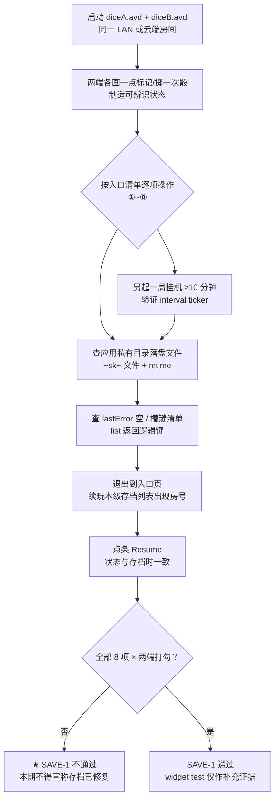
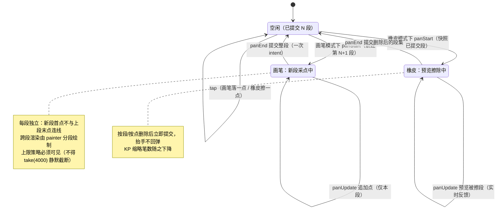
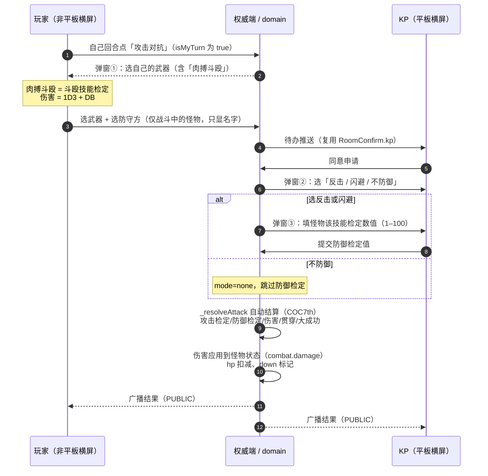
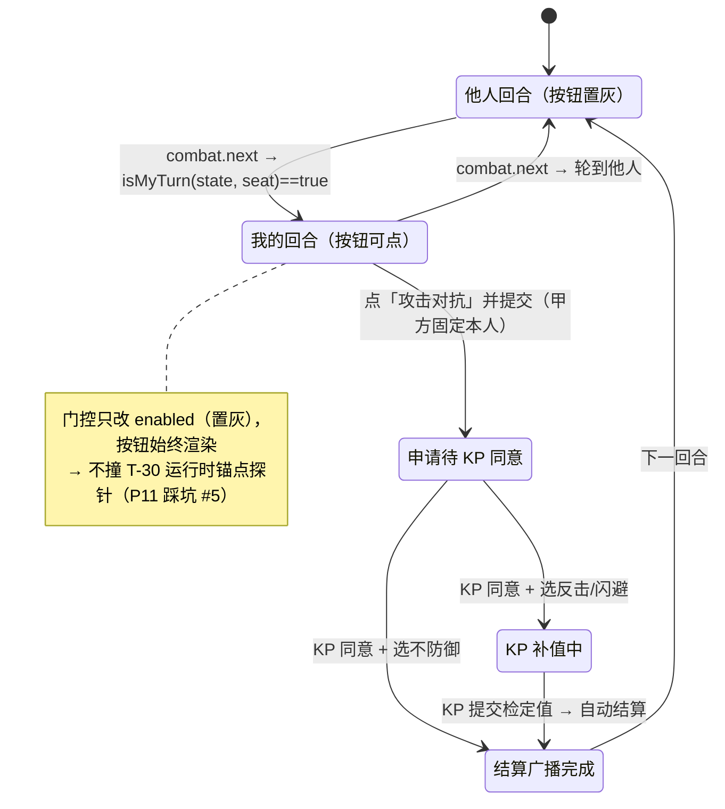

# 骰境 TRPG v2.38.0 增量 PRD（P13 / 第 10 期）

> 产品经理：许清楚（software-product-manager） · 全程中文 · 阶段：增量 PRD（只描述变更部分）
> 版本：`2.37.0+107` → **`2.38.0`**（build 号建议 `+108`，见 §7 Q12）
> 视角约定：**KP = 平板横屏；玩家 = 非平板横屏**（手机竖屏 / 手机横屏 / 平板竖屏布局保持一致）
> 工程根 ROOT：`C:/Users/60965/WorkBuddy/2026-10-08-18-34-17/dice-realm`
> 必读参考：`docs/p12_incremental_prd.md`、`docs/p12_incremental_design.md`（v1.1）、`.workbuddy/memory/2026-11-16.md`（P22 = 2.36→2.37，Q1 存档三处真因）
> 本期 5 大项：**存档（P0 最高）/ 玩家手绘板（P0）/ KP 看玩家手绘板（P0）/ 删 KP 地图模块（P1）/ 战斗模式玩家侧（P0）**
> **本阶段只写本文档**：未改任何源码 / 测试 / `pubspec.lock` / 版本号，未运行 `flutter` / `dart`。
> 本文档只定义「做什么 / 做到什么程度 / 怎么验」；文件级改动清单与任务分解由架构师承接。

---

## 1. 产品目标

本期是「**先止血、再补全**」的一期：第一优先级是把**存档彻底修好**——P12、P22 连续两期修存档，两次都是「测试全绿、AOT 验证通过、真机全丢」，本期必须把验收口径从「widget test 全绿」升级为「**diceA / diceB 两台模拟器双端实机跑一局，逐入口打勾**」，覆盖全部手动入口与 10 分钟自动存档，且落档后可在「续玩本级存档」列表点开续玩，否则本期不得宣称存档修复完成；第二优先级是修好玩家手绘板的笔迹分段、持续增长与橡皮擦除（对齐 KP 侧素材舞台实现方向），并让 KP 能真正**看到**玩家手绘板内容而不是一行文字；同时删除 KP 侧与工具窄栏功能重复的「地图」模块；最后补齐战斗模式玩家侧的参战者显示、信息栏可拖动与「攻击对抗」按钮（回合门控 + KP 审批 + KP 补防御值 + 严格 COC7th 自动结算并扣怪物 HP）。所有改动限定在点名区域，布局骨架、契约计数与 `oracle_*` 规则契约保持零漂移。

---

## 2. 范围与视角边界 + 硬约束

### 2.1 视角适用

| 视角 | 适用设备 | 本期涉及 | 一致性要求 |
|---|---|---|---|
| **KP** | 平板横屏 | 存档（KP 侧）、KP 看玩家手绘板、删地图模块、战斗审批/补值 | 三栏删减后与工具窄栏口径对齐 |
| **玩家** | 非平板横屏（手机竖 / 手机横 / 平板竖） | 存档（玩家侧）、手绘板三缺陷、战斗三项 | 三种形态**布局与行为一致**，不得只在某一形态生效 |
| **全局** | 双端 / 双通道 | 存档（LAN + 云端）、自动存档、COC7 结算与广播 | KP 与玩家两端观察一致 |

### 2.2 允许改动区域（白名单）

| # | 区域 | 允许改动 |
|---|---|---|
| 1 | 存档链路（`repo/file_room_save_store.dart`、`room_save_syncer.dart`、`room_controller.dart`、`room_entry_page.dart`、`sheets/sheet_save_slots.dart`、`sheets/sheet_kp_panel.dart`、`room_exit.dart`、`room_lobby_page.dart`、`main.dart` 注入点） | 全入口落档、续玩列表可见、10 分钟周期、生产后端与测试后端行为对齐 |
| 2 | 玩家手绘板（`widgets/gp_pl_sketch.dart`、`painter/stroke_painter.dart`、`room_ui_local.dart`） | 笔迹分段、持续增长、擦除；参照 KP 舞台方向 |
| 3 | KP 玩家卡片（`widgets/gp_kp_players.dart`） | 全屏只读手绘板真正渲染笔迹 |
| 4 | KP 左栏（`widgets/gp_kp_left.dart`） | 删「地图」tab 及其面板、tab 索引与等宽连带 |
| 5 | 战斗模式（`widgets/gp_combat_list.dart` / `gp_combat_strip.dart`、`view/combat_view.dart`、`domain/room_model_actions_combat.dart`、`sheets/sheet_combat.dart` 或新增玩家攻击入口） | 参战者显示、滚动、玩家攻击对抗与审批补值 |

### 2.3 硬约束（不可越界）

1. **★ 存档验收硬关卡（本期第一位）**：SAVE-1 **只接受「diceA / diceB 模拟器双端实机跑一局」的逐入口打勾结果**。widget test 全绿、反向证伪通过、AOT 字面量命中、**出包成功均不构成存档完成的证据**。任一入口未真机打勾 → SAVE-1 不通过 → 本期不得对外宣称存档已修复。
2. **生产后端与测试后端必须同行为**：P22 新坑明确记载「内存测试后端不过滤 `auto/` `share/` 多段键、生产文件后端静默丢弃」导致「测试全绿、线上全丢」。本期凡涉及存档的测试，**必须至少有一条走生产同款 `FileRoomSaveStore`**（真实 `dart:io`），内存替身只能作为补充；架构师须先做一次「内存后端 vs 生产后端」差异比对并列为验收项。
3. **不动 P22 已落地的存档机制**：`isStructuredSlotKey` / `~sk~<hex>` 可逆文件名编码 / 六处 controller 注入 / `saveOnOpen()` / `kAutoSaveKeep=10` / ticker 10 分钟，均为 P22 现场修复成果，本期**不得回退**；若定位到新的真因，在其上叠加修复而非替换。
4. **排查纪律**：先用真机证据（`lastError`、落盘文件清单、槽键、mtime、导出存档 JSON）定位根因，再定修法；**禁止把「怀疑」直接变成修法**（P22 曾误判云端 `exportSave` 恒 null，被工程师现场证伪）。
5. 布局骨架：`dock / folded` 档位、`RoomSlot` / `RoomKeys` 命名、共用 `gap` 机制不许推翻；三栏删减后的 tab 索引/等宽口径按 §7 Q7 默认值推进，静态锚点表须同步评估。
6. 契约计数：`kRoomPolicy 62` / `RoomEvt 28` / `RoomIntent 13` 逐字不动；本期攻击对抗复用 `combat.attack` / `combat.damage` / `check.opposed` 既有 action，**不新增 action / 事件 / 意图**。
7. `oracle_*`、`lib/domain/data/skills.dart`、`lib/domain/data/occupations.dart` 逐字节不动；COC7 结算复用 `room_rules_combat.dart` 的 `_resolveAttack`，只在上层编排，不改规则函数与 rng 消耗顺序。
8. 测试不许放宽断言、不许 skip；反向证伪必须真红（断言失败而非脚本异常）；全量回归用 `flutter test --no-pub -j 1`（防 `pubspec.lock` 被 pub get 污染）。
9. 固定尺寸控件在系统 `textScaler` **1.3 / 1.5 / 2.0** 三档均无黄黑条溢出（比上期两档更严）；新增的「攻击对抗」按钮、tab（删减后）、战斗栏位需覆盖。
10. **权限分族**：战斗信息栏中怪物**只显名字，不显 HP / 属性**（沿用 `hpPublic` 与 `syncFor(seat)` 裁剪口径）；玩家侧不得因本次改动获得怪物属性。

---

## 3. 用户故事（按 5 大项分组）

### 一、存档（P0，最高优先级）

- **SAVE-1** — 作为 KP / 玩家，我希望**每一个手动存档入口**（存档槽-保存 / 工具-保存本局 / 结束房间 / 结团 / 续玩本级存档）在真机上逐个点击后都能真正落档、出现在「续玩本级存档」列表并能点开续玩；我希望 **10 分钟自动存档**也在真机按周期落档；以便我不再经历「测试全绿但真机全丢」的假修复。

### 二、玩家侧手绘板画笔 / 橡皮（P0）

- **SKETCH-1（笔迹连线）** — 作为玩家，我希望第二笔从落点重新起笔、不与第一笔末尾自动连线，以便我画的两笔是两笔而不是一条折线。
- **SKETCH-2（画几笔后卡死）** — 作为玩家，我希望连续画多笔后仍能继续出墨，不要画了几笔就什么都画不出来，以便我能完整画完一张图。
- **SKETCH-3（橡皮擦不掉）** — 作为玩家，我希望橡皮能真正擦掉已画的笔迹且抬手后不回弹，以便我能修改画错的内容。
- 三者共同诉求：作为玩家，我希望玩家手绘板的落笔 / 擦除**参照 KP 侧素材舞台的画笔 / 橡皮方向**实现，以便两端手感与行为一致。

### 三、KP 侧玩家手绘板空白（P0）

- **KPBOARD-1** — 作为 KP，我点击玩家信息栏里玩家卡片的「手绘板」按钮后，希望能看到该玩家**已经画出的笔迹内容**，而不是一片空白 / 只有一行笔数文字，以便我能查看玩家的手绘记录。

### 四、删除 KP 侧地图模块（P1）

- **MAP-1** — 作为 KP，我希望「地图 / NPC / 素材」三栏里的「地图」栏整个删掉（它只有一个情况标记层按钮和一些信息，与工具窄栏「清除标记」功能重复），以便左栏更简洁、不重复。

### 五、战斗模式玩家侧（P0，最复杂）

- **COMBAT-1（显示参战者）** — 作为玩家，我希望进入战斗后同时看到**参战的玩家和怪物**信息（怪物只显示名字、不显示 HP 等属性），以便我知道自己在和谁交手。
- **COMBAT-2（信息栏可拖动）** — 作为玩家，我希望战斗信息栏自动展开在顶端时，手指按在「顺序」「怪物信息」下面的栏位也能拖动 / 滚动页面，以便我能拉到下方查看其它信息。
- **COMBAT-3（攻击对抗）** — 作为玩家，我希望轮到自己时按钮可点、别人回合时置灰；点击后**只能选自己使用的武器**（含「肉搏斗殴」：斗殴技能检定、伤害 `1D3+DB`），再选战斗中的怪物作为防守方发起攻击对抗；我需要 KP 同意；KP 同意后由 KP 选择反击 / 闪避并填入相应检定值；确认后系统按 COC7th 自动结算（含贯穿伤害、大成功），我成功就对怪物造成伤害并扣血，以便战斗流程能完整跑通且规则无误。

---

## 4. 需求池

> 优先级：**P0** = 数据正确性 / 阻断缺陷 / 核心玩法；**P1** = 界面简化；本期无 P2。所有 P0 均为本期必须交付，P0 中的 SAVE-1 为**最高优先级且有一票否决权**。

| 编号 | 需求 | 优先级 | 影响端 | 验收要点 |
|---|---|---|---|---|
| **SAVE-1** | **全手动入口 + 10 分钟自动存档，KP/玩家两端真机落档、进续玩列表、可续玩** | **P0（最高）** | 全局（KP+玩家/LAN+云端） | **diceA/diceB 双端实机逐项打勾**（§5.1、§6.1）；任一未过 = 本期不宣称存档修复 |
| **SKETCH-1** | 笔迹分段：新笔不与上一笔末尾连线 | P0 | 玩家 | 画两笔分离线段 → 渲染为 2 段、无跨段连线；纯 Dart 分段函数断言 |
| **SKETCH-2** | 连续多笔仍可出墨，不得画几笔后卡死 / 静默截断 | P0 | 玩家 | 连画 ≥20 笔每笔下点均保留；超上限策略明确且可见提示（§7 Q3） |
| **SKETCH-3** | 橡皮可真正擦除、抬手不回弹 | P0 | 玩家 | 画 3 笔擦 1 笔 → 剩 2 笔；跨 intent 往返 / 重进面板后仍为 2 笔 |
| **KPBOARD-1** | KP 点玩家卡片「手绘板」看到真实笔迹（非空 / 非纯文字） | P0 | KP | 全屏只读页 `child` 为 `CustomPaint(BoardPainter(strokes))`，且取自 `boardBySeat[seat]` 本机权威副本 |
| **MAP-1** | 删除 KP「地图」tab 及其面板（情况标记层按钮 + 信息） | P1 | KP | tabs 3→2；地图 tab / 面板 `findsNothing`；NPC·怪物 / 素材功能零回归；静态锚点表与等宽口径同步 |
| **COMBAT-1** | 玩家侧显示参战玩家 + 怪物（怪物只名字、无 HP/属性） | P0 | 玩家 | 玩家裁剪态含战斗中怪物名字；断言无 `hp/hpMax/armor` 等属性键 |
| **COMBAT-2** | 战斗信息栏下方栏位可拖动 / 滚动 | P0 | 玩家 | 在「顺序」「怪物信息」下方栏位 `tester.drag` 可滚动；三形态一致；不破坏 `GpCombatKeys.strip` 命中 |
| **COMBAT-3** | 玩家侧「攻击对抗」：回合门控 → 选己方武器（含肉搏 `1D3+DB`）→ 选怪物 → KP 同意 → KP 选反击/闪避 → KP 补检定值 → 自动 COC7 结算 → 扣怪物 HP 并广播 | P0 | 玩家 + KP + 全局 | 门控仅己方回合可点；甲方固定本人；防守方只列怪物；复用 `combat.attack`+`combat.damage`；COC7 边界见 §6.3；契约 62/28/13 不变 |

---

## 5. 关键交互 / UI 设计稿

### 5.1 存档全入口清单与实机验证矩阵

**现状关键事实（已只读核对）**：P22 已修三处真因（`file_room_save_store.dart` 的 `isStructuredSlotKey` + `~sk~<hex>` 编码放行 `auto/ share/` 三段键；`room_entry_page.dart` 六处 controller 注入；`room_save_syncer.dart` 的 `saveOnOpen()`），QA 2538 用例全绿、AOT 通过、出包，但用户真机**全部入口依然存不上、也没有 10 分钟自动存档**。本期必须先实机取证再修。

```
┌─────────────────────── 存档全入口清单（逐项真机打勾）───────────────────────┐
│                                            diceA(KP)   diceB(玩家)         │
│ ① KP 存档槽 · 保存        sheet_save_slots → save          [ ]            │
│ ② KP 工具 · 保存本局       sheet_kp_panel.dart:381          [ ]            │
│ ③ 结束房间               room_lobby_page.dart:744          [ ]    —        │
│ ④ 结团                   room_lobby_page.dart:751          [ ]    —        │
│ ⑤ 10 分钟自动存档         room_save_syncer interval ticker  [ ]    [ ]      │
│ ⑥ 续玩列表出现该房号       room_entry_page.dart:159          [ ]    [ ]      │
│ ⑦ 点列表条目可续玩        RoomResumeService.run              [ ]    [ ]      │
│ ⑧ 玩家侧手动入口（同①②）  玩家可见的存档入口逐个点             —     [ ]      │
└───────────────────────────────────────────────────────────────────────────┘
        每项判定 = ①落盘文件存在 ②lastError 为空 ③续玩列表可见 ④点开可续玩
```

**实机验证流程（写死，不接受替代）**



> **注**：10 分钟自动存档必须真机等一个完整周期（可用文件 mtime / 槽键 `auto/<code>/interval-*` 验证）；注入缩短 ticker 只作辅助，**不能替代真机 10 分钟实测**。

### 5.2 手绘板落笔 / 擦除状态机（玩家侧，对齐 KP 舞台方向）

现状：`gp_pl_sketch.dart` 的 `strokes` 是**扁平点数组**，`_pending` 累积、`BoardPainter` 连点成线 → 跨笔连线；`eraseBoardPoints` 逐点容差 0.03 删除 → 擦不干净 / 回弹。KP 侧 `gp_map_stage.dart` 用 `beginErase()` + `eraseStrokeSegments()` + `map.strokes.set`，是**分段笔迹、按段擦除**。本期产品方向：**玩家手绘板改为与 KP 舞台同构的分段笔迹**。



**要点**：`SKETCH-1` = 段落边界；`SKETCH-2` = 上限可见 + 不卡死；`SKETCH-3` = 擦除提交与回弹。旧扁平点集需能读入（兼容策略见 §7 Q3）。

### 5.3 KP 看玩家手绘板（KPBOARD-1）

根因已确认：`gp_kp_players.dart:298-302` 调 `showFullscreenReader` **只传了 `title` 与 `text`（"共 N 笔（本机权威副本）"），没传 `child`**；而 `room_sheet.dart:112/123/133` 的 `FullscreenReader` 明确支持 `child`（缺省才用 `Text(text)`）。因此 KP 只看到一行文字 = 用户说的「一片空白」。

```
修复方向（产品口径）：
  showFullscreenReader(
    title: '手绘板 · $name',
    text: '共 $strokes 笔（本机权威副本）',   // 保留
    child: CustomPaint(painter: BoardPainter(read.boardBySeat[seat]['strokes']))
           // ↑ 必须新增：取本机权威副本，不取裁剪态 state.board
  )
```
**要点**：KP 视角 `state.board` 恒空（权威端只把 `boardSelf` 发本人），必须走 `hostRead.boardBySeat[seat]['strokes']`；沿用 `:63/:109` 已有的笔数取数口径。

### 5.4 地图模块删除范围（MAP-1）

```
gp_kp_left.dart:
  PanelTabs tabs: ['地图', 'NPC·怪物', '素材']  ──删除──▶  ['NPC·怪物', '素材']
  _mapPanel（场景摘要 + 笔迹/标记计数 + 清除）  ──整块删除──▶  ∅
  RoomUiLocal.leftTab 默认值 / 索引映射        ──重映射──▶  0=NPC·怪物, 1=素材
  PanelTabs equalWidth（P11 KP-3 三按钮等宽）  ──改──▶     两按钮等宽
  标题 '地图 / NPC / 素材'                    ──改──▶     'NPC / 素材'
```
**必须评估的连带影响（架构师逐条回复）**：静态锚点表 `table.length` / `noAnchor` 守恒式（P11 踩坑 #1：删锚点会打穿 T-30 表）、`RoomKeys.action` 字面量、`textScaler 1.3/1.5/2.0` 下两 tab 等宽、玩家视角是否受影响（应为零）。

### 5.5 攻击对抗完整时序（COMBAT-3）

复用既有 `combat.attack`（`room_model_actions_combat.dart:46`）、`combat.damage`（`:44`）、`check.opposed` 审批链路与 `_resolveAttack`（`room_rules_combat.dart:148`），**不新增 action / 事件 / 意图**。



**回合门控状态**



---

## 6. 验收标准

### 6.1 ★ SAVE-1：存档实机逐项打勾表（一票否决）

> **判定原则**：每项必须同时满足 4 条证据 —— ①落盘文件存在（`~sk~<hex>` / 房号键，mtime 在本次操作后）②`lastError` 为空 ③入口页「续玩本级存档」列表出现该房号 ④点条目 `RoomResumeService` 续玩后状态一致。
> **不接受**：widget test 全绿、fake store 断言、反向证伪、AOT 字面量命中、APK 出包成功 —— 这些只能作补充，**不能替代真机打勾**。

| # | 入口 / 场景 | 设备 | 真机判定（全部满足才打勾） | 打勾 |
|---|---|---|---|---|
| 1 | KP「存档槽 · 保存」 | diceA | 落盘 + lastError 空 + 列表可见 + 可续玩 | [ ] |
| 2 | KP 工具「保存本局」（`sheet_kp_panel.dart:381`） | diceA | 同上 | [ ] |
| 3 | KP「结束房间」 | diceA | 同上；终态存档非空 | [ ] |
| 4 | KP「结团」 | diceA | 同上；`meta.ended` 终态落档 | [ ] |
| 5 | **10 分钟自动存档** | diceA | **真实等待 ≥10 分钟**，`auto/<code>/interval-*` 槽出现、mtime 正确 | [ ] |
| 6 | 10 分钟自动存档 | diceB | 同上（玩家侧 ticker 未被门禁吞掉） | [ ] |
| 7 | 玩家侧手动入口逐个点 | diceB | 每个入口落盘 + 列表可见 + 可续玩 | [ ] |
| 8 | 续玩列表出现房号 | diceA + diceB | 两端各自列表均出现同一房号 | [ ] |
| 9 | 点条目续玩 | diceA + diceB | 状态与存档时一致，无「解析失败 / 连不上」横幅 | [ ] |
| 10 | 生产后端同款测试 | — | 至少 1 条用例走真实 `FileRoomSaveStore`（`dart:io`），并与内存后端行为比对一致 | [ ] |

**补充判定**

- **§6.1 全 10 项打勾前，SAVE-1 状态 = 不通过**；架构师 / QA 不得用「测试全绿」申请豁免。
- 必须记录每次真机验证的：房号、槽键、落盘文件名、mtime、续玩前后状态摘要（写入 PRD 之外的验证报告，由 QA 留存）。
- 若真机仍失败：先按 P22 新坑 #2 比对「内存后端 vs 生产文件后端」的过滤 / 校验差异与 `lastError`，列证据后再改；不得凭猜测提交修法。
- 既有机制不得回退：`isStructuredSlotKey` / `~sk~` / 六处注入 / `saveOnOpen()` / `kAutoSaveKeep=10` / ticker 10 分钟（§2.3 第 3 条）。如有回退，本项直接不通过。

### 6.2 其他需求（可测判定）

| 编号 | 可测判定 | 测试口径 |
|---|---|---|
| SKETCH-1 | 画两段互不相连的笔迹 → 渲染出 **2 段**、两段之间没有连线；新段首点坐标正确 | 纯 Dart 分段函数单测（段数 / 点归属）+ widget test 断言 painter 收到 2 段 |
| SKETCH-2 | 连续画 ≥20 笔，每笔下点均出现在段集中；达到上限时**有可见提示**且不静默截断后续笔 | 参数化单测：20 笔全保留；超上限分支按 §7 Q3 默认值断言；widget test 模拟连续 pan |
| SKETCH-3 | 画 3 笔擦 1 笔 → 剩 2 笔；`pump` 一帧后不回弹；重进面板仍为 2 笔；KP 缩略笔数同步下降 | `eraseBoardPoints` / 分段擦除纯函数单测 + widget test 跨 intent 往返；`RoomUiLocal` 状态机覆盖 §5.2 |
| KPBOARD-1 | `showFullscreenReader` 调用含 `child` 且为 `CustomPaint(BoardPainter(...))`；笔迹取自 `hostRead.boardBySeat[seat]['strokes']`（**不是** `state.board`）；KP 视角看到实际笔迹 | widget test：构造 `boardBySeat` 3 笔、裁剪态 board 空 → 全屏页渲染 3 笔、标题/笔数文案保留；文本断言不能替代绘制断言 |
| MAP-1 | tabs 恰为 2 项且为「NPC·怪物」「素材」；「地图」tab 与 `_mapPanel` `findsNothing`；两 tab 等宽；NPC/素材功能零回归；静态锚点表 `table.length` / `noAnchor` 更新后守恒式仍成立 | widget test + `scanAnchors()` 静态扫描断言；`textScaler 1.3/1.5/2.0` 无溢出；玩家视角零变化 |
| COMBAT-1 | 玩家裁剪态 `state.combat` 中含战斗中的怪物**名字**；断言无 `hp / hpMax / armor / value` 等属性键；参战玩家与怪物均出现在顺序栏 | 纯 Dart `combatRows(isKp:false)` 断言 + widget test 玩家视角 fixture；未「显示给玩家」的怪物是否出现按 §7 Q9 |
| COMBAT-2 | 在「顺序」「怪物信息」下方栏位 `tester.drag` → 页面滚动 / 栏位可见；三形态一致；`GpCombatKeys.strip` 命中不被抢 | widget test：拖前/拖后 `scrollOffset` 变化；`hitTest` 断言；手机竖/横 + 平板竖三 fixture |
| COMBAT-3 | 回合门控（`isMyTurn` 为 true 才可点、否则 `enabled=false` 置灰且按钮仍渲染）；甲方固定本人；武器列表含「肉搏斗殴」且伤害 `1D3+DB`；防守方只列战斗怪物；KP 审批链路复用；KP 选反击/闪避后补值弹窗出现；结算后怪物 hp 扣减且 down 标记、PUBLIC 广播；契约 62/28/13 不变 | widget test 门控/弹窗/按钮顺序；domain 单测参数化覆盖 §6.3 全部边界；fake session 断言无新 action；`oracle_*` 零 diff |

### 6.3 COMBAT-3 的 COC7th 结算边界（必须逐条给用例）

> 结算主体复用 `room_rules_combat.dart` 的 `_resolveAttack` 与既有 rng 消耗顺序（①攻击方检定 2 次 ②防御方检定 2 次 ③伤害主掷 ④伤害加值 ⑤贯穿追加骰 ⑥平局重掷，每轮 4 次最多 10 轮）——**顺序被确定性骰源测试钉死，不许改**。

| 边界 | 期望 | 验收口径 |
|---|---|---|
| **贯穿伤害** | 攻击方极难 / 大成功时伤害取武器最大值并**追加一次伤害骰**；`impale` 标记正确 | 注入固定 rng，断言追加骰被消耗且总伤害 = 最大值 + 追加骰 - 护甲 |
| **大成功** | `critical`（level=5 / `critMax`）判定正确，触发贯穿路径，日志带大成功文案 | 参数化 `roll=critMax` / 低值对照 |
| **大失败** | `fumble`（level=-1 / `fumbleMin`）一律落空，不结算伤害，日志正确 | 参数化 `roll=fumbleMin` |
| **DB 计算** | 从角色卡「伤害加值」属性读取；肉搏斗殴伤害 = `1D3 + DB`；无 DB 属性按 0 处理而非 NaN/崩溃 | 角色卡有 DB / 无 DB / DB 负值三组 fixture |
| **1D3 骰** | 肉搏伤害骰为 3 面、结果 ∈ {1,2,3}；固定 rng 下结果可复现 | 纯 Dart 骰式单测 + 伤害表达式解析断言 |
| **护甲** | 应用前扣除，最低 0；不出现负伤害 / 负 HP | 护甲 > 伤害 / = 伤害 / < 伤害三组 |
| **远程反击降级** | 远程武器防守方选「反击」时自动降级为「闪避」（`coercedFromFightback`） | 传 `ranged:true` + `mode:'fightback'` 断言 `mode=='dodge'` |
| **平局重掷** | 平局按现有逻辑重掷，每轮 4 次、最多 10 轮；rng 消耗顺序零漂移 | 固定 rng 序列下逐次断言，顺序变化即红 |
| **伤害应用** | 怪物 `hp = max(0, hp - dmg)`、`down = hp<=0`；写回怪物状态并 PUBLIC 广播；KP/玩家两端一致 | domain 单测 + 两端 reduce 一致性断言 |

---

## 7. 待确认问题 + 推荐默认值

> 以下默认值均可直接推进、不阻塞架构师 / 施工方；若用户否决，只影响对应单点。

| 编号 | 歧义点 | 推荐默认值 | 影响面 |
|---|---|---|---|
| **Q1** | 真机验证用 LAN 还是云端？ | **两种各跑一局**：先 LAN（diceA/diceB 直连）打通全部入口，再云端跑关键入口（存档槽 / 自动 / 续玩）；存档清单 10 项以 LAN 全绿为底线，云端至少覆盖 #1/#5/#8/#9 | 只调整验证矩阵执行次数 |
| **Q2** | 10 分钟实测太慢，能否只注入短 ticker？ | **不能替代**：真机至少完整等 1 个 10 分钟周期；短 ticker 注入只作为开发期辅助定位手段 | 只影响验收耗时 |
| **Q3** | 玩家手绘板 4000 点上限如何处理？ | 改为**分段存储**；超上限时**丢弃最早整段**并在面板显示「已达上限，最早笔迹已移除」；禁止 `take(4000)` 静默截断；旧扁平点集按单段读入兼容 | 只影响上限策略与提示文案 |
| **Q4** | 玩家手绘板数据形状是否允许改？ | **允许改成分段笔迹**（用户明确要求对齐 KP 舞台方向），但 `INTENT.BOARD` 载荷需兼容旧扁平点集；不动存档版本号语义 | 只影响载荷兼容层 |
| **Q5** | 橡皮是整段删还是逐点删？ | 参照 KP 舞台 `eraseStrokeSegments`：**按段删**（笔迹经过即整段移除），容差沿用现有 0.03；保留逐点精度需求时由架构师裁定 | 只影响擦除粒度 |
| **Q6** | KP 只读页的笔迹取自哪？ | `hostRead.boardBySeat[seat]['strokes']` 本机权威副本；**不读** `state.board`（KP 视角恒空）；保留标题和笔数文字 | 只影响取数源 |
| **Q7** | 删地图 tab 后 `leftTab` 索引怎么处理？ | `0=NPC·怪物 / 1=素材`；旧值 2（地图）落到 0；`PanelTabs` 两按钮等宽；同步静态锚点表与 `table.length` / `noAnchor` 守恒式 | 只影响索引映射与锚点表 |
| **Q8** | 「情况标记层」按钮功能是否需要在 NPC / 素材 tab 补回？ | **不补**：用户明确说与工具窄栏「清除标记」重复，工具窄栏已有入口 | 只影响按钮落位 |
| **Q9** | 战斗中怪物可见性是否受 P12「是否显示给玩家」开关影响？ | **受影响**：沿用 P12 PL-1a 的 `visibleToPlayers`，只有勾选显示的怪物才在玩家战斗栏出现名字；未勾选者不出现（防泄密） | 只影响过滤条件 |
| **Q10** | 「攻击对抗」按钮放在哪？ | 放玩家侧**战斗面板内、当前回合高亮槽附近**；按钮始终渲染、仅 `enabled` 随 `isMyTurn` 置灰（不撞 T-30 探针） | 只影响落位 |
| **Q11** | KP 补值弹窗的数值范围 / 取消行为？ | 怪物防御检定值 **1–100 整数必填**；取消 = 不结算、申请保留可重触发，不产生广播 | 只影响弹窗校验 |
| **Q12** | 版本号 / 出包？ | `2.38.0+108`（`pubspec.yaml:19` + `app_version.dart:15,18` 三处同步，`app_version_test.dart` 零 diff）；**存档真机 10 项打勾前不出包** | 只影响版本三处字面量 |
| **Q13** | 战斗结算是否新增协议？ | **不新增**；复用 `combat.attack` + `combat.damage` + `check.opposed` + `RoomConfirm.kp`；契约 62/28/13 逐字不变 | 若新增需架构师单独裁定并同步锚点表 |

---

## 附：需求编号与用户原文对照

| 用户原文 | 本文档编号 |
|---|---|
| 一、存档全入口 + 10 分钟自动 | SAVE-1 |
| 二.① 笔迹连线 | SKETCH-1 |
| 二.② 画几笔后卡死 | SKETCH-2 |
| 二.③ 橡皮擦不掉 | SKETCH-3 |
| 三、KP 看玩家手绘板空白 | KPBOARD-1 |
| 四、删 KP 地图模块 | MAP-1 |
| 五.1 显示参战者 | COMBAT-1 |
| 五.2 战斗信息栏可拖动 | COMBAT-2 |
| 五.3 玩家侧「攻击对抗」 | COMBAT-3 |

> **交付边界再申明**：本阶段仅只读勘察 + 写文档；未改任何源码 / 测试 / lock / 版本号，未跑 flutter/dart。存档的完成判定以 §6.1 真机打勾表为唯一依据。
