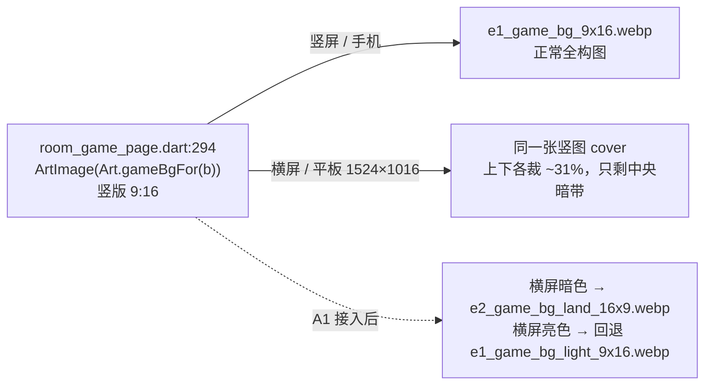
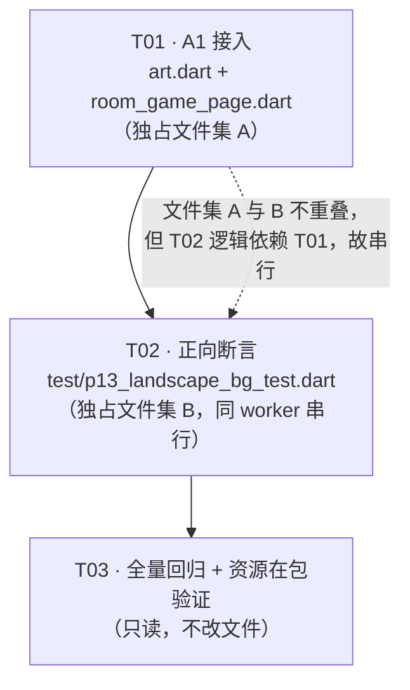

# P13 · UI 素材「已生成但未接入」全量审查与增量设计

> 审查基线：`pubspec.yaml` `version: 2.26.0+96`（`lib/app_version.dart` 同步）
> 审查性质：**只读审查 + 增量设计**。本次**未修改任何源码 / 配置 / 图片 / 测试文件**，仅新增本报告。
> 审查人：架构师 高见远（software-architect）
> 结论速览：**74 项待裁决 → 需要接入 1 项（A1），不接 73 项**。三层差集中「差集 B = 0」，即主理人担心的「声明缺失导致接不上」**不成立**。

---

## 一、方法与实证（可复现）

### 1.1 实读的资料（非凭猜测）

| 资料 | 路径 | 用途 |
| - | - | - |
| 工程素材 106 文件 | `assets/images/` | 差集 B / C 的被查集合 |
| 资源单一真源 | `lib/ui/art.dart`（312 行，全文实读） | 71 个精确常量 + 5 个动态模板 + 21 个方法 |
| 资源声明 | `pubspec.yaml:66-78` | 12 个目录，已覆盖 106 文件所在全部目录 |
| 原始素材包 | `ui_assets/`（成图 119 张，`_raw/_atlas/_preview/_legacy` 已排除） | 差集 A 的源集合 |
| 逐文件清单 | `ui_assets/manifest.csv`（103 行） | 尺寸 / 字节数 / alpha，用于体积与缺陷裁决 |
| 规格表 | `ui_asset_plan.md`（A–F 六组 58 项） | 落点线索；**行号为 2026-11-08 版本，已全部复核并标注漂移** |
| 素材包说明 | `ui_assets/README.md` | 已知偏差（黄斑 / >800KB / E15、F7 改代码绘制） |
| 旧接入报告 | `ui_integration_report.md`（2026-11-10） | **仅作线索**，第五节「还没接的」已过时，逐条用当前代码复核 |
| 项目长期约定 | `.workbuddy/memory/MEMORY.md` + `2026-11-11.md` + `2026-11-12.md` | 硬约束、P12 去 emoji、P9「小图标一律矢量」、历史坑 |
| 全部代码 | `lib/**/*.dart` 203 个 + `test/**/*.dart` 161 个（全量读入脚本） | 调用点实证 |

### 1.2 三层差集怎么算的

**归一化口径**：源包多为 `.png`、工程已转 `.webp`，且工程后续补了 `_light_` 亮色版。故一律用「相对路径去掉扩展名」(`stem`) 做集合键，避免扩展名差异造成假差集。生产中间件目录 `_raw/`、`_atlas/`、`_preview/`、`_legacy/` 从源集合剔除（它们本来就不该进包）。

**命令 1 · 差集 A**（源包成图 → 工程包）

```bash
python - <<'PY'
import os,re
ENG="C:/Users/60965/WorkBuddy/2026-10-08-18-34-17/dice-realm"
SRC="C:/Users/60965/WorkBuddy/2026-11-08-13-25-14/ui_assets"
def relfiles(root):
    return sorted(os.path.relpath(os.path.join(dp,fn).replace('\\','/'),root).replace('\\','/')
                  for dp,dns,fns in os.walk(root) for fn in fns)
eng=relfiles(ENG+"/assets/images")
src=[r for r in relfiles(SRC) if r.lower().endswith(('.png','.webp','.jpg'))
     and not r.split('/')[0].startswith('_')]
stem=lambda p: re.sub(r'\.(png|webp|jpg|jpeg)$','',p,flags=re.I)
A=sorted(set(map(stem,src))-set(map(stem,eng)))
PY
```

**命令 2 · 差集 B**（工程 106 文件 → `art.dart` 声明）

```bash
python - <<'PY'
import re,os
art=open(ENG+"/lib/ui/art.dart",encoding='utf-8').read()
lits=re.findall(r"'assets/images/([^']+)'",art)
declared={l for l in lits if '$' not in l}                 # 精确常量
dyn_dirs={l.split('$')[0] for l in lits if '$' in l}      # die()/icon()/wizardIcon()/badge()/shareState() 的目录模板
B=[p for p in eng if p not in declared and not any(p.startswith(d) for d in dyn_dirs)]
PY
```

**命令 3 · 差集 C（最关键）**（`art.dart` 声明 → `lib/` 真实渲染）

```bash
python - <<'PY'
# ① 逐行去掉 // 注释后，统计 lib/（排除 art.dart）里所有 Art.<token>
#    —— 必须去注释：random_create_page.dart:24 的 `Art.icon('reroll')` 只是注释
# ② 把 token 还原成文件路径：
#    · 常量名           → 该常量路径
#    · xxxFor(b)        → pick(dark,light,b) 展开成两张（appBgFor 是三元实现，人工补登记）
#    · ruleCardFor(id,b)→ _ruleCards 表 6 张 g_rules
#    · banner(d,l,b)    → 实参是调用点直接引用的 bannerXxx 常量，已在 ① 计入
# ③ 补上绕过 Art 的硬编码：room_panel_kit.dart:194 'assets/images/icons/$pngIcon.png'
#    → 全库仅 2 处实参，都形如 'dice/${_dicePngOf(e)}'（gp_dice_bar.dart:207,410）
#    → _dicePngOf 覆盖 d4/d6/d8/d10/d12/d20/d100 共 7 张，hidden.png 不在内
# ④ rendered = 上述路径集合；unrendered = 工程 106 文件 − rendered
PY
```

**交叉验证**（防止「定义 ≠ 调用」的误判）：
- `art.dart` 内 `assets/images/` 字面量出现 **79** 次 → 去重后 **71 个唯一精确路径 + 5 个动态模板目录**（3 次重复来自 `stageSets` 内联路径与 `bannerValhalla*`/`homeBannerValhalla*` 同路径）。主理人侦察的「去重 72 个资源字面量」是 `grep` 口径，差异来自去重与模板字符串，**结论一致：绝大多数只是常量定义，定义 ≠ UI 调用**。
- `lib/` 其余 203 个 dart 文件里，直接硬编码 `assets/images/` 字面量**仅 1 处**（`room_panel_kit.dart:194` 的 `'assets/images/icons/$pngIcon.png'`）。
- 全库 `Icons.` 出现 **306** 次；`Art.icon/wizardIcon/badge/shareState` 去注释后真实调用 **0** 次；`EmptyState(` 14 处、`HairLine`/`StatTile`/`_StepBar` 均为代码绘制。
- `test/` 里 `Art.*` 仅 4 种（`bannerRoomLight` / `rippedStamp` / `sectionAdventure` / `sectionArchiveLight`），`gameBg|e1_game_bg|appBgFor|sheetHeaderFor` **0 命中** → 接入 A1 不需要改任何既有断言。

### 1.3 计数结果

| 层 | 计算 | 结果 |
| - | - | - |
| 工程 `assets/images/` | `find ... -type f \| wc -l` | **106** |
| 源包成图（排除中间件） | `find ... -name '*.webp' -o -name '*.png' \| grep -v /_(raw\|atlas\|preview\|legacy)/ \| wc -l` | **119** |
| **差集 A** | 源包有 / 工程无 | **24**（另反向「工程新增」11：亮色版 3 + `g_rules` 6 + `banner_cards` 2） |
| `art.dart` 字面量 | 精确常量 / 动态模板 | **71 / 5**（模板覆盖 `icons/{dice,wizard,general,badge,share}/`） |
| **差集 B** | 工程素材未声明 | **0**；反向「声明了但磁盘无文件」也 **0**（零断链） |
| `lib/` 去注释后 `Art.<token>` | 种类 / 总次数 | **33 种 / 37 次** |
| **差集 C** | 已渲染 / 未渲染 | **56 / 50**（未渲染按目录：icons 28、e_game 11、b_card 4、a_home 2、f_common 3、c_wizard 1、d_lobby 1） |
| 待裁决总数 | 差集 A 24 + 差集 C 50（B 为 0，不产生待裁决项） | **74** |

> **两个必须纠正的直觉**：
> 1. **差集 B = 0** —— 106 个素材全部已在 `art.dart` 声明（含 `icons/*` 通过 5 个动态模板覆盖），「声明缺失 = 一定接不上」不成立。真正的问题是「声明了但没渲染」。
> 2. **51 个常量零 `Art.x` 直接引用 ≠ 51 个孤儿** —— 其中 24 个经 `*For(b)`/`pick()` 间接渲染、6 个经 `ruleCardFor` 渲染、2 个是同路径冗余常量（`bannerValhalla*` 与 `homeBannerValhalla*` 指向同一文件）。逐层展开后真未渲染为 **50 个文件**。

### 1.4 规格表落点行号复核（已全部漂移）

| 规格表写的落点 | 当前真实位置 | 说明 |
| - | - | - |
| `home_page.dart:132 _HomeHeader` | `home_page.dart:58` sliver → `:548-675` | `_HomeHeader` 现在是纯文字 + 矢量菜单图标，无头图 |
| `home_page.dart:343-450 _CharacterTile` | 组件已迁走；`roster_page.dart:172-225 _RosterCard` | 且已铺 `artDecoration(Art.cardFaceFor(b))` |
| `home_page.dart:92 / :113 EmptyState` | `roster_page.dart:127-132 / :150-155` | 已传 `art: Art.emptyCards / Art.emptyValhalla` |
| `summary_card.dart:335-369 _Avatar` | `summary_card.dart:431-475` | 已接 `Art.avatarDefault` + 代码金框 |
| `create_flow_page.dart:202 _StepBar` | `create_flow_page.dart:452-521` | 已是代码绘制的 9 段渐变三态进度条 |
| `ai_create_page.dart:1049-1090 _candidatesCard` | 该方法已不存在；候选卡在 `random_create_page.dart:305-316` | 直接渲染 `SummaryCard`，**没有「未翻开卡背」层** |
| `room_entry_page.dart` D1 头图 | `room_entry_page.dart:581-600` | **已重新接入**，高度克制为 48px，并有历史坑注释 |
| `gp_map_stage.dart:259-309` | `gp_map_stage.dart:268-324` | 「KP 上传素材 / 纯色+代码边框+文字占位」两态，无默认场景图层 |
| `room_panel_kit.dart:354-396 RoomSheet` | `room_panel_kit.dart:465-521` | 已接 `Art.sheetHeaderFor(b)`（`opacity: 0.55`） |

---

## 二、★ 未接入素材总表

**裁决口径代号**（对应任务书第四节）：

| 代号 | 理由 |
| - | - |
| R1 | 该位置已被**矢量 Material Icons / 代码绘制**替代且效果更好（P12 已把全 App 113 处 emoji 换成矢量图标；P9 明确「小图标一律矢量，别再试 AI」） |
| R2 | 素材图内烧了边框 / 竖线 / 文字，会重现 v2.23.0 已修的 bug（硬约束 3：唯一边框由 App 画；prompt 必须 NO TEXT） |
| R3 | 会动 `lib/ui/room/**` 的布局骨架 / 需新增交互层或改动 Stack 结构与上传覆盖优先级（硬约束 1） |
| R4 | P2 打磨项、性价比低，或与现有视觉重复 |
| R5 | `_raw/`/`_atlas/`/`_legacy/`/`_preview/` 生产中间件（本次已在差集 A 计算时剔除，不进总表） |
| R6 | 素材本身有已知缺陷（卡背 >800KB、`icons/dice/*` 黄斑、旧版烧字 / 带框 / 圆角半透明） |
| R7 | 旧版 / 已被后续迭代**换规格的图**替代（同用途工程已用另一张） |
| R8 | 往滚动列表顶部塞装饰图，会把功能区顶出首屏（旧报告四·2 真实事故，硬约束 4·2 一律判否） |
| R9 | 当前 UI **压根没有这一层**（无卡背态、无默认场景图层），接入 = 新增功能而非「把现成图接到已有组件」 |

### 2.1 差集 A：24 项（源包成图，**根本没进工程包**）

> 共同实证：`lib/` + `test/` 全文对这 24 个文件名字面提及 **0/24**；即代码里既无引用也无占位，`art.dart` 亦无对应常量。接入前还需先把 PNG 转 WebP 拷进 `assets/images/`（目录已在 `pubspec.yaml` 声明，无需改配置，但会产生包体增量）。

| 素材路径 | 差集 | 当前该位置 UI 是什么 | 裁决 | 理由 | 落点文件:行号 | 风险 | 优先级 |
| - | - | - | - | - | - | - | - |
| `a_home/a4_home_banner_valhalla_1x1.png` | A | 工程已用 `a_home_banner_valhalla_2x1.webp`（方角全出血、无字），App 在左侧叠 `Text` 标题/张数 | 不接 | **R7+R6**：1:1 画布 + 烧「英灵殿」三字；P11 已统一改成 2:1 无字版，两张入口同套叠字 | `home_page.dart:294-304`（规格表 `:106` 已漂移） | 覆盖回去会破坏左侧文字安全区 | P2 |
| `b_card/b9_ripped_overlay_3x4.png` | A | `card_detail_page.dart` 已有 `ArtImage(Art.rippedStamp)` + 代码提示条「这名调查员已经死亡…」 | 不接 | **R2+R4**：半透明焦痕蒙版会压正文可读性；P2 打磨项 | `card_detail_page.dart:209,351`（旧行号） | 遮挡动态文案 | P2 |
| `b_card/b10_stat_tile_2x1.png` | A | `StatTile` = `BoxDecoration(color: surface2, borderRadius, border: Border.all)` 代码绘制 | 不接 | **R1+R2**：图内「细金边」与 App 唯一边框重复；HP/SAN/MP 三色由代码叠 | `widgets.dart:334-408` | 双边框 | P2 |
| `c_wizard/c3_progress_seg_dark_3x1.png` | A | `_StepBar` 代码画 9 段 `LinearGradient(gold→goldStr)` + 发光 + 未达段 `surface3` | 不接 | **R1+R4**：分段已在代码里，12:1 底纹与 9 段对不齐 | `create_flow_page.dart:452-521` | 分段错位 / 压点击热区 | P2 |
| `c_wizard/c3_progress_seg_light_3x1.png` | A | 同上 | 不接 | **R1+R4**：同上 | 同上 | 同上 | P2 |
| `c_wizard/c5_random_backs/b3_crimson_3x4.png` | A | `random_create_page.dart:306` 直接渲染 `SummaryCard`（卡面 + 动态文案），**没有「未翻开卡背」层** | 不接 | **R9+R6+R2**：851KB；B3 同系列带金边 | 规格表 `ai_create_page.dart:1049-1090` 方法已不存在 | 需新增交互态；5 张合计 4.56MB | P1 |
| `c_wizard/c5_random_backs/b3_gold_3x4.png` | A | 同上 | 不接 | **R9+R6+R2**：904KB | 同上 | 同上 | P1 |
| `c_wizard/c5_random_backs/b3_indigo_3x4.png` | A | 同上 | 不接 | **R9+R6+R2**：962KB | 同上 | 同上 | P1 |
| `c_wizard/c5_random_backs/b3_teal_3x4.png` | A | 同上 | 不接 | **R9+R6+R2**：859KB | 同上 | 同上 | P1 |
| `c_wizard/c5_random_backs/b3_violet_3x4.png` | A | 同上 | 不接 | **R9+R6+R2**：986KB | 同上 | 同上 | P1 |
| `c_wizard/c6_ai_result_face_3x4.png` | A | `_resultCard` 用 `SummaryCard`；卡面底纹在 v2.23.0 已由「带框 AI 图」换成代码生成的纯色径向渐变 | 不接 | **R7+R2**：B1 派生图，B1 已因「图内烧左右两道金色竖线 + 内框 + 四角花纹」被撤换 | `ai_create_page.dart:1170-1200` | 重现 v2.23.0 竖线 bug | P1 |
| `c_wizard/c8_rule_card_2x1.png` | A | 规则选择页已用 `Art.ruleCardFor(id, b)` → `g_rules/` 6 张（暗/亮各 3） | 不接 | **R7**：工程后续新增了整套规则卡面，此图为旧版通用底 | `rule_pick_page.dart:251` | 已被替代 | P2 |
| `d_lobby/d3_room_code_plaque_3x1.png` | A | 房间号是 App `Text` 动态渲染（`createdCode` 6 位） | 不接 | **R3+R4**：落点在 `room/**`；P2 铭牌 | `room_entry_page.dart:60`、`room_lobby_page.dart:61`（旧行号） | 动房间 UI | P2 |
| `d_lobby/d5_save_slot_3x1.png` | A | 「续玩」区在 `room_entry_page.dart` 的 `ListView` children 内 | 不接 | **R3+R8**：存档槽在滚动列表里，加装饰图会重演「续玩看不见」 | `room_entry_page.dart:72,78`（旧行号） | **历史事故复发** | P2 |
| `d_lobby/d6_start_button_3x1.png` | A | `FilledButtonTheme` 代码绘制（渐变 + 圆角 + 描边两态） | 不接 | **R1+R4**：README 明确 F7 按钮底纹改代码绘制「比 AI 出图更可控」 | `theme.dart:161,172` | 与主题按钮冲突 | P2 |
| `e_game/e13_notice_3x1.png` | A | `room_notice_overlay.dart` 已是居中 2 秒自消的半透明 `inverseSurface` 胶囊 + `IgnorePointer` | 不接 | **R3+R4**：`room/**`；加图会提高对比度盖住底下面板 | `room/ui/room/widgets/room_notice_overlay.dart:39-99` | 遮挡 | P2 |
| `e_game/e14_combat_strip_6x1.png` | A | `GpCombatStrip` 轮次条是 P10 第 7 期代码新增（`initiativeText`），`gp_combat_list.dart` 代码绘制 | 不接 | **R3+R4**：`room/**` 布局骨架冻结 | `room_game_page.dart:128` | 动房间 UI | P2 |
| `e_game/e15_sketch_paper_1x1.png` | A | `gp_pl_sketch.dart` / `gp_pl_notes.dart` 用代码生成的淡噪点 + 方格平铺纹理 | 不接 | **R1**：README 明确「为保证无缝平铺，改用代码生成，不是 AI 出图」 | `widgets/gp_pl_sketch.dart` 等 | 平铺接缝 | P2 |
| `e_game/e18_privates_3x4.png` | A | `gp_privates.dart` / `gp_feeds.dart` 为代码面板 + 文字 | 不接 | **R3+R4**：`room/**`；低对比信笺会压文字可读性 | `widgets/gp_privates.dart` | 动房间 UI | P2 |
| `f_common/f2_sheet_header_danger_16x9.png` | A | `RoomSheet` 头部已统一 `Art.sheetHeaderFor(b)` 一张覆盖 18 个弹层（opacity 0.55） | 不接 | **R4**：P2 分类变体；每张 ~711KB，三张 ~2.1MB | `room_panel_kit.dart:494-512` | 包体 / 视觉重复 | P2 |
| `f_common/f2_sheet_header_kp_16x9.png` | A | 同上 | 不接 | **R4**：同上（734KB） | 同上 | 同上 | P2 |
| `f_common/f2_sheet_header_scene_16x9.png` | A | 同上 | 不接 | **R4**：同上（706KB） | 同上 | 同上 | P2 |
| `f_common/f7_button_filled_3x1.png` | A | `FilledButtonTheme` / `OutlinedButtonTheme` 代码绘制 | 不接 | **R1**：README 明确「9-patch 代码绘制，比 AI 出图更可控」 | `theme.dart:161,172` | 与主题冲突 | P2 |
| `f_common/f7_button_outlined_3x1.png` | A | 同上 | 不接 | **R1**：同上 | 同上 | 同上 | P2 |

### 2.2 差集 C：50 项（已在包、已声明，但**全库零渲染**）

| 素材路径 | 差集 | 当前该位置 UI 是什么 | 裁决 | 理由 | 落点文件:行号 | 风险 | 优先级 |
| - | - | - | - | - | - | - | - |
| `a_home/a2_home_header_3x1.webp` | C | `_HomeHeader` = 纯文字「骰境TRPG / COC 7th / 副标题 / 版本号」+ 矢量 `PopupMenuButton`，位于 `CustomScrollView` 第一个 sliver | 不接 | **R8+R4**：3:1 头图在 760dp 限宽下约 253px，会把四宫格入口顶出首屏（与 D1 事故同构）；且标题已有文字层 | `home_page.dart:58`、`:548-675` | **首屏入口被挤出 / ListView 懒加载** | P1 |
| `a_home/a3_section_header_6x1.webp` | C | 首页两个分类头已用 `sectionAdventureFor` / `sectionArchiveFor`，规则页用 `sectionAdventureFor`，名册页用 `sectionArchiveFor` | 不接 | **R7+R4**：通用分区头已被两张专用分区头替代，无第三处落点 | `home_page.dart:150-154,273-277` | 视觉重复 | P2 |
| `b_card/b2_card_tile_6x1.webp` | C | `_RosterCard` 已铺 `artDecoration(Art.cardFaceFor(b), opacity 0.34/0.28)` + 代码 `Border.all` | 不接 | **R4+R2+R1**：底纹重复；图内「左侧金竖线」正是 v2.23.0 被撤换的 bug 形态 | `roster_page.dart:197-214` | **双边框 / 竖线复发** | P1 |
| `b_card/b3_card_back_3x4.webp` | C | 一键出卡候选卡直接 `SummaryCard`（`random_create_page.dart:306`）；`Art.cardBackFor(b)` 全库 **0 调用** | 不接 | **R9+R2**：当前设计是「直接展示卡面内容」，没有「未翻开卡背」交互态；B3 规格写明「金边」，与硬约束 3 冲突 | `random_create_page.dart:305-316` | 需新增交互态，超出范围 | P1 |
| `b_card/b3_card_back_light_3x4.webp` | C | 同上 | 不接 | **R9+R2**：同上 | 同上 | 同上 | P1 |
| `b_card/b5_avatar_frame_1x1.png` | C | `_Avatar` = 代码 `LinearGradient` 底 + `border: Border.all(gold@0.45)` + `borderRadius: 8` + `ArtImage(Art.avatarDefault)` + 首字兜底 | 不接 | **R1+R2**：已有代码金框；「金色圆环 + 四角星芒」与圆角方头像形状冲突，且叠第二层边框 | `summary_card.dart:440-473` | 双边框 / 40×40 小头像被压 | P0 |
| `c_wizard/c3_wizard_progress_12x1.webp` | C | `_StepBar` 代码画 9 段：完成段金色渐变 + 发光、未达段 `surface3`，每段 `Key('step_jump_$i')` 可点跳转 | 不接 | **R1+R4**：三态动态着色已由代码完成且带交互 Key；12:1 图内分段与 9 段无法对齐 | `create_flow_page.dart:452-521` | 压 `step_jump_$i` 热区 / 测试 | P1 |
| `d_lobby/d4_lobby_seat_3x4.webp` | C | `room_lobby_page.dart` 成员行（P12 已改 `hasCardVitals` 判据）+ `AvatarDot` 代码圆点 | 不接 | **R3**：`room/**` 布局骨架冻结 | `room_lobby_page.dart:95`（旧行号） | 动房间 UI | P1 |
| **`e_game/e2_game_bg_land_16x9.webp`** | **C** | `room_game_page.dart:294` 用 `Art.gameBgFor(b)` **竖版 9:16** 图 `BoxFit.cover` 铺满整个页面；横屏/平板时上下各裁约 31%，只剩中央暗带 | **★ 需要接入（A1）** | 唯一同时满足四条判据：① 现成落点 `:294` 的 `ArtImage`；② 只换 `path` 实参、不动 Stack children / 槽位 / gap / 档位；③ `test/` 零背景断言，可补更强正向断言；④ 素材为纯渐变、无框无字（10.7KB） | `art.dart:158` + `room_game_page.dart:265,294` | 亮色横版缺失（有回退方案）；判据边界差异（见 §4） | **P0** |
| `e_game/e3_stage_default_16x9.webp` | C | `gp_map_stage.dart:268-324` = 「KP 上传素材 `_coverImage` → 无素材时 `ColoredBox` 纯色 + 代码 `Border.all` + 纯 `Text` 占位」两态；`Art.stageSets` 全库 **0 调用** | 不接 | **R3+R9**：没有「默认场景图」这一层；接图要改 Stack 结构与「上传素材覆盖优先级」，且 P10 第 7 期刚修过「上层 Container 盖住底图」的真 bug | `gp_map_stage.dart:268-324` | **重现底图被遮盖 bug** / 动房间 UI | P0 |
| `e_game/e4_stage_cellar_16x9.webp` | C | 同上 | 不接 | **R3+R9**：`stageSets` 零调用，无场景切换入口 | 同上 | 同上 | P1 |
| `e_game/e4_stage_coast_16x9.webp` | C | 同上 | 不接 | **R3+R9**：同上 | 同上 | 同上 | P1 |
| `e_game/e4_stage_forest_16x9.webp` | C | 同上 | 不接 | **R3+R9**：同上 | 同上 | 同上 | P1 |
| `e_game/e4_stage_library_16x9.webp` | C | 同上 | 不接 | **R3+R9**：同上 | 同上 | 同上 | P1 |
| `e_game/e4_stage_street_16x9.webp` | C | 同上 | 不接 | **R3+R9**：同上 | 同上 | 同上 | P1 |
| `e_game/e5_stage_empty_1x1.png` | C | 舞台空态是 `Center(Text('暂无公开素材 · 点左栏「上传素材」'))`，带 `GpMapStageKeys.empty` | 不接 | **R3+R1**：`room/**`；插画会挤压文字占位；P12 全 App 空态已统一矢量图标 / 专用 `art` 插画 | `gp_map_stage.dart:315-324` | 动房间 UI / 压 Key 断言 | P1 |
| `e_game/e10_kp_tools_3x4.webp` | C | `gp_kp_tools.dart` 面板（P10 第 6 期横屏重排后骨架冻结） | 不接 | **R3**：`room/**` 布局骨架 | `widgets/gp_kp_tools.dart:34-56`（旧行号） | 动房间 UI | P1 |
| `e_game/e12_pl_char_card_3x4.webp` | C | `gp_pl_char_card.dart` 已接 `Art.avatarDefault` 系头像 + 代码面板；P10 第 7 期修过「未绑卡」占位 | 不接 | **R3**：`room/**` 布局骨架 | `widgets/gp_pl_char_card.dart:48-74`（旧行号） | 动房间 UI | P1 |
| `e_game/e17_scene_check_3x2.webp` | C | `gp_scene_check_kp.dart` / `gp_scene_check_pl.dart` 代码面板 | 不接 | **R3+R4**：`room/**`；P2 | `widgets/gp_scene_check_*.dart` | 动房间 UI | P2 |
| `f_common/f3_state_loading_1x1.png` | C | `ai_create_page.dart:1001` 已用 `Art.aiLoading`；`EmptyState` 的 `icon` 参数走矢量图标 | 不接 | **R1+R4**：加载插画已有专用图 + 矢量图标体系 | `widgets.dart:418-479` | 视觉重复 | P1 |
| `f_common/f4_state_empty_1x1.png` | C | 全库 `EmptyState(` 14 处，`art:` 已给 A5/A6 专用插画，其余走 `icon: Icons.*` | 不接 | **R1**：P12 明确「矢量图标缩放不糊、零资源体积」；用户第 9 期要求「像素小的直接画矢量图别用 AI」 | `widgets.dart:418-479` | 倒退到 AI 位图 | P1 |
| `f_common/f6_divider_3x1.webp` | C | `HairLine` = `Divider(height:1, thickness:1, color: Palette.border)` 代码线 | 不接 | **R1+R4**：金色纹理线会与代码分隔线重复，且 `HairLine` 被多处 `SectionCard` 复用，改动面大 | `widgets.dart:538-551` | 双线 | P1 |
| `icons/dice/hidden.png` | C | 暗骰开关用 `RoomTap(icon: IconData)`；`pngIcon` 全库仅 2 处且都是 `'dice/${_dicePngOf(e)}'`，`_dicePngOf` 只返回 d4/d6/d8/d10/d12/d20/d100 | 不接 | **R1+R6**：暗骰已有矢量图标；`icons/dice/*` 已知轻微黄斑 | `gp_dice_bar.dart:71-77,207,410` | 引入脏像素 | P2 |
| `icons/general/check.png` | C | 全库 `Icons.` 306 处矢量图标 | 不接 | **R1**：`Art.icon()` 真实调用 0 | 无落点 | — | P2 |
| `icons/general/close.png` | C | 同上 | 不接 | **R1**：同上 | 无落点 | — | P2 |
| `icons/general/collapse.png` | C | 同上 | 不接 | **R1**：同上 | 无落点 | — | P2 |
| `icons/general/copy.png` | C | 同上 | 不接 | **R1**：同上 | 无落点 | — | P2 |
| `icons/general/export.png` | C | 同上 | 不接 | **R1**：同上 | 无落点 | — | P2 |
| `icons/general/import.png` | C | 同上 | 不接 | **R1**：同上 | 无落点 | — | P2 |
| `icons/general/online.png` | C | 同上 | 不接 | **R1**：同上 | 无落点 | — | P2 |
| `icons/general/refresh.png` | C | 同上 | 不接 | **R1**：同上 | 无落点 | — | P2 |
| `icons/general/settings.png` | C | 同上 | 不接 | **R1**：同上 | 无落点 | — | P2 |
| `icons/general/share.png` | C | 同上 | 不接 | **R1**：同上 | 无落点 | — | P2 |
| `icons/general/signal.png` | C | 同上 | 不接 | **R1**：同上 | 无落点 | — | P2 |
| `icons/general/spectator.png` | C | 同上 | 不接 | **R1**：同上 | 无落点 | — | P2 |
| `icons/share/shared.png` | C | `share_panel.dart` 三态用矢量图标 + 代码卡片 | 不接 | **R1+R4**：`Art.shareState()` 真实调用 0；P2 三态插画 | `share_panel.dart:144,183,230`（旧行号） | — | P2 |
| `icons/share/unconfigured.png` | C | 同上 | 不接 | **R1+R4**：同上 | 同上 | — | P2 |
| `icons/share/unshared.png` | C | 同上 | 不接 | **R1+R4**：同上 | 同上 | — | P2 |
| `icons/wizard/assets.png` | C | 9 步向导进度条 / 侧栏用矢量图标 + 文字 | 不接 | **R1**：`Art.wizardIcon()` 真实调用 0 | `wizard_steps.dart:186-280`（旧行号） | — | P1 |
| `icons/wizard/attrs.png` | C | 同上 | 不接 | **R1**：同上 | 同上 | — | P1 |
| `icons/wizard/background.png` | C | 同上 | 不接 | **R1**：同上 | 同上 | — | P1 |
| `icons/wizard/basics.png` | C | 同上 | 不接 | **R1**：同上 | 同上 | — | P1 |
| `icons/wizard/combat.png` | C | 同上 | 不接 | **R1**：同上 | 同上 | — | P1 |
| `icons/wizard/gear.png` | C | 同上 | 不接 | **R1**：同上 | 同上 | — | P1 |
| `icons/wizard/rules.png` | C | 同上 | 不接 | **R1**：同上 | 同上 | — | P1 |
| `icons/wizard/skills.png` | C | 同上 | 不接 | **R1**：同上 | 同上 | — | P1 |
| `icons/wizard/summary.png` | C | 同上 | 不接 | **R1**：同上 | 同上 | — | P1 |
| `icons/badge/b6_badge_coc7.png` | C | 规则徽标位置用代码 `Pill` / 矢量盾形 + 文字 | 不接 | **R1+R4**：`Art.badge()` 真实调用 0；P1 徽标 | `step_rules.dart:40`（旧行号） | — | P1 |
| `icons/badge/b7_badge_locked.png` | C | 「（未开放）」灰化由代码 `RuleRegistry.placeholders` 控制 | 不接 | **R1+R4**：同上 | `step_rules.dart:62`（旧行号） | — | P2 |
| `icons/badge/c9_egg_badge.png` | C | 彩蛋角标用代码 `Pill` / 矢量星 | 不接 | **R1+R4**：同上 | `summary_card.dart:117-126`（旧行号） | — | P2 |

> 备注：`icons/dice/` 共 8 张，其中 **7 张已渲染**（`d4/d6/d8/d10/d12/d20/d100` 经 `room_panel_kit.dart:194` 的 `pngIcon` 硬编码路径接入），仅 `hidden.png` 未渲染。这条**绕过了 `Art` 单一真源**，见 §6 共享知识。

---

## 三、接入必要性结论

### 3.1 需要接入（编号 A1，与「差集 A」无关）

| 编号 | 素材 | 差集 | 一句话理由 |
| - | - | - | - |
| **A1** | `assets/images/e_game/e2_game_bg_land_16x9.webp`（`Art.gameBgLand`，横屏 16:9 背景） | C | 工程已支持横屏 / 平板多列（`RoomGridSpec.of(..., landscape)`），但背景**只有竖版 9:16**，`BoxFit.cover` 在 1524×1016 平板横屏下上下各裁约 31%、只剩中央暗带；横版图是 E1 的横向重排版（纯渐变、无框无字、10.7KB），给**已有** `ArtImage` 换 `path` 即可补齐，零布局改动。用户点名的荣耀平板 GT2 Pro 正是横屏 1524×1016dp。 |

**仅此 1 项。** 其余 73 项均判「不接」。

### 3.2 「不接」汇总统计

| 分组 | 不接数 | 主要理由分布 |
| - | - | - |
| 差集 A（未进包，24 项） | 24 | R7 旧版被替代 3；R9 无对应层 7；R1 代码绘制 6；R3 room/** 5；R4/R6/R2 其余 3 |
| 差集 C（在包未渲染，扣除 A1 后 49 项） | 49 | R1 矢量图标/代码绘制 **35**（icons 28 + b2/b5/c3/f3/f4/f6/a3_section_header 7）；R3/R9 room/** 11；R8 1（a2）；R9 卡背 2 → **35+11+1+2 = 49**，另 1 项为 A1 |
| **合计** | **73** | — |

**理由命中数（含交叉，按主因归类；一项常同时命中多条，加总不必等于 73，例如 C5 五张卡背同时命中 R9/R6/R2）**：

| 主因 | 命中项数 | 说明 |
| - | - | - |
| R1 已被矢量 Material Icons / 代码绘制替代 | **35** | 最大一类：28 张图标 + 7 处组件；P12 去 emoji + P9「小图标一律矢量」是明确的项目决策 |
| R3 会动 `lib/ui/room/**` 布局骨架 | **16** | 11 个差集 C + 5 个差集 A；硬约束 1 |
| R9 当前 UI 压根没有这一层 | **9** | 5 张随机卡背 + B3 卡背 2 + 场景图默认层 2；接入等于新增功能 |
| R7 已被后续迭代换规格的图替代 | **4** | A4 英灵殿 1:1、C6 结果卡面、C8 规则卡底、A3 通用分区头 |
| R2 图内烧边框/竖线/文字 | **3** | B2 列表条、B10 数值块、B5 头像框（会重现 v2.23.0 bug） |
| R8 往滚动列表顶部塞装饰图 | **2** | A2 首页头图、D5 存档槽（旧报告四·2 真实事故） |
| R6 素材本身缺陷（>800KB / 烧字 / 黄斑） | **3** | C5 五张卡背、A4、hidden.png |
| R4 P2 打磨 / 视觉重复 | 余量 | 分散在上表各行 |

> **对用户那句「还有生成图没接入」的直接回答**：确实有 74 项「在包或源包里但没渲染」，但**不是漏接**，而是 2.17→2.26 共十余期迭代里被**矢量图标化、代码绘制、换规格、布局冻结**主动淘汰/替代的结果。`ui_integration_report.md` 第五节（2026-11-10）列出的「下一批候选」中，`e1` 背景、`d1` 头图、`c1` 向导头图、`d2` 大厅头图、`f1` sheet 头图、`b3` 之外的多数项**现在都已接入**；剩下的正是本次判定「不需要接」的那批。

---

## 四、增量设计（A1 唯一接入项）

### 4.1 现状与目标



### 4.2 最小 diff 思路（只动 2 个生产文件 + 1 个新测试文件）

**① `lib/ui/art.dart` —— 扩展 `gameBgFor`，默认行为逐字不变**

```dart
// 原（art.dart:158）：
static String gameBgFor(Brightness b) => pick(gameBg, gameBgLight, b);

// 改为（只加可选命名参数，不删不改任何现有常量 / 方法）：
/// 游戏页背景（按皮肤 + 屏幕方向取图）。
///
/// 横屏暗色用 16:9 横版 [gameBgLand]；横屏亮色**尚无横版图**，
/// 按 [pick] 的 `light ?? dark` 精神回退到亮色竖版 [gameBgLight]，
/// 保证亮色皮肤下不会突然出现一块深色底（用户明确提过「黑色补丁」）。
/// [landscape] 默认 false —— 不传时与本方法改前**逐字等价**。
static String gameBgFor(Brightness b, {bool landscape = false}) {
  if (landscape && b == Brightness.dark) return gameBgLand;
  return pick(gameBg, gameBgLight, b);
}
```

> 为什么不动 `Art.gameBgLand` 常量本身：它已在 `art.dart:155` 声明且磁盘有文件（`assets/images/e_game/e2_game_bg_land_16x9.webp`），**差集 B = 0**，无需新增常量、无需改 `pubspec.yaml`（`assets/images/e_game/` 已在 `:71` 声明）。

**② `lib/ui/room/room_game_page.dart` —— 加 1 个局部变量 + 改 1 行实参**

```dart
// build(BuildContext context) 已在 :265；在 :270 后插入（此处能拿到 context）：
final bool landscape =
    MediaQuery.of(context).size.width > MediaQuery.of(context).size.height;

// :292-297 原样保留，只把 :294 的 path 实参换成：
child: ArtImage(
  Art.gameBgFor(Palette.brightness, landscape: landscape),  // ← 唯一改动行
  fit: BoxFit.cover,
),
```

**③ `test/p13_landscape_bg_test.dart`（新增）—— 纯函数正向断言，零 widget 成本**

```dart
// 断言（全部为新增正向断言，不修改任何既有用例）：
expect(Art.gameBgFor(Brightness.dark),  Art.gameBg);            // 默认参数行为不变（回归钉子）
expect(Art.gameBgFor(Brightness.light), Art.gameBgLight);       // 默认参数行为不变
expect(Art.gameBgFor(Brightness.dark,  landscape: true),  Art.gameBgLand);   // 横屏暗色用横版
expect(Art.gameBgFor(Brightness.light, landscape: true),  Art.gameBgLight);  // 横屏亮色回退亮色竖版
expect(Art.gameBgLand, 'assets/images/e_game/e2_game_bg_land_16x9.webp');    // 路径在包内
```

可选加强（不强制）：加一条源码级守卫，断言 `room_game_page.dart` 里 `gameBgFor(` 调用确实带 `landscape:` 实参，防止后续有人改回单参数导致横版永不生效。

### 4.3 亮色 / 暗色双皮肤处理（硬约束 6）

| 场景 | 暗色 `Brightness.dark` | 亮色 `Brightness.light` |
| - | - | - |
| 竖屏（`landscape=false`） | `e1_game_bg_9x16.webp`（不变） | `e1_game_bg_light_9x16.webp`（不变） |
| 横屏（`landscape=true`） | **`e2_game_bg_land_16x9.webp`（A1 新增）** | `e1_game_bg_light_9x16.webp`（**回退**，保持亮色配色一致） |

> `e2_game_bg_land_light_16x9.webp` **不存在**（源包 `manifest.csv` 只有 `e2_game_bg_land_16x9.webp` 一张 10,758 B）。本方案按 `pick(dark, light, b)` 的 `light ?? dark` 精神回退，不新出图、不扩包体。若用户要求亮色横屏也有专属构图，需**另立生图任务**（超出本次「接现成图」范围，见 §7 待明确事项）。

### 4.4 明确「不动哪些东西」（逐条对照硬约束）

| 约束 | 本方案如何满足 |
| - | - |
| ★ 硬约束 1 `room/**` 布局骨架 | **不改任何布局**：`Stack(fit: StackFit.expand)` 的 children 数量 / 顺序 / `Positioned.fill` / `SafeArea` / `LayoutBuilder` / `RoomGridSpec.of` 调用参数**全部逐字不动**；只替换一个 `ArtImage` 的 `path` 实参。不新增 children、不改槽位尺寸、不动 dock/folded 档位判定、不动 `RoomSlot`/`RoomKeys` 命名、不动共用 gap 机制 |
| 硬约束 2 历史坑「滚动列表顶部塞装饰图」 | 不涉及任何 `ListView` / `SliverToBoxAdapter`；A1 改的是页面根 `Stack` 的背景层 |
| ★ 硬约束 3 图内无边框 / NO TEXT | `e2_game_bg_land_16x9.webp` 是 `e1` 的横向重排版纯渐变（10.7KB），无框、无字；不改 `b1/b1_light` 卡面，**绝不覆盖回带框旧图** |
| 硬约束 4 横幅 `titleInsetFor` | 不涉及 `SectionBanner` / 任何横幅素材；`titleInsetFor(width)` 一字不动 |
| ★ 硬约束 5 测试纪律 | 零放宽、零降级、零删用例、零 skip、零恒真；`test/` 里 `gameBg|e1_game_bg|appBgFor` **0 命中** → 既有断言不可能被破坏；新增 4~5 条**正向**断言且可反向证伪（把 `landscape: true` 分支注释掉，第 3 条立即红） |
| 硬约束 6 双皮肤 | 见 §4.3 表；`pick` 回退语义一致 |
| 硬约束 7 不升版本 / 不出包 / 不推 GitHub | 本报告只出设计；版本、出包、推送由主理人收尾 |
| GENERATED FILE / oracle / `FROZEN = 4` | 完全不触碰 `lib/domain/data/*`、`oracle_*`、`test/*` 门禁文件 |

### 4.5 已知边界与风险（如实登记）

1. **判据来源差异**：A1 用 `MediaQuery.of(context).size` 的宽高比判横屏；`RoomGridSpec.of` 在 `SafeArea → LayoutBuilder` 内用 `c.maxWidth > c.maxHeight`。两者在状态栏扣除 / 键盘弹起 / 分屏的极窄边界可能不同向。但**背景图选择不影响任何几何、档位、槽位尺寸**，只影响底图观感，可接受；`RoomGridSpec.of` 的调用参数**不改**，因此不会打红分栏测试。
2. **widget test 默认视口 800×600 是横屏** → 加了 `landscape` 后，房间页相关 widget 测试会走 `e2` 分支。已实证 `test/` 里无任何背景路径断言（0 命中），故不会红；但 QA 全量回归时请留意这一行为变化属预期。
3. **`MediaQuery.of(context)` 依赖**：在 widget test 中 Flutter 框架默认提供 `MediaQuery`，不会抛异常；`room_game_page.dart` 的 `build` 已能拿到 `context`（`:265`）。
4. **不新增资源文件**：`e2` 已在包内且 `pubspec.yaml` 已声明目录，接入零包体增量、零 `flutter pub get`。
5. **冗余常量未清理**：`art.dart` 中 `bannerValhalla*` 与 `homeBannerValhalla*` 指向同一文件（重复声明）。本次**不动**，避免额外文件哈希变化；如要清理应与 A1 合并在同一独占窗口（见 §5）。

---

## 五、有序任务列表（按文件集切分，零重叠）

> **派工纪律（MEMORY.md ★）**：同一批文件只能由一个 worker 动，重叠就串行。本次只有 1 个接入项，生产改动集中在 2 个文件，建议 **T01 + T02 由同一名工程师在一个独占窗口内完成**（T02 断言依赖 T01 新增的方法签名，且可避免两个 worker 同时碰 `art.dart`）。T03 为只读验证，不改任何文件。
> 说明：本次是存量工程的单点增量接入，不适用「新建项目基础设施 + 每任务 ≥3 文件」的通用模板；严格按文件集切分、任务数 ≤5。

| 任务 | 名称 | 文件集（**独占**） | 依赖 | 优先级 | 执行者 | 验收要点 |
| - | - | - | - | - | - | - |
| **T01** | A1 接入：横屏背景取图 | `lib/ui/art.dart`、`lib/ui/room/room_game_page.dart`（2 个生产文件） | — | P0 | Engineer（单 worker 独占） | ① `art.dart` 只改 `gameBgFor` 一处，默认 `landscape=false` 时逐字等价；② `room_game_page.dart` 只加 1 个局部变量 + 改 1 行实参，`:289-297` 其余逐字不动；③ `flutter analyze` 零告警 |
| **T02** | A1 正向断言（更强，非放宽） | 新增 `test/p13_landscape_bg_test.dart`（1 个新文件） | T01（逻辑依赖新方法签名） | P0 | 与 T01 **同一 worker 同一独占窗口** | 4~5 条纯函数断言全绿；反向证伪：注释掉 `landscape && dark` 分支 → 横屏暗色那条立即红，恢复后逐字节一致；既有 2152 组用例一条断言不改 |
| **T03** | 全量回归 + 资源在包验证 | **不改任何文件**（只运行 / 只读比对） | T01 + T02 | P0 | QA | ① 串行全量 `flutter test` 全绿（基线 2152）；② `flutter analyze` 零；③ `unzip -l` 确认 `assets/images/e_game/e2_game_bg_land_16x9.webp` 仍在包内；④ 复核 `pubspec.yaml` / `app_version.dart` / `pubspec.lock` 未被改动（`NO_PROXY` 与 lock 哈希按 MEMORY.md 口径）；⑤ 确认 `lib/ui/room/**` 除 `room_game_page.dart` 那 2 行外无任何文件哈希变化 |



**不在本次任务范围**（明确排除）：升版本号（`pubspec.yaml` / `lib/app_version.dart`）、出 APK、推 GitHub、更新 `_manual_test_checklist.md`、清理 `ui_assets/` 源图、收敛 `RoomTap` 硬编码图标路径、删除 `bannerValhalla*` 冗余常量 —— 全部由主理人另行决策/收尾。

---

## 六、共享知识 / 跨文件约定（工程师实施时必须遵守）

1. **资源路径单一真源**：所有路径只在 `lib/ui/art.dart` 定义；调用点一律 `Art.xxx` / `Art.xxxFor(b)`。**唯一已知例外**是 `room_panel_kit.dart:194` 的 `'assets/images/icons/$pngIcon.png'`（历史遗留，本次不动，但要意识到 `icons/dice/` 的 7 张是经它渲染的，不能用「`Art.die()` 零调用」误判为未接入）。
2. **双皮肤取图**：`Art.pick(dark, light, b)` = `b == Brightness.dark ? dark : (light ?? dark)`；没有亮色版时**必须**显式说明回退目标（A1 横屏亮色回退 `Art.gameBgLight`），不要只接暗色。新增 `*For(b)` 方法时**必须保持旧签名默认行为逐字不变**（用可选命名参数，不删不改原方法）。
3. **`ArtImage` 兜底行为**：缺图 / 解码失败 / 测试环境无 asset bundle 时静默降级（`errorBuilder` + `frameBuilder` 铺 `Theme.of(c).colorScheme.surfaceContainerHighest`），**绝不抛异常**；可选 `fallback` 传矢量图标（不要传 emoji）。`artDecoration()` **无兜底**，调用方必须保证路径存在——A1 的 `e2` 已在包内，满足。
4. **`pubspec.yaml` 已声明 12 个资源目录**（`:66-78`），往**已有目录**加文件无需改配置；只有新增**目录**才要声明，`flutter pub get` 会把 `pubspec.lock` 的 `pub.dev` 改写成镜像，跑完必须逐字节回滚。
5. **美术约定（硬约束 3/4）**：所有素材 prompt 必须 **NO TEXT**（动态文案由 App `Text` 渲染）；**图内不许有任何边框**，唯一边框由 App 画（`b1_card_face*` 旧版带框版绝对不许覆盖回去）；横幅类要求**方角全出血**；`SectionBanner.titleInsetFor(width) = (w*0.05).clamp(18,46)` 不许推翻（左侧星星压字修复）。
6. **`lib/ui/room/**` 冻结项**：布局骨架、`RoomLayoutMode{dock,folded}` 档位判定、`RoomSlot`/`RoomKeys` 命名、共用 `gap` 机制、槽位尺寸、`ListView` children 一律不许改/不许改名。本次 A1 只换背景 `path`，属装饰层，不是布局。
7. **测试纪律**：不许放宽断言、不许把 `findsOneWidget` 降级成 `findsWidgets`、不许删用例、不许 `skip`、不许改恒真；既有用例口径更新只能**更强或等价**。新增断言必须正向且可反向证伪。`lib/domain/data/skills.dart` / `occupations.dart` 是 GENERATED FILE 禁手改；`oracle_*` 逐字节契约不动；门禁 `FROZEN = 4` 不许改大。
8. **环境与构建**：`flutter` / `dart` 命令必须先 `source /d/dev/env.sh`；`flutter test` 必须带 `NO_PROXY=127.0.0.1,localhost,::1`；跑完核 `pubspec.lock` 哈希与 82 处 `pub.dev`。出包给 600s、验三 ABI `libapp.so` 与上一批逐 ABI 不同 —— 但**本次不出包**。
9. **版本与交付**：本次不升版本、不出包、不推 GitHub；`pubspec.yaml` 的 `version:` 与 `lib/app_version.dart` 由主理人收尾时同时改。

---

## 七、待明确事项（需用户 / 主理人拍板）

| # | 问题 | 建议 | 影响 |
| - | - | - | - |
| Q1 | **是否接受动 `lib/ui/room/room_game_page.dart` 的 2 行**（A1 是唯一落在 `room/**` 的接入项）？ | 建议接受：只换 `ArtImage` 的 `path` 实参，零布局改动、零包体增量、可补更强断言 | 若主理人坚持「`room/**` 零改动」，则 **A1 降级为「不接」，本次需要接入 = 0 项**，工程保持 2.26.0 现状、所有素材维持现状即可收尾 |
| Q2 | 亮色横屏背景 `e2_game_bg_land_light_16x9.webp` **未出图**；是否要补一张？ | 本次按 §4.3 回退亮色竖版，不新出图 | 若要补，需另立**生图 + 压缩 + 接入**任务（超出「接现成图」范围），且要重新走双皮肤验证 |
| Q3 | `ui_assets/` 里差集 A 的 24 张源图（含 5 张 >800KB 卡背、3 张 ~710KB 分类头图）是否清理 / 归档？ | 本次不动；它们只是生产中间件，工程包里本来就没有 | 仅磁盘占用，不影响 App |
| Q4 | `art.dart` 中 `bannerValhalla*` 与 `homeBannerValhalla*` **重复声明同一路径**（2 组冗余常量）是否清理？ | 建议**本次不动**（清理会改 `art.dart` 哈希，且无视觉收益）；若决定清理，必须与 T01 合并在**同一独占窗口**内，避免两个 worker 同时改 `art.dart` | 纯代码整洁，无功能影响 |
| Q5 | `RoomTap` 的硬编码 `'assets/images/icons/$pngIcon.png'` 是否收敛回 `Art.die()` / `Art.icon()` 单一真源？ | 建议**本次不动**（属重构，会动 `room_panel_kit.dart` + `gp_dice_bar.dart`，且涉及 `pngIcon` 参数与 2 个调用点，风险 > 收益） | 若收敛，可顺带让 `icons/dice/hidden.png` 有正式落点，但仍与 P12「矢量图标」结论冲突，仍判不接 |
| Q6 | 旧报告 `ui_integration_report.md` 第五节「还没接的（下一批候选）」已过时，是否订正？ | 建议在收尾报告里加一句「以 `_p13_asset_audit.md` 为准」，**不改原报告**（保住历史证据链与哈希） | 文档口径一致性 |

---

## 附：本次审查未做的事（边界声明）

- 未修改任何源码、配置、图片、测试文件；未运行 `flutter pub get` / `flutter test` / 出包 / git 操作。
- 未升版本、未推 GitHub、未更新 `_manual_test_checklist.md`。
- 未对 74 项素材做任何视觉真机比对（截图 / 模拟器）——裁决依据是**代码实证 + 规格表 + 项目约定 + 历史事故记录**；A1 的最终视觉效果建议主理人在出包后按真机清单登记一项（平板横屏暗/亮两套背景观感）。
- 报告中的行号均为 **v2.26.0+96 当前代码**实测值；规格表行号已明确标注「旧行号 / 已漂移」。
