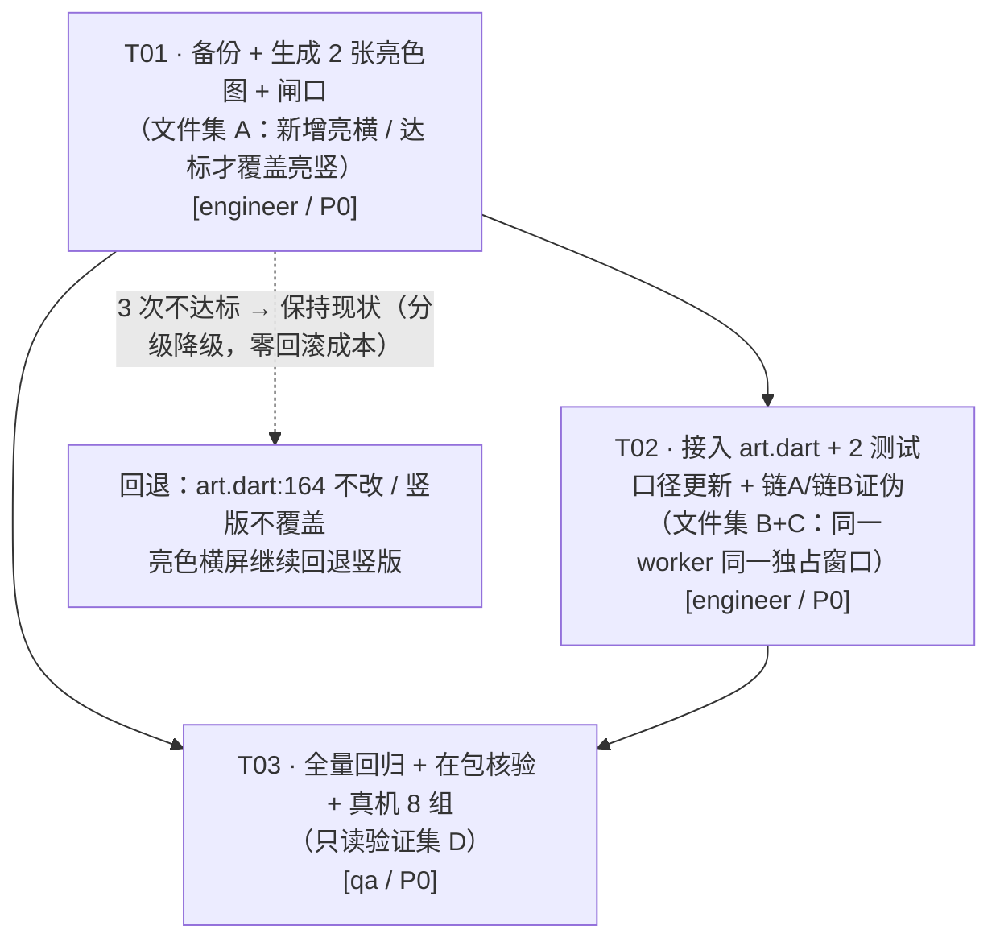

# P15 · 亮色游戏页背景「金色装饰四朝向可见」生图规格（只读 · 供工程师施工）

> 审查基线：`v2.27.0+97`（`pubspec.yaml` / `lib/app_version.dart`），三张既有背景哈希见 §4.4
> 上游输入：`_p14_device_bg_spec.md`（v1.3，安全区 / 配色 / 接入 / 测试口径结论**复用**）、`ui_asset_plan.md` §2.2/§2.4/§2.5、`MEMORY.md:26/36`、主理人 P15 任务书、主理人链路实测与备份基线补充
> 修订：**v1.1** —— 依主理人只读实测补充：① 确认 `post.py fit` 可用（实测暗横 fit 到 640×360 成功、产物 RGB 不透明）、明确禁用 `webp` 子命令；② **新增「原生 Windows Python 不认 MSYS `/tmp`」坑** —— 所有中间文件（AI 原图 / fit 产物 / 证伪备份）一律改用工作区绝对路径，证伪恢复用 Git Bash `cp` + `cmp -s` + `sha256sum`、不用原生 Python；③ 主理人**已完成**三张现有背景的权威备份（工程外、不进包）并给出字节数 + sha 基线，§1.4 的备份 / 回滚随之改为「核验 + 从主理人备份回滚」；④ 补入接口探活（36 模型、flare/sunburst 在列、KEY 有效）、余额端点全 404 需按 1.08 元自行控量、历史尺寸成功率与 `timeout ≥ 420s`。**7 项设计结论与全部裁决不变。**
> 实读复核：`lib/ui/art.dart`（:75-76 / :148-170）、`lib/ui/room/room_game_page.dart:270-325`、`test/p13_landscape_bg_test.dart`（85 行全文）、`test/p13_landscape_bg_wiring_test.dart`（204 行全文）、`pubspec.yaml:64-82`、`ui_asset_plan.md` 全文、`MEMORY.md:18-38`、`tool_img/gen.py`（246 行）/ `post.py`（268 行）
> 审查人：架构师 高见远（Gao / `software-architect`）
> 审查性质：**只读规格设计**。本次**未修改任何源码 / 配置 / 图片 / 测试文件**，仅新增本报告；**未调用生图 API、未生成任何图片、未消耗余额、未写入任何 API KEY 明文**
>
> **★ 与 P14 的关系（先读这段）**：P14 的「不需要新图，0 张」裁决**已由用户明确推翻并作废**。作废的最硬依据是 R-B′（「GT2 Pro 竖屏同样裁掉金饰、用户长期未反馈 → 证明观感影响低」）：用户原话「**我是根本不知道有这个金饰**」——**「未反馈」不能解释为「接受」**。因此本规格**不沿用 P14 的裁决**，只复用其已算好的安全区（§2.3 / §1.4）、配色（§2.5）、接入（Q4 / §2.4.1）、测试口径（§2.4.1）、链路缺陷（§2.6）等**工程结论**，并启用其 §三 / §五 Q3 的**条件分支**。用户新指令的实质诉求：**让这圈金色装饰在两台设备 × 横竖两种朝向下都完整可见**，且明确授权「横屏竖屏都可以补」（不是只补一张横版）。
>
> **★ 只读边界的轮次说明**：硬约束 6「本次只读」约束的是**本轮（P15 规格产出）**。主理人随后转给工程师施工的**施工轮**按 §七 T01~T03 执行（允许调 API、生图、改 `art.dart`/素材/测试）；但**升版本、出包、推 GitHub 仍不在本批次范围**，需主理人另立任务。

---

## 零、裁决速览

| 项目 | 结论 |
| - | - |
| **生成几张图** | **2 张**：① **新增**亮色横屏专属图；② **定向覆盖**亮色竖版图（先备份、给回滚）。不是 1 张、不是 4 张 |
| **① 新增** | `assets/images/e_game/e2_game_bg_land_light_16x9.webp`，**1920×1080 / 16:9**，服务亮色横屏（平板 1.5 + 手机 2.156） |
| **② 覆盖** | `assets/images/e_game/e1_game_bg_light_9x16.webp`，保持**原路径 + 原尺寸 1080×1920 / 9:16**，服务亮色竖屏（手机 0.464 + 平板 0.667）；金饰从「顶部 8%」重构进**竖屏双比例交集安全区** |
| **暗色两张** | `e1_game_bg_9x16.webp`、`e2_game_bg_land_16x9.webp` **逐字不动、内容不动、不补金饰**（理由 §1.5） |
| **覆盖 vs 新增的拍板** | **覆盖原文件**（用户已授权定向重出）。**主理人已完成权威备份**：`C:/Users/60965/WorkBuddy/2026-11-08-13-25-14/_bg_backup_20261112/`（三张图字节数 + sha 基线见 §1.4b，工程外、不进 assets / 不进包）。施工前**核验**备份 + sha，回滚从该目录 `cp`（`cmp -s` + sha 复核 == 基线），**达标才覆盖**。不新增常量、不换路径、不制造孤儿素材（§1.4） |
| **接入改动** | `lib/ui/art.dart` **加 1 个常量 + 改 1 行**（`:164`）+ 订正文档注释；`gameBgFor` 不新增任何比例分档方法；`room_game_page.dart` / `pubspec.yaml` / `lib/ui/room/**` **零改动** |
| **模型 / 链路** | 主链路 `gpt-image-2.6-flare` + `generations`（文生图）；备选 `gpt-image-2.6-sunburst` + `edits`（拿原亮竖转 PNG 当 `ref=` 做构图锚定）。`IMG_MODEL` 必须显式覆盖 `gen.py` 默认的 `gpt-image-2.5` |
| **测试口径更新** | 2 个文件：`p13_landscape_bg_test.dart`（覆盖点 3 等价更新 + 新增 2 条用例）、`p13_landscape_bg_wiring_test.dart`（`_kAllGameBg` 3→4、场景 3、新增场景 6、注释订正）。**场景 1/2/4/5 + 纯函数覆盖点 1/2/4/5 逐字不动**；零放宽 / 零删 / 零 skip / 零恒真 |
| **反向证伪** | 旧「恰好 4 条红」判据**失效**；重算：**链 A 8 红 / 11 绿**、**链 B 5 红 / 14 绿**；两链各自独占窗口、串行、`trap restore EXIT`、逐字节恢复 + sha256 留证 |
| **主要风险** | ① AI 出图达标率（NO TEXT / 无边框 / 装饰可见但不抢文字的平衡）；② 竖版覆盖影响面比横版新增大（会波及两种亮色竖屏）；③ `post.py fit` 的**二次裁切 7.81%**（P14 未登记，本规格已预留）；全部由「备份 + 闸口 + 3 次重试 + 失败保持现状、零回滚成本」闭环 |
| **凭据安全** | API KEY **只通过 `IMG_KEY` 环境变量由主理人注入工程师**；本报告 / 命令 / 日志 / git / 记忆**零明文**。`gen.py` 的 `gen_log.jsonl` 不含 KEY，且 `tool_img/` 位于工程目录外。主理人只读探活：`GET /v1/models` 返回 **36 个模型**，`gpt-image-2.6-flare` / `gpt-image-2.6-sunburst` **均在列、KEY 有效**；**中转站不暴露余额端点**（`/v1/dashboard/billing/credit_grants`、`/v1/balance`、`/user/balance` 全 404），只能按用户给的 **1.08 元自行控量** |
| **★ 链路实测坑（v1.1）** | ① `post.py fit <src> <dst.webp> W H` **已实测可用**（现有暗横 fit 到 640×360 成功，`_save` 对 `.webp` 写 `quality=88, method=6`，产物 RGB 不透明）；**禁用 `post.py webp`**（`q=` TypeError）。② **原生 Windows Python 不认 MSYS `/tmp`**：实测命令返回成功但产物不在 `/tmp` 也不在 `C:\tmp`，Python 读 `FileNotFoundError` → **所有中间文件一律用工作区绝对路径，禁用 `/tmp`**；证伪恢复用 Git Bash `cp` + `cmp -s` + `sha256sum`，**不用原生 Python 做恢复**。③ `gen.py generate()` 默认 `timeout=420`、历史单次 44~168s → **timeout 留足 ≥420s 不调小**；历史 `gen_log.jsonl` **112 次全成功**，`1536x1024`(70) / `1024x1536`(16) / `1024x1024`(20) 佐证尺寸选择（§3.5 / §八.9） |

---

## 一、设计题 1 · 生成几张图 / 路径尺寸用途 / 覆盖 vs 新增 / 暗色

### 1.1 结论表（拍板）

| # | 动作 | 文件（相对工程根） | 尺寸 / 比例 | 用途（服务哪几格） | 是否动代码 |
| - | - | - | - | - | - |
| **①** | **新增文件** | `assets/images/e_game/e2_game_bg_land_light_16x9.webp` | **1920×1080 / 16:9** | 亮色**横屏**：平板 GT2 Pro 1.5、手机 Magic9 2.156 | **是**：`art.dart` 加常量 `gameBgLandLight` + 改 `:164`（§五） |
| **②** | **定向覆盖**（先备份） | `assets/images/e_game/e1_game_bg_light_9x16.webp` | **1080×1920 / 9:16**（原路径、原尺寸**不变**） | 亮色**竖屏**：手机 0.464、平板 0.667 | **否**：`gameBgLight` 常量值、竖屏分支 `pick(gameBg, gameBgLight, b)` **逐字不动**；只有图片字节变 |
| **③** | **不动** | `assets/images/e_game/e1_game_bg_9x16.webp`（暗竖） | 1080×1920 | 暗色竖屏（两种竖屏比例） | 否 |
| **④** | **不动** | `assets/images/e_game/e2_game_bg_land_16x9.webp`（暗横） | 1920×1080 | 暗色横屏（两种横屏比例） | 否 |

> **共 2 张图**（1 新增 + 1 覆盖），**4 张游戏页背景**（暗竖 / 暗横 / 亮竖 / 亮横），不新增比例分档方法，不枚举设备型号。

### 1.2 为什么是 2 张（最小完备集论证）

- **取图逻辑决定必须横竖各一张**：`gameBgFor(b, {landscape})` 只有两个分支。竖屏 `!landscape` 恒取 9:16 竖版；横屏 `landscape` 恒取 16:9 横版（接入后）。**竖版图永远不会用于横屏，横版图永远不会用于竖屏**（`room_game_page.dart:301` 已把 `landscape: landscape` 传进来，且该调用点本次零改动）。
- **只补 1 张横版不够**：那样平板竖屏 0.667（裁上下 15.6%，顶部 8% 金饰几乎全丢）仍看不到——正是用户点名驳回的那个场景。用户明确「横屏竖屏都可以补」，即授权补齐**两种朝向**。
- **只重出 1 张竖版、让横屏继续回退竖版也不够**：9:16 竖版用于横屏会被 `cover` 裁掉 62.5%（平板横）~73.9%（手机横），无论金饰放在竖版哪里都不可能同时在两种横屏比例下完整可见（唯一能幸存的是极窄中心带，而中心带正是必须保持低对比平坦的区域，矛盾）。
- **不需要 4 张（每设备每朝向一张）**：安全区「交集」设计让**一张竖版同时覆盖 0.464 / 0.667**、**一张横版同时覆盖 1.5 / 2.156**（§1.6）。为设备枚举出图会滑向代码层比例分档，违反硬约束 1。
- 一句话：**设备差异用「一张图的安全区」吸收，不用「代码的 if-else」吸收**；朝向差异用「横竖各一张」吸收，这是 `gameBgFor` 现有二元分支能表达的最小粒度。

### 1.3 四种朝向覆盖矩阵（接入后，逐格核对用户诉求）

| 朝向 | 设备 / 比例 | 亮色取图 | 图纸 `cover` 可见区 | 金饰可见性（改后） | 改前 |
| - | - | - | - | - | - |
| 竖屏 | Magic9 0.464 | **② 竖版（覆盖后）** | x∈[8.75%,91.25%]、y 全 | ✅ **完整可见**（金饰在交集安全区） | ✅ 可见（原顶部拱饰完整保留） |
| 竖屏 | GT2 Pro 0.667 | **② 竖版（覆盖后）** | x 全、y∈[7.81%,92.19%] | ✅ **完整可见** | ❌ 顶部 8% 金饰几乎全丢 |
| 横屏 | GT2 Pro 1.5 | **① 横版（新增）** | x∈[7.81%,92.19%]、y 全 | ✅ **完整可见** | ❌ 回退竖版裁 62.5%，金饰全丢 |
| 横屏 | Magic9 2.156 | **① 横版（新增）** | x 全、y∈[8.76%,91.24%] | ✅ **完整可见** | ❌ 回退竖版裁 73.9%，金饰全丢 |
| 四朝向 | 两台设备 | 暗色 ③ / ④（**不动**） | 同上 | 本就无金饰，纯渐变四角光晕，无硬边、不突兀 | 同左 |

> **完全对上用户诉求**：「两台设备 × 横竖两种朝向下都完整可见」= 上表 4 个亮色格全部 ✅；「横屏竖屏都可以补」= ① 补横屏 + ② 补竖屏，两张都补。

### 1.4 ② 覆盖原文件：拍板 + 备份 / 回滚闭环 + 风险评估

> **拍板：覆盖 `e1_game_bg_light_9x16.webp` 原路径、原尺寸，不新增文件、不新增常量、不换路径。** 主理人倾向正确，予以采纳并补三重保险。

**（a）为什么覆盖优于「新增文件 + 换常量路径」**

| 维度 | 覆盖原文件（采纳） | 新增文件 + 改 `gameBgLight` 常量值 |
| - | - | - |
| 孤儿素材 | **无** | 旧 `e1_game_bg_light_9x16.webp`（15,574 B）仍在 `assets/images/e_game/`，被 `pubspec.yaml:71` 目录声明**打进包**成为死资源，违背 P13 刚做完的去冗余成果 |
| 常量与断言 | `gameBgLight` 字符串**逐字不变** → 所有 `expect(..., Art.gameBgLight)` 断言（竖屏两格、场景 5、`notWired` 守卫）**完全不受影响** | 常量值变了：虽断言文本引用常量名不改，但「竖屏亮色」的路径语义变化，`kLandAssetRel` 类硬编码实体断言口径与 `qa_p13` 历史哈希留证都要重解释，徒增歧义 |
| 命名规范 | 保持 `分组_用途[_light]_比例` | `e1_game_bg_light_v2_9x16.webp` / `_light2_` 破坏命名法，且仍是孤儿 + 歧义 |
| 回滚成本 | **纯文件替换、零代码 / 零测试 / 零配置改动**（§c） | 需同时回滚常量值，且旧文件仍在包里 |
| 用户授权 | 硬约束 3 已明确留口子：「本次若覆盖 `e1_game_bg_light_9x16.webp` 属**用户明确授权的定向重出**」 | 无需该授权，但引入上述成本 |

**（b）强制前置：核验主理人权威备份（先于一切生成动作）**

> **v1.1 更新**：主理人**已完成**三张现有背景的备份，工程师**无需重复备份、也不要在工程根另建 `_p15_backup/`**，只需施工前核验存在与 sha。备份目录在**另一工作区**（`tool_img/` 同级），**工程外、不进工程 assets、不进包、不进 git**。

**权威备份基线（`C:/Users/60965/WorkBuddy/2026-11-08-13-25-14/_bg_backup_20261112/`）**：

| 文件 | 字节数 | sha256 前缀 | 用途 |
| - | - | - | - |
| `e1_game_bg_light_9x16.webp` | 15,574 B | `ca61a628…` | **② 覆盖对象**：回滚源 + 备选链路 `ref=` 源 |
| `e2_game_bg_land_16x9.webp` | 10,014 B | `72923231…` | ④ 暗横「零改动」留证 |
| `e1_game_bg_9x16.webp` | 10,262 B | `3a0b52f4…` | ③ 暗竖「零改动」留证 |

```bash
# 施工前核验（工作区绝对路径，禁用 /tmp）；任一不符即停手并报主理人
BK="C:/Users/60965/WorkBuddy/2026-11-08-13-25-14/_bg_backup_20261112"
ls -l "$BK"
sha256sum "$BK"/e1_game_bg_light_9x16.webp "$BK"/e2_game_bg_land_16x9.webp "$BK"/e1_game_bg_9x16.webp
sha256sum assets/images/e_game/e1_game_bg_light_9x16.webp assets/images/e_game/e2_game_bg_land_16x9.webp assets/images/e_game/e1_game_bg_9x16.webp
# 两组 sha 必须逐一对齐，前缀 == ca61a628… / 72923231… / 3a0b52f4…；工程师取完整 sha 留证
```

- 备份**只在工程外工作区**（`_bg_backup_20261112/`），Flutter 不会当资源、不会进包；**不得把它复制进工程 `assets/` 或工程根**，避免制造需清理的额外文件。
- **备份中的亮竖原图同时是备选生图链路的 `ref=` 参考源**（§3.6）：它保存了原图那套「金色拱形藤蔓 + 四芒星 + 星点」的视觉语汇，转 PNG 后喂给 `edits`，比覆盖后再取更忠实。
- 三张备份的 sha 同时作为「③ ④ 暗色两张逐字节不变」的验收基线（§4.1 第 12 项）；主理人已登记字节数，核验时一并比对。

**（c）回滚方法（单命令，零代码改动）**

```bash
# 从主理人权威备份回滚（工作区绝对路径，Git Bash 原生命令）
BK="C:/Users/60965/WorkBuddy/2026-11-08-13-25-14/_bg_backup_20261112"
cp "$BK"/e1_game_bg_light_9x16.webp assets/images/e_game/e1_game_bg_light_9x16.webp
cmp -s "$BK"/e1_game_bg_light_9x16.webp assets/images/e_game/e1_game_bg_light_9x16.webp && echo "cmp OK"
sha256sum assets/images/e_game/e1_game_bg_light_9x16.webp
```

- **★ 验收点**：`cmp -s` 必须静默返回 0（打印 `cmp OK`）；`sha256sum` 结果**必须等于 `ca61a628…`**（主理人登记的亮竖基线，施工前先取完整 sha 留证）。不等即判回滚失败、停手报主理人。
- **★ 禁用原生 Windows Python 做恢复**：实测原生 Python 不认 MSYS `/tmp`、路径解析与 Git Bash 不一致（§3.5 缺陷 4），恢复一律用 Git Bash 的 `cp` + `cmp -s` + `sha256sum`。
- 因路径 / 尺寸 / `gameBgLight` 常量 / 竖屏分支 / 所有测试断言**全不变**，回滚是**纯字节替换**：不改一行 Dart、不改一个测试、不改 `pubspec.yaml`、不需要 `flutter pub get`、不需要重新出包即可恢复旧观感。

**（d）风险评估与缓解**

| 风险 | 等级 | 缓解 |
| - | - | - |
| 覆盖影响面比新增横版**大**：劣化会波及手机竖 + 平板竖两种亮色场景（横版新增只影响两种横屏） | 中 | **达标才覆盖**（§4.4）：竖版独立过全部闸口 + 两种竖屏朝向金饰可见性**人工看图复核**；未达标一律不覆盖，保持原图 |
| AI 出图不确定性（带文字 / 边框 / 高对比 / 单色 2KB） | 中 | §4.1 闸口逐项判定；§4.3 三次重试决策树；失败保持原状 |
| 一旦覆盖，旧图仅存主理人权威备份 | 低 | 主理人备份（工程外、不进包、不进 git）+ 施工前 `sha256sum` 核验 + `cmp -s` 回滚验收（**sha 必须重新 == `ca61a628…`**）；回滚单命令（§1.4c） |
| 覆盖对象被误认成「既有素材不许覆盖」的违规 | — | **不违规**：硬约束 3 禁止的是 `b1_card_face*` / `ui_assets/` 旧版带金边竖杠图**回填**；本项是用户明确授权的定向重出，且**与其它素材无关**（③ ④ 及 `b1_card_face*` 全部零改动） |
| 覆盖后 `pubspec.yaml` / 资源声明要改吗 | — | **不用**：`pubspec.yaml:71` 声明的是 `assets/images/e_game/` **目录**，同目录内覆盖 / 新增文件自动纳入，不触发配置变更（但跑 flutter 命令仍须按 MEMORY.md 核 `pubspec.lock`，见 §八） |

**（e）解耦原则（写进 T01 验收）**：① 横版新增 + 接入、② 竖版覆盖 是**两个正交动作，分别判定、分别降级**。任一失败不影响另一：即使竖版 3 次未达标保持原图，横版仍可独立接入（此时两种横屏已能看到金饰、平板竖屏仍看不到），如实登记交主理人决定是否再批预算。**绝不因为一张失败而把两张都回滚。**

### 1.5 暗色两张不动：理由（拍板）

**结论：`e1_game_bg_9x16.webp`（暗竖）、`e2_game_bg_land_16x9.webp`（暗横）内容与哈希逐字不动，不补金饰。**

1. **用户说的「这圈金饰」是亮色专属**：实测三张图——暗竖 / 暗横都是「四角光晕 + 中心纯暗」的**纯渐变、无框无字、无任何金色装饰**；只有亮色竖版顶部有「金色拱形藤蔓 + 四芒星 + 星点」。用户原话「平板竖屏同样裁掉那圈金饰，**我是根本不知道有这个金饰**」——用户是在**亮色皮肤**下没看到这套装饰；暗色皮肤本就没有这套装饰，不存在「裁掉」的问题。给暗色补金饰是**无中生有**，不是修复。
2. **暗色两张是已验证的良好资产**：2167 全绿 + 反向证伪真红 + `unzip -l` 在包；「四角光晕、无硬边」在 0.464 / 0.667 / 1.5 / 2.156 任意比例下裁切都不出现「装饰被切断」的突兀感。给它们加金饰反而可能引入硬边 / 抢文字 / 破坏中心平坦，制造新回归。
3. **「双皮肤构图对称」的考量不足以凌驾于诉求与稳定性**：暗色的金色语义本就由 UI 层承担（`Palette.gold / goldStr` 的标题、分隔线、图标），位图层保持克制是刻意的设计层次；「亮色带装饰 / 暗色纯氛围」不是不对称缺陷，而是两套皮肤各自的定位。
4. **成本与改动面**：少 2 张图、2 次 API、2 套闸口、2 组真机比对；把风险收敛到「亮色 2 张」，符合硬约束 1 的最小改动原则。

> 若用户**后续**明确要求「暗色也要同款金饰、双皮肤对称」，属**另立设计任务**（要重新算暗底上的金色对比度，与本次的浅米底不是一套 prompt），本次不顺手做。

### 1.6 安全区复核（含 P14 未登记的 `fit` 二次裁切坑）

**（a）设备 `cover` 硬交集安全区（复用 P14 §1.4 / §2.3，主理人已算、逐条复核一致）**

| 图纸 | 屏比 | 裁掉 | 可见区 | 两比例**硬交集** | 加工程余量后**推荐安全区** |
| - | - | - | - | - | - |
| 9:16 竖版 `r_i=0.5625` | 手机竖 0.464 | 左右共 17.5%（各 8.75%） | x∈[8.75%,91.25%]、y 全 | **x∈[8.75%,91.25%] ∩ y∈[7.81%,92.19%]** | **x∈[15%,85%]、y∈[14%,86%]** |
| 9:16 竖版 | 平板竖 0.667 | 上下共 15.6%（各 7.81%） | x 全、y∈[7.81%,92.19%] | 同上 | 同上 |
| 16:9 横版 `r_i=1.778` | 平板横 1.5 | 左右共 15.6%（各 7.81%） | x∈[7.81%,92.19%]、y 全 | **x∈[7.81%,92.19%] ∩ y∈[8.76%,91.24%]** | **x∈[12%,88%]、y∈[14%,86%]**（P14 §2.3） |
| 16:9 横版 | 手机横 2.156 | 上下共 17.5%（各 8.76%） | x 全、y∈[8.76%,91.24%] | 同上 | 同上 |

> 裁切一律**居中对称均分**（`ArtImage.alignment = Alignment.center`，`art.dart:240-250`），这是上述可见区成立的前提；本次不动该默认值。

**（b）★ 新增发现：`post.py fit` 会「二次裁切」约 7.81%，必须预留**

P14 建议生图尺寸用历史成功率高的 `1536x1024`（横 3:2）/ `1024x1536`（竖 2:3），再 `post.py fit <src> <dst.webp> W H` 到目标尺寸。但 `fit_crop`（`post.py:151-164`）是**标准 cover**：`scale = max(tw/sw, th/sh)` → 等比放大 → **居中裁切**。生成图与目标图比例不同，因此会再吃掉一圈：

| 生成图 → 目标 | `fit` 实际行为 | 生成图被保留区 |
| - | - | - |
| 横 `1536×1024`（1.5）→ `1920×1080`（1.778） | 放大到 1920×1280，裁上下各 100px | 生成图 **y∈[7.81%,92.19%]**，x 全 |
| 竖 `1024×1536`（0.667）→ `1080×1920`（0.5625） | 放大到 1280×1920，裁左右各 100px | 生成图 **x∈[7.81%,92.19%]**，y 全 |

即：**若按「交付图安全区」直接写 prompt，生成图边缘约 7.81% 的装饰会在 `fit` 阶段先被切掉一次**，再经设备 `cover` 又切一次，双重裁切后金饰可能仍丢失。P14 的规格未把这一层算进 prompt 安全区（因其裁决为不生图、链路未运行）。

**（c）本规格的统一解法：在「生成图坐标系」上定安全区，装饰核心离四边 ≥ 18%**

设生成图装饰核心落在 `x∈[18%,82%]、y∈[18%,82%]` 的内缩环带（推导见 §2.3），逐层映射验证：

- **横版**：生成 y∈[18%,82%] → `fit` 后交付图 `y_d = (y_g − 7.81%)/84.38% = [12.08%,87.92%]`；生成 x 不裁 → 交付 `x_d∈[18%,82%]`。设备硬交集 x∈[7.81%,92.19%]、y∈[8.76%,91.24%] → **完全包含** ✅
- **竖版**：生成 x∈[18%,82%] → `fit` 后交付 `x_d∈[12.08%,87.92%]`；生成 y 不裁 → 交付 `y_d∈[18%,82%]`。设备硬交集 x∈[8.75%,91.25%]、y∈[7.81%,92.19%] → **完全包含** ✅

**（d）唯一验收判据**：所有闸口（§四）在 **`fit` 之后的交付 `.webp`** 上执行，并用脚本模拟四种设备比例做 `cover` 裁切，检查装饰锚点是否仍完整可见（§4.2）。**不靠纸面计算定结论**；prompt 里的百分比是给模型的构图指引，不是验收数值。

**（e）可选优化（不强制）**：若工程师先试探 API 是否接受同比例尺寸（如横 `1024x576` / 竖 `576x1024`，或 `1344x768` / `768x1344`），`fit` 对同比例输入等于纯等比缩放、零裁切，安全区更宽。但 `gen.py probe` 只探测过 `1024x1024 / 1536x1024 / 1024x1536 / 2048x2048`，未探测尺寸可能被拒 → **主链路仍用已探测档 + 预留 18%**，试探成功再作为优化，不阻塞。

---

## 二、设计题 2 · 金饰怎么画才既能被看见、又不毁可读性

### 2.1 核心矛盾（先摆清楚，再给裁决）

| 约束 | 来源 | 要求 |
| - | - | - |
| **A. 金饰必须能看见** | 用户核心诉求（不是「随便一张好看的渐变」） | 可辨识的金色装饰、四种朝向完整可见；不能淡到等于没有 |
| **B. 中心 60% 低对比近乎平坦** | `ui_asset_plan.md` §2.4 / §2.5.4，任务书硬约束 2 | 面板密集，背景不能抢文字；中心不放高对比细节 / 星点 |
| **C. 横屏顶部是顶栏、小字压在上面** | `room_game_page.dart:305-320` + P8 历史坑 | 装饰不能是高对比硬边；顶部段对比度要更克制 |
| **D. 图内不许有任何边框** | 硬约束 2 / `ui_asset_plan.md` §2.2 | 「一圈金饰」极易被模型画成「一个金色边框」→ **必须正面处理** |
| **E. 与暗色横版视觉语言自洽** | P14 §2.3 | 「四角内缩光晕 + 中心平坦」是已验证的横屏构图 |

若沿用原图「顶部 8% 一道横贯拱形」：满足 A 但**在平板竖 / 所有横屏被裁**（§1.3 改前两列），且横屏顶部拱形会糊顶栏小字（违反 C）。**结论：装饰母题保留、位置与形态必须重构。**

### 2.2 裁决：「内缩描金环带 + 四角四芒星 + 大半径柔光」构图（两张图同一母题）

> 把用户说的「**一圈**金色装饰」从「**顶部一条拱**」重构为「**沿安全区内侧环绕一圈、断续有机、柔和晕开的淡金装饰环带**」。既保留「一圈」的意象与可辨识度（用户认得出「那圈金饰」），又让它在四种朝向下都不被裁、不抢文字、不成为边框。

**四层构图（从底到面）**：

| 层 | 内容 | 数值 / 约束 |
| - | - | - |
| **L0 底** | 浅米 `#FAF3EA` → 极淡淡紫 `#F2ECF4` 的柔和径向 / 对角渐变 | 中心最亮最平；参照实测四角 ≈(241,230,217)、中心 ≈(245,238,227)；**深色底不用纯黑**（本就是亮色图，全图最小亮度 ≥ 12/255） |
| **L1 环带** | 一圈**断续、有机、粗细有起伏**的淡金藤蔓 / 星轨，沿安全区内侧环绕 | 生成图坐标：环带外缘离四边 **18%**、带宽约 **12%**（即 x∈[18%,30%]∪[70%,82%]、y∈[18%,30%]∪[70%,82%] 的粗环）；**不是等宽连续闭合线** |
| **L2 锚点** | 四角环带交汇处各一簇**四芒星 + 细星点**（呼应原亮竖「四芒星 + 星点」语汇），可加极淡的拱形藤蔓弧段作母题呼应 | 金色 `#D9B45A` 主 / `#F0C96A` 高光，**低饱和**、峰值不过曝成纯白（`ui_asset_plan.md` §2.5.5） |
| **L3 柔化** | 所有金色元素用**大半径高斯渐变晕开，绝对无硬边描边**；**顶部中间段刻意更淡**（约为底部 / 侧边段对比的 50~60%） | 保证顶栏小字区（顶部约 8~12%）压的是极淡晕影而非硬边 |

**中心区**：
- 中心 **40%**（x/y∈[30%,70%]）**零装饰、纯渐变**；
- 中心 **60%**（x∈[20%,80%]、y∈[20%,80%]）**Δ ≤ 12/255**，相邻列 / 行亮度差分 ≤ 4/255（环带内缘 30% 处的渐变尾焰允许侵入 20~30% 带，但必须 Δ≤12）。

**「装饰可见」的量化下界**（区别于纯渐变，防止出成一张看不见金饰的米色图）：
- 环带 / 四角锚点区与其正下方底色的**亮度或色度差 ≥ 10/255**（局部可辨），
- 同时受 §4.1「相邻列 / 行亮度尖峰 ≤ 8/255」约束 → 该差异必须由**渐变过渡**产生，不能是阶跃硬边。

### 2.3 为什么这样四种朝向都能看见（逐条论证）

1. **竖版 ② 服务两种竖屏**：手机竖 0.464 裁左右（可见 x∈[8.75%,91.25%]）、平板竖 0.667 裁上下（可见 y∈[7.81%,92.19%]）。装饰落在两者**硬交集** x∈[8.75%,91.25%] ∩ y∈[7.81%,92.19%] 内（交付图实际 x∈[12.08%,87.92%]、y∈[18%,82%]，§1.6c）→ 两种竖屏都完整可见。
2. **横版 ① 服务两种横屏**：平板横 1.5 裁左右（可见 x∈[7.81%,92.19%]）、手机横 2.156 裁上下（可见 y∈[8.76%,91.24%]）。装饰落在硬交集内（交付图 x∈[18%,82%]、y∈[12.08%,87.92%]）→ 两种横屏都完整可见。
3. **「环绕一圈」而非「贴顶部一条」是抗裁切的关键**：无论居中裁左右还是裁上下，**上下段与左右段至少各保留一组、四角锚点至少保留一组**；不会出现原图「顶部一条拱被整条切没」的情形。对称居中裁切下，四角锚点（交付图约 (0.20,0.20)/(0.80,0.20)/(0.20,0.80)/(0.80,0.80)）在**四种比例下 4/4 全部落在可见盒内**（最紧的可见边界是 8.75% / 8.76%，20% 远在其内）。
4. **`fit` 二次裁切 7.81% 已在「生成图离边 ≥18%」里预留**（§1.6c），交付 webp 上装饰仍稳在硬交集内。
5. **最终以交付 webp 的四朝向 `cover` 裁切模拟为唯一验收判据**（§4.2），不靠纸面推导定结论。

### 2.4 与 B / C / E 三条约束的兼容说明

| 约束 | 本方案如何满足 |
| - | - |
| **B 中心平坦** | 装饰是「环带」不是「满铺」，中心 40% 零装饰；环带内缘的大半径渐变尾焰侵入中心 60% 时被 `Δ≤12/255` 闸口卡住 → 不抢文字 |
| **C 顶栏可读** | ① 顶部段对比度刻意降到侧边的 50~60%；② 环带上缘在交付图 y≈12%（横版）/ y≈18%（竖版），顶栏小字主要压 y∈[0,12%] 的干净区；③ **无硬边**（大半径渐变）；④ 上层 `DecoratedBox`（`Palette.bg` alpha 0.62/0.30/0.66）再压一层半透明渐变，进一步保对比 |
| **D 无边框** | 见 §2.5 专门定义 |
| **E 与暗横自洽** | 「四角内缩 + 中心平坦 + 大半径渐变无硬边」正是 `e2_game_bg_land_16x9.webp` 已验证的构图语言；亮横版相当于给它加了一圈低饱和描金，双皮肤横屏观感成套 |

### 2.5 ★ 「装饰环」≠「边框」：必须写进 prompt 的明确定义

这是本设计题**最容易被 AI 画歪**的点。硬约束 2 要求「图内不许有任何边框（唯一边框由 App 画）」，而用户要「一圈金饰」。二者靠以下定义区分，工程师**必须逐字写进 prompt 并人工看图复核**：

| | 允许的「装饰环」 | 禁止的「边框」 |
| - | - | - |
| 形态 | 断续、有机、粗细起伏的**植物藤蔓 / 星尘 / 星轨**，有间断、有疏密 | 等宽、连续、闭合的**直线 / 描边 / 矩形框 / 圆角矩形** |
| 边缘 | 大半径高斯渐变晕开，**无硬边** | 清晰硬边、锐利分界 |
| 位置 | 离画布四边 ≥18%（内缩），四周留白通透 | 贴画布边缘、沿四边平行走线 |
| 作用 | 氛围点缀、可辨识的「那圈金饰」 | 把画面框起来 |

prompt 里必须写死：`NO border, NO frame, NO stroke outline, NO continuous ruled line, NO rectangle, NO rounded rectangle, NO rectangular frame`，并正面描述 `broken / organic / intermittent vine-and-stardust garland, NOT a continuous line`。

---

## 三、设计题 3 · 两张图的完整 prompt + 模型 / 链路

### 3.1 模型与链路决策（拍板）

| 项 | 主链路（默认走这条） | 备选链路（主链路 2 次不达标时启用） |
| - | - | - |
| 模型 | **`gpt-image-2.6-flare`**（快速出图、省钱） | **`gpt-image-2.6-sunburst`**（擅长编辑图） |
| endpoint | **`/v1/images/generations`**（`gen.py` 不带 `ref=` 时走这条） | **`/v1/images/edits`**（带 `ref=` 时走这条） |
| 参考图 | **无**（纯文生图） | 原亮色竖版备份转 **PNG** 后作 `ref=`（§3.6） |
| 理由 | ① 两张图都要**从「顶部拱形」重构为「四角内缩环带」**，参考图反而会把旧构图 / 竖版比例 / 顶部横贯拱带进来；② 纯文生图更干净地执行 `NO border / NO TEXT / 中心平坦`；③ flare 省钱（余额 1.08 元，约 0.038 元/张） | 若 flare 始终出不来「像原来那圈」的金色藤蔓 / 四芒星语汇，用 sunburst 的编辑能力拿原图做**视觉锚定**，prompt 强制覆盖「重排为四角内缩环带、去掉顶部横贯拱形、不要边框」 |
| 尺寸 | 横 `1536x1024`、竖 `1024x1536`（`gen.py probe` 已探测） | 同左（`edits` 亦建议用已探测档） |

**必须用环境变量 `IMG_MODEL` 显式覆盖模型**：`gen.py:28` 是 `MODEL = os.environ.get("IMG_MODEL", "gpt-image-2.5")`，不覆盖会用到**错误模型**。

**`gen.py` 的 CLI 是 `key=value` 空格分隔，不是 `--flag`**（`gen.py:202`）：`args = dict(a.split("=", 1) for a in sys.argv[2:] if "=" in a)`。任务书口语里的「`--ref`」实际参数是 **`ref=`**（多个用 `;` 分隔）。工程师照抄 §3.4 命令即可，勿写成 `--prompt-file` / `--size`。

### 3.2 ① 横版完整 prompt（可直接交给 API）

存为 `tool_img/p15_land_prompt.txt`（工程目录外）：

```
Full-bleed horizontal 16:9 game background, opaque, square corners edge-to-edge with no rounded corners. A soft warm ivory (#FAF3EA) to very pale lilac (#F2ECF4) radial gradient, brightest and almost perfectly flat in the central 40 percent; the central 60 percent must stay extremely low-contrast (luminance delta under 12 of 255), with absolutely no detail, no stars, no texture, no highlights there.

A decorative "golden garland ring": a broken, organic, INTERMITTENT band of fine low-saturation gold vine tendrils, stardust and faint four-point star accents, forming a loose inward-set halo that runs around all four sides, kept well inside the frame at least 18 percent away from every canvas edge, band roughly 12 percent wide. Slightly denser clusters of four-point stars and tiny sparkles at the four inner corners as anchors. The TOP-CENTER segment of the ring must be noticeably fainter (about half the contrast of the sides and bottom) so small UI text stays readable there. Gold tones are muted #D9B45A with sparse #F0C96A highlights, never blown out to pure white.

Every golden element must fade out with a LARGE soft radial gaussian falloff, absolutely NO hard edges, NO sharp outlines, NO crisp lines. The garland is broken, organic and uneven in thickness, NOT a continuous ruled line and NOT a frame.

CRITICAL: NO TEXT of any kind, NO letters, NO numbers, NO words, NO watermark, NO signature, NO logo. NO border, NO frame, NO stroke outline, NO continuous ruled line, NO rectangle, NO rounded rectangle, NO rectangular frame, NO rounded-rectangle corners. The image must be fully opaque with square full-bleed corners (a rounded rectangle would create semi-transparent corners). NO transparency, NO alpha, NO black, NO dark background, NO pure black shadows. Clean minimal parchment-fantasy mood, calm and understated, a background plate that never competes with dense UI panels.
```

### 3.3 ② 竖版完整 prompt（可直接交给 API）

存为 `tool_img/p15_portrait_prompt.txt`（工程目录外）。与横版**同一母题**，仅把 16:9 换 9:16、强调竖构图，保证两张图成套：

```
Full-bleed vertical 9:16 game background, opaque, square corners edge-to-edge with no rounded corners. A soft warm ivory (#FAF3EA) to very pale lilac (#F2ECF4) radial gradient, brightest and almost perfectly flat in the central 40 percent; the central 60 percent must stay extremely low-contrast (luminance delta under 12 of 255), with absolutely no detail, no stars, no texture, no highlights there.

A decorative "golden garland ring": a broken, organic, INTERMITTENT band of fine low-saturation gold vine tendrils, stardust and faint four-point star accents, forming a loose inward-set halo that runs around all four sides, kept well inside the frame at least 18 percent away from every canvas edge, band roughly 12 percent wide. Slightly denser clusters of four-point stars and tiny sparkles at the four inner corners as anchors, with a few gentle arched vine segments as a nod to a classic ornamental arch motif (but spread around the whole ring, NEVER a single horizontal arch across the top). The TOP-CENTER segment of the ring must be noticeably fainter (about half the contrast of the sides and bottom) so status-bar and app-bar text stays readable there. Gold tones are muted #D9B45A with sparse #F0C96A highlights, never blown out to pure white.

Every golden element must fade out with a LARGE soft radial gaussian falloff, absolutely NO hard edges, NO sharp outlines, NO crisp lines. The garland is broken, organic and uneven in thickness, NOT a continuous ruled line and NOT a frame.

CRITICAL: NO TEXT of any kind, NO letters, NO numbers, NO words, NO watermark, NO signature, NO logo. NO border, NO frame, NO stroke outline, NO continuous ruled line, NO rectangle, NO rounded rectangle, NO rectangular frame, NO rounded-rectangle corners. The image must be fully opaque with square full-bleed corners (a rounded rectangle would create semi-transparent corners). NO transparency, NO alpha, NO black, NO dark background, NO pure black shadows. Clean minimal parchment-fantasy mood, calm and understated, a background plate that never competes with dense UI panels.
```

> **两段 prompt 的「写死」项核对**：`NO TEXT` ✅ / 图内无任何边框 ✅ / 方角全出血 ✅ / 不透明背景（`NO transparency, NO alpha`）✅ / 深色不用纯黑（`NO black, NO pure black shadows`）✅ / 配色 `#FAF3EA` → 极淡淡紫 + `#D9B45A`/`#F0C96A` 低饱和 ✅ / 中心 60% 低对比 ✅ / 顶部段降对比 ✅ / 装饰离边 ≥18%（预留 `fit` 二次裁切）✅。

### 3.4 完整命令序列（工程师照抄；KEY 由主理人经环境变量注入）

> **前置**：`IMG_KEY` 由主理人在施工轮通过环境变量注入工程师环境（`gen.py` 直接读 `os.environ`，**命令行不出现 KEY、不写入任何文件**）；`IMG_MODEL` 同轮显式设置。`tool_img/` 位于 `C:/Users/60965/WorkBuddy/2026-11-08-13-25-14/`，**在工程目录外**：`gen_log.jsonl`、中间 PNG、prompt 文本全部落在这里，不进工程、不进包、不进 git。
>
> **★ v1.1 路径 / 超时 / 控量（主理人实测，强制）**：① **所有中间文件一律用工作区绝对路径**（`C:/Users/60965/WorkBuddy/2026-11-08-13-25-14/...`），**禁用 `/tmp`** —— 原生 Windows Python 不认 MSYS `/tmp`，实测命令返回成功但产物既不在 `/tmp` 也不在 `C:\tmp`；② 证伪恢复用 Git Bash `cp` + `cmp -s` + `sha256sum`，**不用原生 Python 做恢复**；③ `gen.py generate()` 默认 `timeout=420`、历史单次 44~168s，**timeout 留足 ≥420s 不调小**；④ 接口已探活（36 模型 / flare+sunburst 在列 / KEY 有效），但**余额端点全 404 查不到**，按用户给的 **1.08 元自行控量**（2 张图 × 最多 3 次外层迭代）；⑤ `post.py fit` 已实测可用，禁用 `post.py webp`。

```bash
# ---- 施工前：核验主理人权威备份（§1.4b），必须在任何生成动作之前 ----
BK="C:/Users/60965/WorkBuddy/2026-11-08-13-25-14/_bg_backup_20261112"
ls -l "$BK" && sha256sum "$BK"/*.webp
sha256sum "<工程根>/assets/images/e_game/e1_game_bg_light_9x16.webp" "<工程根>/assets/images/e_game/e2_game_bg_land_16x9.webp" "<工程根>/assets/images/e_game/e1_game_bg_9x16.webp"
# 两组 sha 逐一对齐（ca61a628… / 72923231… / 3a0b52f4…）才可继续

# ---- 环境变量（由主理人注入；此处只写变量名，不写值）----
export IMG_MODEL=gpt-image-2.6-flare        # 主链路；备选改 gpt-image-2.6-sunburst
# IMG_KEY 已由主理人注入当前 shell，无需在此出现
# ★ gen.py generate() 默认 timeout=420（实测单次 44~168s），留足、不要调小；
#   若外层另用包装脚本设超时，必须 >= 420s
# ★ 余额端点 404 查不到，按用户给的 1.08 元自行控量：2 张图 x 最多 3 次外层迭代

# ---- 工作区绝对路径常量（★ 禁用 /tmp：原生 Windows Python 不认 MSYS /tmp）----
W="C:/Users/60965/WorkBuddy/2026-11-08-13-25-14"
ENG="<工程根>"
mkdir -p "$W/p15_work"

# ---- ① 横版：generations + flare ----
cd "$W/tool_img"
python gen.py single \
  prompt-file="$W/tool_img/p15_land_prompt.txt" size=1536x1024 \
  out="$W/p15_work/land_raw.png" tag=p15_land_v1
# 后处理：★ 用 fit（主理人实测可用），绝不用 post.py webp（见 §3.5 缺陷 1）
python post.py fit "$W/p15_work/land_raw.png" \
  "$ENG/assets/images/e_game/e2_game_bg_land_light_16x9.webp" 1920 1080
python post.py info "$ENG/assets/images/e_game/e2_game_bg_land_light_16x9.webp"

# ---- ② 竖版：generations + flare（生成到工程外临时文件，★ 达标后才覆盖）----
python gen.py single \
  prompt-file="$W/tool_img/p15_portrait_prompt.txt" size=1024x1536 \
  out="$W/p15_work/portrait_raw.png" tag=p15_portrait_v1
python post.py fit "$W/p15_work/portrait_raw.png" \
  "$W/p15_work/e1_game_bg_light_9x16.webp" 1080 1920
python post.py info "$W/p15_work/e1_game_bg_light_9x16.webp"
# 过 §4.1 全部闸口 + §4.4 竖屏可见性人工复核后，才执行覆盖：
#   cp "$W/p15_work/e1_game_bg_light_9x16.webp" "$ENG/assets/images/e_game/e1_game_bg_light_9x16.webp"
```

> **② 的关键纪律**：先 `fit` 到**工程外的临时 webp**、过闸口、**达标才 `cp` 覆盖**工程内原文件。绝不把未经校验的图直接写进 `assets/images/e_game/`。

### 3.5 链路已知缺陷（P14 §2.6，实读脚本复核，务必避开）

| # | 缺陷 | 位置（实读） | 后果 | 本规格的处置 |
| - | - | - | - | - |
| **1** | `post.py webp` 子命令调用 `_save(..., q=...)`，但 `_save(im, dst, out_fmt=None)`（`post.py:215`）**无 `q` 形参** → 必抛 `TypeError: unexpected keyword argument 'q'` | `post.py:258-260` / `:215` | 执行 `post.py webp` 直接崩 | **统一用 `post.py fit <src> <dst.webp> W H`**（`fit_crop` 内 `_save(im, dst)` 按扩展名走 WEBP `quality=88, method=6`）。**主理人已实测可用**：用现有 `e2_game_bg_land_16x9.webp` fit 到 640×360 成功，**产物 RGB 不透明**。**本次禁止使用 `webp` 子命令**；修脚本须另立任务，不得塞进 T01 |
| **2** | `gen.py` 默认模型是 `gpt-image-2.5`，不是用户给的两个模型 | `gen.py:28` | 不覆盖会用到错误模型 | 显式 `export IMG_MODEL=gpt-image-2.6-flare`（或 `...-sunburst`）；`gen.py probe` 打印的 `MODEL=` 可复核 |
| **3** | `--ref` 非 PNG 会被声明成 `image/jpeg` mime | `gen.py:106` `mime = "image/png" if .png else "image/jpeg"` | 直接喂 `.webp` 参考图会 mime 不符，`/v1/images/edits` 可能失败 | 启用备选链路前**先把参考图转成 PNG**（§3.6）；且参考图参数是 `ref=` 不是 `--ref` |
| **4** | **★ 原生 Windows Python 不认 MSYS `/tmp`**（v1.1 主理人实测）：`post.py fit ... /tmp/_probe.webp 640 360` 命令返回成功，但产物既不在 MSYS `/tmp` 也不在 `C:\tmp`，用 Python 读报 `FileNotFoundError` | 环境差异（Windows 原生 Python vs Git Bash MSYS 路径空间） | **「看似成功」实则丢文件**，后续 `info` / 闸口 / 覆盖会读空文件，极易误判 | **所有中间文件（AI 原图、`fit` 产物、证伪备份）一律用工作区绝对路径** `C:/Users/60965/WorkBuddy/2026-11-08-13-25-14/...`，**禁用 `/tmp`**；证伪恢复用 Git Bash `cp` + `cmp -s` + `sha256sum`，**不要用原生 Python 做恢复**（§八.9 / §六.7） |

**另外几项实读 / 实测补充（非缺陷，但影响交付）**：
- `gen.py generate()` 默认 `timeout=420`（`gen.py:83`），历史 `gen_log.jsonl` **112 次调用全成功**、单次耗时 **44~168s** → **timeout 留足 ≥420s，不要调小**；若外层包装脚本设超时也必须 ≥420s。
- 历史成功率高的尺寸：**`1536x1024`（70 次） / `1024x1536`（16 次） / `1024x1024`（20 次）**，**佐证 §3.1 选的横 `1536x1024` / 竖 `1024x1536`**。
- 主理人只读接口探活：`GET /v1/models` 返回 **36 个模型**，`gpt-image-2.6-flare` 与 `gpt-image-2.6-sunburst` **均在列、KEY 有效**；但中转站**不暴露余额端点**（`/v1/dashboard/billing/credit_grants`、`/v1/balance`、`/user/balance` 全 **404**）→ **无法查余额，只能按用户给的 1.08 元自行控量**（§4.3）。
- `post.py` 的 `_load` 统一 `convert("RGBA")`，`fit` 输出的 WebP **会带 alpha 通道**（生成 PNG 不透明时 A 全 255）。视觉与渲染等价于不透明，不阻塞；但闸口必须验 `post.py info` 的 `alpha=(255,255)` / `transparent_pct=0` / `opaque_pct=100`（§4.1）。若工程师追求「零 alpha 通道」，可在校验脚本里补一步 `Image.open(dst).convert("RGB").save(dst, "WEBP", quality=88, method=6)`，非强制。
- `gen.py:135-141` 的 `gen_log.jsonl` 记录 `ts/tag/model/size/background/quality/refs/out/bytes/elapsed/usage/ok`，**不含 KEY**；`LOG` 路径 = `gen.py` 同目录（`tool_img/`），已在工程外，仍须确认不被 git 追踪。
- `gen.py generate()` 内部已有 `retries=3` 的 **HTTP 层重试**（`gen.py:98`、`400/401/403/404` 直接 break 不重试）。§4.3 说的「3 次」是**外层人工 prompt / 模型迭代**，与内层重试是两回事，预算按外层 3 次估算。

### 3.6 备选链路的 `ref=` 用法（仅主链路 2 次不达标时）

```bash
# 工作区绝对路径（禁用 /tmp）；备份用主理人权威目录（§1.4b）
W="C:/Users/60965/WorkBuddy/2026-11-08-13-25-14"
mkdir -p "$W/p15_work"

# 1) 原亮竖备份 → PNG（规避 gen.py:106 的 mime 缺陷）；读主理人备份，不读覆盖后的新图
python -c "from PIL import Image; Image.open(r'$W/_bg_backup_20261112/e1_game_bg_light_9x16.webp').convert('RGB').save(r'$W/p15_work/light_9x16_ref.png')"

# 2) 切 sunburst，走 edits；prompt 用加了「重排指令」的编辑版
cd "$W/tool_img"
export IMG_MODEL=gpt-image-2.6-sunburst
python gen.py single \
  prompt-file="$W/tool_img/p15_land_prompt_edit.txt" size=1536x1024 \
  out="$W/p15_work/land_raw.png" ref="$W/p15_work/light_9x16_ref.png" tag=p15_land_edit_v1
```

**编辑版 prompt 必须额外覆盖的三句**（加在 §3.2 文本末尾）：`Re-compose the reference's TOP golden arch ornament into an all-four-sides inward-set broken garland ring; REMOVE any single horizontal arch across the top; the reference is only a color-and-motif guide, NOT a layout to copy. Do NOT reproduce any border or frame from the reference.`

> ⚠️ 参考图是 **9:16 竖版且带顶部拱形**，sunburst 有把旧构图 / 竖向比例带回来的风险 → 备选链路出图后**必须重点复核「无顶部横贯拱」「装饰环绕四边」「无边框」**三项，人工看图不可省。

---

## 四、设计题 4 · 生成后校验闸口 + 降级 / 重试策略

> 项目踩过的坑：**图像处理后必须校验体积 + 抽样色数，否则会把图写成单色 2KB 而不自知**。以下闸口**在 `fit` 之后的交付 `.webp` 上执行**；两张图各跑一遍、分别判定。工程师可写一个 `_p15_verify.py` 放 `tool_img/p15_work/`（工程外，不进包），用 PIL + numpy（`post.py` 已依赖）实现。

### 4.1 闸口判定项（可执行表）

| # | 判定项 | 方法 | 阈值 / 期望 | 失败含义 |
| - | - | - | - | - |
| 1 | **尺寸** | `Image.open(dst).size` | 横版精确 `1920×1080`；竖版精确 `1080×1920` | `fit` 参数错 |
| 2 | **格式 / 通道** | `Image.format` / `.mode`；`post.py info` | `WEBP`；`alpha` extrema = `(255,255)`；`transparent_pct = 0`；`opaque_pct = 100` | alpha 泄漏 / 四角半透明 |
| 3 | **★ 体积** | `os.path.getsize(dst)` | **8 KB ≤ size ≤ 60 KB**（同族实测 10,014 / 10,262 / 15,574 B；金饰略复杂放宽上限；硬上限 300 KB 见 `ui_asset_plan.md` §十.7）。**下限是关键**：< 8 KB 极可能是单色 / 简单渐变被压成 2 KB | 体积过小 → **必须查色数**（第 4 项），单色图直接判失败 |
| 4 | **★ 色数 / 方差** | 全图 `getcolors(maxcolors=2**24)` 唯一色数；灰度数组 `std()` | 唯一色数 **≥ 2000**（纯单色 / 简单渐变仅几百色）；全图灰度标准差 **≥ 6/255**；中心 60% 块标准差 **1.5~6/255**（不能死平单色，也不能高对比） | 色数 / 方差过低 → 单色图（踩坑） |
| 5 | **★ 相邻列 / 行亮度尖峰**（检测硬边竖线 / 横线） | 对每列 / 每行求平均亮度 `L[i]`，算 `|L[i] − L[i−1]|` | 全图任意相邻列 / 行差分 **≤ 8/255**；中心 60% 区内 **≤ 4/255** | 尖峰 → 有硬边描边 / 边框 / 竖线 / 横线 |
| 6 | **四角半透明 / 发白 / 发黑** | 四角各取 64×64 块均值；与全图均值比 | 四角块 RGB 均值与全图均值差 **≤ 25/255**，四角彼此差 **≤ 20/255**；且都不是纯白(>250) / 纯黑(<10)；配合第 2 项 `transparent_pct=0` | rounded-rectangle 四角半透明 / alpha 泄漏 |
| 7 | **中心区低对比** | 取 x∈[20%,80%]、y∈[20%,80%] 块，`max−min` 亮度 Δ | **Δ ≤ 12/255**；块内相邻列 / 行差分 ≤ 4/255 | 高对比细节抢文字 |
| 8 | **★ 装饰可见性**（本次新增，对应用户核心诉求） | §4.2 四朝向 `cover` 裁切模拟 + 环带 / 四角锚点局部对比 | 4 个装饰锚点在**四种设备比例下 4/4 落在可见盒内**；环带 / 四角锚点区与底的亮度或色度差 **≥ 10/255**（且由渐变产生，非阶跃） | 装饰太淡看不见 / 被裁没 / 出成一张纯渐变 |
| 9 | **无文字** | **人工看图**（导出 PNG 实看） | 零字母 / 数字 / 汉字 / 水印 / 签名 / logo | AI 烧字 |
| 10 | **无边框** | 人工看图 + 第 5 项尖峰 | 零等宽连续闭合线 / 矩形框 / 圆角矩形描边；装饰环须「断续有机」 | 「一圈金饰」被画成边框 |
| 11 | **NO 纯黑 / NO 深色底** | 全图最小亮度 | `min ≥ 12/255`；整体是浅米 / 淡紫族 | 意外暗块 |
| 12 | **三种既有暗色 / 其它素材哈希不变** | `sha256sum` 比对 §1.4b **主理人权威备份基线** | `e1_game_bg_9x16.webp` == `3a0b52f4…`(10,262 B)、`e2_game_bg_land_16x9.webp` == `72923231…`(10,014 B)，以及 `b1_card_face*` / `ui_assets/` 全部**逐字节不变**；亮竖**覆盖前**应 == `ca61a628…`(15,574 B) | 误覆盖 / 误回填 |

> 第 3 / 4 / 5 / 8 项是**本项目专属**：3+4 防「单色 2KB 坑」，5 防「装饰被画成硬边 / 边框」，8 防「补了图但金饰还是看不见」（P14 规格里没有第 8 项，因其裁决为不生图、装饰可见不是目标）。

### 4.2 四朝向 `cover` 裁切模拟（装饰可见性专用，§4.1 第 8 项实现骨架）

```python
RATIOS = {
    "portrait_phone":  1236 / 2664,   # 0.464
    "portrait_tablet": 2032 / 3048,   # 0.667
    "land_tablet":     3048 / 2032,   # 1.5
    "land_phone":      2664 / 1236,   # 2.156
}
# 交付图上四角装饰锚点（离边 20%，保守取值；§2.3 论证其在四种比例下 4/4 可见）
ANCHORS = [(0.20, 0.20), (0.80, 0.20), (0.20, 0.80), (0.80, 0.80)]

def visible_box(iw, ih, rs):
    """cover 居中裁切后，交付图上可见的归一化盒 (l, t, r, b)。"""
    ri = iw / ih
    if ri >= rs:                       # 图相对更横 → 裁宽度
        x0 = (1 - rs / ri) / 2
        return (x0, 0.0, 1 - x0, 1.0)
    else:                              # 图相对更竖 → 裁高度
        y0 = (1 - ri / rs) / 2
        return (0.0, y0, 1.0, 1 - y0)

# 每张图只验它服务的两种朝向：
#   竖版 ② → portrait_phone / portrait_tablet；横版 ① → land_tablet / land_phone
# 判据：4 个 ANCHORS 在每种朝向的 visible_box 内 4/4 命中；
#       且环带/锚点区相对底的亮度或色度差 ≥ 10/255（渐变过渡，非阶跃）。
```

> 若某种朝向命中数 < 4 → 判失败，回到 §4.3 重试（通常是 prompt 里「离边 ≥18%」被模型忽略，需在重试 prompt 中把装饰往内再收）。**人工看图复核不可省**：脚本验「还在画面里」，人眼验「看得清、不像边框、不抢文字」。

### 4.3 降级 / 重试策略（最多 3 次，决策树）

**每张图独立最多 3 次外层迭代**（预算约 0.038 元/张，用户给的余额 1.08 元，但**主理人实测中转站不暴露余额端点、三个余额 URL 全 404，查不到实时余额** → 只能按 1.08 元**自行控量**：2 张图 × 最多 3 次外层迭代，接近预算即停手并如实登记；`gen.py` 内部另有 HTTP 层 `retries=3`，不额外计费决策；`generate()` 默认 `timeout=420`、历史单次 44~168s，**留足不调小**）：

| 次数 | 动作 | 换什么 |
| - | - | - |
| **第 1 次** | 主链路：`gpt-image-2.6-flare` + `generations` + §3.2/§3.3 主 prompt + 已探测尺寸 | — |
| **第 2 次**（第 1 次任一闸口失败） | **只改 prompt，不换模型**（最省）：按失败项定点微调 —— 带文字 → 把 `NO TEXT / NO letters / NO watermark` 提到 prompt **最开头**并加 `absolutely no typography of any kind`；带边框 / 尖峰超标 → 强化 `NO border / NO frame / NOT a continuous ruled line`，并加 `the garland must be broken into separated organic fragments`；中心不平坦 → 强化 `the central 60 percent is a completely flat empty gradient`；**装饰看不见 / 被裁** → 把「离边 ≥18%」改成「≥22%」、加 `gold accents must be clearly visible yet soft`；色数 / 体积过小 → 加 `subtle multi-tonal parchment gradient with faint color variation, not a flat fill` | prompt |
| **第 3 次**（仍失败） | **换模型 + 换链路**：`gpt-image-2.6-sunburst` + `edits` + 原亮竖备份转 PNG 作 `ref=`（§3.6），用编辑能力锚定金色语汇；prompt 用编辑版（含「重排为四角环带、去顶部横贯拱、不要边框」三句） | 模型 + endpoint + ref |
| **3 次都不达标** | **保持现状，不硬接**：见下方分级降级 | — |

**分级降级（关键：两张图解耦，互不阻塞）**：

- **① 横版失败** → **不接入**：`art.dart` 保持 `pick(gameBgLand, gameBgLight, b)`（亮色横屏继续回退亮色竖版），**零代码改动、零测试改动、零回滚成本**；`ArtImage` 的 `errorBuilder` / `frameBuilder` 会静默铺 `surfaceContainerHighest`，不崩页、不黑块。如实登记「亮色横屏金饰补图未达标、已保持现状」，交主理人决定是否再批预算 / 换方案（如改代码层矢量装饰，属另立任务）。
- **② 竖版失败** → **不覆盖原文件**（用 §1.4c 回滚或干脆不执行 `cp`），恢复 / 保留原 `e1_game_bg_light_9x16.webp`（sha256 复核 == 基线），平板竖屏仍看不到金饰，如实登记。**竖版覆盖是独立、最后、可选动作**，失败不影响横版接入与测试。
- **两者都成功** → 全量接入（§五 + §六）。
- **一成一败** → 成的那张照常接入 / 覆盖，败的那张按上两条降级；**绝不因一张失败把两张都回滚**。

> 因接入改动仅「1 常量 + 1 行」，即使全部接入后想整体回退，也可逐字节 revert，成本≈0；这是本方案相对「多图 + 代码分档」的核心优势。

### 4.4 ② 竖版覆盖的额外闸口（达标才覆盖）

在 §4.1 全部 12 项之外，竖版 `cp` 覆盖前**额外**必须：

1. 生成 / `fit` 产物先落在**工程外** `p15_work/e1_game_bg_light_9x16.webp`，不直接写 `assets/images/e_game/`；
2. §4.2 裁切模拟用 **`portrait_phone 0.464` + `portrait_tablet 0.667`** 两种朝向，4 锚点各 4/4 命中；
3. **人工导出 PNG 实看**，确认「那圈金饰」在**平板竖 0.667 的裁切模拟图**里清晰可辨（这是用户点名驳回的场景，必须重点看），且不抢文字、不像边框；
4. 复核尺寸 `1080×1920`、文件名 `e1_game_bg_light_9x16.webp` 拼写**逐字正确**（覆盖错文件名会变成新增孤儿）；
5. 覆盖后立刻 `sha256sum` 登记**新哈希**，与 §1.4b 主理人备份的**旧基线** `ca61a628…`(15,574 B) 并列留证；确认另两张暗色背景哈希仍 == `3a0b52f4…` / `72923231…`；**若回滚，sha 必须重新等于 `ca61a628…`**（§1.4c 验收点）；
6. 覆盖动作**只在 T01 末尾执行一次**，中途任何重试都只在工程外临时文件上迭代。

---

## 五、设计题 5 · 接入方案（精确到行号）

> **好消息：`room_game_page.dart:301` 已经把 `landscape: landscape` 传进来了**，横屏换图只需在 `gameBgFor` 内部改；`pubspec.yaml:71` 已声明 `assets/images/e_game/` 目录，同目录新增 / 覆盖文件自动纳入。**生产代码只动 `lib/ui/art.dart` 一个文件，且只加 1 常量 + 改 1 行。**

### 5.1 `art.dart` 改动（改后代码骨架，供工程师照抄）

现状（实读 `:152-165`）：
```dart
  // ---------- E 房间游戏期 ----------
  static const String gameBg = 'assets/images/e_game/e1_game_bg_9x16.webp';
  static const String gameBgLight = 'assets/images/e_game/e1_game_bg_light_9x16.webp';
  static const String gameBgLand = 'assets/images/e_game/e2_game_bg_land_16x9.webp';

  /// 游戏页背景（两套皮肤）。
  /// [landscape] 为 true 时暗色改用 16:9 横版，避免 9:16 竖图在横屏被
  /// `BoxFit.cover` 上下各裁约 31%；横版只有暗色一张，亮色按 [pick] 的
  /// `light ?? dark` 语义回退到亮色竖版（宁可构图不完美，也不能出现
  /// 深紫补丁压在亮色羊皮卷上）。
  static String gameBgFor(Brightness b, {bool landscape = false}) {
    if (!landscape) return pick(gameBg, gameBgLight, b);
    return pick(gameBgLand, gameBgLight, b);
  }
```

改后（**仅 3 处**：加 1 常量、订正文档注释、改 1 行）：
```dart
  // ---------- E 房间游戏期 ----------
  static const String gameBg = 'assets/images/e_game/e1_game_bg_9x16.webp';
  static const String gameBgLight = 'assets/images/e_game/e1_game_bg_light_9x16.webp';
  static const String gameBgLand = 'assets/images/e_game/e2_game_bg_land_16x9.webp';
  static const String gameBgLandLight =                                  // ← 新增（:155 之后）
      'assets/images/e_game/e2_game_bg_land_light_16x9.webp';

  /// 游戏页背景（两套皮肤 × 横竖两版）。
  /// [landscape] 为 true 时按屏幕方向取 16:9 横版，避免 9:16 竖图在横屏被
  /// `BoxFit.cover` 上下各裁约 31%；横屏暗 / 亮各有一张专属横版，亮色不再
  /// 回退竖版（P15：让金色装饰在两台设备 × 横竖两种朝向下都完整可见）。
  /// 竖屏仍取 9:16 竖版，暗 / 亮各一张，逻辑逐字不变。
  static String gameBgFor(Brightness b, {bool landscape = false}) {
    if (!landscape) return pick(gameBg, gameBgLight, b);                // ← 逐字不动
    return pick(gameBgLand, gameBgLandLight, b);                        // ← 唯一逻辑改动行（:164）
  }
```

**逐行改动表**：

| 文件 / 行 | 改动 | 说明 |
| - | - | - |
| `art.dart:155` 之后 | **新增 1 个常量** `gameBgLandLight` | 紧跟 `gameBgLand`；命名 `分组_用途_light_比例`，与 `gameBgLight` / `gameBgLand` 同族；**字符串值必须与 §1.1 ① 的新文件名逐字一致** |
| `art.dart:157-161` | **文档注释订正**（非逻辑） | 原文「横版只有暗色一张，亮色…回退到亮色竖版」前提已失效，改为「横屏暗 / 亮各一张专属横版」 |
| `art.dart:164` | `return pick(gameBgLand, gameBgLight, b);` → **`return pick(gameBgLand, gameBgLandLight, b);`** | **唯一逻辑改动行**。亮色横屏不再回退竖版 |
| `art.dart:163` | **逐字不动** | `!landscape`（竖屏暗 / 亮）分支完全不变 |
| `art.dart:75-76` `pick` | **不动** | `pick(dark, light, b) = b == Brightness.dark ? dark : (light ?? dark)` 二元语义刚好够用：把「横版暗 / 横版亮」作为一对传进去即可。**禁止新增比例分档方法**（会引入代码层分档，违反硬约束 1 与 §1.2 结论） |
| `art.dart:154` `gameBgLight` | **逐字不动** | 竖版是**覆盖原文件**，路径字符串不变 → 所有引用 `Art.gameBgLight` 的测试断言不受影响（§六） |
| `art.dart:162` 方法签名 | **不动** | 保留可选命名参数 `landscape = false`，旧调用默认行为逐字不变 |

### 5.2 亮 / 暗双皮肤取图表（改后，`pick` 语义逐格核对）

| 场景 | 暗色 `Brightness.dark` | 亮色 `Brightness.light` |
| - | - | - |
| **竖屏** `landscape=false` | `e1_game_bg_9x16.webp`（③ **逐字不变**） | `e1_game_bg_light_9x16.webp`（② **路径不变、内容定向重出**） |
| **横屏** `landscape=true` | `e2_game_bg_land_16x9.webp`（④ **逐字不变**） | `e1_game_bg_light_9x16.webp`（现状回退）→ **`e2_game_bg_land_light_16x9.webp`**（① 接入后） |

- `pick` 语义：`b == Brightness.dark ? dark : (light ?? dark)`。横屏把 `(gameBgLand, gameBgLandLight)` 作为一对传入 → dark 取 `gameBgLand`（**与改前逐字相同**，因为 `pick` 的 dark 分支只看第一个参数，而第一个参数仍是 `gameBgLand`）、light 取 `gameBgLandLight`（**唯一变化格**）。
- **暗色皮肤零影响**：暗竖 / 暗横两格 + 图片字节全不动。
- **竖屏零影响（取图逻辑层面）**：竖屏两格返回的路径字符串逐字不变；② 只改图片**内容**（金饰重构），这是 §1.4 覆盖方案相对「新增文件 + 换常量」的最大好处。
- **产品行为变更只有 1 格**：`gameBgFor(Brightness.light, landscape: true)` 的返回值。§六 的测试口径更新**只针对这一格**。

### 5.3 「零改动」清单（逐字核对）

| 文件 / 范围 | 结论 | 依据 |
| - | - | - |
| `room_game_page.dart:276-277` | **零改动** | `MediaQuery.of(context).size` → `landscape = width > height` 判据不动 |
| `room_game_page.dart:299-304` | **零改动** | `Positioned.fill → ArtImage(Art.gameBgFor(Palette.brightness, landscape: landscape), fit: BoxFit.cover)` 整段不动；`:301` 已传 `landscape:`，换图在 `gameBgFor` 内部完成 |
| `room_game_page.dart:305-320` | **零改动** | `DecoratedBox` 半透明渐变（`Palette.bg` alpha 0.62/0.30/0.66、stops `[0,0.45,1]`）不动——它是文字对比度保障，改了要重跑全部房间 widget 测试 |
| `room_game_page.dart:321-329` 及 `lib/ui/room/**` 全部 | **零改动** | 硬约束 1：`Stack(fit: StackFit.expand)` / `SafeArea` 紧约束 / `RoomGridSpec.of(...)` 判据 / dock·folded 档位 / `RoomSlot`·`RoomKeys` 命名 / 共用 gap / `ListView` children **一律冻结**；用户上一批被 429 限流打断的 4 项布局重排需求**不在本次范围** |
| `pubspec.yaml`（含 `:71`） | **零改动** | `assets/images/e_game/` 目录已声明，同目录新增 / 覆盖文件自动纳入，**不触发配置变更、不需要新增声明行**（但跑 flutter 命令仍须按 MEMORY.md 核 `pubspec.lock` 哈希与 82 处 `pub.dev`，见 §八） |
| `lib/domain/data/*` / `oracle_*` / `FROZEN = 4` | **绝不触碰** | 硬约束 / MEMORY.md:23-25 |
| `assets/images/e_game/` 下 ③ ④ 及 `b1_card_face*` / `ui_assets/` | **逐字节不动** | 硬约束 3；§4.1 第 12 项闸口复核 |

> **`room_game_page.dart` 确实零改动**——可用 `flutter analyze` + 该文件 sha256 与基线 `b90fcdd28ae1dd9b…`（P14 登记；工程师施工前须**重新采样一次**确认，勿硬套旧哈希）比对证明；链 A 的临时注入也在退出前逐字节恢复（§6.7）。

---

## 六、设计题 6 · ★ 测试口径更新（逐行表 + 反向证伪矩阵重算）

### 6.1 铁律与强度判定（先立规矩）

`MEMORY.md:26`（v1.2 订正，实读 `:26-27` 原文）：

> 「测试不许为了变绿而放宽断言；`findsOneWidget` 不许降级成 `findsWidgets`。既有用例的『口径更新』必须**更强或等价**（保留核心不变量逐字断言 + 新增正向断言），不许删用例、不许 `skip`、不许改恒真。」
> 「★ 别把这条误读成『既有断言一字不许改』：产品行为真的变了时，测试口径**允许并应当**跟着更新，只要更强或等价……正确做法示例：**横屏亮色新增专属图后**，把 `expected` 从 `gameBgLight` 改成新常量、`_kAllGameBg` 集合 3→4 张（加固更强）、保留 forbidden 不变量、竖屏与横屏暗色用例逐字不动、重做反向证伪。」

**本次产品行为变更恰好就是 MEMORY.md:27 举例的那一格**（`gameBgFor(light, landscape:true)`）。强度判定表：

| 动作 | 强度 | 允许 |
| - | - | - |
| expected 从 `Art.gameBgLight` → `Art.gameBgLandLight`（仍是精确 `expect` / `findsOneWidget`） | **等价**：精度不变，语义随正确实现更新 | ✅ |
| forbidden 从 2 张扩到 3 张（补 `Art.gameBgLight`） | **更强** | ✅ |
| `_kAllGameBg` 3 → 4 张 | **更强**：能抓「第 4 张混入」「亮横与亮竖同时出现」 | ✅ |
| 新增正向用例 / 新增 `isNot` / 新增素材实体断言 / 新增比例极值场景 | **更强** | ✅ |
| `rendered == {c.expected}` 表达式逐字不动（Set 扩到 4 自动更强） | 不变（自动增强） | ✅ |
| `findsOneWidget` → `findsWidgets` / 删用例 / `skip` / 改恒真 / 用 `Art.gameBgFor(...)` 生成期望值 | **放宽 / 假保护** | ❌ **严禁** |

**三条核心不变量（断言表达式逐字保留）**：
1. 亮色横屏**绝不能出现暗色横版** `Art.gameBgLand`（用户明确提过「黑色补丁」）；
2. 亮色横屏**绝不能出现暗色竖版** `Art.gameBg`；
3. 页面里游戏页背景**恰好只有一张**（`rendered == {c.expected}` 集合加固）。
> **新增第 4 条**：亮色横屏**绝不能再回退亮色竖版** `Art.gameBgLight`（新增 `isNot`，正向更强）。

**★ 竖版 ② 覆盖不触发任何测试断言变化**：因 `gameBgLight` 常量字符串逐字不变，所有 `expect(..., Art.gameBgLight)` 断言（含场景 5 竖屏平板亮色、覆盖点 1、覆盖点 5 `notWired`）**全部逐字不动**。这是覆盖方案相对「新增文件 + 换常量」的又一处收益。

### 6.2 文件 1 逐行更新表：`test/p13_landscape_bg_test.dart`（85 行）

| 位置 | 现状（实读） | 处置 | 强度 |
| - | - | - | - |
| `:13` 文件头注释 | 「横屏亮色 → 回退亮色竖版（不出现深紫补丁）」 | **注释订正**为「→ 专属亮色横版 `gameBgLandLight`」 | 注释非断言 |
| `:16-19` 文件头注释 | 反向自证伪说明（改回 `pick(gameBg, gameBgLight, b)` 让第 2 条变红） | **保留**（针对覆盖点 2 横屏暗色，改后仍成立）；措辞可不动 | — |
| `:29` `kLandAssetRel` | `'assets/images/e_game/e2_game_bg_land_16x9.webp'` | **逐字不动**；**另起新增** `kLandLightAssetRel = 'assets/images/e_game/e2_game_bg_land_light_16x9.webp'` | — |
| `:34-39` 覆盖点 1（默认行为 4 条 expect） | 4 条 `expect` | **逐字不动**（竖屏语义未变） | 不变 |
| `:43-49` 覆盖点 2（横屏暗色 → `gameBgLand`） | `expect(..., Art.gameBgLand, reason:...)` | **逐字不动**（暗色分支未变） | 不变 |
| `:51-52` 覆盖点 3 注释 | 「横版只有暗色一张，亮色按 `light ?? dark` 回退到亮色竖版」 | **注释订正**（前提失效） | 注释非断言 |
| `:53` 覆盖点 3 用例名 | 「横屏亮色 → 亮色竖版 gameBgLight（不是深色补丁）」 | **订正为**「横屏亮色 → 亮色横版 gameBgLandLight（不是深色补丁）」 | — |
| `:55` | `expect(path, Art.gameBgLight);` | **等价更新** → `expect(path, Art.gameBgLandLight);` | 等价 |
| `:56-57` | `expect(path, isNot(Art.gameBgLand), reason: '…黑色补丁…');` | **逐字保留**（不变量 1） | 不变 |
| `:58` | `expect(path, isNot(Art.gameBg));` | **逐字保留**（不变量 2） | 不变 |
| `:59` 之后 | — | **新增** `expect(path, isNot(Art.gameBgLight), reason: '亮色横屏不得再回退亮色竖版');` | **更强** |
| `:63-70` 覆盖点 4（`gameBgLand` 实体在包） | 钉 `gameBgLand` | **逐字不动**；**另起新增 1 条同类用例**钉 `gameBgLandLight`：常量断言 + `File(kLandLightAssetRel).existsSync() == true` + `lengthSync() > 0` | 更强 |
| `:75-84` 覆盖点 5（反向自证伪 `notWired`） | `pick(gameBg, gameBgLight, dark)` | **逐字不动**（与新增亮横版无关） | 不变 |
| 文件末尾新增 | — | **新增 1 条**：「四张游戏页背景两两不等」（`gameBg / gameBgLight / gameBgLand / gameBgLandLight` 构成 4 元 Set，`length == 4`） | **更强** |

**改后覆盖点 3 骨架（示意）**：
```dart
test('横屏亮色 → 亮色横版 gameBgLandLight（不是深色补丁）', () {
  final String path = Art.gameBgFor(Brightness.light, landscape: true);
  expect(path, Art.gameBgLandLight);                    // 等价强度：期望值随正确实现更新
  expect(path, isNot(Art.gameBgLand),  reason: '…');  // 不变量 1：逐字保留
  expect(path, isNot(Art.gameBg),      reason: '…');  // 不变量 2：逐字保留
  expect(path, isNot(Art.gameBgLight), reason: '亮色横屏不得再回退亮色竖版'); // 新增正向
});
```

**改后文件 1 用例数**：原 5 条 → **7 条**（+覆盖点 4 同类 1 条、+四张两两不等 1 条）。

### 6.3 文件 2 逐行更新表：`test/p13_landscape_bg_wiring_test.dart`（204 行）

| 位置 | 现状（实读） | 处置 | 强度 |
| - | - | - | - |
| `:30-34` 文件头注释 | 「亮色无横版，回退 `gameBgLight` → 本就不该被注入影响」 | **注释订正**：该解释在新实现下**不成立**（见 §6.6/§6.8），按新矩阵重写 | 注释非断言 |
| `:46-51` `_kAllGameBg` | 3 张 Set `{gameBg, gameBgLight, gameBgLand}` | **扩成 4 张**（加 `Art.gameBgLandLight`）→ 集合加固断言**更强** | **更强** |
| `:74-75` 注释 | 「forbidden 一律列全另两张背景，锁定『三选一且仅一』」 | **注释订正**为「四选一且仅一 / forbidden 列全另三张」 | 注释非断言 |
| `:80-81` 场景 1「横屏平板 1280×800 / 暗色」 | expected `gameBgLand`，forbidden `[gameBg, gameBgLight]` | **逐字不动** | 不变 |
| `:82-83` 场景 2「横屏小窗 780×320 / 暗色」 | 同上 | **逐字不动** | 不变 |
| `:84` 场景 3 注释 ② | 「验证回退到亮色竖版、不是深紫横版补丁」 | **注释订正**为「验证取专属亮色横版」 | 注释非断言 |
| `:85-86` 场景 3「横屏平板 1280×800 / 亮色」 | expected `gameBgLight`，forbidden `[gameBgLand, gameBg]` | expected **等价更新** → `Art.gameBgLandLight`；forbidden **扩成 3 张** `[Art.gameBgLand, Art.gameBg, Art.gameBgLight]`（原两项**逐字保留** + 新增一项更强） | 等价 + **更强** |
| `:88-89` 场景 4「竖屏手机 360×640 / 暗色」 | expected `gameBg`，forbidden `[gameBgLand, gameBgLight]` | **逐字不动** | 不变 |
| `:91-92` 场景 5「竖屏平板 820×1180 / 亮色」 | expected `gameBgLight`，forbidden `[gameBgLand, gameBg]` | **逐字不动**（★ 竖版覆盖因路径不变，此格不受影响） | 不变 |
| `:92` 之后（表尾） | — | **新增 1 条场景 6**：`_Case('横屏手机 1080×500 / 亮色', 1080, 500, Brightness.light, Art.gameBgLandLight, <String>[Art.gameBgLand, Art.gameBg, Art.gameBgLight])`（≈2.16，覆盖 Magic9 横屏比例极值；与场景 3 的 1.5 一起覆盖两个横屏比例极值） | **更强** |
| `:95-99` `_bg` finder | `byWidgetPredicate` | **逐字不动** | 不变 |
| `:101-125` `_app` / `_boot` | 脚手架 | **逐字不动** | 不变 |
| `:132-133` `main` 双重循环 | `_kCases × [kHostSeat, 'p1']` | **逐字不动**；新增场景自动被循环覆盖 → 5 场景 ×2 = 10 条 → **6 场景 ×2 = 12 条** | 不变（自动增强） |
| `:152-186` 三条守卫 + Act/Assert | `findsOneWidget` / `findsNothing` | **逐字不动**（零放宽） | 不变 |
| `:188-200` 加固断言 | `rendered == <String>{c.expected}`，finder 用 `_kAllGameBg` | **表达式逐字不动**；因 Set 扩到 4 张，断言**自动更强** | 不变（自动增强） |
| `:20-28` 其它文件头注释 | 视口 / 主题 / 期望值硬编码说明 | **逐字不动**（仍成立） | — |

**改后文件 2 用例数**：原 5 场景 ×2 = 10 条 → **6 场景 ×2 = 12 条**。

> **主理人点名的「竖屏 2 格 + 横屏暗色 2 格逐字不动」= 场景 1 / 2 / 4 / 5**（外加纯函数覆盖点 1 / 2 / 4 / 5）：它们的 expected、forbidden、屏幕尺寸、用例名、断言表达式**一个字节都不改**。整份文件允许改的只有：`_kAllGameBg`（3→4）、场景 3、新增场景 6、以及注释文案。

### 6.4 「逐字不动」清单（提交前用 `git diff` / 分段 sha256 证明）

- **文件 1**：覆盖点 1（`:34-39`）、覆盖点 2（`:43-49`）、覆盖点 3 的两条 `isNot`（`:56-58`）、覆盖点 4（`:63-70`）、覆盖点 5（`:75-84`）、`kLandAssetRel`（`:29`）。
- **文件 2**：场景 1 / 2 / 4 / 5 的 `_Case` 定义（`:80-83`、`:88-92`）、`_bg` / `_app` / `_boot`（`:95-125`）、`main` 循环与三条守卫（`:132-186`）、加固断言表达式（`:188-200`）。
- **判定**：以上任一字节变化即判验收失败（除非是新增行导致的行号偏移，用 `git diff` 逐 hunk 核对，不靠行号硬套）。

### 6.5 「新增更强」清单（全部可反向证伪，零放宽）

1. 文件 1 覆盖点 3 新增 `expect(path, isNot(Art.gameBgLight))`（第 4 条不变量）；
2. 文件 1 新增「`gameBgLandLight` 素材实体在包」用例（`kLandLightAssetRel` + `existsSync()` + `lengthSync() > 0`）；
3. 文件 1 新增「四张游戏页背景两两不等」用例；
4. 文件 2 `_kAllGameBg` 3 → 4；
5. 文件 2 场景 3 forbidden 2 → 3（补 `Art.gameBgLight`）；
6. 文件 2 新增场景 6「横屏手机 1080×500 / 亮色」（覆盖 2.156 比例极值）。

> 期望值一律**硬编码 `Art.*` 常量**，**绝不调用 `Art.gameBgFor(...)` 生成期望值**（否则等于用被测实现验证被测实现，接线回归时断言会跟着「正确」，变成恒真假保护——文件 2 `:16-18` 已写明此纪律）。

### 6.6 ★ 反向证伪：旧「恰好 4 条红」判据失效，重算预期红 / 绿矩阵

**改后测试总条数**：文件 1 **7 条** + 文件 2 **12 条** = **19 条**（原 15 条，只增不减）。

**链 A（接线）**：注入 `room_game_page.dart:301` 去掉 `landscape:`（改成 `Art.gameBgFor(Palette.brightness)`）→ 页面恒走 `!landscape` 竖版分支：暗色→`gameBg`、亮色→`gameBgLight`。

| 场景 | 皮肤 | expected（改后） | 注入后实际渲染 | 结果 |
| - | - | - | - | - |
| 1 横平板 1280×800 暗 | dark | `gameBgLand` | `gameBg` | **红**（expected `findsNothing`；forbidden `gameBg` `findsOneWidget`） |
| 2 横小窗 780×320 暗 | dark | `gameBgLand` | `gameBg` | **红** |
| 3 横平板 1280×800 亮 | light | `gameBgLandLight` | `gameBgLight` | **红**（expected `findsNothing`；新增的 forbidden `gameBgLight` `findsOneWidget`） |
| 4 竖手机 360×640 暗 | dark | `gameBg` | `gameBg` | 绿（本就竖版） |
| 5 竖平板 820×1180 亮 | light | `gameBgLight` | `gameBgLight` | 绿（本就竖版） |
| 6 横手机 1080×500 亮（新增） | light | `gameBgLandLight` | `gameBgLight` | **红** |

- **wiring 文件 2**：红 = 场景 1/2/3/6 ×2 = **8 红**；绿 = 场景 4/5 ×2 = **4 绿**。
- **纯函数文件 1**：**7 条全绿**（纯函数直接调 `Art.gameBgFor(b, landscape: true)`，不受 `:301` 接线影响——这正是 wiring 文件存在的意义）。
- **链 A 合计：8 红 / 11 绿（共 19 条）。**

**链 B（取图，新增；旧脚本完全没有）**：注入 `art.dart:164` 改回 `pick(gameBgLand, gameBgLight, b)`（亮色横屏回退竖版）→ 横屏亮色→`gameBgLight`，横屏暗色 / 竖屏全不变。

| 文件 | 受影响用例 | 结果 |
| - | - | - |
| 文件 1 覆盖点 3 | `expect(path, Art.gameBgLandLight)` 实际得 `gameBgLight`；新增的 `isNot(gameBgLight)` 也红 | **红 1 条** |
| 文件 1 其余 6 条 | 覆盖点 1/2/4/5 不涉及横屏亮色；新增实体用例只查文件存在；四张两两不等 | 绿 6 条 |
| 文件 2 场景 3 / 6（横亮） | expected `gameBgLandLight` 实际 `gameBgLight` | **红 4 条**（2 场景 ×2） |
| 文件 2 场景 1/2/4/5 | 不受影响 | 绿 8 条 |

- **链 B 合计：5 红 / 14 绿（共 19 条）。**

### 6.7 两条证伪链的工程要求（MEMORY.md:36 铁律）

1. **两条链各自独占窗口、串行执行，绝不并行**。MEMORY.md:36：「同一份文件只能有一个 worker 动……反向证伪是『改坏→跑红→恢复』的循环，如果另一个 worker 同时改同一文件，两人会互相覆盖成不确定态」。链 A 动 `room_game_page.dart`、链 B 动 `art.dart`，虽是不同文件，但都要跑全库 `flutter test` 且链 B 改的是本批次**已交付的生产源码** → 串行最稳。
2. **`trap restore EXIT`**：注入前 `cp <file> <bak>` + 记 sha256；注入用精确脚本替换；跑测试；**无论成功失败，EXIT 时都恢复**；恢复后 `sha256sum` 复核。
3. **逐字节恢复 + sha256 留证**：
   - 链 A 恢复后 `room_game_page.dart` 应 == **施工前重新采样的基线**（P14 登记 `b90fcdd28ae1dd9b…`，须重采样确认，勿硬套）；因该文件**永久零改动**，这是「调用点零改动」的强证据。
   - 链 B 恢复后 `art.dart` 应 == **接入完成后的新 sha256**（不是旧基线，因本批次确实改了 `art.dart`）。
4. **打印每条用例的实际红 / 绿并与 §6.6 矩阵逐条核对**（不是只看总数）：链 A 必须看到 wiring 场景 1/2/3/6 各 2 条真红、场景 4/5 各 2 条绿、纯函数 7 绿；链 B 必须看到覆盖点 3、场景 3、场景 6 真红。**只看总数会掩盖亮色场景根本没被验证**（主理人担心的假证伪）。
5. **禁止复用**旧脚本 `.qa_p13_falsify.sh` 的「4 条红 / 6 条绿」判据、`_kAllGameBg = 3` 口径、旧报告 §3.3「另外 6 条仍绿」的解释；脚本里的期望集合、锚点计数、红条数判据必须按新实现**重写并人工复核一次矩阵**。
6. **链 B 改 `art.dart` → 必须在生产源码 worker 交付之后**、由持有 `art.dart` 临时窗口的**同一 worker** 执行（§7.3 文件集 B+C 归属），不得与链 A 并行。
7. 注入锚点本身**仍有效**：`:301` 的 `Art.gameBgFor(Palette.brightness, landscape: landscape)` 本次零改动，去掉 `landscape:` 的动作照旧可做；**不要改动调用点来「适配」脚本**。

### 6.8 「旧脚本恰好 4 条红」为什么失效（写进 T02 / T03 验收）

- **旧实现**：横屏亮色回退 `gameBgLight`；去掉 `landscape:` 后，亮色横屏渲染**仍是** `gameBgLight`（无变化）→ 亮色用例**全绿**；只有横屏暗色 2 场景 ×2 = **4 条红**。旧报告 §3.3「另外 6 条仍绿」的解释正是「亮色无横版图，`gameBgFor(light)` 与 `gameBgFor(light, landscape:true)` 都回退 `gameBgLight`」。
- **新实现**：横屏亮色 expected 改为 `gameBgLandLight`；去掉 `landscape:` 后渲染 `gameBgLight` → **场景 3 + 新增场景 6 也变红** → **8 条红**。
- 后果：旧脚本若判「恰好 4 条红」→ **误判失败**（实际 8 红）；若判「≥1 条红」→ **掩盖亮色场景根本没被验证**。旧 §3.3 解释必须作废、逐条重算（§6.6）。
- **链 B 是旧脚本完全没有的新链**，专防「新图没接上、悄悄退回竖版」这一**本批次新增的回归面**。

---

## 七、设计题 7 · 有序任务列表（按文件集切分、零重叠）

### 7.1 结论：素材集 / 生产源码集 / 测试集是否合并给同一 worker

**硬结论（不可协商）**：**生产源码集 B（`art.dart`）+ 测试集 C（2 个 test 文件 + 证伪脚本）必须合并给同一 worker、同一独占窗口，不可拆分、不可并行。** 理由：

1. **编译期依赖**：C 的测试**编译期引用**新常量 `Art.gameBgLandLight`。若 B 未落地就让 C 改测试期望 → `Undefined name` 编译失败；或被迫写成恒真假保护（违反 MEMORY.md:26）。
2. **证伪链独占窗口**：链 B 需临时注入 `art.dart`、链 A 需临时注入 `room_game_page.dart`，二者是「改坏→跑红→恢复」循环，MEMORY.md:36 明确要求独占窗口，禁止并行互改。
3. 合并后**只需 1 次哈希采样、1 个窗口、0 次跨 worker 等待**。

**软结论（推荐）**：**素材集 A 也合并进同一 worker**，内部按 `T01 → T02` **串行**执行。理由：

4. A（备份 / 生图 / 覆盖）与 B（接入）、C（`File(kLandLightAssetRel).existsSync()` 断言）是**同一条因果链**：素材不落盘，C 的实体断言必红；B 的接入常量指向的文件不存在，`ArtImage` 会静默不显示。
5. 合并后零交接、零等待、零歧义，最不容易踩「跨批次哈希漂移」。

**若主理人坚持拆**：最多拆成 **A（T01）** 和 **B+C（T02）** 两个 worker，**严格串行**：A 交付 + 过闸口 + 交出横版新图 sha256 与竖版覆盖结果后，T02 才可开工；T02 窗口内**禁止任何 worker 再碰 `assets/images/e_game/`**。**绝对禁止**：B 与 C 拆分并行；A 未落盘就让 C 改测试期望；两个 worker 同时改 `art.dart`。

> 映射到主理人已建的任务：**#2「调 API 生成素材并接入」= T01 + T02（同一 engineer，内部串行）**；**#3「全量回归与反向证伪」= T03（qa-engineer，只读 / 运行）**。证伪链 A / B 的**执行**由持有独占窗口的 worker 完成，qa 负责**复核矩阵与 sha256 留证**。

### 7.2 有序任务表（3 个任务，≤5，按文件集分组、零重叠）

| 任务 | 名称 | 独占文件集 | 依赖 | 优先级 | 验收要点 |
| - | - | - | - | - | - |
| **T01** | **核验主理人备份 + 生成 2 张亮色图 + 后处理 + 校验闸口**（素材集 A） | `assets/images/e_game/e2_game_bg_land_light_16x9.webp`（**新增**）、`assets/images/e_game/e1_game_bg_light_9x16.webp`（**达标才覆盖**）、主理人权威备份目录 `_bg_backup_20261112/`（**工程外，只读核验 / 回滚源**，不在工程内制造新备份）、`C:/Users/60965/WorkBuddy/2026-11-08-13-25-14/p15_work/`（工程外绝对路径：prompt / `gen_log.jsonl` / 中间 PNG / `_p15_verify.py`） | 无（起点） | **P0** | ① **核验主理人权威备份**（§1.4b）+ sha 基线 `ca61a628…` / `72923231…` / `3a0b52f4…`；② `IMG_KEY` 经环境变量、`IMG_MODEL` 显式覆盖；③ 主链路 flare+generations，备选 sunburst+edits（ref 转 PNG）；④ **用 `post.py fit`（已实测可用）、禁用 `webp` 子命令**（§3.5）；⑤ 两张图各过 §4.1 全部 12 项 + §4.2 四朝向裁切模拟 + 人工看图；⑥ 竖版过 §4.4 额外 6 项才覆盖；⑦ 3 次不达标按 §4.3 分级降级、**保持现状**；⑧ 三张既有暗色 / 其它素材哈希不变；⑨ `NO TEXT` / 无边框 / 方角全出血 / 中心平坦 / 无纯黑；⑩ 日志 / 中间产物不落工程目录、不进 git、无 KEY 明文；⑪ **所有中间文件用工作区绝对路径、禁用 `/tmp`**，`timeout ≥ 420s` 不调小，余额端点 404 按 1.08 元控量（§八.9） |
| **T02** | **接入 `art.dart` + 2 个测试文件口径更新 + 两条反向证伪链**（生产源码集 B + 测试集 C，**同一 worker 同一独占窗口**） | `lib/ui/art.dart`、`test/p13_landscape_bg_test.dart`、`test/p13_landscape_bg_wiring_test.dart`、证伪脚本（工程外 / 随窗口恢复）；`room_game_page.dart` **仅链 A 临时注入、`trap restore EXIT` 逐字节恢复、永久零改动** | **T01**（素材落盘后 `existsSync()` 才绿） | **P0** | ① `art.dart` 只加 1 常量 + 改 `:164` 一行 + 订正注释；`!landscape` 分支 / `pick` / `gameBgLight` 逐字不动；② `room_game_page.dart` / `pubspec.yaml` **零改动**（sha256 + `flutter analyze` 可证）；③ 既有断言只做**等价 / 更强**更新，**零放宽 / 零删 / 零 skip / 零恒真**；④ 场景 1/2/4/5 + 纯函数覆盖点 1/2/4/5 **逐字不动**（`git diff` 逐 hunk 证明）；⑤ §6.5 六项新增更强断言全部落地；⑥ **重做链 A / 链 B**（§6.6 矩阵：8 红/11 绿、5 红/14 绿），串行独占、`trap restore EXIT`、逐条打印红绿、逐字节恢复 + sha256 留证，旧判据不复用；⑦ `flutter analyze` 零告警、全库 `flutter test` 全绿（条数 2167 只增不减） |
| **T03** | **全量回归 + 资源在包核验 + 真机 8 组比对 + 交付判定**（只读验证集 D，**不改任何文件**） | 无文件（运行 / 比对 / 登记） | **T01 + T02** | **P0** | ① `flutter analyze` 零告警；② 全库 `flutter test` 全绿；③ `unzip -l` 确认横版新图在包、竖版覆盖后仍在包、`assets/images/` 由 106 → **107** 条；④ `pubspec.lock` 哈希 / 82 处 `pub.dev` 未漂移；⑤ `lib/ui/room/**` 除零改动外无任何文件哈希变化、`pubspec.yaml` 哈希不变；⑥ **真机 8 组**（Magic9 / GT2 Pro × 横 / 竖 × 亮 / 暗）截图登记，重点看**四种亮色朝向下金饰是否完整可见**、顶栏小字对比、有无硬边 / 色带 / 边框；⑦ 三张既有暗色背景 + 覆盖前亮竖基线 sha256 留证对比；⑧ 复核链 A / B 的 sha256 恢复清单 |

### 7.3 worker 独占文件集划分表（零重叠 / 串行契约）

| 文件集 | 独占文件 | 归属 | 与其它集的关系 | 并行度 |
| - | - | - | - | - |
| **A · 素材** | `e2_game_bg_land_light_16x9.webp`（新增）、`e1_game_bg_light_9x16.webp`（达标才覆盖）、主理人备份目录 `_bg_backup_20261112/`（**工程外、只读核验 / 回滚源，不归属 worker 写权限**）、`C:/Users/60965/WorkBuddy/2026-11-08-13-25-14/p15_work/`（**工作区绝对路径，禁用 `/tmp`**） | **T01**（推荐与 T02 同一 worker，内部串行） | 与 B/C 零重叠；C 的 `File(...).existsSync()` **逻辑依赖 A 落盘** | 推荐与 T02 串行；若拆 worker 则 A **必须先交付** |
| **B · 生产源码** | `lib/ui/art.dart`（**仅此 1 个生产文件**） | **T02**（与 C 同一 worker 同一独占窗口） | 与 C **零重叠**但**编译期依赖**；C 引用 `Art.gameBgLandLight` → B 先 C 后，同一窗口内串行 | **不可与 C 拆开并行** |
| **C · 测试口径 + 证伪** | `test/p13_landscape_bg_test.dart`、`test/p13_landscape_bg_wiring_test.dart`、证伪脚本 | **T02**（与 B 同一 worker） | 与 B 零重叠；链 B 需临时独占 `art.dart`、链 A 需临时独占 `room_game_page.dart` | 必须在 B 落地并 `analyze` 绿之后 |
| **D · 只读验证** | 无文件（运行 / 比对 / 真机 8 组） | **T03**（qa） | 依赖 A + B + C | 最后 |
| **永久零改动** | `lib/ui/room/room_game_page.dart`（及 `lib/ui/room/**` 全部）、`pubspec.yaml`、`lib/domain/data/*`、`oracle_*`、③ ④ 暗色背景、`b1_card_face*` / `ui_assets/` | **不归属任何 worker** | 链 A 仅对 `:301` **临时注入**，`trap restore EXIT` 逐字节恢复 + sha256 复核；注入窗口独占、禁止并行 | — |

### 7.4 任务依赖图



### 7.5 明确不在范围（不得顺手做）

- 升版本号、**出包**、推 GitHub（本次施工轮只落地「源码 + 素材 + 测试」改动；出包 / 升版本另立任务）；
- 动 `lib/ui/room/**` 布局骨架（`Stack(fit: StackFit.expand)` / `SafeArea` 紧约束 / `RoomGridSpec.of(...)` 判据 / dock·folded 档位 / `RoomSlot`·`RoomKeys` 命名 / 共用 gap / `ListView` children / `DecoratedBox` 叠层）；**用户上一批被 429 限流打断的 4 项布局重排需求不在本次范围**；
- 清理 `ui_assets/` 源图、收敛 `RoomTap` 硬编码图标路径、删 `bannerValhalla*` 冗余常量；
- **修 `post.py webp` 的 `q` 参数 bug**（若需修须另立任务，不得塞进 T01）；
- 给暗色两张背景补金饰（§1.5）、为设备枚举比例分档出第 3 / 第 4 张图、新增 `Art.pick` 之外的分档方法；
- 回填 `b1_card_face*` 或任何带金边竖杠的旧图（硬约束 3）。

---

## 八、共享约定 / 跨文件纪律（工程师施工必须遵守）

1. **资源路径单一真源**：路径只在 `lib/ui/art.dart` 定义，调用点一律 `Art.xxx` / `Art.xxxFor(b)`。唯一已知例外 `room_panel_kit.dart:194` 的历史硬编码本次不动。
2. **双皮肤取图**：`Art.pick(dark, light, b) = b == Brightness.dark ? dark : (light ?? dark)`；`gameBgFor` 保留**可选命名参数** `landscape = false`，旧签名默认行为逐字不变。**禁止新增任何比例分档方法**——「横版暗 / 横版亮」作为一对传给现有 `pick` 即可（§5.2）。
3. **`ArtImage` 兜底**：缺图 / 解码失败静默降级为 `surfaceContainerHighest`，**不抛异常但也不透明**；`artDecoration()` 无兜底 → 新图必须真实在包，测试必须钉住 `File.existsSync()` + `lengthSync() > 0`（§6.5）。`fit` 默认 `BoxFit.cover`、`alignment` 默认 `Alignment.center`（裁切居中是全部安全区计算的前提，本次不动）。
4. **`pubspec.yaml:71` 已声明 `assets/images/e_game/`**：同目录新增 / 覆盖 `.webp` **无需改配置、无需新增声明行、不构成配置变更**；但**跑任何 flutter 命令**会触发自动 `pub get`，须按 MEMORY.md:37 逐字节核 `pubspec.lock` 哈希（`FA69E596…`）/ 82 处 `pub.dev` / 0 镜像，在副本跑过 `pub get` 必须逐字节回滚 lock。
5. **美术约定（硬约束 2）**：`NO TEXT` / 图内无任何边框（唯一边框由 App 画）/ **方角全出血**（rounded-rectangle 会得到四角半透明，App 里像角被裁掉）/ 不透明底无 alpha / 中心 60% 低对比 Δ≤12/255 / 深色不用纯黑 / 金色 `#D9B45A`·`#F0C96A` 低饱和不过曝 / `b1_card_face*` 旧版带金边竖杠图**绝不许覆盖回填**。参考 `ui_asset_plan.md` §2.2/§2.4/§2.5（只引用其**风格 / 安全区 / 命名 / 体积**约定，落点行号是 2026-11-08 旧版，不引用）。
6. **`lib/ui/room/**` 冻结项**：布局骨架、`RoomLayoutMode{dock,folded}` 档位判定、`RoomSlot`/`RoomKeys` 命名、共用 `gap`、槽位尺寸、`ListView` children、`RoomGridSpec.of` 判据与调用参数一律不许改 / 改名；本次仅 `art.dart` + 图片属可动的装饰层。
7. **测试纪律（MEMORY.md:26 正确口径）**：**不许为了变绿而放宽**——`findsOneWidget` 不降级、不删用例、不 `skip`、不改恒真、不用 `Art.gameBgFor(...)` 生成期望值；新增断言只能更强且可反向证伪。**产品行为变更导致的口径更新明确允许**，只要**更强或等价**。`lib/domain/data/skills.dart` / `occupations.dart` 是 GENERATED FILE 禁手改；`oracle_*` 逐字节契约不动；门禁 `FROZEN = 4` 不许改大。
8. **API 凭据（硬约束 5）**：API KEY **只通过 `IMG_KEY` 环境变量由主理人注入工程师**，绝不写入任何文件 / 报告 / 日志 / git / 记忆；本报告及命令序列里**只出现变量名，不出现密钥明文**。`IMG_MODEL` 必须显式覆盖 `gen.py:28` 的默认值；`gen_log.jsonl` 不含 KEY，且 `tool_img/` 在工程目录外、须确认不被 git 追踪。主理人只读探活：`GET /v1/models` 返回 36 个模型、flare/sunburst 在列、KEY 有效；**但余额端点全 404（查不到余额）**，只能按用户给的 **1.08 元自行控量**，不得假设能实时查询余额。
9. **★ 链路坑 / 链路纪律（P15 v1.1 主理人实测，强制；详见 §3.5）**：
   - **`fit` 已实测可用**：`python tool_img/post.py fit <src> <dst.webp> W H` → 等比放大 + 居中裁切 + 按扩展名走 `_save`（`.webp` 写 `quality=88, method=6`），产物 **RGB 不透明**；实测用现有 `e2_game_bg_land_16x9.webp` fit 到 640×360 成功。**统一用 `fit`，禁用 `post.py webp <src> <dst> <q>`**（该分支 `_save(..., q=...)` 而 `_save` 只接 `(im, dst, out_fmt=None)` → 必抛 TypeError）。
   - **★ 禁用 `/tmp`**：原生 Windows Python 不认 MSYS `/tmp`（实测命令返回成功，但产物既不在 MSYS `/tmp` 也不在 `C:\tmp`，Python 读报 `FileNotFoundError`）。**所有中间文件（AI 原图 / `fit` 产物 / 证伪备份）一律用工作区绝对路径** `C:/Users/60965/WorkBuddy/2026-11-08-13-25-14/...`；**证伪恢复用 Git Bash `cp` + `cmp -s` + `sha256sum`，不要用原生 Python 做恢复**。
   - `IMG_MODEL` 显式覆盖 `gen.py:28` 默认 `gpt-image-2.5`；CLI 是 `key=value`（`ref=` 不是 `--ref`），非 PNG 参考图先转 PNG；`--size` 用历史成功率高的 `1536x1024`(70 次) / `1024x1536`(16 次)；`generate()` 默认 `timeout=420`、历史单次 44~168s → **timeout 留足 ≥420s 不调小**；历史 `gen_log.jsonl` 112 次全成功。
   - **牢记 `fit` 会二次裁切 7.81%**：装饰按「生成图离边 ≥18%」设计，**验收只认交付 webp 的四朝向 `cover` 裁切模拟**（§4.2）；`post.py info` 须验 `transparent_pct=0` / `opaque_pct=100`。
   - **余额端点全 404**（`/v1/dashboard/billing/credit_grants`、`/v1/balance`、`/user/balance`），KEY 有效但查不到余额 → 按 **1.08 元自行控量**（2 张图 × 最多 3 次外层迭代，§4.3）。
10. **反向证伪纪律（MEMORY.md:36）**：同一份文件同一时刻只能一个 worker 动；链 A / 链 B 各自独占窗口、串行、`trap restore EXIT`、逐字节恢复 + sha256 留证（**恢复用 Git Bash `cp` + `cmp -s` + `sha256sum`，备份不放 `/tmp`、不用原生 Python 做恢复**）；**旧「4 红 / 6 绿」判据、`_kAllGameBg = 3` 口径、旧 §3.3 解释一律禁止复用**，按 §6.6 新矩阵重写并人工复核一次。
11. **本轮（P15 规格产出）只读边界**：不升版本、不出包、不推 GitHub、不改任何源码 / 配置 / 图片 / 测试、不调用生图 API、不生成图片、不消耗余额、不写入任何 KEY 明文；本报告为**单一交付物**，不额外生成 `docs/` 下的设计文档或独立 mermaid 文件（任务书明确「只产出一份规格报告文档」，沿用 P14 §附先例）。

---

## 九、风险与待明确

| # | 风险 / 事项 | 结论 / 处置 |
| - | - | - |
| 1 | **AI 出图达标率**（NO TEXT / 无边框 / 装饰可见但不抢文字的平衡） | 主链路 flare + 3 次外层迭代（§4.3）+ 12 项闸口（§4.1）+ 人工看图；失败**分级降级保持现状**，`art.dart:164` 不改回即可，零回滚成本 |
| 2 | **竖版覆盖影响面比横版新增大**（劣化会波及两种亮色竖屏） | **主理人已完成权威备份**（工程外、`ca61a628…` / 15,574 B，§1.4b）+ 施工前 sha 核验 + **达标才覆盖**（§4.4）+ `cp`/`cmp -s`/sha 单命令回滚（**回滚后 sha 必须 == `ca61a628…`**，§1.4c）+ 竖版失败独立降级、不阻塞横版（§4.3） |
| 3 | **★ `post.py fit` 二次裁切 7.81%**（P14 未登记） | §1.6 已量化并预留：prompt 按「生成图离边 ≥18%」设计、**验收只认交付 webp 的四朝向裁切模拟**（§4.2）；可选同比例生成尺寸优化 |
| 4 | **包体增量** | 同族纯渐变 WebP 预计 10~60 KB（现有亮竖 15,574 B / 暗横 10,014 B），相对 `70,561,384 B` APK ≈ 0.02~0.08%，可忽略；`assets/images/` 由 106 → 107 条，需 `unzip -l` 复核；**竖版是覆盖不增文件数** |
| 5 | **测试口径更新合规** | 按 `MEMORY.md:26`「更强或等价」执行（§6.1），**无需豁免、非阻塞**；`qa_p13` §八「既有测试哈希不变」只是那一轮（行为未变）的合规证据，非跨批次禁令 |
| 6 | **是否需要真机验证** | **需要**（本批次有真实视觉变更）：Magic9 横 / 竖 + GT2 Pro 横 / 竖 × 亮 / 暗 共 **8 组**（T03）。重点看**四种亮色朝向金饰完整可见**、顶栏小字对比、金色是否抢面板、`DecoratedBox` 叠层后有无色带 / 硬切边 |
| 7 | **凭据安全 / 日志** | KEY 只经 `IMG_KEY`；`gen_log.jsonl` 不含 KEY 但须确认不落工程目录 / git；`tool_img/` 已在工程外 |
| 8 | **`pubspec.lock` / 环境** | 跑 flutter 命令前按 MEMORY.md：`source /d/dev/env.sh`、`NO_PROXY=127.0.0.1,localhost,::1`；跑完核 lock 哈希 / 82 处 `pub.dev`；`build` 必须是实目录（MEMORY.md:35）；flutter / git 命令前台 + `dangerouslyDisableSandbox`（MEMORY.md:18） |
| 9 | **既有素材不许覆盖** | `b1_card_face*` / `ui_assets/` 旧版带金边竖杠图绝不回填；② 覆盖 `e1_game_bg_light_9x16.webp` 是**用户明确授权的定向重出**，与它们无关；③ ④ 暗色两张哈希不变（基线 `3a0b52f4…` / `72923231…`） |
| 10 | **★ 链路环境坑（v1.1 主理人实测）** | ① 原生 Windows Python **不认 MSYS `/tmp`**（看似成功实则丢文件）→ 中间文件全用工作区绝对路径、证伪恢复用 Git Bash `cp`/`cmp -s`/`sha256sum`，不用原生 Python；② **余额端点全 404** 查不到 → 按 1.08 元自行控量（2 张图 × 最多 3 次迭代）；③ 单次 44~168s → `timeout ≥ 420s` 不调小；④ `post.py fit` 实测可用、`webp` 子命令必崩。已全部写进 §3.5 / §八.9 与 T01 验收 |

**待主理人 / 用户拍板（不阻塞 T01 起步，但影响交付判定）**：

| # | 问题 | 架构师建议 |
| - | - | - |
| **Q1** | 「② 覆盖原文件」是否确认按 §1.4 的备份 / 回滚 / 达标才覆盖执行？ | **备份环节主理人已完成（v1.1）**：三张图已备份到工程外 `_bg_backup_20261112/`、sha 基线已给（`ca61a628…` / `72923231…` / `3a0b52f4…`），工程师只需**核验 + 从该目录回滚**，无需重复备份。剩余只需确认「达标才覆盖 + 回滚验收」。用户已授权定向重出，闭环已全，风险可控。若改判「新增文件 + 换常量」，须同步重做 §五 / §六（竖屏断言语义会变），成本明显更高，**不推荐** |
| **Q2** | 模型 flare vs sunburst 的最终选择权 | **建议交给工程师按达标情况走 §4.3 决策树**（主 flare / 备 sunburst），不预先锁死；`IMG_MODEL` 显式覆盖即可 |
| **Q3** | 真机 8 组若本次无法做（无设备 / 模拟器），可否用「§4.2 四朝向裁切模拟 + 导出 PNG 人工看图」替代？ | **建议可接受**，但必须在交付说明里**如实登记「未做真机 8 组」**，并把它列为下一批出包前的必补项，不得写成「已验证」 |
| **Q4** | 暗色是否补金饰 / 双皮肤构图对称？ | **建议否**（§1.5）。若用户后续明确要求，属另立设计任务（暗底金色对比度需重算，与浅米底不是一套 prompt），本次不顺手做 |
| **Q5** | 施工轮交付形态：只落地「源码 + 素材 + 测试」改动，还是连带升版本 / 出包 / 推 GitHub？ | **建议明确「只落地工程改动」**；硬约束 6 的「不升版本 / 不出包 / 不推 GitHub」在本批次继续有效，**升版本与出包另立任务**。避免工程师把 `build_apk.sh` / 版本号一起改了 |
| **Q6** | 3 次迭代后某一张仍不达标，是否再批预算 / 换方案（如改代码层矢量装饰）？ | **建议先按 §4.3 保持现状交付**，把「哪张没达标、失败在哪一项闸口」如实登记，由主理人 / 用户决定是否追加预算或改用代码层矢量装饰（后者属另立任务，会触及 `lib/ui/room/**` 装饰层，需重新评估硬约束 1）。**注意中转站查不到余额（三个余额端点全 404）**，追加预算前请按已发生的调用次数自行估算剩余额度 |

---

## 附：本次审查未做的事（只读边界声明）

- 未修改任何源码、配置、图片、测试文件；未运行 `flutter pub get` / `flutter test` / `flutter analyze` / 出包 / git 操作；未升版本、未推 GitHub。
- **未调用生图 API、未生成任何图片、未消耗任何余额**；未写入任何 API KEY 或含密钥的内容（全文只出现变量名 `IMG_KEY` / `IMG_MODEL`）。
- 未对三张背景做视觉真机比对；像素数值沿用主理人已实看的结论 + P14 的 PIL 只读采样，并与本次实读的目录体积（`e1_game_bg_light_9x16.webp` 15,574 B / `e1_game_bg_9x16.webp` 10,262 B / `e2_game_bg_land_16x9.webp` 10,014 B）交叉复核。
- 行号均为 **`v2.27.0+97` 当前代码**实测值（`art.dart` / `room_game_page.dart` / 两个 test 文件 / `pubspec.yaml` / `ui_asset_plan.md` / `MEMORY.md` / `gen.py` / `post.py` 均已实读）；`ui_asset_plan.md` 只引用风格 / 安全区 / 命名 / 体积约定，不引用其 2026-11-08 旧版落点行号。
- 本报告为**单一交付物**，未额外生成 `docs/system_design.md` / 独立 mermaid 文件 / 类图 / 时序图（任务书明确「只产出一份规格报告文档」；任务依赖图以 Mermaid 内嵌于 §7.4）。
- **P14 的「0 张 / 不需要」裁决已作废**，本报告不沿用；R-B′ 依据按用户驳回意见删除，R-A 保持「实施成本项·非阻塞」定位不再作为阻塞依据。
- **v1.1 修订同为只读**：仅更新本报告文本，未改任何源码 / 配置 / 图片 / 测试，未调用生图端点、未生成图片、未扣费；主理人完成的链路实测与接口探活均为**只读**（`GET /v1/models`、用既有暗横图做 `post.py fit` 到 640×360 的路径验证），三张背景的权威备份基线（字节数 + sha 前缀）已登记于 §1.4b，本报告只做引用不在工程内复制备份。
