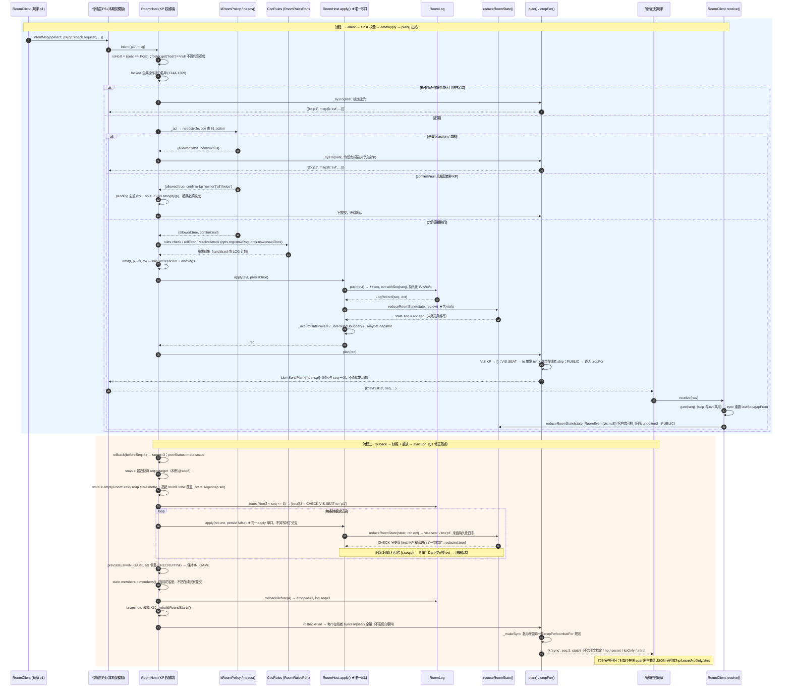
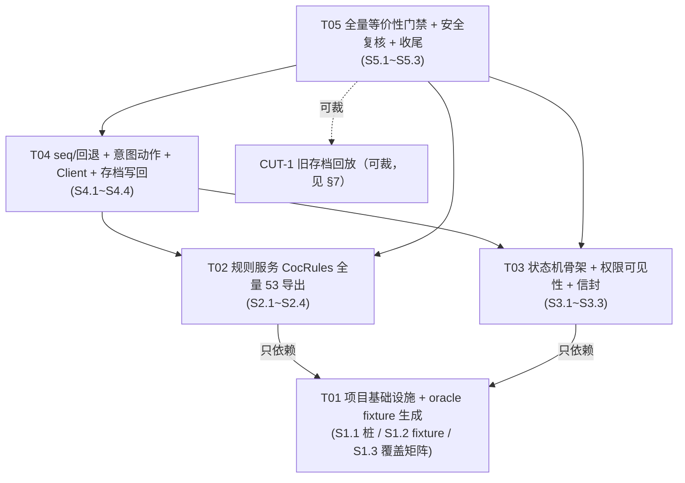

# P4 增量系统设计：房间规则层（room-rules / room-model 移植）

> 架构师：高见远（Bob） · 语言：简体中文 · 文档类型：**增量系统设计 + 有序任务列表**
> 输入：`_p4_prd.md`（429 行，许清楚已交付）+ team-lead 对 §8 Q1–Q8 的裁决
> 权威规格（只读）：`coc7th-card-app/web/js/core/room-rules.js`(1591) / `room-model.js`(7712)
> 工程根：`dice-realm`（Flutter/Dart 原生，禁 WebView/HTML）
> 基线：`2.15.0+81`，`flutter test` 572 组 0 红，`dart analyze` 干净，`lib/domain` 零 Flutter/IO 命中
> 本文只做**设计与文档**：不写/改任何 `lib/`、`test/`、`tool/` 代码，不改 `pubspec.yaml`，不跑 `flutter test`/`flutter build`

---

## 0. 复核结论（开工前必读）

### 0.1 Q1 独立复核：**缺陷真实存在，我认同 PM 结论，按 team-lead 裁决修正**

我用两种方式独立验证，结论一致：

**(a) 源码行号交叉验证**

| 位置 | 实际代码 | 后果 |
|---|---|---|
| `room-model.js:961` | `var evt = { t: t, vis: vis, to: to \|\| null, p: p \|\| {} };` | 日志里**确实**持久化了 `vis/to` |
| `room-model.js:962` | `var rec = this.log.push(evt);` | `rec.evt` 携带完整 `vis/to` |
| `room-model.js:965` | `reduce(this.state, { t: evt.t, seq: rec.seq, p: evt.p, vis: vis, to: evt.to });` | 初始 emit 把可见性交给 reduce |
| `room-model.js:3450` | `reduce(this.state, { t: recs[j].evt.t, seq: recs[j].seq, p: recs[j].evt.p });` | **重放只传 `{t,seq,p}`，丢掉 `vis/to`** |
| `room-model.js:685` | `var checkPublic = (evt.vis === undefined \|\| evt.vis === VIS.PUBLIC);` | `vis` 缺失 → 被当成 PUBLIC → 明文写入 `state.logs` |
| `room-model.js:699-701` | 非 PUBLIC 分支落 `text:'KP 秘密进行了一次检定', redacted:true` | 初始 emit 的脱敏行 |
| `room-model.js:762` | `if (evt.vis === VIS.SEAT && evt.to && evt.to !== HOST_SEAT) break;` | `vis` 缺失 → 守卫失效 → SEAT 私密混进 `state.privates` |
| `room-model.js:1273` | `var st = this.state;`（`syncFor` 原样下发） | 明文经全量同步广播给每个玩家 |

**(b) Node VM 只读实跑**（原样加载 `room-rules.js` + `room-model.js`，未修改任何旧码；`Math.random`=LCG、`Date.now`=1700000000000）

```
输入：
  snapshotEvery = 2；roster = p1 / p2（均在线）
  emit seq1 CHAT PUBLIC
  emit seq2 LOG  PUBLIC            → 触发快照 @seq2
  emit seq3 CHECK VIS.SEAT to='p1', p.summary='秘密检定：骰出 07，极难成功'
  emit seq4 CHAT PUBLIC
  rollback(4)

旧版初始 emit：
  state.logs[1] = {seq:3, seat:'', text:'KP 秘密进行了一次检定', kind:'check', opp:null, redacted:true}
  log.items[2].evt = {t:'check', vis:'seat', to:'p1', p:{summary:'秘密检定：骰出 07，极难成功', ...}}

旧版 rollback(4)：
  {dropped:1, seq:3, from:2}
  state.logs[1] = {seq:3, seat:'p1', text:'秘密检定：骰出 07，极难成功', kind:'check', opp:null}   ← 脱敏行变明文
  syncFor('p2').state.logs[1] 同样含明文
  >>> 未授权玩家 p2 的 sync 载荷是否含明文检定结果 = true

同类复现（PRIVATE 守卫失效）：
  初始 state.privates = []
  回退后 state.privates = [{seq:3, text:'线索A', title:'只给p1', ...}]   ← 定向私密混入 KP 公共私有栏
```

**结论**：这是 `rollback()` 的实现 bug，不是规格。Dart **不复刻**，按裁决修正。

### 0.2 Q2–Q8 与 PRD 数字复核（Node VM 实跑，全部与 PRD 一致）

| 项 | 复核结果 |
|---|---|
| `Object.keys(CocRules)` | **53** |
| `Object.keys(RoomModel)` | **41** |
| `EVT` / `INTENT` / `POLICY` | **27 / 13 / 61**（`board.self` 定义两次值相同，源码 62 行 → 61 唯一 action） |
| `parse()` 接受 | `sync` / `evt` / `skip` / `intent` **4 类**；`host.gone` → `null`（Q3 按 4 类） |
| `plan(VIS.KP)` | `[]` |
| `plan(VIS.SEAT, to='p1')` | `[{to:'p1',msg:{k:'evt',...}}, {to:'p2',msg:{k:'skip',seq}}]` |
| `emit(PUBLIC,{text,secret:'leak'})` | `p` 被 scrub 成 `{text}` + `warnings:[{t:'chat',reason:'非 SEAT 事件携带私有字段，已剥离'}]` |
| `check({base:50,value:42})` | **randUsed = 2**，`value=42`，`level=2` |
| `check({base:50,value:42,bonus:2})` | **randUsed = 4** |
| `check({base:50,value:42,ones:3,forcedTens:[2]})` | **randUsed = 0** |
| `emptyState({})` 顶层键 | `meta,members,chats,logs,dice,scene,combat,privates,rewind,requests,board,sceneCheck,archive,lastState,alert,opposed,seq,version`（18 个） |
| `ruleOptsOf` 缺省口径 | `critThreshold` 默认 1、`fumbleThreshold` 默认 100；仅 `[1,99]` 才下发 `critMax/fumbleMin` |
| `CLOSED` / `ENDED` / `KICK` | `CLOSED` 不写 `meta.ended`；`ENDED` 写 `true`；`KICK` 置 `CLOSED` |
| `POLICY['rollback.turn']` | **不存在**（入口已摘除）；`POLICY['rollback.round']`、`POLICY['rollback.commit']` 存在；`applyAction:1845` 的 `rollback.turn` 分支保留 |
| `TEMP_COMMIT` | reduce 无 case，走 `default`；不进 `save()` |

### 0.3 复核中发现的一处**命名精度**问题（不是 PM 错误，但工程师极易写错）

`Client._gate` 内部字段叫 `gapFrom`，但 **`Client.receive()` 的返回体里没有 `gapFrom` 字段**，用的是 `from`（值 = `lastSeq`）：

```
receive seq 1 → {kind:'evt', changed:true,  seq:1, t:'log', filled:false}
receive seq 1 → {kind:'evt', dup:true, gap:false, from:1, got:1}
receive seq 3 → {kind:'evt', dup:false, gap:true, from:1, got:3}   ← 内部 gapFrom=1
receive seq 2 → {kind:'evt', changed:true, seq:2, t:'log', filled:true} ← 内部 gapFrom 归 0
```

**设计约定**：fixture 必须同时断言 `receive()` 返回体与 `client.gapFrom` 内部快照；**禁止**在返回体里凭空加 `gapFrom` 键（会触发「键集合不一致」）。PRD §5.11 的 `gapFrom=1 / gapFrom=0` 指的是内部字段，不是返回体字段。

### 0.4 复核中发现的第二处 PRD 计数偏差：`Host.save()` 是 **20 键**，不是 19 键

PRD §5.10 与 P0-M12 写「19 个键」，但 `room-model.js:6885-6905` 实际 `Object.keys(host.save()).length === 20`（Node VM 实跑）：

```
v, code, rules, savedAt, seq, stateSeq, meta, members, chats, logs, dice,
scene, combat, sceneCheck, roundStarts, privateBySeat, requestsBySeat,
boardBySeat, localAssets, localActors
```

PRD §5.10 自己列出的清单也是 20 项，属于计数笔误。**本设计一律按实测 20 键**，`test/room_save_test.dart` 与 `room_model.json` 的 `M-save` 用例按 20 键逐字段深比较（键集合完全一致）；请 team-lead 知会 QA 同步修正 P0-M12 的验收文字。

---

## 1. 实现方案 + 框架选型

### 1.1 核心技术难点

| # | 难点 | 对策 |
|---|---|---|
| D1 | 9303 行 JS、53+41 导出成员，一次性重写必然失控 | 按「规则服务 / 状态骨架 / 意图动作 / 门禁」切 **5 个任务 + 内部子批次**，每批有独立可跑的测试 |
| D2 | JS 隐式类型转换（`parseInt \|\| 0`、`Number()`、真值判定、`Math.round` 负数口径）会逐字段偏 | 全部走已有 `lib/domain/js_compat.dart`（`jsNum/jsParseInt/jsStr/jsTruthy/jsRound/jsMax/jsMin/asMap/asList`），**不新造第二套转换层** |
| D3 | 随机/时间必须可复现，且 `randUsed` 必须钉死 | 复用 `js_compat.dart` 的 `setRng()/setClock()/nowRng/nowClock`；所有掷骰入口接收 `opts['rng']`/`opts['now']`，默认回落 `nowRng`；测试用 `test/support/oracle.dart` 的同款 `Lcg` |
| D4 | C9「无隐式副作用」+ Q1 修正要同时成立 | 收敛为 **`RoomHost.apply(RoomEvent evt, {bool persist = true})` 唯一状态变更入口**；初始 emit 与 rollback 重放都调它，且都传**持久化的完整事件对象**（含 `vis/to/seq`）；`persist` 只管簿记（入日志/快照/回合边界），**不参与任何归约判定**，重放路径不写任何补丁分支 |
| D5 | KP 隐藏信息「字节级不下发」 | 三道机械闸：① `emit` 非 SEAT 自动 `scrub` + `warnings`；② `plan` 的 `VIS.KP → []` / `VIS.SEAT → evt + skip` / PUBLIC 逐人裁剪；③ `reduce` 的 CHECK 脱敏 + PRIVATE 守卫。**`syncFor` 与增量裁剪共用同一套 `_cropFor`**，不在同步阶段二次过滤 |
| D6 | 角色卡写回必过 `CharacterRepo.save()`（C5），但 `lib/domain` 不得依赖 `lib/repo` | **端口倒置**：domain 定义纯抽象 `RoomCardSink`/`RoomSaveStore`；`lib/repo` 实现 `CharacterRepoRoomCardSink`（唯一调 `repo.save()` 的地方）；测试注入 `InMemoryRoomCardSink` |
| D7 | 旧存档 JSON 无损导入，契约冻结（无 `schemaVersion`） | `roomClone()` 逐键深拷贝且保持插入序；`adoptSave` 只做 body 一次性幂等迁移；`sanitizeSheet` 严格照搬白名单输出键，不增不改名 |
| D8 | 4 类信封 + seq 幂等 + `skip` 水位 | `RoomEnvelope` sealed 四子类；`RoomClient.gate()` 被 `evt` 与 `skip` **共用**；`Host.intent(SYNC)` 的 `canFill` 增量补齐不叠全量 sync |

### 1.2 框架 / 库选型

| 选择 | 结论 | 理由 |
|---|---|---|
| 语言/运行时 | **纯 Dart 3（SDK `^3.13.7`）**，无 Flutter Widget | C1：`lib/domain` 零 `package:flutter`/`dart:io`/`dart:ui`。P5/P6 直接消费，无需改规则代码 |
| 新增第三方依赖 | **0 个**（`pubspec.yaml` 一行不动） | `dart:math` / `dart:convert` / `dart:async` 均为 Dart 核心库，C1 只禁 `dart:io`/`dart:ui`/`package:flutter`。**刻意不用 `collection` 包的 `lastOrNull`**，本地写 5 行 helper，避免改 `pubspec.yaml` |
| 预言机 | Node `vm` + 已有 `tool/oracle/load.js` 的 `createSandbox()` | 原样加载旧 JS，monkey-patch `Math.random`=LCG / `Date.now`=固定时钟；**新增** `load_p4_room.js` 在同一 ctx 追加加载两个 room 模块，不改 `load.js` |
| 测试 | `flutter_test` + `test/support/oracle.dart` 的 `Lcg` / `expectJsonMatch` | 逐字段深比较（键集合完全一致）+ `randUsed` 断言；沿用 P0 1621 例与 P3 的既有口径 |
| 架构模式 | **端口与适配器（Hexagonal） + 事件溯源（Event Sourcing） + 单一归约口** | `apply(evt)` = 唯一写口；`reduce` = 纯函数；`plan()` 返回发送计划不碰网络；`save/adoptSave` = 纯数据对象；端口在 domain、适配器在 repo |
| 代码组织 | **`part/part of`**（规则服务）+ **`extension on RoomHost`**（状态机） | 规则服务用 `library room_rules;` + 5 个 `part`，让 53 个导出成员可以按批次填实现而门面签名一次定死；状态机用 Dart extension 把 4000+ 行 Host 方法拆到多个文件而不产生循环 import、不需要 `part` |
| 复用既有件 | `js_compat.dart`、`test/support/oracle.dart`、`lib/repo/character_repo.dart:224`、`lib/domain/normalize.dart`、`lib/domain/madness.dart` | 不改 `lib/domain/dice.dart`（Q2）、不改 `lib/domain/rules_coc7.dart`（Q8）、不改 `pubspec.yaml` |
| 明确绕开 | `dice.js:36-54` 的 `d100Bonus` / `successLevel` | C7：P4 另建 `rollD100/combine/levelOf`，不复用、不包装、不委托；`dice.dart` 一行不动 |

### 1.3 Q5 裁决落地：**哪层放什么**（team-lead 要求明确）

| 能力 | 落点 | 理由 |
|---|---|---|
| `Host.save()` / `savePayload()` / `adoptSave()` / `parseSave()` / `restoreHost()` / `playerViewFromSave()` / `sanitizeSheet()` / `sanitizeSceneSteps()` | **`lib/domain/room_model_save.dart`** | 全部是「`Map<String,Object?>` ↔ `Map<String,Object?>`」的纯数据变换：`roomClone`、`emptyRoomState`、`Roster` 重建、`jsonEncode`（`dart:convert`）。**零 I/O、零文件、零 `dart:io`**，符合 C1，且能被 P5/P6 在无 Flutter 环境下直接调用 |
| `RoomSaveStore` / `RoomCardSink` 抽象端口 + `RoomCardPatch` / `CardWriteResult` 值对象 | **`lib/domain/room_ports.dart`** | domain 只声明「依赖什么」，不声明「谁来实现」；避免 domain → repo 的反向依赖 |
| `InMemoryRoomSaveStore` / `InMemoryRoomCardSink` / `CharacterRepoRoomCardSink` | **`lib/repo/room_save_store.dart` / `room_state_writer.dart`** | **这一层是 I/O 边界，必须出 domain**。`CharacterRepo.save()` 是 `Future<void>` 且内部 `_flush()` 走文件后端；只有 repo 层能 `await`。C6 双后端：内存后端供测试，repo 后端供生产 |
| `saveRoom(code, ...)` / `saveNow()` / `listRoomSaves` / `MAX_SAVES=8` | **不在 P4** | PRD §5.10 / Q5：落地留后续期；P4 只留 `RoomSaveStore.put/get/list` 三个纯方法，后续期换实现即可，**domain 一行不改** |

> 一句话：**序列化/恢复在 domain（因为纯），落地与写回适配在 repo（因为 I/O）**；后续期把 `InMemoryRoomSaveStore` 换成 `FileRoomSaveStore` 属于换适配器，不动规则代码。

### 1.4 Q1 修正的机械设计（必须照抄，不得变通）

1. `RoomEvent` 持久化 `t / seq / p / vis / to` 五字段；`RoomLog.push()` 返回 `LogRecord(seq, evt.withSeq(seq))`，日志项 = 完整事件对象。
2. **`RoomHost.apply()` 是唯一写口**：
   - `persist: true`（`emit` 调用）→ `log.push(evt)` 分配 seq → `reduceRoomState(state, rec.evt)` → 回合边界/`_privateBySeat`/快照。
   - `persist: false`（`rollback` 重放调用）→ 直接用日志里的 `rec.evt`（seq 已存在、`vis/to` 完整）→ **同一个** `reduceRoomState(state, rec.evt)` → 不做日志/快照/簿记。
   - **`persist` 不出现在 `_reduce` 的任何分支条件里**；全库 `reduceRoomState(` 调用点**恰好 2 处**：`RoomHost.apply` 与 `RoomClient.receive`（客户端回放，按旧版构造 `vis:null`）。
3. `EVT.CHECK` 分支按 `evt.vis == null || evt.vis == public` 判 PUBLIC；`evt.vis == seat` 落 `redacted:true` 脱敏行。`EVT.PRIVATE` 守卫按 `evt.vis == seat && evt.to != null && evt.to != HOST_SEAT` 生效。重放时两者都拿到 `vis/to` → 脱敏保持。
4. `_privateBySeat` / `_requestsBySeat` / `_boardBySeat` / `localAssets` / `localActors` 等**权威端私有容器在 rollback 中按旧版原样保留**（不重建、不裁剪），避免引入第二处不一致；Q1 修正只作用于 `apply()` 交给 `reduce` 的事件对象。

### 1.5 Q3 / Q4 / Q6 落地要点

- **Q3**：`parseRoom()` 只放行 `sync/evt/skip/intent` 四类；`skip` 与 `evt` **共用 `RoomClient.gate()`**；`plan(VIS.SEAT)` 必须给其余在线者发 `skipMsg(seq)`；`Host.intent(SYNC)` 的补齐路径只发与己相关事件，`part.to == '*' || part.to == seat` 才转发。
- **Q4**：`check()` 无条件先调 `rollD100({...})`，再把 `opts['value']` 覆盖 `value`；`rollD100` 的 `ones`/`forcedTens` 全给时 0 次 RNG、`bonus:2` 4 次。fixture 用 3 个 seed × 3 组合钉死 `randUsed`，**禁止任何「跳过无用掷骰」优化**。
- **Q6**：`EVT.TEMP_COMMIT` 常量保留、reduce 无 case（走 default）、不进 `save()`；`rollbackPropose/rollbackVote/rollbackCommit`、`EVT.REWIND`、`INTENT.VOTE`、`REWIND` 枚举、`case EVT.REWIND`、`state.rewind` 全部休眠保留；`POLICY` **不登记** `rollback.turn`；`applyAction` 的 `rollback.turn` 分支保留（伪造 ACT 被 `needs()` 默认拒绝）。旧存档回放纳入本期 oracle（见 **CUT-1 可裁项**）。

---

## 2. 完整文件列表（相对 `dice-realm/`，逐个说明职责与预估行数）

> 命名铁律：P4 新增文件统一 `room_*` 前缀；**不改** `lib/domain/rules_coc7.dart`、`lib/domain/dice.dart`、`pubspec.yaml`。
> 「预估行数」是给工程师排期的量级参考，Dart 通常比等价 JS 略冗长。

### 2.1 `lib/domain/`（纯 Dart，零 `package:flutter` / `dart:io` / `dart:ui`）

| # | 文件 | 职责 | 预估行数 |
|---|---|---|---|
| D01 | `lib/domain/room_types.dart` | 全部常量/枚举/值对象：`RoomRole/Status/Mode/Rewind/Confirm/Vis`、`RoomEvt`(27)、`RoomIntent`(13)、`kRoomPolicy`(61)、`kSecretKeys`(7)、`RoomEvent`(t/seq/p/vis/to)、`LogRecord`、`RoomSnapshot`、`RoomWarning`、`SendPlan`、`RoomEnvelope` sealed 四子类 + `toJson()`、结构化结果类 | 380 |
| D02 | `lib/domain/room_ports.dart` | 端口倒置：`RoomRulesPort`（实读注入面 ~22 方法）、`RoomMadnessPort`、`RoomSaveStore`、`RoomCardSink`；值对象 `RoomCardPatch` / `CardWriteResult` / `NeedsResult` / `GateResult` / `ReceiveResult` / `RollbackResult` / `ApplySheetResult` / `AttachPeerResult` / `ResyncDiag` | 150 |
| D03 | `lib/domain/room_rules.dart` | `library room_rules;` + 5 个 `part` 声明；`class CocRules implements RoomRulesPort` 门面：`static const` 常量 + **53 个实例方法/转发器**（Dart 不允许同名 static 与 instance 成员共存；签名一次定死，实现在 part 文件） | 310 |
| D04 | `lib/domain/room_rules_core.dart` | `part of room_rules`：阈值/成功等级/`rollD100`/`combine`/`describeDice`/`check`/`describeCheck`/`canPush`/`luckAllowed`/`spendLuck` + 私有 `die10/clampDie10/clampValue/pickRng` → P0-R01~R07 | 520 |
| D05 | `lib/domain/room_rules_opposed.dart` | `part of room_rules`：`opposed` / `opposedReroll` / `opposedAttack`（模式敏感 ≤10 轮重掷）/ `opposedFull` → P0-R08 | 280 |
| D06 | `lib/domain/room_rules_expr.dart` | `part of room_rules`：`parseExpr`/`rollExpr`/`rollDamageBonus`/`maxOfExpr`/`maxOfDamageBonus`/`impaleDamage`/`burstMaxOf`/`isBurstWeapon`/`malfunctionThresholdOf`/`malfunctionOf`/`defaultMalfunctionType`/`malfunctionEffect`/`isRevolver`/`burstSelfDamage` → P0-R09 / R14 | 430 |
| D07 | `lib/domain/room_rules_sheet.dart` | `part of room_rules`：`parseSanLoss`/`resolveSanCheck`/`insanityFlags`/`temporaryInsanityCheck`/`boutRounds`/`damageFlags`/`dyingRoundCheck`/`skillValue`/`attrValue`/`sceneStepPlan`/`sceneStepResolve` + `SKILL_ALIAS`/`normSkillName`/`skillBase`/`skillSpecs`/`totalOfSkill`/`normBranch`/`toLevelNumber` → P0-R10 / R11 / R14 | 540 |
| D08 | `lib/domain/room_rules_combat.dart` | `part of room_rules`：`initiativeOrder`/`advanceTurn`/`resolveAttack`/`buildAttackSummary`/`rollD100Value`/`OUTCOME` → P0-R12 / R13 | 480 |
| D09 | `lib/domain/room_model.dart` | **barrel 入口**：`export` D01/D02/D03/D10~D21，供 P5/P6 单行 import | 35 |
| D10 | `lib/domain/room_model_state.dart` | `emptyRoomState(meta)`（18 键，键序固定）/ `roomClone` / `hasSecret` / `scrub` / `allowed` / `needs` / `ruleOptsOf` / `bodyView` / `bodyForHp` / `migrateBodyStatus` / `validCode` / `cleanText` / `inviteLink` / `readInvite` / `normalizeServerBase` | 370 |
| D11 | `lib/domain/room_model_reduce.dart` | `reduceRoomState(state, evt)`：**26 个 case + default**（`TEMP_COMMIT` 无分支），末尾无条件 `state['seq'] = evt.seq`；`CHAT≤500 / LOG≤2000 / DICE≤200 / PRIVATE≤100` 裁剪；CHECK 脱敏、PRIVATE 守卫依赖 `evt.vis/evt.to` | 430 |
| D12 | `lib/domain/room_model_log.dart` | `RoomLog`（`push/since/canFill/rollbackBefore`，cap 400、`truncated`）与 `RoomRoster`（`open/markOffline/remove/get/list/players/spectators/onlinePlayers/allReady/dump`，`kicked` 防回踢） | 270 |
| D13 | `lib/domain/room_model_envelope.dart` | `syncMsg/evtMsg/skipMsg/intentMsg/parseRoom`（4 类，非法 JSON / 非对象 / 未知 `k` → null） | 120 |
| D14 | `lib/domain/room_model_host_core.dart` | `RoomHostOptions` + `RoomHost` 构造（state/roster/log/local/snapshots/warnings/私有容器/`_stateSeq`/`roundStarts`/`_fireUsed`/`_fadedArm`…） + **★`apply()` 唯一写口** + `emit` / `emitLocal` / `plan` / `planAll` / `_push` / `_cropFor` / `_cropMember` / `_cropSlot` / `_cropCombat` / `combatFor` / `syncFor` / `_makeSync` / `attachPeer` / `detachPeer` / `members` / `syncMembers` | 640 |
| D15 | `lib/domain/room_model_rollback.dart` | `extension RoomHostRollback on RoomHost`：`rollback` / `rollbackPlan` / `rollbackPropose` / `rollbackVote` / `rollbackCommit`（休眠保留）/ `_rebuildRoundStarts` / `_maybeSnapshot` / `nextTurn` / `_onRoundBoundary` / `_advanceRound` / `setStatus` / `kick` / `closeRoom` / `endSession` | 300 |
| D16 | `lib/domain/room_model_host_intent.dart` | `extension RoomHostIntent on RoomHost`：`intent(seat,msg)` 13 分支（含 `locked` 全局操作锁白名单 1344-1369）、`_act`（`needs` / confirm / pending 去重 / KP 直执）、`consent` / `confirmPending` / `stateSyncAck` | 540 |
| D17 | `lib/domain/room_model_actions_room.dart` | `extension RoomHostActionsRoom on RoomHost`：`applyAction` 的房间/场景/素材/地图/手绘板分支 + `addAsset/revealAsset/coverAsset/delAsset/delItem/mapMark/mapStroke/mapClear/mapStrokesSet/boardSelf/_modeChanged/setActorPool/suspendRoom/resumeRoom/setRoomRules` | 570 |
| D18 | `lib/domain/room_model_actions_combat.dart` | `extension RoomHostActionsCombat on RoomHost`：`applyAction` 战斗/掷骰/检定分支 + `combatStart/combatActor/combatEnqueue/combatDamage/combatAttack/combatEnd/diceRoll/diceDirect/darkRoll/checkRequest/checkOpposed/opposed/sceneCheckPush/sceneCheckStep/playerSanCheck` | 900 |
| D19 | `lib/domain/room_model_actions_sheet.dart` | `extension RoomHostActionsSheet on RoomHost`：`applyAction` 卡/伤势/SAN/施救分支 + `stateApply/stateSelf/stateRequest/settleWounds/applyHpChange/sheetDamage/sheetSanCheck/sheetTempStatus/sheetItem/sheetSanLoss/healWound/aidApply/psychoAnalyze/advanceMadness/cureIndefinite/memberRipped/memberInBout/_isDying/_isUnconscious` | 1100 |
| D20 | `lib/domain/room_model_client.dart` | `RoomClient`：`receive` / `gate`（evt 与 skip 共用）/ `_filledMark` / `resyncIntent` / `resyncDiag` / `applySheetState` / `intent` / `member` / `isReady` / `onChange` | 250 |
| D21 | `lib/domain/room_model_save.dart` | `extension RoomHostSave on RoomHost`：`save()`（**20 键** `v:2`，见 §0.4）/ `savePayload()` / `adoptSave()`；纯函数 `parseSave` / `restoreHost` / `playerViewFromSave` / `resolveRoomCardPatch` / `sanitizeSheet` / `sanitizeSceneSteps` | 430 |

**domain 小计：约 8,395 行 / 21 个文件。**

### 2.2 `lib/repo/`（I/O 边界，C6 双后端）

| # | 文件 | 职责 | 预估行数 |
|---|---|---|---|
| R01 | `lib/repo/room_state_writer.dart` | `InMemoryRoomCardSink`（测试内存后端）+ `CharacterRepoRoomCardSink implements RoomCardSink`：`resolveRoomCardPatch` 定位 → 改 `Character.status` → **`await repo.save(card)`**（C5 唯一落盘入口）→ 返回 `CardWriteResult{ok,reason,cardId,source}`；绝不静默失败、绝不退到 `current` 别的卡 | 190 |
| R02 | `lib/repo/room_save_store.dart` | `InMemoryRoomSaveStore implements RoomSaveStore`（`put/get/list` 纯内存）+ 预留 `FileRoomSaveStore` 的构造位（本期**不实现**、`dart:io` 只在本文件后续期出现） | 95 |

### 2.3 `tool/`（Node VM 预言机与静态探针；不改既有 `load.js`）

| # | 文件 | 职责 | 预估行数 |
|---|---|---|---|
| O01 | `tool/oracle/load_p4_room.js` | `require('./load').createSandbox()` 拿到 `{ctx,sandbox}` 后，在同一 ctx 用 `vm.runInContext` **按顺序追加** `core/room-rules.js` → `core/room-model.js`；注入 `Math.random`=LCG（`__setSeed/__randUsed`）、`Date.now`=1700000000000；导出 `{ctx, S, CocRules, RoomModel, CocMadness}`。**零改动 `load.js`** | 95 |
| O02 | `tool/oracle/dump_p4_room.js` | 用例注册表（fn / args / seed / tag），调用旧 JS 产出 `{cases:[{name,fn,args,seed,expect,randUsed,tag}]}`，写 3 个 JSON；自带「覆盖矩阵自检」打印缺口 | 720 |
| Q01 | `tool/qa/qa_p4_gate.js` | 静态门禁探针：① 扫 `lib/domain/room_*.dart` 的 `package:flutter`/`dart:io`/`dart:ui` 命中数；② 扫 `reduceRoomState(` 调用点数量必须 = 2；③ 扫写回路径必须含 `repo.save(` 且无 `card.status[...] = ... + 落盘` 旁路；④ 输出覆盖矩阵报告 | 130 |

### 2.4 `test/`（fixtures / 支持库 / 测试）

| # | 文件 | 职责 | 预估行数 |
|---|---|---|---|
| F01 | `test/fixtures/room_rules.json` | O02 产出，≥ 420 例（CocRules 全 53 导出 + §5.11 阈值/骰/等级边界 + RNG 三组合 × 3 seed） | 生成 |
| F02 | `test/fixtures/room_model.json` | O02 产出，≥ 460 例（41 导出 + 26 reduce 分支 + 61 POLICY × 3 角色 + 27 EVT + 13 INTENT + 4 信封 + save/body/sanitize） | 生成 |
| F03 | `test/fixtures/room_sequences.json` | O02 产出，≥ 120 例（seq 乱序/重复/补拉、skip 水位、rollback、KP 秘密+回退、旧存档回放） | 生成 |
| S01 | `test/support/room_oracle.dart` | 类比 `OracleFixture.run`：按 `fn` 分组、`Lcg(seed)` + `setRng/setClock`、`expectJsonMatch` 逐字段深比较、`randUsed` 断言；**白名单闸门**（非白名单用例一律严格比较，禁止 `contains`） | 200 |
| S02 | `test/support/room_oracle_whitelist.dart` | **恰好 1 条** `KnownDivergence` 登记（Q1），含 `legacyRef` / `reproInput` / `legacyBehavior` / `dartBehavior` / `allowedPaths`；断言 `length == 1` | 70 |
| S03 | `test/support/room_fakes.dart` | `InMemoryRoomSaveStore` / `InMemoryRoomCardSink` / `DeterministicRoomRules` / `DeterministicRoomMadness` / `roomHostOpts()` 固定时钟与 LCG 工厂 | 160 |
| T01 | `test/room_coverage_test.dart` | **覆盖矩阵可追溯**：断言 3 个 fixture 的 `tag` 集合覆盖全部 `CocRules`(53) / `RoomModel`(41) / `EVT`(27) / `INTENT`(13) / `POLICY`(61) / 26 reduce 分支 / §5.11 全部边界，零缺口 | 130 |
| T02 | `test/room_rules_oracle_test.dart` | F01 全量等价性 + `randUsed` 2/4/0 三组合专项 + 53 导出 handler 全覆盖 | 190 |
| T03 | `test/room_model_core_test.dart` | F02 的 reduce/plan/envelope/权限/裁剪部分；P0-M01/M02/M03/M09/M11 | 220 |
| T04 | `test/room_visibility_test.dart` | P0-M04 七条安全不变式（KP 零出站、SEAT 单发+skip、PUBLIC scrub、玩家载荷无 HP/秘密、syncFor 与增量同视图、非 PUBLIC 检定脱敏、PRIVATE 守卫） | 200 |
| T05 | `test/room_sequences_test.dart` | F03 的 seq 乱序/重复/补拉、`skip` 共用闸门、`canFill` 增量补齐不叠全量、CLOSED/ENDED/KICK | 180 |
| T06 | `test/room_rollback_security_test.dart` | **Q1 安全回归（Dart-only，非 oracle 比较）**：构造 `VIS.SEAT` 秘密 CHECK → `rollback` → 对每个在线玩家调 `syncFor`，断言载荷里不存在明文检定结果 / `hp` / `secret` / `kpOnly` / `attrs`；同时断言 PRIVATE 守卫在重放后仍生效 | 150 |
| T07 | `test/room_card_writeback_test.dart` | P0-M06/M07：`applySheetState` 幂等、`resolveRoomCardPatch` 找不到 `charId` 返回 `card_not_found`、濒死卡（HP=0/dying）写回后仍 0/true、静态检查写回路径调 `CharacterRepo.save` | 170 |
| T08 | `test/room_save_test.dart` | P1-05：`save()` **20 键**（§0.4）、`savePayload` JSON 形状、`adoptSave` 幂等 + body 迁移 + `online=false`、`playerViewFromSave` 可直接喂 `receive` | 160 |
| T09 | `test/room_equivalence_test.dart` | **全量门禁**：3 个 fixture 全跑 + 白名单逐路径校验 + `randUsed` 全等 + 白名单长度 == 1 + 全量 `flutter test` 只增不减 | 150 |
| T10 | `test/room_purity_test.dart` | 静态扫描 `lib/domain/room_*.dart` 零 Flutter/IO 命中；`reduceRoomState(` 调用点 == 2；`dice.dart`/`rules_coc7.dart` 未改动 | 110 |
| T11 | `test/room_legacy_save_replay_test.dart` | **CUT-1（可裁）**：旧版房间 JSON 无损导入 → `adoptSave` → reduce 消费 `EVT.REWIND` / `state.rewind` / `rollback.turn` 休眠分支，逐字段一致 | 140 |

### 2.5 文档提取件（本阶段新增，非代码）

| 文件 | 内容 |
|---|---|
| `_p4_design.md` | 本文（主交付） |
| `docs/class-diagram.mermaid` | §3 类图提取件 |
| `docs/sequence-diagram.mermaid` | §4 时序图提取件（流程一 + 流程二合于一张图） |

---

## 3. 数据结构与接口（Dart 骨架 + Mermaid 类图）

### 3.1 核心签名骨架（照抄，不要改名）

```dart
// ---------- room_types.dart ----------
/// 用「字符串常量类」而非 enum：与 JS 对象的键集合/值逐字节一致，避免序列化漂移
class RoomRole {
  static const kp = 'kp', player = 'player', spectator = 'spectator';
  static const List<String> values = [kp, player, spectator];
}
class RoomStatus {
  static const recruiting = 'RECRUITING', inGame = 'IN_GAME',
      closed = 'CLOSED', suspended = 'SUSPENDED';
  static const List<String> values = [recruiting, inGame, closed, suspended];
}
class RoomMode  { static const exploration = 'EXPLORATION', combat = 'COMBAT'; }
class RoomRewind{ static const idle = 'IDLE', voting = 'VOTING', done = 'DONE', failed = 'FAILED'; }
class RoomConfirm { static const twice='twice', kp='kp', owner='owner', all='all'; } // null = 直接执行
class RoomVis   { static const public = 'public', kp = 'kp', seat = 'seat'; }
const String kHostSeat = 'host';
const List<String> kSecretKeys = ['secret','hidden','kpOnly','truth','clue','spoiler','answer'];

class RoomEvt {                       // 27 项，值见「附录 A」
  static const hello='hello', members='members', chat='chat', dice='dice', log='log',
    scene='scene', combat='combat', turn='turn', status='status', kick='kick',
    closed='closed', private_='private', board='board', asset='asset', actor='actor',
    turnstate='turnstate', check='check', request='request', rewind='rewind',
    round='round', tempCommit='tempcommit', ended='ended', archive='archive',
    sceneCheck='scenecheck', state='state', turnAlert='turnalert', opposed='opposed';
  static const List<String> values = [...];   // 恰好 27
}
class RoomIntent {                    // 13 项，值见「附录 A」
  static const sync='sync', ready='ready', chat='chat', dice='dice', char='char',
    act='act', board='board', vote='vote', consent='consent', confirm='confirm',
    stateSync='statesync', sanCheck='sancheck', opposed='opposed';
  static const List<String> values = [...];   // 恰好 13
}
class RoomPolicyEntry {
  final List<String> roles; final String? confirm;
  const RoomPolicyEntry(this.roles, this.confirm);
  Map<String,Object?> toJson() => {'roles': roles, 'confirm': confirm};
}
const Map<String, RoomPolicyEntry> kRoomPolicy = { /* 61 项，附录 B */ };

/// ★ Q1 关键：事件对象持久化 vis / to / seq。
/// vis 可空：null ≡ 旧版「客户端 reduce / 旧调用未传 vis」→ 按 PUBLIC 处理（见 0.3 / 1.4）。
/// RoomHost.emit 必须显式赋 vis；RoomHost.apply 重放必须沿用日志里这个对象。
class RoomEvent {
  const RoomEvent({required this.t, required this.p, this.vis, this.to, this.seq});
  final String t;
  final Map<String, Object?> p;
  final String? vis;
  final String? to;
  final int? seq;
  RoomEvent withSeq(int s) => RoomEvent(t: t, p: p, vis: vis, to: to, seq: s);
  Map<String,Object?> toJson() => {'t': t, 'vis': vis, 'to': to, 'p': p, 'seq': seq};
}
class LogRecord {
  const LogRecord(this.seq, this.evt);
  final int seq; final RoomEvent evt;   // evt.seq == seq（apply 保证）
}
class RoomSnapshot { const RoomSnapshot(this.seq, this.state); final int seq; final Map<String,Object?> state; }
class RoomWarning  { const RoomWarning(this.t, this.reason); final String t, reason; }

sealed class RoomEnvelope { Map<String,Object?> toJson(); String get k; }
class SyncEnvelope   extends RoomEnvelope { final int seq; final Map<String,Object?> state; }
class EvtEnvelope    extends RoomEnvelope { final int seq; final String t; final Map<String,Object?> p; }
class SkipEnvelope   extends RoomEnvelope { final int seq; }
class IntentEnvelope extends RoomEnvelope { final String op; final Map<String,Object?> p; }
class SendPlan { const SendPlan(this.to, this.msg); final String to; /* '*' = 广播 */ final RoomEnvelope msg; }

// ---------- room_ports.dart ----------
abstract class RoomRulesPort {            // 实读 room-model.js 注入面（约 22 方法）
  Map<String,Object?> check(Map<String,Object?> opts);
  Map<String,Object?> rollExpr(String expr, Map<String,Object?> opts);
  Map<String,Object?> rollDamageBonus(Object? expr, Map<String,Object?> opts);
  Map<String,Object?> parseExpr(String expr);
  Map<String,Object?> resolveAttack(Map<String,Object?> opts);
  Map<String,Object?> initiativeOrder(Object? actors, Map<String,Object?> opts);
  Map<String,Object?> opposed(Map<String,Object?> opts);
  Map<String,Object?> opposedFull(Map<String,Object?> opts);
  Map<String,Object?> resolveSanCheck(Map<String,Object?> opts);
  Map<String,Object?> parseSanLoss(Object? expr);
  Map<String,Object?> dyingRoundCheck(Map<String,Object?> opts);
  Map<String,Object?> temporaryInsanityCheck(Map<String,Object?> opts);
  int  skillValue(Object? sheet, Object? name);
  int  attrValue(Object? sheet, Object? key);
  Map<String,Object?> sceneStepResolve(Map<String,Object?> opts);
  int  impaleDamage(Map<String,Object?> opts);
  int  burstMaxOf(Object? expr);
  Map<String,Object?> malfunctionOf(Map<String,Object?> opts);
  String defaultMalfunctionType(Object? weapon);
  Map<String,Object?> malfunctionEffect(Map<String,Object?> opts);
  String normDifficulty(Object? d);
  Map<String,int> get levelMap;          // 端口侧改名：规避与 CocRules.static const LEVEL 撞名；room-model.js 有 11 处 rules.LEVEL 引用
}
abstract class RoomMadnessPort {
  Map<String,Object?>? roll(Object? type, bool permanent, [JsRng? rng]);
  Map<String,Object?>? make(Object? type, bool permanent, String? name, [JsRng? rng]);
}
abstract class RoomSaveStore {           // 纯 Map 端口；后续期可无痛换成文件/云端
  void put(String code, Map<String,Object?> data);
  Map<String,Object?>? get(String code);
  List<String> list();
}
abstract class RoomCardSink {            // C5：唯一允许落盘的方向
  Future<CardWriteResult> write(RoomCardPatch patch);
}
class RoomCardPatch { final String? charId; final Map<String,Object?> patch; }
class CardWriteResult { final bool ok; final String reason; final String cardId; final String source; }
class NeedsResult     { final bool allowed; final String? confirm; }
class GateResult      { final bool ok, dup, gap; final int lastSeq; }
class ReceiveResult   { /* kind/changed/seq/t/dup/gap/from/got/filled → toJson() */ }
class RollbackResult  { final int dropped, seq, from; }
class ApplySheetResult{ final bool applied; final int seq; final bool? dup; }
class AttachPeerResult{ final String seat; final bool rejected, blocked; final Map<String,Object?>? member; final List<SendPlan> out; }
class ResyncDiag      { final int from, last, filled, holes, count; }

// ---------- room_rules.dart（门面） ----------
library room_rules;
part 'room_rules_core.dart';
part 'room_rules_opposed.dart';
part 'room_rules_expr.dart';
part 'room_rules_sheet.dart';
part 'room_rules_combat.dart';

class CocRules implements RoomRulesPort {
  const CocRules();
  // ⚠️ 方法必须是**实例方法**：Dart 不允许同名 static 与 instance 成员共存。
  //    常量仍为 static const（测试可直接 `CocRules.LEVEL` 断言）；端口用 `levelMap`
  //    间接暴露 LEVEL，避免撞名。Host 注入 `const CocRules()`。
  static const int version = 1;
  static const Map<String,int> LEVEL = { 'CRITICAL':5,'EXTREME':4,'HARD':3,'REGULAR':2,'FAIL':0,'FUMBLE':-1 };
  static const Map<String,String> LEVEL_KEY = {...}, LEVEL_TEXT = {...};
  static const Map<String,Map<String,Object?>> DIFFICULTY = {...};
  static const Map<String,String> OUTCOME = {...}, JAM_TYPES = {...};
  static const Map<String,int> limits = {'MAX_DICE':100,'MAX_SIDES':1000};
  @override Map<String,int> get levelMap => LEVEL;
  @override Map<String,Object?> check(Map<String,Object?> opts) => _check(opts);
  Map<String,Object?> thresholds(Object? base) => _thresholds(base);
  Map<String,Object?> rollD100(Map<String,Object?> opts) => _rollD100(opts);
  // ... 其余 50 个实例转发器（附录 C：53 导出成员 → 目标 part 文件）
}

// ---------- room_model_state.dart ----------
Map<String,Object?> emptyRoomState([Map<String,Object?>? meta]);       // 18 键，键序固定
Object? roomClone(Object? x);                                        // LinkedHashMap 保序深拷贝
bool hasSecret(Object? p);
Object? scrub(Object? p);
bool allowed(String role, String action);
NeedsResult needs(String role, String action);                        // 未登记 → allowed:false
Map<String,Object?> ruleOptsOf(Map<String,Object?> meta);              // 仅 [1,99] 下发
Map<String,Object?> bodyView(Map<String,Object?> status);
Map<String,Object?> bodyForHp(Map<String,Object?> status);
void migrateBodyStatus(Map<String,Object?> status);                   // 幂等
bool validCode(Object? c);
String cleanText(Object? s, [int? max]);
String inviteLink(String base, String code);
String? readInvite(String url);

// ---------- room_model_reduce.dart ----------
/// 全库仅 2 个调用点：RoomHost.apply 与 RoomClient.receive。
/// evt 必须携带 vis/to（权威端）；客户端传 vis:null 复刻旧版「undefined → PUBLIC」。
Map<String,Object?> reduceRoomState(Map<String,Object?> state, RoomEvent evt);

// ---------- room_model_log.dart ----------
class RoomLog {
  RoomLog({int cap = 400});
  int cap, seq = 0, truncated = 0;
  final List<LogRecord> items = <LogRecord>[];
  LogRecord push(RoomEvent evt);            // ++seq → evt.withSeq(seq) → 超限 shift+truncated++
  List<LogRecord> since(int fromSeq);
  bool canFill(int fromSeq);                // items[0].seq > fromSeq+1 → false
  int rollbackBefore(int beforeSeq);        // 返回 dropped，seq = beforeSeq-1
}
class RoomRoster {
  final Map<String,Map<String,Object?>> bySeat = <String,Map<String,Object?>>{}; // LinkedHashMap
  final List<String> order = <String>[];
  final Set<String> kicked = <String>{};
  Map<String,Object?>? open(Map<String,Object?> m);
  Map<String,Object?>? markOffline(String seat);
  Map<String,Object?>? remove(String seat);
  Map<String,Object?>? get(String seat);    // 'host' 恒为 null，禁止据此判旁观者
  List<Map<String,Object?>> list(), players(), spectators(), onlinePlayers(), dump();
  bool allReady();
}

// ---------- room_model_envelope.dart ----------
SyncEnvelope syncMsg(int seq, Map<String,Object?> state);
EvtEnvelope evtMsg(LogRecord rec);
SkipEnvelope skipMsg(int seq);
IntentEnvelope intentMsg(String op, Map<String,Object?> p);
RoomEnvelope? parseRoom(Object? raw);       // string → jsonDecode；非 4 类 k → null

// ---------- room_model_host_core.dart ----------
class RoomHostOptions {
  RoomHostOptions({this.meta = const {}, this.logCap = 400, this.snapshotEvery = 20,
    this.snapshotLimit = 20, JsClock? now, JsRng? rng, this.rules, this.madness, this.saveStore})
      : now = now ?? nowClock, rng = rng ?? nowRng;   // C3：不另造注入点
  final Map<String,Object?> meta;
  final int logCap, snapshotEvery, snapshotLimit;
  final JsClock now; final JsRng rng;
  final RoomRulesPort? rules; final RoomMadnessPort? madness; final RoomSaveStore? saveStore;
}
class RoomHost {
  RoomHost(RoomHostOptions opts);
  late Map<String,Object?> state;
  late RoomRoster roster; late RoomLog log;
  final List<RoomSnapshot> snapshots = []; final List<RoomWarning> warnings = [];
  int localSeq = 0; final List<LogRecord> local = []; int stateSeq = 0;
  // 私有容器：_privateBySeat / _requestsBySeat / _boardBySeat / localActors /
  //           localAssets / roundStarts / pending / rewind / _sanLostThisRound /
  //           _roundStartSan / _fadedArm / _fireUsed

  /// ★★★ 唯一状态变更入口（C9 + Q1）。初始 emit 与 rollback 重放都走这里。
  /// persist 仅控制簿记（入日志/私有累计/回合边界/快照），**不参与任何归约判定**；
  /// 全库唯一的 reduce 调用在此，禁止在重放路径另写补丁分支。
  LogRecord apply(RoomEvent evt, {bool persist = true}) {
    final rec = persist ? log.push(evt) : LogRecord(evt.seq!, evt);
    reduceRoomState(state, rec.evt);               // ← vis/to 完整传入
    if (persist) { _accumulatePrivate(rec); _onRoundBoundary(rec); _maybeSnapshot(rec.seq); }
    return rec;
  }
  LogRecord emit(String t, Map<String,Object?> p, {String vis = RoomVis.public, String? to});
  LogRecord emitLocal(String t, Map<String,Object?> p);       // 不占共享序号、永不外发
  List<SendPlan> plan(LogRecord rec);                        // KP→[]；SEAT→evt+skip；PUBLIC→裁剪
  List<SendPlan> planAll(List<LogRecord> recs);              // 顺序与 seq 一致
  List<SendPlan> pushInto(List<SendPlan> out, LogRecord rec);
  Map<String,Object?> cropFor(String t, Map<String,Object?> p, String seat);
  Map<String,Object?>? combatFor(String seat);               // HOST_SEAT 全量；玩家删 hp/hpMax/secret/kpOnly/attrs
  SyncEnvelope syncFor(String seat);                         // 与增量共用 cropFor，不再二次过滤
  SyncEnvelope makeSync(String seat, Object? scene, Object? board);
  AttachPeerResult attachPeer(Map<String,Object?> m);
  List<SendPlan> detachPeer(String seat);
  List<Map<String,Object?>> members();
  List<SendPlan> syncMembers();
}
// 其余 Host 方法以 extension 形式分布在 D15~D19、D21（避免 part 与循环 import）

// ---------- room_model_rollback.dart ----------
extension RoomHostRollback on RoomHost {
  RollbackResult rollback(int beforeSeq) {
    final target = beforeSeq - 1;
    final prevStatus = state['meta']!['status'];
    final snap = _latestSnapshotAtOrBefore(target);
    // state = emptyRoomState(snap.state['meta']) 后逐键 roomClone 覆盖；state.seq = snap.seq
    for (final r in log.items.where((r) => r.seq > snap.seq && r.seq <= target)) {
      apply(r.evt, persist: false);      // ★同一 apply 单口；r.evt 含持久化 vis/to
    }
    // prevStatus==IN_GAME && 恢复出 RECRUITING → 保持 IN_GAME
    // state.members = members()（不让在线玩家变没）
    // log.rollbackBefore / snapshots 裁剪 / _rebuildRoundStarts
  }
  List<SendPlan> rollbackPlan(int beforeSeq);        // 全量 sync，不发反向事件
  // 休眠保留：rollbackPropose / rollbackVote / rollbackCommit
  void rebuildRoundStarts(); void maybeSnapshot(int seq);
  List<SendPlan> nextTurn(), advanceRound(int round), setStatus(String s),
                 kick(String seat), closeRoom(), endSession();
}

// ---------- room_model_host_intent.dart ----------
extension RoomHostIntent on RoomHost {
  List<SendPlan> intent(String seat, Map<String,Object?> msg);   // 13 INTENT；isHost = seat=='host'
  List<SendPlan> act(String seat, Map<String,Object?>? mem, String role, Map<String,Object?> p);
  List<SendPlan> consent(String seat, Map<String,Object?> p);
  List<SendPlan> confirmPending(String seat, Map<String,Object?> p);
  List<SendPlan> stateSyncAck(String seat, Map<String,Object?> p);
}

// ---------- room_model_client.dart ----------
class RoomClient {
  RoomClient({required this.seat, this.role = RoomRole.player,
    Map<String,Object?>? meta, JsClock? now,
    void Function(Map<String,Object?>)? onChange})
      : state = emptyRoomState(meta), now = now ?? nowClock,
        onChange = onChange ?? _noopOnChange;
  final String seat, role;
  Map<String,Object?> state;                 // sync 时会整体替换，故非 final
  final JsClock now;
  final void Function(Map<String,Object?>) onChange;
  int lastSeq = 0, gapFrom = 0, resyncFromSeq = 0, resyncCount = 0,
      rejected = 0, lastStateSeq = 0;
  Map<String,Object?>? sheetState; final List<Map<String,Object?>> requests = [];
  ReceiveResult receive(Object? raw);          // sync 重置；skip/evt 共用 gate；intent→ignore
  GateResult gate(int seq);
  bool filledMark(int prev);
  IntentEnvelope resyncIntent();               // 带 lastSeq
  ResyncDiag resyncDiag();                     // {from,last,filled,holes,count}
  ApplySheetResult applySheetState(Object? seq, Map<String,Object?>? patch);
  IntentEnvelope intent(String op, Map<String,Object?> p);
  Map<String,Object?>? member([String? seat]);
  bool isReady();
}

// ---------- room_model_save.dart（纯内存，Q5） ----------
extension RoomHostSave on RoomHost {
  Map<String,Object?> save();                  // 20 键（§0.4），v:2，含 stateSeq/roundStarts/privateBySeat/...
  String savePayload();                       // jsonEncode(save())
  RoomHost adoptSave(Map<String,Object?> save);
}
Map<String,Object?>? parseSave(Object? payload);
RoomHost? restoreHost(Object? saveOrPayload, [RoomHostOptions? opts]);
SyncEnvelope? playerViewFromSave(Object? saveOrPayload, String seat);
CardWriteResult resolveRoomCardPatch(RoomCardPatch patch,
    Map<String,Map<String,Object?>> cards, Map<String,Object?>? current);
Map<String,Object?> sanitizeSheet(Object? p, [Map<String,Object?>? mem]);
List<Map<String,Object?>> sanitizeSceneSteps(Object? p);

// ---------- lib/repo/room_state_writer.dart（C5 唯一落盘点） ----------
class CharacterRepoRoomCardSink implements RoomCardSink {
  const CharacterRepoRoomCardSink(this.repo);
  final CharacterRepo repo;
  @override Future<CardWriteResult> write(RoomCardPatch patch) async {
    // 1) resolveRoomCardPatch(...)  ← domain 纯函数，charId 找不到即 card_not_found
    // 2) 命中才把 patch 应用到 Character.status（不新增/改名键）
    // 3) await repo.save(card);     ← ★ C5，applyExplicitStatusMarks→normalize→recalc
    // 4) 返回 {ok, reason, cardId, source}
  }
}
```

### 3.2 Mermaid 类图

```mermaid
classDiagram
    direction TB

    class CocRules {
        <<RulesService / pure Dart>>
        +int version
        +Map LEVEL
        +Map LEVEL_KEY
        +Map LEVEL_TEXT
        +Map DIFFICULTY
        +Map OUTCOME
        +Map JAM_TYPES
        +Map limits
        +thresholds(Object) Map
        +levelOf(Object,Object,Object,Map) int
        +rollD100(Map) Map
        +check(Map) Map
        +describeCheck(Map) String
        +canPush(Map,String) Map
        +spendLuck(Map) Map
        +opposedAttack(Map) Map
        +parseExpr(String) Map
        +rollExpr(String,Map) Map
        +resolveSanCheck(Map) Map
        +damageFlags(Map) Map
        +initiativeOrder(Object,Map) Map
        +resolveAttack(Map) Map
        +skillValue(Object,Object) int
        +impaleDamage(Map) int
        +malfunctionOf(Map) Map
    }

    class RoomRulesPort {
        <<interface / lib/domain>>
        +check(Map) Map
        +rollExpr(String,Map) Map
        +resolveAttack(Map) Map
        +initiativeOrder(Object,Map) Map
        +skillValue(Object,Object) int
        +levelMap Map
    }
    class RoomMadnessPort { <<interface>> +roll() +make() }
    class RoomSaveStore  { <<interface>> +put(code,data) +get(code) +list() }
    class RoomCardSink   { <<interface>> +write(RoomCardPatch) Future~CardWriteResult~ }

    class RoomEvent {
        <<ValueObject / Q1 KEY>>
        +String t
        +Map~String,Object?~ p
        +String? vis
        +String? to
        +int? seq
        +withSeq(int) RoomEvent
        +toJson() Map
    }
    class LogRecord { +int seq +RoomEvent evt }
    class RoomSnapshot { +int seq +Map state }
    class RoomWarning { +String t +String reason }

    class RoomEvt { <<constants>> +27 values }
    class RoomIntent { <<constants>> +13 values }
    class RoomVis { <<constants>> +public +kp +seat }
    class RoomPolicy { <<constants>> +61 actions +needs(role,action) NeedsResult +allowed(role,action) bool }
    class RoomState {
        <<emptyRoomState / 18 keys>>
        +Map meta
        +List members
        +List chats
        +List logs
        +List dice
        +Object? scene
        +Object? combat
        +List privates
        +Object? rewind
        +List requests
        +Object? board
        +Object? sceneCheck
        +Object? archive
        +Object? lastState
        +Object? alert
        +Object? opposed
        +int seq
        +int version
    }

    class RoomEnvelope { <<sealed>> +String k +toJson() Map }
    class SyncEnvelope   { +int seq +Map state }
    class EvtEnvelope    { +int seq +String t +Map p }
    class SkipEnvelope   { +int seq }
    class IntentEnvelope { +String op +Map p }
    class SendPlan { +String to +RoomEnvelope msg }

    class RoomLog {
        +int cap
        +int seq
        +int truncated
        +List~LogRecord~ items
        +push(RoomEvent) LogRecord
        +since(int) List
        +canFill(int) bool
        +rollbackBefore(int) int
    }
    class RoomRoster {
        +Map bySeat
        +List order
        +Set kicked
        +open(Map) Map
        +markOffline(String) Map
        +remove(String) Map
        +get(String) Map
        +list() List
        +onlinePlayers() List
        +dump() List
        +allReady() bool
    }

    class RoomHost {
        <<Authoritative / KP>>
        +Map state
        +RoomRoster roster
        +RoomLog log
        +List~RoomSnapshot~ snapshots
        +List~RoomWarning~ warnings
        +int stateSeq
        +List roundStarts
        +RoomRulesPort? rules
        +RoomMadnessPort? madness
        +apply(RoomEvent, bool persist) LogRecord
        +emit(String,Map,String,String) LogRecord
        +emitLocal(String,Map) LogRecord
        +plan(LogRecord) List~SendPlan~
        +planAll(List) List~SendPlan~
        +cropFor(String,Map,String) Map
        +combatFor(String) Map
        +syncFor(String) SyncEnvelope
        +attachPeer(Map) AttachPeerResult
    }
    class RoomHostRollback { <<extension>> +rollback(int) RollbackResult +rollbackPlan(int) List +rebuildRoundStarts() }
    class RoomHostIntent   { <<extension>> +intent(String,Map) List +act(String,Map,String,Map) List }
    class RoomHostActions  { <<extension x3>> +applyAction(String,Map) List +stateApply() +combatAttack() +checkRequest() }
    class RoomHostSave     { <<extension>> +save() Map +savePayload() String +adoptSave(Map) RoomHost }

    class RoomClient {
        <<DeterministicReplay / Player>>
        +String seat
        +String role
        +Map state
        +int lastSeq
        +int gapFrom
        +int rejected
        +int lastStateSeq
        +receive(Object) ReceiveResult
        +gate(int) GateResult
        +filledMark(int) bool
        +resyncIntent() IntentEnvelope
        +resyncDiag() ResyncDiag
        +applySheetState(Object,Map) ApplySheetResult
        +intent(String,Map) IntentEnvelope
    }

    class ReduceRoomState {
        <<pure function / 26 cases>>
        +reduceRoomState(Map,RoomEvent) Map
    }
    class ScrubVisibility {
        <<pure functions>>
        +hasSecret(Object) bool
        +scrub(Object) Object
        +ruleOptsOf(Map) Map
    }

    class CharacterRepoRoomCardSink { <<adapter / lib/repo>> +write(RoomCardPatch) Future~CardWriteResult~ }
    class InMemoryRoomCardSink      { <<adapter / test>> +write(RoomCardPatch) Future~CardWriteResult~ }
    class InMemoryRoomSaveStore     { <<adapter / test>> +put() +get() +list() }
    class CharacterRepo             { <<existing>> +save(Character) Future~void~ }

    RoomRulesPort <|.. CocRules
    RoomCardSink <|.. CharacterRepoRoomCardSink
    RoomCardSink <|.. InMemoryRoomCardSink
    RoomSaveStore <|.. InMemoryRoomSaveStore

    RoomEnvelope <|-- SyncEnvelope
    RoomEnvelope <|-- EvtEnvelope
    RoomEnvelope <|-- SkipEnvelope
    RoomEnvelope <|-- IntentEnvelope

    RoomLog o-- LogRecord : contains
    LogRecord --> RoomEvent : evt (persists vis/to/seq)
    RoomHost *-- RoomLog
    RoomHost *-- RoomRoster
    RoomHost --> RoomState : owns (only via apply)
    RoomHost ..> RoomRulesPort : injected (opts.rules)
    RoomHost ..> RoomMadnessPort : injected (opts.madness)
    RoomHost ..> ReduceRoomState : apply() ONLY writer
    RoomHost ..> ScrubVisibility : emit / plan
    RoomHost ..> SendPlan : plan() returns
    SendPlan --> RoomEnvelope : msg
    RoomHost ..> RoomEvt : t
    RoomHost ..> RoomIntent : op
    RoomHost ..> RoomVis : vis
    RoomHost ..> RoomPolicy : needs()
    RoomHost ..> RoomSaveStore : optional (Q5 port)

    RoomHostRollback ..> RoomHost : extension on
    RoomHostIntent   ..> RoomHost : extension on
    RoomHostActions  ..> RoomHost : extension on
    RoomHostSave     ..> RoomHost : extension on

    RoomClient --> RoomState : replay
    RoomClient ..> ReduceRoomState : receive() ONLY other caller
    RoomClient ..> RoomEnvelope : receive / intent
    RoomClient ..> SendPlan : consumes via P6

    CharacterRepoRoomCardSink --> CharacterRepo : await save() (C5)
    RoomHostSave ..> RoomSaveStore : serializes only
```



---

## 4. 程序调用流程（Mermaid 时序图）



> 静态不变式（由 `tool/qa/qa_p4_gate.js` + `test/room_purity_test.dart` 强制）：
> `reduceRoomState(` 全库调用点 == 2（仅 `RoomHost.apply` 与 `RoomClient.receive`）；`RoomHost` 除 `apply` 外无 `state[...] =` 写入；`lib/domain/room_*.dart` 零 Flutter/IO 命中。

---

## 5. 有序任务列表（**5 个任务**，按依赖顺序；每任务含内部可独立验收子批次）

> **重要说明**：架构规范对任务数有 **≤5 的硬性上限**，而 team-lead 建议的 6 个批次（规则服务 / 状态机骨架 / 权限与可见性 / seq 与回退 / 信封与 Host-Client / oracle fixture 与等价性）无法全部单列。
> 本设计按 **5 个任务**编排，把「状态机骨架 + 权限与可见性 + 信封」合入 T03、「seq/回退 + 意图动作 + Client + 存档写回」合入 T04；
> **每个任务内部再切 Sxx 子批次**，每个 Sxx 有独立可跑的测试与验收判据，工程师按 Sxx 分批提交即可，效果等价于 6+ 批。
> 依赖尽量压到「只依赖 T01」，不构造长链。

### T01 · 项目基础设施 + oracle fixture 生成（**独立前置**）

- **优先级**：P0
- **依赖的任务号**：无
- **涉及文件**：
  - D01 `lib/domain/room_types.dart`、D02 `lib/domain/room_ports.dart`、D03 `lib/domain/room_rules.dart`（`library` + 5 个 `part` 声明 + 53 个签名/常量，方法体暂为 `throw UnimplementedError()`）、D09 `lib/domain/room_model.dart`（barrel）
  - D04~D08、D10~D21 的**空壳桩文件**（仅 `part of room_rules;` / `import` + 空类，保证 `dart analyze` 能过）
  - O01 `tool/oracle/load_p4_room.js`、O02 `tool/oracle/dump_p4_room.js`、Q01 `tool/qa/qa_p4_gate.js`
  - F01/F02/F03 `test/fixtures/room_rules.json` / `room_model.json` / `room_sequences.json`
  - S01 `test/support/room_oracle.dart`、S02 `test/support/room_oracle_whitelist.dart`、S03 `test/support/room_fakes.dart`
  - T01 `test/room_coverage_test.dart`、T10 `test/room_purity_test.dart`（先只跑纯度/覆盖矩阵）
  - 文档提取件 `docs/class-diagram.mermaid`、`docs/sequence-diagram.mermaid`
- **内部子批次**：
  - **S1.1 基础设施**：D01/D02/D03/D09 + 全部空壳桩 + 端口/结果类；`dart analyze` 干净；`lib/domain` 零 Flutter/IO 命中；**不改** `pubspec.yaml` / `dice.dart` / `rules_coc7.dart`
  - **S1.2（独立前置任务：fixture 生成）**：O01/O02 产出 3 个 JSON；`node tool/oracle/dump_p4_room.js` 一次跑通；**必须在 T02/T03 开工前完成**
  - **S1.3 覆盖矩阵 + 白名单登记**：T01 覆盖矩阵零缺口；S02 恰好 1 条白名单；S01 严格比较器（禁用 `contains`）
- **可独立验收判据**：
  1. `dart analyze` 干净（桩文件不得引入未使用 import 告警）；`lib/domain/room_*.dart` 中 `package:flutter` / `dart:io` / `dart:ui` 命中数 = 0
  2. `node tool/oracle/dump_p4_room.js` 生成 3 个 fixture，合计 **≥ 1000 例**，每个用例带 `name/fn/args/seed/expect/randUsed/tag`
  3. `test/room_coverage_test.dart` 全绿：`tag` 覆盖 53 `CocRules` + 41 `RoomModel` + 27 `EVT` + 13 `INTENT` + 61 `POLICY` + 26 reduce 分支 + §5.11 全部边界，零缺口
  4. S02 白名单长度断言 == 1，且字段齐全（见 §6.4）
  5. `git diff -- pubspec.yaml lib/domain/dice.dart lib/domain/rules_coc7.dart` 为空

### T02 · 规则服务 `CocRules` 全量（53 导出成员）

- **优先级**：P0
- **依赖的任务号**：**T01**（只需 fixture 与桩，不需 T03）
- **涉及文件**：D03 `lib/domain/room_rules.dart`（补齐 53 转发器）、D04 `room_rules_core.dart`、D05 `room_rules_opposed.dart`、D06 `room_rules_expr.dart`、D07 `room_rules_sheet.dart`、D08 `room_rules_combat.dart`、T02 `test/room_rules_oracle_test.dart`
- **内部子批次**：
  - **S2.1** D04 阈值/成功等级/`rollD100`/`check`/推动/幸运（P0-R01~R07）→ 跑 `room_rules.json` 中 `tag=R-core` 子集
  - **S2.2** D05 对抗（R08）+ D06 骰式/伤害/连发/故障（R09/R14 部分）→ 跑 `R-opposed`/`R-expr` 子集
  - **S2.3** D07 SAN/HP/卡读数/场景步骤（R10/R11/R14 部分）→ 跑 `R-sheet` 子集
  - **S2.4** D08 行动顺序/战斗结算（R12/R13）→ 跑 `R-combat` 子集；然后跑 F01 全量
- **可独立验收判据**：
  1. F01 **≥420 例**逐字段深比较（`expectJsonMatch`，键集合完全一致）全绿，且每例 `Lcg.used == randUsed`
  2. Q4 三种组合恒定：`check(value:42)=2`、`bonus:2=4`、`ones+forcedTens=0`，各 3 个 seed，断言写死在测试里
  3. 53 个 `CocRules` 导出成员在 T02 中 100% 有 handler（`unknown` 集合为空）
  4. `rollD100` 不变式：先 `combine(t,ones)` 成百分数再比大小；**静态检查** D04~D08 无 `import 'dice.dart'`、无 `d100Bonus`/`successLevel` 引用
  5. `dart analyze` 干净；`lib/domain` 零 Flutter/IO 命中；`dice.dart` 一行未动

### T03 · 状态机骨架 + 权限与可见性 + 协议信封

- **优先级**：P0
- **依赖的任务号**：**T01**（不依赖 T02：reduce/plan/权限/信封均不调用规则服务；`RoomRulesPort` 用 S03 的确定性替身）
- **涉及文件**：D10 `room_model_state.dart`、D11 `room_model_reduce.dart`、D12 `room_model_log.dart`、D13 `room_model_envelope.dart`、D14 `room_model_host_core.dart`、T03 `test/room_model_core_test.dart`、T04 `test/room_visibility_test.dart`
- **内部子批次**：
  - **S3.1 骨架**：D10（18 键 `emptyRoomState`、`roomClone`、`hasSecret/scrub`、`allowed/needs`、`ruleOptsOf`、body 三键、工具函数）+ D12（Log/Roster）→ 跑 F02 的 `M-state`/`M-log` 子集
  - **S3.2 归约**：D11（26 case + default，`TEMP_COMMIT` 无分支、`state.seq` 末尾无条件写、CHECK 脱敏 / PRIVATE 守卫 / 四个裁剪上限）→ 跑 `M-reduce` 子集
  - **S3.3 信封 + Host 核心 + 可见性**：D13（4 类信封 + `parseRoom`）+ D14（`apply` 唯一写口、`emit/emitLocal/plan/planAll/cropFor/combatFor/syncFor/_makeSync/attachPeer/detachPeer`）→ 跑 `M-envelope`/`M-plan`/`M-visibility` 子集 + T04
- **可独立验收判据**：
  1. F02 中 `M-*` 子集全绿；`emptyRoomState({})` 顶层 18 键键集合与顺序一致；`needs()` 对未登记 action 一律 `allowed:false`
  2. `EVT` 27 项逐项构造事件：26 个 reduce 分支状态一致，`TEMP_COMMIT` 无分支且不进 `save()`
  3. P0-M01：静态检查 `RoomHost` 中除 `apply` 外无 `state[...] =` 写入；同一 `(state0, evt序列)` 跑两次状态全等
  4. P0-M02：`intent('host', CHAT)` 产生 1 条广播（`roster.get('host')==null` 不判旁观者）；`combatFor('host')` 全量
  5. P0-M04 七条全部通过：`VIS.KP→[]`、`VIS.SEAT→evt+skip`、`PUBLIC+secret` 被 scrub + 1 条 warning、玩家/旁观者载荷无 `hp/hpMax/secret/kpOnly/attrs`、`syncFor` 与增量同视图、非 PUBLIC CHECK 落 `redacted:true`、PRIVATE 守卫生效；`warnings` 正常路径为空
  6. P0-M03：`CLOSED` 不写 `meta.ended`、`ENDED` 写 true、`KICK` 置 CLOSED；`SUSPENDED` 独立
  7. P0-M11：`parseRoom` 只放行 4 类（含 `skip`），`host.gone` / 非法 JSON / 非对象 → null；`Host` 对外方法一律返回 `List<SendPlan>`，不返回事件记录
  8. `dart analyze` 干净；`lib/domain` 零 Flutter/IO 命中

### T04 · seq/回退 + 意图动作 + Client + 存档写回

- **优先级**：P0（内含 P1-01/P1-02/P1-03/P1-04/P1-05）
- **依赖的任务号**：**T02、T03**
- **涉及文件**：D15 `room_model_rollback.dart`、D16 `room_model_host_intent.dart`、D17 `room_model_actions_room.dart`、D18 `room_model_actions_combat.dart`、D19 `room_model_actions_sheet.dart`、D20 `room_model_client.dart`、D21 `room_model_save.dart`、R01 `lib/repo/room_state_writer.dart`、R02 `lib/repo/room_save_store.dart`、T05 `test/room_sequences_test.dart`、T06 `test/room_rollback_security_test.dart`、T07 `test/room_card_writeback_test.dart`、T08 `test/room_save_test.dart`
- **内部子批次**（每个 Sxx 独立跑通自己的测试）：
  - **S4.1 seq/回退/Client**：D15 + D20 + T05 + T06。先落 `rollback` 的 `apply(rec.evt, persist:false)` 重放（**Q1 修正**），再落 `receive/gate/resyncIntent/resyncDiag/applySheetState`。验收：F03 的 `S-seq`/`S-rollback` 子集 + T06 安全回归全绿
  - **S4.2 意图与权限执行链**：D16 + `locked` 白名单 + pending 去重 + `consent/confirmPending/stateSyncAck`；验收：F02 的 `M-policy`（61 action × 3 角色）与 F03 的 `S-intent` 子集
  - **S4.3 动作分发**：D17/D18/D19 的 `applyAction` 全分支（含休眠 `rollback.turn`）；验收：F02/F03 的 `M-action` 子集；**工作量最大的一批**，若工期紧按 §7 待明确事项 4 执行降级
  - **S4.4 存档/写回**：D21 + R01 + R02 + T07 + T08；验收 P1-05、P0-M06/M07/M12
- **可独立验收判据**：
  1. P0-M05：`receive` seq `1→1→3→2` 返回体与内部 `gapFrom` 快照均一致（注意 §0.3：`receive` 返回体用 `from`，**不加** `gapFrom` 键）；`skip` 与 `evt` 共用 `gate`；`sync` 重置 `lastSeq/gapFrom`；`Host.intent(SYNC)` 的 `canFill` 增量补齐不叠全量
  2. **Q1 修正**：`rollback` 重放走 `apply(rec.evt, persist:false)`，事件对象带 `vis/to`；静态检查全库 `reduceRoomState(` 调用点 == 2，且 `persist` 不出现在 reduce 任何分支条件中
  3. **T06 安全回归通过**：构造 `VIS.SEAT` 秘密 CHECK → `rollback` → 对每个在线玩家 `syncFor`，断言载荷 JSON 中不存在明文检定结果、`hp`、`hpMax`、`secret`、`kpOnly`、`attrs`、症状明细；PRIVATE 定向事件重放后不进 `state.privates`
  4. P0-M08：`rollback` 恢复快照 + 重放 + `roundStarts` 重建 + `members` 用当前花名册 + `prevStatus` 只进不退；`rollbackPlan` 给所有在线者发全量 sync（无反向事件）
  5. P0-M10：61 action 的 `needs()` 与旧版一致、未登记 action 拒绝、`pending` 去重、`locked` 白名单与 1344-1369 一致、跨玩家改状态被 `bySeat != host && target != bySeat` 拒绝
  6. P0-M06：`applySheetState` 对 `seq<=lastStateSeq` 返回 `{applied:false,dup:true}`、`seq<=0` 返回 `applied:false`；同一 seq 只扣一次血
  7. P0-M07 / C5：`resolveRoomCardPatch` 找不到 `charId` 返回 `{ok:false,reason:'card_not_found'}` 且绝不退到 `current`；`HP=0,dying=true` 的濒死卡写回后仍 `0/true`；静态检查写回路径有 `repo.save(`、无「直接 `card.status[k]=v` + 落盘」旁路
  8. P0-M12 / P1-05：`save()` **20 键**（`v:2`/`code`/`rules`/`savedAt`/`seq`/`stateSeq`/`meta`/`members`/`chats`/`logs`/`dice`/`scene`/`combat`/`sceneCheck`/`roundStarts`/`privateBySeat`/`requestsBySeat`/`boardBySeat`/`localAssets`/`localActors` 全带，见 §0.4）；`adoptSave` 幂等 + `migrateBodyStatus` 一次 + `online=false`；`playerViewFromSave` 可直接喂 `receive` 且已裁剪；`RoomSaveStore` 内存后端可注入
  9. Q6：`EVT.REWIND`/`INTENT.VOTE`/`REWIND`/`state.rewind`/`case EVT.REWIND`/`rollbackPropose|Vote|Commit` 存在；`POLICY['rollback.turn']` 不存在；`applyAction` 的 `rollback.turn` 分支保留
  10. `dart analyze` 干净；`lib/domain` 零 Flutter/IO 命中（`lib/repo` 允许）

### T05 · 全量等价性门禁 + 安全回归复核 + 旧存档回放（可裁）+ 收尾

- **优先级**：P0（CUT-1 为 P2 可裁）
- **依赖的任务号**：**T02、T03、T04**
- **涉及文件**：T09 `test/room_equivalence_test.dart`、T10 `test/room_purity_test.dart`（补齐）、Q01 `tool/qa/qa_p4_gate.js`（补齐静态探针）、T11 `test/room_legacy_save_replay_test.dart`（**CUT-1 可裁**）、T06 `test/room_rollback_security_test.dart`（复核）
- **内部子批次**：
  - **S5.1** T09 全量跑 3 个 fixture；白名单逐路径校验；`randUsed` 全等
  - **S5.2** Q01 + T10 静态门禁（纯度、reduce 调用点、写回路径、白名单长度）
  - **S5.3（CUT-1 可裁）** T11 旧存档 JSON 无损导入/导出回放
- **可独立验收判据**：
  1. `flutter test` 在 **572 组基线上只增不减、0 红**；`dart analyze` 干净
  2. 3 个 fixture 合计 ≥1000 例全绿；**白名单恰好 1 条**，且仅该条允许差异，其余场景严格逐字段深比较（禁用 `contains`/模糊匹配）+ `randUsed` 全等
  3. 白名单逐路径校验：只比较 `allowedPaths` 里登记的路径，其余路径仍 `expectJsonMatch` 严格相等
  4. T06 安全回归二次复核通过；P0-M04 七条在**全量门禁**下复跑
  5. `lib/domain` 零 `package:flutter`/`dart:io`/`dart:ui` 命中；`reduceRoomState(` 调用点 == 2；`dice.dart`/`rules_coc7.dart`/`pubspec.yaml` 未改动
  6. **版本号由 team-lead 在 P4 收尾决定，本任务不改 `pubspec.yaml`**

### 5.1 任务依赖图



---

## 6. 依赖包列表 + 共享知识

### 6.1 Required Packages

**新增第三方依赖：0 个。`pubspec.yaml` 一行不改。**

```
# 生产（lib/domain，Dart 核心库，C1 允许）
- dart:math        (js_compat.dart 已用；本层仅通过 js_compat 间接使用)
- dart:convert     (jsonEncode / jsonDecode：savePayload / parseRoom / parseSave)
- dart:async       (Future<CardWriteResult>：RoomCardSink 端口)
- package:dice_realm/domain/js_compat.dart        (既有：setRng/setClock/nowRng/nowClock/jsNum/jsParseInt/jsStr/jsTruthy/jsRound/asMap/asList)
- package:dice_realm/domain/normalize.dart       (既有：角色卡契约冻结，仅 repo 适配层间接引用)
- package:dice_realm/domain/madness.dart         (既有：RoomMadnessPort 适配，见 §7)
- package:dice_realm/repo/character_repo.dart    (既有：C5，仅 lib/repo 适配层引用)

# 测试（dev，既有）
- flutter_test (sdk: flutter)
- flutter_lints ^6.0.0 (仅静态分析，不改)
- test/support/oracle.dart                       (既有：Lcg / expectJsonMatch / OracleFixture / oracleNowMs)

# Node 预言机脚本（Node 内置，无 npm 依赖）
- node:fs / node:path / node:vm                  (tool/oracle/load.js 已用)
```

> 若后续期确需新依赖（例如 `collection` 的 `lastOrNull`），**不得**在本期加入；本地写 helper（`T? lastWhereOrNull<T>(...)`）即可。
> 若必须新增，写明理由与 `pubspec.yaml` 位置（`dependencies:` 段或 `dev_dependencies:` 段），但**由 team-lead 单独审批，本设计不改文件**。

### 6.2 共享知识（跨文件约定，工程师必须遵守）

| # | 约定 |
|---|---|
| K1 **命名** | 新增文件统一 `room_*` 前缀；Dart 标识符 lowerCamelCase；类名 `Room*`；常量类 `RoomEvt/RoomIntent/RoomVis/RoomStatus/...`；**JSON 键一律沿用旧版小写/下划线原值**（`k/t/p/seq/vis/to/op/levelKey/levelText/...`），不翻译、不驼峰化；`EVT.PRIVATE` 在 Dart 里写 `private_`（保留字规避），但 wire 值仍是 `'private'` |
| K2 **键序** | `roomClone` / `emptyRoomState` / `toJson()` 一律用 Dart `Map` 字面量（`LinkedHashMap`，插入序稳定），**按旧版赋值顺序逐字段写入**；禁止 `HashMap`/`SplayTreeMap`。原因：`_act` 的 pending 去重用 `jsonEncode(p)` 做签名（旧版 `JSON.stringify(p)`），键序不同会误判为「不同待办」 |
| K3 **错误/结果** | 旧版对可预期的非法输入**不抛异常**，返回结构化结果：`{ok,reason,cardId,source}`、`{allowed,confirm}`、`{applied,seq,dup?}`、`{dropped,seq,from}`、`{kind,dup,gap,from,got,filled}`。Dart 用 §3.1 的结果类 + `toJson()`；异常只用于程序员错误（`StateError`/`ArgumentError`），不得静默 `return false` |
| K4 **seq 语义** | 全局单调，由 `RoomLog.push()` 分配（`++seq`）；`reduceRoomState` 末尾**无条件** `state['seq'] = evt.seq`；`emitLocal` 用独立 `localSeq`，**不占共享序号**；`stateSeq` 是角色卡写回的独立单调序号（`stateApply` 每次 +1）；`skip` 与 `evt` 共用 `gate`，`sync` 重置 `lastSeq/gapFrom`；`rollbackBefore(beforeSeq)` 后 `log.seq = beforeSeq-1` |
| K5 **RNG 消耗口径** | 所有掷骰入口收 `opts['rng']`（`JsRng`），缺省回落 `nowRng`；`die10` = 1 次 `nowRng()`；`rollD100` 的 `ones` + `forcedTens` 全给 → **0 次**；`check({value})` 仍先掷 `rollD100` → **2 次**，`bonus:2` → **4 次**；每例 fixture 必带 `randUsed`，测试断言 `Lcg.used == randUsed`。**禁止优化掉「没用的」掷骰** |
| K6 **时钟** | 复用 `setClock()/nowClock`，测试固定 `1700000000000`（`oracleNowMs`）；所有 `at/savedAt/joinedAt/id` 走 `opts['now']`；生产回落 `DateTime.now().millisecondsSinceEpoch` |
| K7 **纯 Dart** | `lib/domain/room_*.dart` 零 `package:flutter` / `dart:io` / `dart:ui`；**允许** `dart:math`/`dart:convert`/`dart:async`；`lib/repo/room_*.dart` 才允许 I/O。`savePayload()` 用 `jsonEncode`（`dart:convert`），不是文件写入 |
| K8 **两层协议不混** | 中继层 `hub.*`/`peer.*` 不认识应用层字段；应用层只有 4 类 `k`：`sync/evt/skip/intent`；`Host` 对外方法**一律**返回 `List<SendPlan>`（`to:'*'` = 广播），不返回事件记录、不发包 |
| K9 **可见性三闸** | ① `emit` 非 SEAT 自动 `scrub` + `warnings`；② `plan`：KP→`[]`、SEAT→`to` 单发 evt + 其余在线者 skip、PUBLIC 的 `MEMBER_EVTS/COMBAT_EVTS` 逐人 `cropFor`；③ `reduce`：CHECK 非 PUBLIC 落脱敏行、PRIVATE SEAT 守卫。`syncFor` **复用** `cropFor/combatFor`，不在同步阶段二次过滤 |
| K10 **C5 写回** | 房间状态写回角色卡**必须** `await CharacterRepo.save(Character)`；domain 只出 `resolveRoomCardPatch` 纯函数与 `RoomCardSink` 端口；`charId` 命中才写、找不到返回 `card_not_found`、**绝不退到 current 别的卡**、无 `charId` 才退 `current` 并标 `source:'current'` |
| K11 **契约冻结** | 角色卡无 `schemaVersion`；靠 `normalize()` 幂等迁移；禁止新增/改名顶层或嵌套键；`sanitizeSheet()` 输出白名单字段与旧版逐键一致；旧版房间 JSON 必须无损导入导出 |
| K12 **Q6 休眠项** | `TEMP_COMMIT` 无 reduce 分支、不进 `save()`；`rollback.turn` 不在 POLICY 但 `applyAction` 分支保留；`REWIND/VOTE/state.rewind` 全部保留；`CLOSED` 语义不改（`ENDED` 才写 `meta.ended`） |
| K13 **静态不变式** | ① `reduceRoomState(` 调用点 == 2；② `RoomHost` 除 `apply` 外无 `state[...] =` 写；③ 写回路径含 `repo.save(`；④ `lib/domain` 零 Flutter/IO 命中。由 Q01/T10 强制 |
| K14 **fixture 比较** | 一律 `expectJsonMatch`（键集合完全一致，多一个 null 键也算不一致）+ `randUsed` 断言；**禁止** `contains` / `toString().contains` / 只比汇总值 / 跳过字段 |
| K15 **Q7 生成脚本路径** | 按工程既有约定选 `tool/oracle/`（而非 `tool/qa/`）：`tool/oracle/load_p4_room.js` + `tool/oracle/dump_p4_room.js` → `test/fixtures/room_*.json`；`tool/qa/qa_p4_gate.js` 只放静态探针/门禁报告（与 `tool/qa/qa_p3_*_gen.js` 同定位） |

### 6.3 Q7：目标 fixture 数量估算

| Fixture | 覆盖组 | 每对象用例 | 小计（下限） |
|---|---|---|---|
| `room_rules.json` | 常量/阈值 8 组 | 4 | 32 |
| | 检定/描述/推动/幸运 12 函数 | 6 | 72 |
| | 对抗 4 函数（含 `opposedAttack` 3 模式 × 轮次） | 8 | 32 |
| | 骰式/伤害/SAN/HP 16 函数 | 5 | 80 |
| | 行动顺序/战斗结算/卡读数/场景/连发/故障 13 函数 | 5 | 65 |
| | §5.11 边界矩阵（14 行 × 2 组） | 2 | 28 |
| | Q4 RNG 三组合 × 3 seed | 3 | 9 |
| | 53 导出成员「至少 1 例」补齐 + 私有函数经调用方覆盖 | — | 60 |
| | **小计** | | **≥ 420** |
| `room_model.json` | 常量/枚举键集合 9 组 | 3 | 27 |
| | `reduce` 26 分支 × 3 输入 | 3 | 78 |
| | `needs()` 61 action × 3 角色 | 3 | 183 |
| | `EVT` 27 + `INTENT` 13 + 4 类信封/非法输入 | 2 | 88 |
| | `hasSecret/scrub/allowed/ruleOptsOf/body×3/validCode/cleanText/invite` | 3 | 40 |
| | `save/adoptSave/parseSave/restoreHost/playerViewFromSave/sanitizeSheet/sanitizeSceneSteps` | 4 | 32 |
| | 41 导出成员补齐 + `emptyState` 18 键 | — | 20 |
| | **小计** | | **≥ 460** |
| `room_sequences.json` | seq `1→1→3→2` 及变体、重复/跳跃/补拉 | — | 35 |
| | `skip` 水位（SEAT 事件给其他人） | — | 12 |
| | `canFill` 增量补齐 / 超出窗口全量 | — | 12 |
| | `rollback`（快照 + 重放 + roundStarts + members + prevStatus） | — | 25 |
| | **KP 秘密 CHECK + 回退** 可见性（Q1 白名单场景） | — | 8 |
| | `CLOSED/ENDED/KICK/SUSPENDED` 兼容 | — | 10 |
| | 旧存档回放（CUT-1） | — | 12 |
| | **小计** | | **≥ 120** |
| **合计** | | | **≥ 1000 例（建议 1050±50）** |

覆盖矩阵的可追溯性由 `test/room_coverage_test.dart` 强制：每个 fixture case 必带 `tag`（如 `R:check`、`M:reduce:CHECK`、`P:combat.attack`、`EVT:turnalert`、`INTENT:sancheck`、`S:rollback`），测试断言这些 tag 集合覆盖附录 A/B/C 的全部成员、§5.11 全部边界、§6 每条 P0 的 3–5 组输入，以及「KP 秘密检定 + 回退」「seq 乱序/重复/补拉」序列。

### 6.4 Q1 白名单登记格式（**严格单列，唯一一处**）

`test/support/room_oracle_whitelist.dart` 只允许 **1 条** `KnownDivergence`：

```dart
class KnownDivergence {
  final String caseId;            // 'Q1-rollback-vis-to-loss'
  final String legacyRef;         // 'room-model.js:965 (emit 传 vis/to) / :3450 (replay 只传 {t,seq,p})'
  final String reproInput;        // 完整复现输入（见 §0.1b，snapshotEvery=2 / 4 条 emit / rollback(4)）
  final String legacyBehavior;    // 旧版实际行为（见 §0.1b 输出，含明文 logs 与 privates）
  final String dartBehavior;      // Dart 期望行为（脱敏行 + privates 不含定向私密）
  final List<String> allowedPaths;// 精确到 JSON 路径，禁止 contains / 模糊匹配
  final List<String> forbiddenKeys; // ['hp','hpMax','secret','kpOnly','attrs', 症状明细]
}
const List<KnownDivergence> kRoomOracleWhitelist = <KnownDivergence>[
  KnownDivergence(/* 唯一一条 */),
];
// 测试启动断言：kRoomOracleWhitelist.length == 1
```

`allowedPaths` 建议精确登记（同一根因的两个表现，仍算**一条**记录）：
- `$.state.logs[1].text` / `$.state.logs[1].seat` / `$.state.logs[1].redacted` / `$.state.logs[1].opp`（CHECK 脱敏行）
- `$.state.privates`（PRIVATE SEAT 守卫）
- `$.syncFor('p2').state.logs[1].*`、`$.syncFor('p2').state.privates`（全量同步视图）

**门禁规则**：
1. 命中白名单的用例：对 `allowedPaths` 逐一断言「旧版值 == 登记的 legacyBehavior 片段」且「Dart 值 == 登记的 dartBehavior 片段」；**其余所有路径仍跑 `expectJsonMatch` 严格深比较**；`randUsed` 仍全等。
2. 未命中白名单的用例：一律 `expectJsonMatch` + `randUsed`，**禁止** `contains`、模糊匹配、跳过字段、只比汇总值。
3. `T06` 安全回归是 **Dart-only 断言**（不参与 oracle 比较），**不得**登记进白名单；它独立验证「未授权客户端字节级收不到」。
4. 禁止新增第 2 条白名单记录；若 QA 坚持「一记录一路径」，最多把这一条拆成 2 条且都指向同一根因 `Q1`，**不得**为任何其他字段差异开白名单。

---

## 7. 待明确事项（含建议默认值，不卡流程）

| # | 事项 | 建议默认值 / 处置 |
|---|---|---|
| U1 | `RoomMadnessPort` 的默认实现：`room-model.js:876` 回落 `global.CocMadness`；Dart 侧 `lib/domain/madness.dart` 有顶层 `roll()/make()/advance()` 但是 P0 车卡期产物 | **默认**：在 `lib/repo/` 之外提供一个 `DefaultRoomMadness` 适配 `lib/domain/madness.dart`（纯 Dart），注入同一个 `JsRng`；测试用 `DeterministicRoomMadness`（S03）。P4 **不重新做疯狂表等价性验证**（P0 已覆盖）；若 QA 要求，追加 fixture，不改架构 |
| U2 | `attachPeer()` 旧版返回 `{seat,rejected,blocked,member,out}`，与「Host 对外方法一律返回发送计划」(K8) 表面冲突 | **默认**：保留 `AttachPeerResult` 结构对象，`out` 字段为 `List<SendPlan>`；理由是它是「传输层接入点」而非 KP 动作方法，`blocked` 需要显式回传给 P6 断开连接。若 team-lead 要求统一，改为只返回 `List<SendPlan>` 并把元信息放 `diagnostics`——**当前按前者设计** |
| U3 | `sanitizeSheet()` 白名单输出键 与 `Character` 契约（C4）字段映射 | **默认**：严格照搬 `room-model.js:7297-7395` 的输出键集合，不增不改名；`at` 取 `nowClock()`；`avatar` 的 dataURL 正则与 20000 长度上限原样保留。若发现与 `normalize()` 冲突，**以旧版键为准**（契约冻结），在 repo 适配层做映射 |
| U4 | S4.3 动作分发（D17/D18/D19 约 2570 行）是最大工作量批次 | **默认**：全量实现。若工期失控，允许**降级**为「`applyAction` 全分支结构存在 + 61 action 的 `needs()` 用例 + 伪造 ACT 拒绝用例 + 主干动作（chat/dice/check/combat.start/state.apply）等价」，其余深层链（`SAN_CHECK/OPPOSED/aid.psycho/psychoAnalyze`）先给确定性替身并标记 TODO；**但不得删除任何方法/枚举/分支**（Q6/P0-M09）。此降级需 team-lead 书面确认 |
| U5 | **CUT-1 旧存档回放**（T05/S5.3、T11） | **默认纳入本期**（DoD 第 4 条）。若工作量失控，**单列为可裁项**：裁掉后由 T04 的 `save()/adoptSave()` 纯内存等价用例 + `test/room_purity_test.dart` 的角色卡契约静态检查兜底；休眠枚举/分支的「存在性」仍由 T03/T04 的 `tag` 覆盖矩阵保证。**请 team-lead 在 T04 收尾时裁决** |
| U6 | Q1 白名单「一条记录多路径」 vs QA 可能要求的「一记录一路径」 | **默认**：1 条记录 + 精确 `allowedPaths`（§6.4）。若 QA 驳回，最多拆成 2 条同根因记录，仍禁止任何其他白名单 |
| U7 | 版本号 `2.15.0+81` → ? | **team-lead 在 P4 收尾决定**；本设计与所有任务均**不改 `pubspec.yaml`** |
| U8 | `EVT.TEMP_COMMIT` 是否需要一条「无 reduce 分支」的显式 fixture | **默认**：需要（F02 的 `M-reduce` 子集一条，断言 `state` 前后全等但 `state.seq` 被写为该事件 seq），用于钉死「刻意无 case」而非漏写 |

---

## 附录 A · 常量全集（工程师照抄，键集合与值不许改）

**`EVT` 27 项**（`room-model.js:52-103`）
`hello, members, chat, dice, log, scene, combat, turn, status, kick, closed, private, board, asset, actor, turnstate, check, request, rewind, round, tempcommit, ended, archive, scenecheck, state, turnalert, opposed`

**`INTENT` 13 项**（`106-126`）
`sync, ready, chat, dice, char, act, board, vote, consent, confirm, statesync, sancheck, opposed`

**`VIS` 3 项 / `SECRET_KEYS` 7 项 / `STATUS` 4 项 / `MODE` 2 项 / `REWIND` 4 项 / `CONFIRM` 5 项**
`public|kp|seat` · `secret,hidden,kpOnly,truth,clue,spoiler,answer` · `RECRUITING,IN_GAME,CLOSED,SUSPENDED` · `EXPLORATION,COMBAT` · `IDLE,VOTING,DONE,FAILED` · `null,twice,kp,owner,all`

## 附录 B · `POLICY` 61 个唯一 action（`room-model.js:164-275`）

```
chat, dice.request, ready.set, char.share, board.self, state.edit.self, state.edit.other,
room.start, room.kick, room.close, room.end, scene.set, scene.reveal, scene.clue, scene.mode,
state.request, asset.add, asset.reveal, asset.cover, asset.del, item.del, state.self,
madness.advance, madness.cure, map.mark, map.stroke, map.clear, map.strokes.set,
combat.set, combat.start, combat.next, combat.actor, combat.enqueue, combat.pool.set,
combat.attack, combat.damage, combat.end, combat.roll, dice.roll, check.request, check.push,
dice.dark, sheet.damage, sheet.sancheck, sheet.tempstatus, sheet.item,
rollback.commit, round.next, rollback.round, session.end, combat.prepare,
scene.check.push, scene.check.step, check.opposed, room.suspend, room.resume, room.rules,
sheet.sanloss, sheet.healwound, aid.apply, aid.psycho
```
> `board.self` 在第 169 与 204 行定义两次且值相同 → 源码 62 行 / **61 唯一 action**。
> `rollback.turn` **不在**此表（入口已摘除），但 `applyAction:1845` 分支保留。
> `needs()` 对未登记 action 返回 `{allowed:false, confirm:null}`。

## 附录 C · 53 个 `CocRules` 导出成员 → 目标文件

| 目标 part | 导出成员 |
|---|---|
| `room_rules.dart`（门面常量） | `version`, `LEVEL`, `LEVEL_TEXT`, `LEVEL_KEY`, `DIFFICULTY`, `OUTCOME`, `JAM_TYPES`, `limits` |
| `room_rules_core.dart` | `thresholds`, `targetOf`, `normDifficulty`, `fumbleRange`, `isFumble`, `levelOf`, `critThresholdOf`, `fumbleThresholdOf`, `rollD100`, `combine`, `check`, `describeCheck`, `canPush`, `luckAllowed`, `spendLuck` |
| `room_rules_opposed.dart` | `opposed`, `opposedReroll`, `opposedAttack`, `opposedFull` |
| `room_rules_expr.dart` | `parseExpr`, `rollExpr`, `rollDamageBonus`, `maxOfExpr`, `maxOfDamageBonus`, `impaleDamage`, `burstMaxOf`, `isBurstWeapon`, `malfunctionThresholdOf`, `malfunctionOf`, `defaultMalfunctionType`, `malfunctionEffect` |
| `room_rules_sheet.dart` | `parseSanLoss`, `resolveSanCheck`, `insanityFlags`, `damageFlags`, `dyingRoundCheck`, `temporaryInsanityCheck`, `boutRounds`, `skillValue`, `attrValue`, `sceneStepPlan`, `sceneStepResolve` |
| `room_rules_combat.dart` | `initiativeOrder`, `advanceTurn`, `resolveAttack` |

**必须等价移植的私有函数**（影响 `randUsed` 与输出字段，落在对应 part）：
`num/defRng/pickRng/die10/clampDie10/clampValue/describeDice/rollD100Value/buildAttackSummary/SKILL_ALIAS/normSkillName/skillBase/skillSpecs/totalOfSkill/normBranch/toLevelNumber/isRevolver/burstSelfDamage`

## 附录 D · 41 个 `RoomModel` 导出成员 → 目标文件

| 目标文件 | 导出成员 |
|---|---|
| `room_types.dart` | `ROLE`, `HOST_SEAT`, `STATUS`, `STATUS_TEXT`, `MODE`, `REWIND`, `CONFIRM`, `EVT`, `INTENT`, `VIS`, `POLICY`, `SECRET_KEYS` |
| `room_model_state.dart` | `allowed`, `needs`, `hasSecret`, `scrub`, `validCode`, `cleanText`, `inviteLink`, `readInvite`, `clone`(=`roomClone`), `bodyView`, `bodyForHp`, `migrateBodyStatus` |
| `room_model_log.dart` | `Log`, `Roster` |
| `room_model_host_core.dart` + extensions | `Host` |
| `room_model_client.dart` | `Client` |
| `room_model_state.dart` / `room_model_reduce.dart` | `emptyState`, `reduce` |
| `room_model_envelope.dart` | `syncMsg`, `evtMsg`, `skipMsg`, `intentMsg`, `parse` |
| `room_model_save.dart` | `parseSave`, `restoreHost`, `playerViewFromSave`, `applyStateToCard`(→ `resolveRoomCardPatch` + `RoomCardSink`), `sanitizeSheet`, `sanitizeSceneSteps` |

---

## 附：给 team-lead 的决策清单（本设计已按默认值落地，仅以下 3 项需你拍板）

1. **Q1 复核结论**：缺陷真实存在（Node VM 实跑 + 源码行号双重验证），我**认同** PM 结论与你的裁决，已按「统一 `apply(evt)` 单口 + 严格单条白名单 + T06 安全回归」设计，未默默改设计。
2. **CUT-1（旧存档回放）**：默认纳入 T05/S5.3；若工作量失控，请在你 T04 收尾时明确「裁掉」，我已单列为可裁项并写好兜底口径。
3. **U4（S4.3 动作分发降级）**：默认全量实现；若工期紧，降级方案已写明，但需你书面确认（涉及 P0-M09/P0-M10 的覆盖口径）。
4. **FYI · PRD 计数偏差（非待决，已按实测修正）**：`Host.save()` 实测为 **20 个顶层键**（`Object.keys().length===20`），PRD §5.10 与 P0-M12 写成「19 个键」，但其自身清单也是 20 项，属计数笔误。本设计、D21、T08、T04 判据 8 与 `room_model.json` 的 `M-save` 用例一律按 **20 键**逐字段深比较；请知会 QA 同步修正 P0-M12 验收文字。另有一处命名精度提示（§0.3）：`Client.receive()` 返回体用 `from`，`gapFrom` 是内部字段，勿混。

> 任务列表条数：**5 个任务（T01–T05）**，内部共 **15 个可独立验收子批次（S1.1–S5.3）**。
