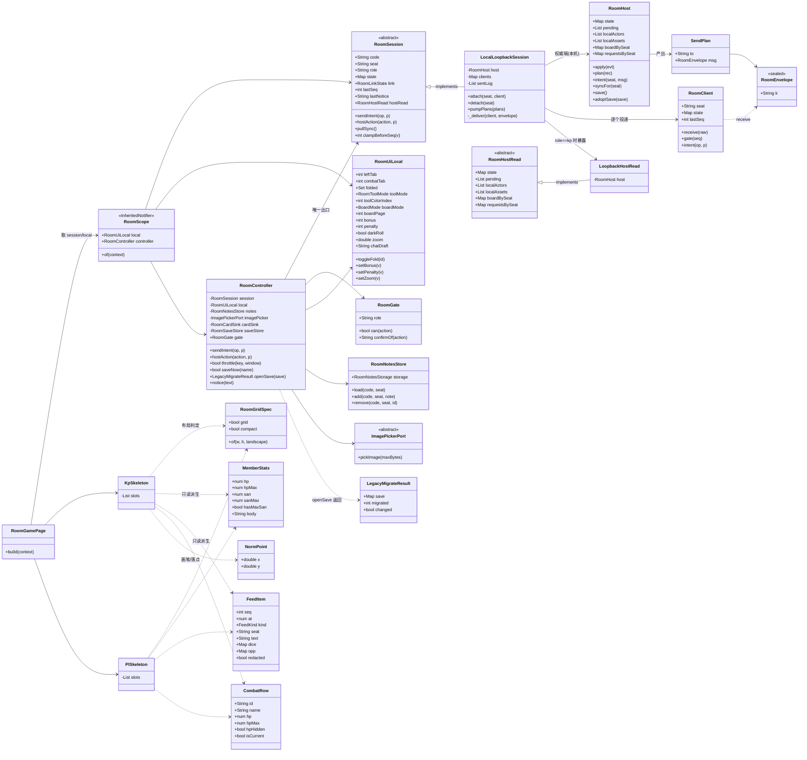
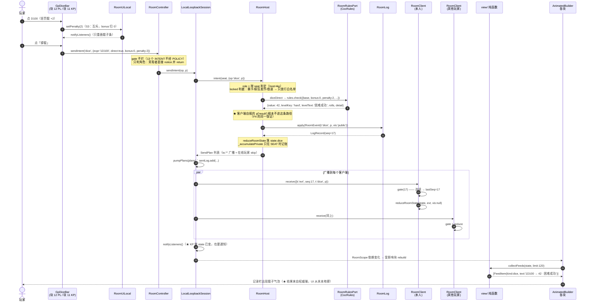
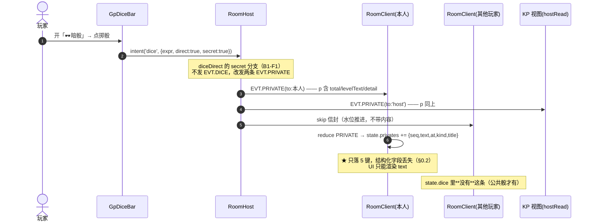
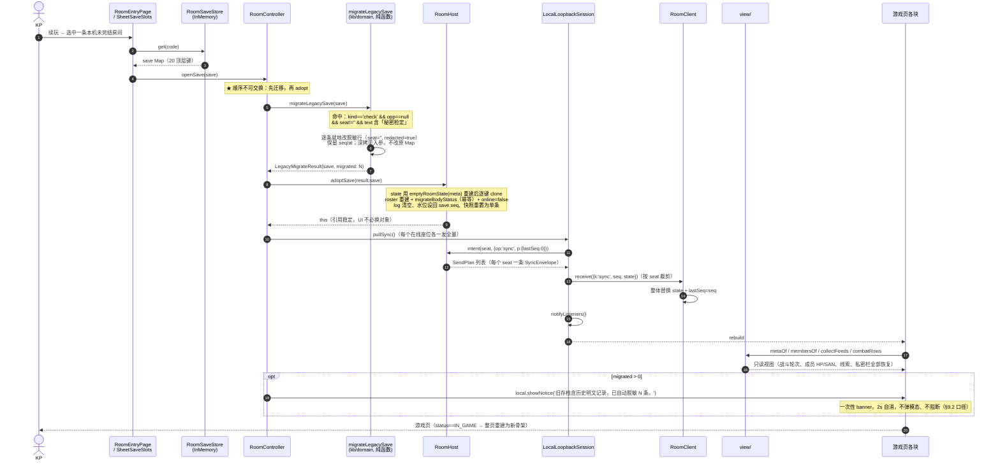
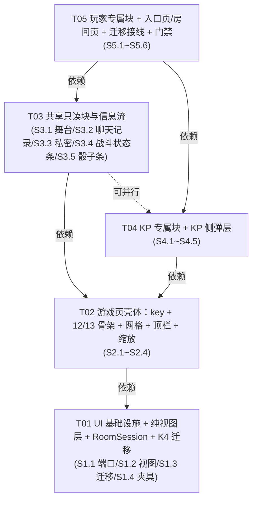

# P5 增量系统设计：房间 UI（room-ui / room-panels 原生 Flutter 移植）

> 编写人：高见远（software-architect-2 · 架构师）
> 基线版本：`2.15.0+81`（P4 未出包；P5 出包版本按 team-lead 裁决留 `2.16.0+82`，**本阶段不改 `pubspec.yaml`**）
> 上游输入：`_p5_prd.md`（1118 行，产品经理交付）+ team-lead 6 项裁决 + P4 补丁 B1
> 交付性质：**只做设计与文档**。本阶段未改任何 `lib/`、`test/` 代码，未跑 `flutter test` / `flutter build`。
>
> **落盘状态**：已完成（两批）+ **R2 勘误**（§0.3 file_picker 13.x API / §6.4 座位名 `p1·p2·sp1` / §6.1 横屏语义 / §7 K13–K15 / §5.0 T01 交付清单）。
> 第一批 §1 实现方案 + §2 文件列表 + §5 任务列表（工程师可据此开工）；
> 第二批补齐 §3 数据结构与类图 / §4 时序图 / §6 测试策略 / §7 共享知识 / §8 待明确事项 / §9 决策清单。
> 提取件：`docs/p5-class-diagram.mermaid`、`docs/p5-sequence-diagram.mermaid`、`docs/p5-sequence-diagram-b.mermaid`、`docs/p5-task-dependency-graph.mermaid`。

---

## 0. 开工前必读的 5 条复核结论

我实读了 PRD、B1 补丁、P4 设计范式与已交付的规则层源码，有 5 处需要工程师在动手前先对齐（其中 2 条是**好消息**：省掉两处工作量）。

### 0.1 B1 已落地，四个 intent 可直接用（设计里**不安排**「补齐结算函数」）

`room_model_host_intent.dart` 现在四个分支都接上了：`dice` 按 `p.direct` 分流到 `diceDirect`（:199-202）、`sanCheck → playerSanCheck`（:244-246）、`opposed → opposed`（:248-250）、`board → boardSelf`（:252-254）。
因此 P5 的 UI **只需要**构造正确形状的信封，不需要任何「补结算」任务。四条信封形状（我逐字段核过源码）：

| 控件 | `IntentEnvelope` | `p` 载荷（UI 只填这些） |
|---|---|---|
| D100 / D4-D10 / 自定义骰式 | `op: 'dice'` | `{expr, direct: true, bonus, penalty, secret?, base?, label?, difficulty?}` |
| 技能检定 | `op: 'dice'` | `{expr:'1D100', direct:true, base, label, skill?, bonus, penalty}` |
| 🧠 SAN Check | `op: 'sancheck'` | `{okLoss, loss}` |
| ⚔ 武器对抗 / 选伤害目标 | `op: 'opposed'` | `{phase, ...}`（`phase ∈ apply / target`） |
| 我的手绘板 | `op: 'board'` | `{strokes: [...]}`（**全量替换**，模型侧 `take(4000)`） |
| 61 个 action | `op: 'act'` | `{op: '<action>', ...字段}`（`act()` 从 `p['op']` 取 action 名） |

> ⚠️ 注意 `act` 是**双层**的：外层信封 `{'op':'act','p':{...}}`，内层 `p['op']` 才是 action 名。工程师最容易写成单层。

### 0.2 暗骰/私密检定结果：**只渲染 `text`，不扩展 `privateBySeat`**

我核对了三处源码，结论是「结构化字段在 UI 层拿不到，而且**不应该**去拿」：

1. `diceDirect` 的 secret 分支（`room_model_actions_combat.dart:820-885`）把完整结果（`total/level/levelText/detail/rolls`）**同时**编码进 `text` 与 `evt.p`；
2. `reduceRoomState` 的 `EVT.PRIVATE` 分支（`room_model_reduce.dart:314-328`）只落 **5 个键**：`{seq, text, at, kind, title}`；
3. `RoomHost._accumulatePrivate`（`room_model_host_core.dart:167-181`）同样只留这 5 个键。

而 `text` 的构造已经把信息全都写进去了（`… = 42（困难成功）　明细：…`）。所以：

- **P5 决定**：块 10 / PL 块 9 的私密栏、以及「暗骰结果」条目，**一律直接渲染 `text`**，不做任何解析或还原（符合 C6「`redacted` 行只显示 `text`，不得尝试还原」）。
- 结构化骰子气泡（`expr / total / levelText / detail / rolls`）**只用于公开骰** —— 因为 `state.dice[]` 是 `EVT.DICE` 归约结果，键集合是 `{seq, seat, nickname, expr, rolls, total?, level?, levelText, label, at}`（`room_model_reduce.dart:95-110`）。
- **不扩展** `privateBySeat`：那要动 P4 冻结文件 + 存档 20 键 + 1349 例 oracle fixture，收益仅是「重连后骰子气泡更漂亮」，性价比不成立。

### 0.3 Q-P5-2 可以**零新增依赖**解决：`file_picker` 已在 `pubspec.yaml:39`

`file_picker: ^13.3.2` 是现有依赖（`lib/ui/card_transfer_io.dart` 已在用）。素材/头像上传的 `ImagePickerPort` 生产实现基于它，依赖**一行不改**，产出仍是 `data:image/<ext>;base64,...`（与旧版 `FileReader.readAsDataURL` 同形状，可直接进 `asset.add` 载荷）。

> ⚠️ **勘误（工程师 T01 实读包源码 + `card_transfer_io.dart:75-84` 注释双确认）**：本文初版把 API 写成了
> **file_picker 8.x 的形态**，在 13.3.2 上**硬写会编译失败**。以下表为准：

| 项 | 8.x（初版写错） | **13.3.2（以此为准）** |
|---|---|---|
| 入口 | `FilePicker.platform.pickFiles(...)` | **静态方法** `FilePicker.pickFile(...)`；`FilePicker.platform` 已不再使用 |
| 取字节 | 入参 `withData: true`，字节随返回值一起给 | **`withData` 参数在 13.x 已不存在**；改为 `await picked.readAsBytes()` |

```dart
// 13.3.2 的真实写法（已按此落地：lib/ui/room/room_image_picker.dart:47-58）
final PlatformFile? picked = await FilePicker.pickFile(
  dialogTitle: '选择图片素材',
  type: FileType.image,
);
if (picked == null) return null;                          // 用户取消
final Uint8List bytes = await picked.readAsBytes();
if (maxBytes > 0 && bytes.length > maxBytes) return null; // S9：2MB 上限
return 'data:image/$ext;base64,${base64Encode(bytes)}';
```

⇒ **不需要新增 `image_picker`，`pubspec.yaml` 一行不改**。测试用 `FakeImagePicker`（返回固定 1×1 PNG 的 dataURL），注入方式沿用 `cardTransferIo` 的全局可替换实例范式（`roomImagePicker`）。

### 0.4 容器数：KP **12** / 玩家（含旁观）**13**，且**不做跨视角块号对齐**

以 PRD 附录 A 的**容器 key**为唯一标识。我在设计里引入 `RoomSlot` 枚举，键名与 PRD 一致（`gpTopbar` / `gpKpLeft` / … / `gpStatus`），块号**只出现在注释里**，不参与任何逻辑（旧版块号在两侧含义不同，拿块号当标识一定出错）。

旁观者**复用玩家骨架**（`role != kp` → PL 骨架）。所以代码里只有两套骨架：`_KpSkeleton` / `_PlSkeleton`。

### 0.5 死代码清单（C7）：4 个面板**不实现**，且做成机械门禁

`plBottomBar` / `plFeeds` / `kpChat` / `kpGameLog` 在 `lib/ui/room/` 内必须**零命中**。我会把这条写进 `tool/qa/qa_p5_ui.js`（新增静态探针，5 行 grep），而不是只写在文档里 —— 否则下一个接手的人一定会「顺手补全」。

---

## 1. 实现方案 + 框架选型

### 1.1 核心技术难点（7 个，逐个给解法）

| # | 难点 | 为什么难 | 本设计的解法 |
|---|---|---|---|
| D1 | **12/13 块同构不同内容** | KP 4 列 2 行、玩家 3 列；块数不同、同一块号含义不同；旧版注释「绝不把 5/6/7/8/9/10 合并成一个节点」 | 骨架用「**槽位清单**」描述（`List<RoomSlot>`），每个槽位是**独立 widget 子树**，有稳定 `ValueKey(RoomKeys.x)`。布局只决定槽位放哪一格，**不合并、不嵌套滚动** |
| D2 | **局部重绘 + 状态保持** | 旧版每次 `paint()` 重建整个 DOM，靠 `refreshSheet` / `restoreScroll` 打补丁；Flutter 里换 widget 会丢 `ScrollPosition` 和输入内容 | ① 每块一个 `AnimatedBuilder(animation: session)`，只重建自己；② 稳定 key + `PageStorageKey`；③ **输入行**用独立 `StatefulWidget` 持 `TextEditingController`，`didUpdateWidget` 只同步「外部强制清空」信号，重绘不重建；④ 滚动位置由 `ScrollController` 挂在块的 State 上，块本身不换 key 就不重置 |
| D3 | **UI 不许碰规则，且要结构上成立** | 只靠 review 一定漏 | `lib/ui/room/view/` 为**纯 Dart 层**（零 `package:flutter`），只做 `state → 只读视图数据`；`widgets/` 只 import `view/` + `Material`，**不 import** `RoomHost.apply` / `RoomRules` 相关符号。UI 的**唯一出入口**是 `RoomController`（`sendIntent` / `hostAction`），它是 Ui 层唯一持有 `RoomSession` 的地方 |
| D4 | **网格阈值是唯一真相源** | 旧版 CSS 已不再二次判定，且 520/599/820/290/360 五个魔数各有含义 | `view/room_view.dart` 里的**纯函数** `RoomGridSpec.of(w, h, landscape)`，一个函数、一份阈值常量；widget 层只消费结果。这样阈值可以被纯 Dart 单测直接钉死（不需要 pump 界面） |
| D5 | **手绘板 / 地图笔迹** | 归一化坐标 `[0,1]`、段级擦除、单笔落点上限、4000 笔上限、全量替换语义 | `painter/stroke_painter.dart`：`StrokesPainter`（`CustomPainter`，输入归一化点列 + `Size`）+ `marks` 叠加层。**命中判定/段级删除是纯函数**放 `view/scene_view.dart`（`hitStrokeIndex` / `eraseStrokeSegments`），可在纯 Dart 测试里钉死。手势用 `Listener`（onPointerDown/Move/Up），手势末尾**一次**提交 |
| D6 | **没有 P6 传输也要能验收玩家/旁观视角** | 玩家视图必须来自「真正被裁剪过的数据」，不能拿 host.state 假装 | `RoomSession` 抽象 + `LocalLoopbackSession`：`host.intent()` 返回的 `List<SendPlan>` **逐条**喂给本机注册的 `RoomClient.receive(msg.toJson())`（`to=='*'` 全员、`to==seat` 单人）。P6 只加 `RemoteSession`，UI 一行不改 |
| D7 | **权限与可点性必须同源** | 旧版教训：玩家侧误挂 KP 面板，「点下去权威端静默拒绝、界面弹推送成功」 | 所有按钮走 `RoomGate`：`can(op)` = `needs(role, op).allowed`。不可用时**要么不渲染、要么 disabled + 原因文案**。再配一条表驱动探针测试，遍历 §5.9 全表断言「可点 ⟺ allowed」 |

### 1.2 框架 / 库选型

| 选择 | 结论 | 理由 |
|---|---|---|
| UI 框架 | **Flutter 原生 widget**（项目既有） | C5 禁 WebView；PRD 明确「原生 widget 移植」 |
| 状态管理 | **`ChangeNotifier`（RoomSession）+ `InheritedNotifier`（RoomScope）+ 每块 `AnimatedBuilder`** | 与项目既有范式一致（`RepoScope` / `SettingsScope` / `ShareScope` 都是 `InheritedNotifier`）。**不引入 Riverpod / Bloc / GetX**：本项目的状态是「一个外部权威快照 + 一份 UI 本地态」，两个 `Listenable` 就够；引入新范式会让 P2/P3 已有页面的写法分叉，review 成本大于收益 |
| 本地 UI 态 | **`RoomUiLocal extends ChangeNotifier`**（一个对象） | 对应旧版 `UI_STATE`（`room-panels.js:58`）：`leftTab / combatTab / matesOpen / tool{mode,icon,color} / boardMode / boardPage / d100Mod / darkRoll / fold / zoom / drafts`。**不进 state、不进存档** |
| 纯视图层 | **纯 Dart 函数 + 不可变数据类** | 让「UI 不算规则」在结构上成立（D3）；可纯 Dart 单测，不需要 pump |
| 绘制 | **`CustomPainter`** | 笔迹/标记/网格都是矢量；`CustomPaint` 比一堆 `Positioned` 便宜得多，且归一化坐标缩放天然正确 |
| 手势 | **`Listener`（画笔/橡皮/平移）+ `GestureDetector`（点按/捏合）** | `Listener` 能拿到 `PointerMoveEvent` 的原始位置，不被 `onPan` 的采样吞掉；捏合用 `GestureDetector.onScaleUpdate` |
| 图片 | **`file_picker`（已有依赖）** + `Image.memory` | 见 §0.3：零新增依赖，不违反禁 WebView |
| 弹层 | **`showModalBottomSheet(isScrollControlled: true)` + `RoomSheet` 可刷新包装** | 对应旧版 `UI.sheet({body: fn})` 的「状态变化后弹层自动重画」；Flutter 侧用 `ValueNotifier` 触发 `StatefulBuilder` 重建 |
| 长列表 | **`ListView.builder`**（聊天/记录/成员/战斗） | 懒构建；测试需配 `scrollTo`（T4 铁律） |
| 新增依赖 | **无** | `file_picker` 已在 `pubspec.yaml:39`。`image_picker` **不需要加** |

### 1.3 分层与依赖方向（铁律的机械落地）

```
lib/domain/                    纯 Dart（零 flutter / 零 dart:io / 零 dart:ui）
  room_types.dart              常量（EVT 27 / INTENT 13 / POLICY 61 / VIS）
  room_model*.dart             状态机（Host / Client / reduce / save）
  room_legacy_migrate.dart     ★P5 新增：旧存档明文脱敏（纯函数、零 I/O、零 flutter）
        ▲
        │ 只读 / 只调 intent
        │
lib/ui/room/view/              ★纯 Dart（零 flutter），state → 只读视图数据
  room_view.dart  member_view.dart  feed_view.dart
  combat_view.dart  scene_view.dart  sheet_view.dart
        ▲
        │ 只消费不可变视图数据
        │
lib/ui/room/widgets/ + sheets/ + painter/     Flutter widget（只画、只发 intent）
        ▲
        │ 唯一出入口
        │
lib/ui/room/room_controller.dart              sendIntent / hostAction / 节流 / 错误提示
lib/ui/room/room_session*.dart                RoomSession 端口 + LocalLoopback 实现
lib/ui/room/room_scope.dart                   InheritedNotifier（向下传 session + local + controller）
```

**机械可检的三条**（写进 `tool/qa/qa_p5_ui.js`）：

1. `lib/ui/room/view/*.dart` 内 `package:flutter` 命中数 == **0**
2. `lib/ui/room/**`（除 `view/`）内 `state[` **赋值** 命中数 == 0；`rules?.check(` / `rollExpr(` / `opposedFull(` 命中数 == 0
3. `lib/ui/room/**` 内 `plBottomBar` / `plFeeds` / `kpChat` / `kpGameLog` 命中数 == 0

### 1.4 状态与重绘范式（照这个写，别自创）

```dart
// room_scope.dart
class RoomScope extends InheritedNotifier<RoomSession> {
  const RoomScope({
    super.key,
    required RoomSession session,
    required this.local,       // RoomUiLocal
    required this.controller,  // RoomController
    required super.child,
  }) : super(notifier: session);

  final RoomUiLocal local;
  final RoomController controller;

  /// `InheritedNotifier` 把它存在 `notifier` 里；这里给一个有类型的别名。
  RoomSession get session => notifier!;

  static RoomScope of(BuildContext c) { /* 断言 + dependOnInheritedWidgetOfExactType */ }
  static RoomScope read(BuildContext c) { /* getInheritedWidgetOfExactType，不订阅 */ }
}
```

每块的写法（**统一模板**）：

```dart
class GpPrivates extends StatelessWidget {
  const GpPrivates({super.key, required this.fullscreen});
  final bool fullscreen;

  @override
  Widget build(BuildContext context) {
    final sc = RoomScope.of(context);          // 订阅 session
    final s = sc.session.state;                // 只读快照
    final rows = privRowsOf(s, sc.session.seat); // 纯函数（view/）
    return ListenableBuilder(                   // 再订阅本地态（折叠/tab）
      listenable: sc.local,
      builder: (_, __) => SectionBox(/* ... */),
    );
  }
}
```

> 两层 `Listenable` 分开订阅的理由：`session` 变化频繁（每秒都可能），`local` 变化稀疏（点 tab）；合成一个会让「点一下折叠」重算整页视图函数。这是 P0-17 的成本关键。

### 1.5 布局 / 网格 / 缩放

**网格判定（唯一真相源，纯函数）**

```dart
// view/room_view.dart
class RoomGridSpec {
  const RoomGridSpec({required this.grid, required this.compact});
  final bool grid;      // 宽屏多列
  final bool compact;   // 手机横屏档：行高收紧

  static const double wide = 820;      // 宽屏阈值
  static const double narrowLo = 520;  // 窄档下界
  static const double narrowHi = 599;  // 窄档上界（含）
  static const double minH = 290;      // 极矮 → 单列
  static const double compactH = 360;  // ≤ 此高度 → compact

  static RoomGridSpec of({
    required double w,
    required double h,
    required bool landscape,
  }) => RoomGridSpec(
        grid: ((landscape && w >= narrowLo) || w >= wide) &&
            !(w >= narrowLo && w <= narrowHi) &&
            h >= minH,
        compact: ((landscape && w >= narrowLo) || w >= wide) &&
            !(w >= narrowLo && w <= narrowHi) &&
            h >= minH &&
            h <= compactH,
      );
}
```

`compact` 的算法刻意与 `grid` 同源（旧版 `compact = grid && h <= 360`），**不要**简化成独立的 `h <= 360` —— 那会让 520–599 单列档也被判成 compact。

**缩放**：`RoomZoomHost` 只包**内容区**，工具栏在它外面（`room_game_page.dart` 的结构上就分开，不靠样式）。

```dart
// 缩放范围 0.6 ~ 1.0，只缩小不放大
// 因为只缩小，Transform.scale 后的滚动内容**必然小于**滚动视口，
// 永远不会被裁掉 —— 所以不需要 post-frame 量高再撑 SizedBox。
Stack(children: [
  SingleChildScrollView(child: Transform.scale(
    scale: zoom, alignment: Alignment.topLeft, child: contentColumn)),
  Positioned(left: 0, right: 0, bottom: 0, child: GpToolbar()), // 缩放容器之外
])
```

> 这条推理是设计决策，不是偷懒：旧版 `transform:scale()` 生成 containing block 才把 toolbar 挪出去（`room-ui.js:2683-2686`），P5 保留「工具栏在缩放容器外」这个**可见结果**；而「放大到 >100% 需要撑高」这个 P5 不存在的能力，不做预备。

**朝向**：不调 `SystemChrome.setPreferredOrientations`（跟系统）。

> 测试侧的尺寸语义见 §6.1：`useRoomScreen(tester, w, h, {landscape})` 的 `w/h` 就是**最终视口宽高**，
> **不做宽高交换**；横屏直接传 `(780, 320)`，`landscape` 只用来喂 `RoomGridSpec.of` 选档。

**触控**：`RoomTap`（`room_panel_kit.dart`）统一 `minimumSize: Size(48, 48)` + `MaterialTapTargetSize.padded`；所有图标按钮必须用它，禁止裸 `IconButton`。

### 1.6 权限同源（`RoomGate`）

```dart
// room_controller.dart
class RoomGate {
  const RoomGate(this.role);
  final String role;

  /// 控件可点 ⟺ POLICY 允许。
  bool can(String op) => needs(role, op).allowed;

  /// 需要哪种确认（null = 直接生效 / 'kp' / 'twice' / 'owner' / 'all'）。
  String? confirmOf(String op) => needs(role, op).confirm;
}
```

按钮统一写法：

```dart
RoomTap(
  key: RoomKeys.kpStartGame,
  label: '开始游戏',
  enabled: gate.can('room.start') && allReady,
  hint: gate.can('room.start') ? null : '只有 KP 能开始游戏',
  onTap: () => ctl.hostAction('room.start'),
)
```

**insight 通道（13 个 `INTENT`）不经 POLICY**，所以 `can()` 对它们恒为 `false`（`needs()` 对未登记 op 返回 `allowed:false`）。这类按钮的可点性用**角色 + 业务前置条件**判定，且必须与 `intent()` 的拒绝分支**逐条对齐**（见 §7 共享知识 K6 的对齐表）。

---

## 2. 完整文件列表（相对 `dice-realm/`，逐文件职责与预估行数）

> 行数按项目既有风格（含中文注释、每行 ≤ 80 列）估算。**合计 ≈ 17,000 行**（≈ 11825 行 JS 的 1.4 倍，
> 原因是 Flutter 的 widget 树比 DOM 拼串啰嗦 + 「约束在结构上成立」需要额外的纯函数层）。
> 工期紧时按 §8 的裁剪顺序落地（P2 项 + 3 个 sheets 文件可延后，约 −1,300 行）。

### 2.1 `lib/domain/`（纯 Dart，零 flutter / 零 dart:io / 零 dart:ui）

| 文件 | 职责 | 行数 | 任务 |
|---|---|---|---|
| `room_legacy_migrate.dart` | **★新增** K4 旧存档明文脱敏迁移。纯函数：`LegacyMigrateResult migrateLegacySave(Map save)`；命中条件 `kind=='check' && opp==null && seat!='' && text 含「秘密检定」`；就地改脱敏行、保留 `seq`/`at`；幂等。**不改 `room_model_save.dart`** | 140 | T01 |

### 2.2 `lib/repo/`（I/O 边界）

| 文件 | 职责 | 行数 | 任务 |
|---|---|---|---|
| `room_notes_store.dart` | **★新增** 笔记栏本机存储（P1-05）。`RoomNotesStore` + `MemoryNotesStorage` + `RoomNotesStorage` 抽象；键 = `roomCode/seat`；**不上传、不进 state**。文件后端留构造位（同 `room_save_store.dart` 范式） | 160 | T01 |

### 2.3 `lib/ui/room/`（根层：端口 / 控制器 / 路由 / 页面壳）

| 文件 | 职责 | 行数 | 任务 |
|---|---|---|---|
| `room_session.dart` | `RoomSession` 抽象（`extends ChangeNotifier`）、`RoomLinkState`、`RoomHostRead`（KP 专属只读面）、`SessionSendLog`（测试记录） | 260 | T01 |
| `room_session_local.dart` | `LocalLoopbackSession`：持有 `RoomHost` + 多个 `RoomClient`，`SendPlan` 泵（`to=='*'` 广播 / `to==seat` 单发）、`beforeSeq >= 1` 守卫、`pullSync(seat)` | 330 | T01 |
| `room_scope.dart` | `RoomScope extends InheritedNotifier<RoomSession>`，向下传 `session / local / controller / gate` | 120 | T01 |
| `room_controller.dart` | **UI 唯一出入口**：`sendIntent(op,p)` / `hostAction(action,p)` / `gate` / 400ms 节流 / 错误与提示 sink / 弹层刷新登记 | 320 | T01 |
| `room_ui_local.dart` | `RoomUiLocal extends ChangeNotifier`：旧版 `UI_STATE` 全集 + `fold` + `zoom` + 草稿 | 340 | T01 |
| `room_keys.dart` | 全部稳定 key 常量（`RoomKeys.gpChat` 等）+ `RoomSlot` 枚举 + 槽位→key 映射 | 130 | T01 |
| `room_theme.dart` | 房间页配色 / 尺寸常量 / `kDrawColors`（5 色）/ 48dp 常量 | 160 | T01 |
| `room_image_picker.dart` | `ImagePickerPort` + `FilePickerImagePicker`（基于已有 `file_picker`）+ `roomImagePicker` 全局可替换实例 + `FakeImagePicker`（测试侧放 harness） | 80 | T01 |
| `room_entry_page.dart` | 房间入口页：创建 / 加入 / 续玩 / 存档槽列表 | 560 | T05 |
| `room_lobby_page.dart` | 房间页（招募中）R1–R12（头卡/成员/准备/绑卡/开始/结束/模式/探索面板/KP 工具/状态条/掷骰条） | 700 | T05 |
| `room_game_page.dart` | 游戏页壳体：视角路由（`role=='kp'` → KP 骨架，否则 PL 骨架）、网格、缩放、折叠、槽位装配 | 520 | T02 |

### 2.4 `lib/ui/room/view/`（**纯 Dart，零 `package:flutter`**）

| 文件 | 职责 | 行数 | 任务 |
|---|---|---|---|
| `room_view.dart` | `metaOf / statusText / whoLine / roleText`、`members / playersOf / spectatorsOf / findMe / mySeatOf`、`isCombat / modeOf`、**`RoomGridSpec.of`** | 240 | T01 |
| `member_view.dart` | `MemberStats memberStats(mem)`（**S1**：`sheet.status` 与 `runtime` 双源兼容）、`memberDex`（**S2**：只认 `sheet.attrs.dex`）、`bodyViewOf`、`isDown`（**S5**：带 `hpMax>0` 守卫）、`hpText / sanText`（他人无 `maxSAN` → 只显当前值）、`targetBlocked`、`operationLocked`（**S7**） | 320 | T01 |
| `feed_view.dart` | `List<FeedItem> collectFeeds(...)`：`logs` + `dice` 按 `at` 合并升序、cap 120 / 聊天 cap 60；`FeedKind` 枚举；`redacted` 行只取 `text`；`opposedResultCard` 的只读数据化 | 300 | T01 |
| `combat_view.dart` | `CombatRow` 列表化（`hpPublic==false` → `hidden:true`）、`curSlot / isMyTurn / roundText`、`initiativeRows` | 240 | T01 |
| `scene_view.dart` | `assetsOf(scene, kind)` / `publicAssets` / `marksOf` / `strokesOf` / `boardCountOf` / `sceneCheckProgress`；**`hitStrokeIndex` / `eraseStrokeSegments` / `clampNorm`**（笔迹纯函数） | 220 | T01 |
| `sheet_view.dart` | 角色卡只读派生：`vitalsOf`、`attrRows`、`skillRows(sheet)`、`charStatusText`、`tempStatusOf`、`itemsOf`、`mentalText` | 260 | T01 |

### 2.5 `lib/ui/room/widgets/`（逐块 widget）

| 文件 | 职责 | 行数 | 任务 |
|---|---|---|---|
| `room_panel_kit.dart` | 通用件：`SectionBox`（**内禁 `ListTile`**）、`PanelTabs`、`ScrollBox`、`StatBar`、`AvatarDot`、`ChipRow`、`FoldHeader`、`RoomTap`（≥48dp）、`RoomSheet` 包装、`ConfirmTwice` | 300 | T01 |
| `gp_topbar.dart` | 块 1（两侧共用）：房间名/身份/房间号/场景/连接态/角色/模式/观众数 + 服务地址块（仅 KP） | 330 | T02 |
| `gp_toolbar.dart` | 块 11(KP) / 12(PL)：快捷行 + 缩放控件 + `reserve` 高度；**必须在缩放容器外**。骰子条本体见 `gp_dice_bar.dart` | 300 | T02 |
| `gp_dice_bar.dart` | `diceBar`：D100 / 奖惩骰 0–5（**互斥**，S3；分开传，S4）/ 🕶暗骰 / D4-D10 / 扩展组按钮 | 420 | T03 |
| `gp_map_stage.dart` | 块 4(KP) / 3(PL)：公开素材舞台 16:9 + 平移 + 缩放 ± + 全屏只读 + 落点（工具态决定）+ `MapStageController`（供 KP 工具窄栏调用） | 560 | T03 |
| `gp_feeds.dart` | 块 8/9（KP）/ 4/5（PL）：`FeedList`（懒构建 + 上滚不拉底）+ `FeedRow`（sys/chat/dice/check/opposed 分派）+ `ChatInputRow`（**建页挂一次**）+ 全屏 | 620 | T03 |
| `gp_privates.dart` | 块 10(KP) / 9(PL)：最近 12 条、正序、新条高亮、点开全文、⛶ 全屏 | 300 | T03 |
| `gp_combat_list.dart` | 块 6（两侧共用，KP 可推进 / PL 只读）：顺序/名称/类型/HP/状态/行动 + 怪物信息 tab + 未参战加入 | 520 | T03 |
| `gp_status.dart` | 块 12(KP，恒空) / 13(PL)：「需我同意」请求卡 + 对抗待办 + 选伤害目标 | 320 | T03 |
| `gp_kp_left.dart` | 块 2：三 tab（🗺地图 / 👹NPC·怪物 / 🖼素材）+ 子列表 + 上传/删/公开切换 | 430 | T04 |
| `gp_kp_tools.dart` | 块 3：标记 / 画笔 / 橡皮 / 5 色 / 放置单位 / 放置玩家 / 清除（二次确认） | 300 | T04 |
| `gp_scene_check_kp.dart` | 块 5(KP)：步骤进度 + 6 档裁定 + 自定义快速推送 + 编辑器入口 | 360 | T04 |
| `gp_scene_check_pl.dart` | 块 7(PL)：**只读** KP 推来的 + 用自己技能主动检定。**绝不**出现裁定/推送按钮 | 280 | T05 |
| `gp_kp_players.dart` | 块 7(KP)：头像/名/HP/MP/SAN/手绘板入口 + 成员详情 | 340 | T04 |
| `gp_pl_char_card.dart` | 块 2(PL)：头像/名/职业/HP·MP·SAN 条/状态管理/推进 1 轮/角色状态/撕卡提示/临时卡条 | 450 | T05 |
| `gp_pl_mates.dart` | 块 8(PL)：队友列表（可收起）+ 每人 HP/SAN + 体/精标签 + 手绘板缩略（按**笔数**） | 320 | T05 |
| `gp_pl_sketch.dart` | 块 10(PL)：画布 + `‹1/1›` 分页 + 笔/擦切换 + 清空（确认）；落笔/擦除末尾一次 `INTENT.BOARD` 全量 | 380 | T05 |
| `gp_pl_notes.dart` | 块 11(PL)：本机笔记（增/删/改），不上传 | 220 | T05 |

### 2.6 `lib/ui/room/painter/`

| 文件 | 职责 | 行数 | 任务 |
|---|---|---|---|
| `stroke_painter.dart` | `StrokesPainter`（笔迹）、`MarksPainter`（标点）、`BoardPainter`（手绘板）+ 归一化↔像素换算 | 280 | T01 |

### 2.7 `lib/ui/room/sheets/`（弹层，每个文件一组同族）

| 文件 | 职责 | 行数 | 任务 |
|---|---|---|---|
| `room_sheet.dart` | `showRoomSheet(...)` 统一入口 + **可刷新 body**（`ValueNotifier` + `StatefulBuilder`）+ `refreshTopSheet()` + `FullscreenReader` | 200 | T01 |
| `sheet_bind_char.dart` | 绑定/更换/清空角色卡（房间页） | 180 | T05 |
| `sheet_self_state.dart` | 状态管理：身体 chips / 精神多选 / HP·MP·SAN 数字（**文案按 Q-P5-3**：「立即生效」vs「提交后等 KP 同意」） | 300 | T05 |
| `sheet_char_view.dart` | 人物卡只读 + 完整信息图（复用 P2 `summary_card.dart`，不新增卡片键） | 230 | T04 |
| `sheet_dice_tools.dart` | 技能检定 / SAN Check / 自定义骰子 / d100 修正面板 / 暗骰设置 | 420 | T04 |
| `sheet_kp_panel.dart` | `kpPanel` 根：待确认队列 + 待裁定对抗 + 待处理改状态 + 四组工具（回合/检定骰子/战斗/场景与素材/房间管理） | 560 | T04 |
| `sheet_kp_directives.dart` | KP 定向 9 项（伤害/临时状态/物品/SAN Check/暗骰/治愈不定疯狂/治愈重伤/急救医学/SAN 大失败） | 620 | T04 |
| `sheet_opposed.dart` | 对抗全链路：通用对抗 / 攻击对抗 / 武器对抗(PL) / 裁定对抗申请 / 选伤害目标 | 520 | T04 |
| `sheet_combat.dart` | 战斗准备（选参战单位）/ 结算伤害 / 新增怪物NPC | 480 | T04 |
| `sheet_scene.dart` | 场景检定编辑器 / 递线索 / 要求检定 / 请求修改状态 / 素材与地图卡 | 430 | T04 |
| `sheet_save_slots.dart` | 存档槽：新建 / 载入 / 删除 + 默认名 | 280 | T05 |
| `sheet_misc.dart` | 规则参考 / 物品道具 / 音乐控制台(P2) / AI RP / UI 缩放设置 / 观众名单 | 300 | T05 |

### 2.8 `test/`

| 文件 | 职责 | 行数 | 任务 |
|---|---|---|---|
| `support/room_ui_harness.dart` | `RoomUiFixture`（`boot({players, spectators, mode})` / `kpPage()` / `playerPage(seat)` / `spectatorPage(seat)`）、`sent` 记录、`FakeImagePicker`、`InMemoryNotesStorage`、`useRoomScreen(tester, w, h, {landscape})`（不做宽高交换，见 §6.1）；**复用 `room_fakes.dart` 的 `roomHostOpts` / `Lcg`** | 340 | T01 |
| `room_view_test.dart` | 纯 Dart：`RoomGridSpec` 五档阈值、`memberStats` 双源、`isDown` 守卫、`sanText` 他人格式、`collectFeeds` 排序/裁剪/redacted、`hitStrokeIndex` | 320 | T01 |
| `room_session_test.dart` | `LocalLoopbackSession`：广播/单发/可见性裁剪（玩家视图无他人 `attrs`）/ `skip` 消费 / 断线 `pullSync` / `beforeSeq<1` 守卫 | 260 | T01 |
| `room_legacy_migrate_test.dart` | K4 迁移：命中/不命中/幂等/保留 `seq,at` | 130 | T01 |
| `room_ui_shell_test.dart` | T-01 ~ T-08（骨架/视角/折叠/整页重建/旁观禁用） | 300 | T02 |
| `room_ui_feeds_test.dart` | T-10 ~ T-12（输入不丢 / redacted / 无 `toWireJson`）+ T-15 T-16 | 320 | T03 |
| `room_ui_blocks_test.dart` | T-13 T-14 T-17 T-18 T-19（隐藏 HP / SAN 格式 / 奖惩互斥 / 上限 5 / 暗骰走 `dice.dark`） | 420 | T03 |
| `room_ui_kp_test.dart` | KP 12 容器全存在 + KP 专属可点性 + 场景检定裁定 + 定向指令 9 项 | 360 | T04 |
| `room_ui_player_test.dart` | PL 13 容器全存在 + T-20 ~ T-23 + 手绘板落笔 | 380 | T05 |
| `room_ui_permission_test.dart` | T-30 ~ T-35（表驱动「可点 ⟺ needs」/ 越权零状态变化 / 定向提示 / 同意链 / 秘密检定 / 手绘板隔离） | 320 | T05 |
| `room_ui_layout_test.dart` | T-40 ~ T-43（360×640 / 780×320 / 480 单列 / 48dp） | 240 | T02 |
| `room_ui_save_test.dart` | T-50 ~ T-52（存档往返 / 三路径 / 旧存档迁移提示） | 220 | T05 |
| `room_ui_roll_test.dart` | T-60 ~ T-63（D100 / 技能 / SAN / 手绘板，**断言权威侧**） | 300 | T05 |

### 2.9 静态门禁与文档提取件

| 文件 | 职责 | 行数 | 任务 |
|---|---|---|---|
| `tool/qa/qa_p5_ui.js` | 新增静态探针：`view/` 零 flutter、`ui/room` 零 `state[..]=`、零 `rollExpr(`/`opposedFull(`、4 个死代码名零命中、`await repo.save(` 命中数不增加、`lib/domain` 零 flutter/io、行数/文件清单核对 | 160 | T05 |
| `docs/p5-class-diagram.mermaid` | 从 §3.8 抽取（类图） | — | T01 |
| `docs/p5-sequence-diagram.mermaid` | 从 §4.1 抽取（时序 A：掷骰主链路） | — | T01 |
| `docs/p5-sequence-diagram-b.mermaid` | 从 §4.2 抽取（时序 B：导入旧存档） | — | T01 |
| `docs/p5-task-dependency-graph.mermaid` | 从 §5.1 抽取（任务依赖图） | — | T01 |

---

## 3. 数据结构与接口（签名照抄，不要改名）

### 3.0 两条硬性类型约束（先看，写错了后面全要返工）

**① `view/` 里禁止 `dart:ui` 类型。** `Offset` / `Rect` / `Color` / `Size` 全部在 `dart:ui`（经由 `package:flutter` 导出），
`view/` 要能纯 Dart 单测就必须自己造值对象：

```dart
// view/scene_view.dart
class NormPoint { const NormPoint(this.x, this.y); final double x, y; }        // 归一化 [0,1]
class NormBox   { const NormBox(this.l, this.t, this.r, this.b); final double l, t, r, b; }
class RgbColor  { const RgbColor(this.argb); final int argb; }                 // 颜色只在 view 层当数据，widget 层转 Color
```

**② `state` 是 `Map<String, Object?>`，只读。** `view/` 里所有函数签名第一参数都是 `Map<String, Object?> state`，
返回**不可变的值对象或 `List<不可变值对象>`**；**禁止**返回 `state` 里的 Map 引用（调用方一旦就地改就绕过了 `apply`）。
需要挑子集时一律 `roomClone` 后用 `asMap` 收口（`lib/domain/js_compat.dart` 已有 `asMap/asList/jsStr/jsNum/jsTruthy`，直接用，不要自造）。

### 3.1 `RoomSession`（`lib/ui/room/room_session.dart`）

```dart
/// 连接状态三档：游戏页块 1 必须**始终可见**（P0-04）。
enum RoomLinkState { connecting, connected, offline }

/// P5 的核心端口：UI 只认这个接口，不认 Host/Client/WebSocket。
///
/// ★ 为什么 `extends ChangeNotifier` 而不是纯 `Listenable`：
///   要能被 `InheritedNotifier` 直接吃（项目既有范式），且需要一个地方
///   在 `dispose()` 里摘掉所有 client 的 onChange 回调。
///
/// ★ 为什么 `state` 是 `Map` 而不是强类型：P4 的 `save()` / `syncFor()` /
///   reduce 的落库形状全是 JSON Map（键集合由旧版逐字节决定），
///   强类型化会引入「Dart 字段名 ↔ JSON 键名」的映射层，反而制造漂移风险。
///   类型安全的边界放在 `view/`（纯函数 + 值对象），而不是放在 Map 上。
abstract class RoomSession extends ChangeNotifier {
  /// 房间号（`meta.code`）；入口页未进房时为 ''。
  String get code;

  /// 本端座位：KP 恒 `kHostSeat`('host')；玩家/旁观者为其 seat。
  String get seat;

  /// `RoomRole.kp / player / spectator`。**唯一权威**，UI 不自己推。
  String get role;

  /// 只读房间快照。KP = `host.state`；玩家/旁观 = `client.state`。
  /// ⚠️ UI 只读，不得改；`view/` 只读，不得改。
  Map<String, Object?> get state;

  RoomLinkState get link;

  /// 已应用的最后全局序号（仅诊断用；**不得**据此做任何业务逻辑，见 PRD §6.4）。
  int get lastSeq;

  /// 权威端最近一次的定向提示（`sysTo`），供块级 banner 显示。
  /// 不弹模态、不阻断（K3 错误口径）。
  String? get lastNotice;

  /// KP 专属只读面；玩家/旁观者恒 `null`（UI 必须判空，不得假设存在）。
  RoomHostRead? get hostRead;

  /// 玩家 → KP 的意图（13 个 `INTENT`）。
  Future<void> sendIntent(String op, Map<String, Object?> p);

  /// KP → 权威端的 action（走 `INTENT.ACT` + `needs()` 闸门）。
  Future<void> hostAction(String action, [Map<String, Object?> p]);

  /// 断线补拉（P6 用；P5 loopback 直通 `INTENT.SYNC`）。
  Future<void> pullSync();

  /// ★ K1 守卫：UI 永不提供回退入口，但适配层仍夹取 `beforeSeq >= 1`。
  /// 逻辑是纯函数，放这里而不是 P4 —— 这样即使将来有人从 UI 侧引出来，
  /// 也过不了这道闭区间守卫，且不用改 P4 冻结文件。
  int clampBeforeSeq(int v) => v < 1 ? 1 : v;
}
```

### 3.2 `RoomHostRead`（KP 专属只读面，同文件）

`state` 里**没有**这些东西（它们是 Host 的本地字段，不进事件流、不进玩家视图）：

```dart
/// KP 端本地权威面。玩家/旁观者拿不到（`session.hostRead == null`）。
///
/// ★ 为什么不让 UI 直接持 `RoomHost`：
///   ① UI 会顺手调 `host.apply()` 改状态（C1 直接破防）；
///   ② P6 换成 `RemoteSession` 后 KP 仍是本机权威，但 UI 不该知道 Host 类型。
abstract class RoomHostRead {
  Map<String, Object?> get state;
  List<Map<String, Object?>> get pending;                 // 待确认队列
  List<Map<String, Object?>> get localActors;             // 开战前候选池（P1-03）
  List<Map<String, Object?>> get localAssets;             // 未公开素材库
  Map<String, Map<String, Object?>> get boardBySeat;      // 各玩家手绘板（全屏查看用）
  Map<String, List<Map<String, Object?>>> get requestsBySeat; // 待玩家同意的改状态请求
}
```

### 3.3 `LocalLoopbackSession`（`lib/ui/room/room_session_local.dart`）

同进程环回：**把 `List<SendPlan>` 直接喂给 `client.receive()`**。这是 P5 能验收玩家/旁观视角的前提（Q-P5-1）。

```dart
class LocalLoopbackSession extends RoomSession {
  LocalLoopbackSession({
    required this.host,                 // RoomHost（KP 与所有 player client 共处一进程）
    required this.seat,
    required this.role,
    RoomClient? client,                 // KP 传 null（KP 直接读 host.state）
  });

  final RoomHost host;                  // 仍是 UI 层私有字段，不对外暴露
  final Map<String, RoomClient> clients = {};   // seat → client（含玩家与旁观）
  final List<Map<String, Object?>> sentLog = []; // 测试断言用：所有出站信封

  @override Map<String, Object?> get state =>
      role == RoomRole.kp ? host.state : clients[seat]!.state;

  @override RoomHostRead? get hostRead => role == RoomRole.kp ? _read : null;

  /// 注册一个客户端视图（玩家/旁观）。重复注册同 seat 覆盖。
  void attach(String seat, RoomClient c);
  void detach(String seat);

  /// ★ 唯一泵：把权威端产出的计划投递到本机。
  void pumpPlans(List<SendPlan> plans) {
    for (final p in plans) {
      sentLog.add(p.toJson());
      if (p.to == '*') {
        for (final c in clients.values) { _deliver(c, p.msg); }
      } else {
        final c = clients[p.to];        // KP 的 plan 也可能 to:'host'
        if (c != null) _deliver(c, p.msg);
      }
    }
    notifyListeners();                  // ★ KP 侧 state 已变，必须通知
  }

  /// 单条投递 + 缺口自愈。`receive` 的 6 种返回体里只有两种要动作：
  ///   · `gap:true` → 立刻自报 `INTENT.SYNC` 补拉（P6 的网络版也要这一手）
  ///   · `dup:true` → 忽略（正常，重连补拉必然有重复）
  void _deliver(RoomClient c, RoomEnvelope msg) { /* c.receive(msg.toJson()) */ }
}
```

**`sendIntent` / `hostAction` 的实现（同一处，别分叉）**

```dart
@override
Future<void> sendIntent(String op, Map<String, Object?> p) async {
  pumpPlans(host.intent(seat, <String, Object?>{'op': op, 'p': roomClone(p)}));
}

@override
Future<void> hostAction(String action, [Map<String, Object?> p]) async {
  // ★ 双层：外层 op='act'，内层 p['op'] 才是 action 名（见 §0.1）
  pumpPlans(host.intent(seat, <String, Object?>{
    'op': RoomIntent.act,
    'p': <String, Object?>{...roomClone(p ?? const {}), 'op': action},
  }));
}
```

### 3.4 `RoomController`（`lib/ui/room/room_controller.dart`）—— UI 的唯一出入口

```dart
/// 全部 UI 交互的**唯一出口**。widget 里禁止直接拿 `RoomSession` 发东西。
///
/// 它在三件事上有价值：
///   ① 节流（S6：400ms 防连点，按 key 分桶，不是全局一个闸门）
///   ② 可点性闸门（`gate`），让「控件可点 ⟺ POLICY 允许」只有一处实现
///   ③ 提示口径（`notice` 只写 `local.notice`，不弹模态、不乐观提示成功）
class RoomController {
  RoomController({
    required this.session,
    required this.local,
    required this.notes,          // RoomNotesStore（本机笔记）
    this.imagePicker,             // ImagePickerPort?（测试注入假实现）
    this.cardSink,                // RoomCardSink?（写回角色卡唯一落盘口）
    this.saveStore,               // RoomSaveStore?
  });

  final RoomSession session;
  final RoomUiLocal local;
  final RoomNotesStore notes;
  final ImagePickerPort? imagePicker;
  final RoomCardSink? cardSink;
  final RoomSaveStore? saveStore;

  RoomGate get gate => RoomGate(session.role);

  Future<void> sendIntent(String op, Map<String, Object?> p);
  Future<void> hostAction(String action, [Map<String, Object?> p]);

  /// 按 key 分桶的 400ms 节流。返回 true = 放行；false = 本次被吞。
  /// 用途：`madness.advance`（S6）、重绘风暴按钮、`combat.next`。
  bool throttle(String key, {Duration window = const Duration(milliseconds: 400)});

  /// 存档：`host.save()` → `saveStore.put(code, data)`。返回是否成功。
  Future<bool> saveNow({String? name});

  /// 载入：★ K4 顺序**不可交换** —— 先迁移、再 adopt。
  ///   `migrateLegacySave` → `host.adoptSave` → `pullSync()` → 一次性提示
  Future<LegacyMigrateResult> openSave(Map<String, Object?> save);

  /// 提示（进 `local.notice`，由块级 banner 渲染，2s 自消）。
  void notice(String text);
}

/// 可点性闸门：唯一实现。**不缓存**（POLICY 是 const，开销可忽略）。
class RoomGate {
  const RoomGate(this.role);
  final String role;
  bool can(String action) => needs(role, action).allowed;
  String? confirmOf(String action) => needs(role, action).confirm;
}
```

### 3.5 `RoomUiLocal`（`lib/ui/room/room_ui_local.dart`）—— 旧版 `UI_STATE` 的 Dart 对应物

```dart
enum RoomToolMode { none, mark, draw, erase, placeActor, placePlayer }
enum BoardMode { draw, erase }

/// 纯 UI 本地态：**不进 state、不进存档、不参与任何规则**。
/// 对应旧版 `room-panels.js:58` 的 `UI_STATE` 全集 + 旧版散落在模块变量里的
/// 折叠态 / 缩放 / 草稿。唯一允许「不进事件流」的可变数据就是这一份。
class RoomUiLocal extends ChangeNotifier {
  // 面板 tab（P1-01：切 tab 不丢滚动位置 → 滚动位置由各 tab 的 ScrollController 持）
  int leftTab = 0;            // 0 🗺地图 / 1 👹NPC·怪物 / 2 🖼素材
  int combatTab = 0;          // 0 顺序 / 1 怪物信息
  int logTab = 0;

  // 折叠（P0-17：折叠态重绘后保持）
  final Set<String> folded = {};   // {'kpCombat','kpPlayers','plMates','plChat',...}

  // KP 工具窄栏（块 3）：纯本地
  RoomToolMode toolMode = RoomToolMode.none;
  String toolIcon = '✏️';
  int toolColorIndex = 0;          // 索引进 `kDrawColors`（5 色）

  // 手绘板（块 10 PL）
  BoardMode boardMode = BoardMode.draw;
  int boardPage = 0;

  // 骰子条草稿（S3 / S4：**必须分开两个字段**，传 net 会丢信息）
  int bonus = 0;
  int penalty = 0;
  bool darkRoll = false;

  // 放置单位/玩家选中的目标（块 3 → 块 4 落点）
  String? pendingActorName;
  String? pendingPlayerSeat;

  // 缩放（60–100%）
  double zoom = 1.0;
  static const double zoomMin = 0.6, zoomMax = 1.0;
  static const List<int> zoomSteps = [60, 70, 80, 90, 100];

  // 草稿（输入行重建不丢，见 S12）
  String chatDraft = '';
  String notesDraft = '';

  // 一次性提示
  String? notice;
  void showNotice(String text, {Duration ttl = const Duration(seconds: 2)});

  void toggleFold(String id);
  bool isFolded(String id);
  void setTool(RoomToolMode m, {String? icon, int? colorIndex});
  /// ★ S3：奖惩骰**互斥**，切边清空另一侧，各自 0–5。
  void setBonus(int v);
  void setPenalty(int v);
  void setZoom(double v);        // 夹到 [0.6, 1.0]，6 位小数收口
}
```

### 3.6 `view/` 派生函数签名（**纯 Dart，照抄**）

```dart
// ── view/room_view.dart ───────────────────────────────────────
Map<String, Object?> metaOf(Map<String, Object?> state);
String roomStatusText(String status);                  // RoomStatus.text
String roleText(String role);                          // 主持人 / 玩家 / 旁观者
String whoLine(Map<String, Object?> state, String seat, String role);
  // KP → '👑 <kpName> · KP 主持';  玩家 → '🎭 当前玩家：<昵称>';  旁观 → '👁 旁观中'
List<Map<String, Object?>> membersOf(Map<String, Object?> state);
List<Map<String, Object?>> playersOf(Map<String, Object?> state);
List<Map<String, Object?>> spectatorsOf(Map<String, Object?> state);
Map<String, Object?>? findMe(Map<String, Object?> state, String seat);   // 查不到 = 旁观者
Map<String, Object?>? memberOfSeat(Map<String, Object?> state, String seat);
bool isInGame(Map<String, Object?> state);             // meta.status == IN_GAME
bool isCombat(Map<String, Object?> state);             // meta.mode == COMBAT
String modeOf(Map<String, Object?> state);

/// ★ 网格判定唯一真相源（§1.5 的纯函数，五档阈值只在这里出现一次）。
class RoomGridSpec {
  const RoomGridSpec({required this.grid, required this.compact});
  final bool grid, compact;
  static RoomGridSpec of({required double w, required double h, required bool landscape});
}

// ── view/member_view.dart ─────────────────────────────────────
/// ★ S1：HP/MP/SAN 必须**兼容两套来源**（`sheet.status` 与 `mem.runtime`），
///   missing 时逐个回退。只读一套会「血量显示 0」（旧版踩过）。
class MemberStats {
  const MemberStats({
    required this.hp, required this.hpMax,
    required this.mp, required this.mpMax,
    required this.san, required this.sanMax,
    required this.hasMaxSan,      // ★ 他人视图 maxSAN 被置 null → false
    required this.body, required this.dying, required this.unconscious,
  });
  final num hp, hpMax, mp, mpMax, san, sanMax;
  final bool hasMaxSan, dying, unconscious;
  final String body;
}
MemberStats memberStats(Map<String, Object?>? mem);

/// ★ S2：战斗敏捷**只认 `sheet.attrs.dex`**（用 `derivedStats` 会与 KP 视角不一致）。
num memberDex(Map<String, Object?>? mem);

/// 身体状态视图：死亡 > dying > unconscious > body（`room_model_state.dart:174`）。
String bodyViewOf(Map<String, Object?>? mem);

/// ★ S5：判活**必须带 `hpMax > 0` 守卫**，否则 HP 未公开的怪物被判「已死」。
bool isDown(Map<String, Object?>? mem);

/// ★ C2：他人视图无 `maxSAN` → `sanText(s, full:false)` 只输出 `SAN 40`，
///   **不得**输出 `SAN 40 / 60`（T-14 断言不含 '/' 分隔的 SAN）。
String hpText(MemberStats s, {required bool full});
String sanText(MemberStats s, {required bool full});
String mpText(MemberStats s, {required bool full});

bool isRipped(Map<String, Object?>? mem);          // 死亡 or 永久疯狂（S8）
bool operationLocked(Map<String, Object?>? mem);   // ★ S7，与 Host `_memberLocked` 同判据
bool targetBlocked(Map<String, Object?>? mem);     // KP 定向目标过滤：已撕卡
String madnessText(Map<String, Object?>? mem, {required bool self});
  // self → 症状名明细；他人 → 只 '不定疯狂 ×2'（`madnessCount` 整数）

// ── view/feed_view.dart ──────────────────────────────────────
enum FeedKind { sys, note, chat, dice, check, opposed }

class FeedItem {
  const FeedItem({required this.seq, required this.at, required this.kind,
    this.seat = '', this.nickname = '', this.text = '',
    this.dice, this.opp, this.redacted = false});
  final int seq; final num at; final FeedKind kind;
  final String seat, nickname, text;
  final Map<String, Object?>? dice;    // 仅 FeedKind.dice，形状见 §0.2
  final Map<String, Object?>? opp;     // 仅 check.kind=='opposed'
  final bool redacted;                 // true → **只能**渲染 text
}

/// ★ logs + dice 按 `at` 升序合并（同 at 按 seq），取最近 [limit] 条（默认 120）。
///   ★ C6：**不得**调 `LogRecord.toWireJson()`；`redacted` 行只取 text。
List<FeedItem> collectFeeds(Map<String, Object?> state, {int limit = 120});
List<FeedItem> collectChats(Map<String, Object?> state, {int limit = 60});

/// 私密栏：最近 [limit] 条（默认 12），**正序**（最新在最后）。
/// ★ 只取 `{seq,title,text,at,kind}` 五键，不做任何解析/还原。
List<Map<String, Object?>> collectPrivates(Map<String, Object?> state, {int limit = 12});

String diceLine(Map<String, Object?> d);   // '1D100 → 42 · 困难成功'
String checkLine(FeedItem it);            // 检定行单行文案（redacted 时恒为 text）

// ── view/combat_view.dart ───────────────────────────────────
class CombatRow {
  const CombatRow({required this.id, required this.name, required this.kind,
    required this.seat, required this.hp, required this.hpMax,
    required this.hpHidden, required this.stateText,
    required this.isCurrent, required this.actionsPerRound});
  final String id, name, kind, seat, stateText;
  final num hp, hpMax;
  final bool hpHidden;   // ★ hpPublic == false → UI 显示「隐藏」而不是 0
  final bool isCurrent;
  final int actionsPerRound;
}
List<CombatRow> combatRows(Map<String, Object?> state, {required bool isKp});
Map<String, Object?>? curSlot(Map<String, Object?> state);
bool isMyTurn(Map<String, Object?> state, String seat);
String roundText(Map<String, Object?> state);   // '第 3 轮 · 行动 2/5'
List<CombatRow> downRows(List<CombatRow> rows);  // 判活失败（含 hpMax>0 守卫）

// ── view/scene_view.dart ────────────────────────────────────
Map<String, Object?>? sceneOf(Map<String, Object?> state);
List<Map<String, Object?>> assetsOf(Map<String, Object?> state, {String? kind});
List<Map<String, Object?>> publicAssets(Map<String, Object?> state);   // revealed == true
List<Map<String, Object?>> marksOf(Map<String, Object?> state);
List<Map<String, Object?>> strokesOf(Map<String, Object?> state);
int boardCountOf(Map<String, Object?> state, String seat);   // scene.boards[seat].count
List<Map<String, Object?>> myBoardStrokes(Map<String, Object?> state); // state.board.strokes
Map<String, Object?>? sceneCheckOf(Map<String, Object?> state);
List<Map<String, Object?>> sceneCheckSteps(Map<String, Object?> state);
int sceneCheckCursor(Map<String, Object?> state);

List<NormPoint> normalizePath(List<NormPoint> pts, NormBox box);  // 像素 → [0,1]
/// 段级擦除（旧版 `hitStrokeIndex` / `eraseStrokeSegments`，panels:801）。
/// 纯函数 → 命中判定可在纯 Dart 测试里钉死，不需要 pump 画布。
int hitStrokeIndex(List<Map<String, Object?>> strokes, NormPoint at, {double tol = 0.02});
List<Map<String, Object?>> eraseStrokeSegments(
    List<Map<String, Object?>> strokes, List<NormPoint> path, {double tol = 0.02});

// ── view/sheet_view.dart ────────────────────────────────────
class Vitals {
  const Vitals({required this.hp, required this.hpMax, required this.mp,
    required this.mpMax, required this.san, required this.sanMax, required this.luck});
  final num hp, hpMax, mp, mpMax, san, sanMax, luck;
}
Vitals vitalsOf(Map<String, Object?>? mem);
class KeyValue { const KeyValue(this.k, this.v); final String k; final String v; }
List<KeyValue> attrRows(Map<String, Object?>? mem);        // STR/CON/SIZ/DEX/APP/INT/POW/EDU
class SkillRow { const SkillRow(this.name, this.value, {this.isCustom = false});
  final String name; final int value; final bool isCustom; }
List<SkillRow> skillRows(Map<String, Object?>? sheet);     // 技能检定弹层的候选
String charStatusText(Map<String, Object?>? mem);          // '正常 / 轻伤 / 重伤·濒死'
List<Map<String, Object?>> tempStatusOf(Map<String, Object?>? mem);
List<Map<String, Object?>> itemsOf(Map<String, Object?>? mem);
```

### 3.7 `RoomLegacyMigrate`（`lib/domain/room_legacy_migrate.dart`，纯函数、零 I/O）

```dart
class LegacyMigrateResult {
  const LegacyMigrateResult({required this.save, required this.migrated});
  final Map<String, Object?> save;   // 深拷贝后迁移过的存档（**不改入参**）
  final int migrated;                // 命中并改写了几条（0 = 无需迁移）
  bool get changed => migrated > 0;
}

/// ★ K4：命中条件（保守，只打真缺陷产物）
///   `log.kind == 'check' && log.opp == null && log.seat != '' && log.text 含「秘密检定」`
/// 命中后就地改为脱敏行：`seat: ''`、`text: 'KP 秘密进行了一次检定'`、`redacted: true`，
/// **保留** `seq` 与 `at`（不打乱时间轴，不动 `log.seq` 水位）。
/// 幂等：已脱敏行 `seat == ''` → 不命中；重复导入零变化。
LegacyMigrateResult migrateLegacySave(Map<String, Object?> save);
```

### 3.8 Mermaid 类图

> 说明：为保证 Mermaid 可渲染，图中泛型一律省略（真实类型见 §3.1–3.7 的 Dart 签名）。



### 3.9 跨任务契约（**T03 ∥ T04 并行时唯一需要对齐的东西**）

并行开工的两个工程师**只能**通过这四个签名交互。它们全部在 **T01** 落地（声明 + 空实现），
所以 T03/T04 开工时签名已经存在，谁都不用等谁。

```dart
// ── widgets/room_panel_kit.dart（T01 声明；T03 在 gp_map_stage.dart 里给实现）
/// 素材舞台的控制面：KP 工具窄栏（块 3，T04）通过它去操作舞台（块 4，T03）。
///
/// ★ 为什么不让块 3 直接拿舞台的 State：
///   块 3 与块 4 是**两个独立 widget 子树**（D1：绝不合并），块 3 拿不到块 4 的
///   State；用 InheritedWidget 传 Controller 是唯一不破坏「独立子树」的做法。
abstract class MapStageController {
  /// 进入画笔模式（下一笔按 [color]/[width] 落 `map.stroke`）。
  void beginStroke({required String color, required double width});
  /// 进入橡皮模式：手势期间本地删段，**手势末尾**一次 `map.strokes.set`（全量）。
  void beginErase();
  /// 进入标点模式：下一次点击落 `map.mark {x,y,kind,label,revealed}`。
  void beginMark({required String kind, required String label, bool revealed = true});
  /// 放置单位/玩家：下一次点击把 [pendingActorName]/[pendingPlayerSeat] 落到该点。
  void beginPlace({String? actorName, String? playerSeat});
  void cancel();
  /// 舞台当前是否处于「等待一次点击」的待放状态（用于显示十字光标）。
  bool get awaitingTap;
}

// ── repo/room_notes_store.dart（T01）
class RoomNote { const RoomNote({required this.id, required this.text, required this.at}); }
abstract class RoomNotesStorage {
  Future<Map<String, Object?>> load(String key);
  Future<void> save(String key, Map<String, Object?> data);
}
class MemoryNotesStorage implements RoomNotesStorage { /* 测试 + P5 生产共用 */ }
class RoomNotesStore {
  RoomNotesStore(this.storage);
  final RoomNotesStorage storage;
  Future<List<RoomNote>> load(String code, String seat);       // 键 = 'room/<code>/<seat>'
  Future<void> add(String code, String seat, String text);
  Future<void> update(String code, String seat, String id, String text);
  Future<void> remove(String code, String seat, String id);
}

// ── ui/room/room_image_picker.dart（T01）
abstract class ImagePickerPort {
  /// 返回 dataURL（`data:image/png;base64,...`，与旧版 `FileReader.readAsDataURL`
  /// 同形状）或 null（用户取消）。生产实现走已有 `file_picker`（§0.3）。
  Future<String?> pickImage({int maxBytes = 2 * 1024 * 1024});
}
/// 全局可替换实例（范式同 `cardTransferIo`）：widget 测试里换成 `FakeImagePicker`。
ImagePickerPort roomImagePicker = FilePickerImagePicker();
```

**另两个必须共用的通用件（同在 `room_panel_kit.dart`，T01）**

| 名称 | 契约 | 用途 |
|---|---|---|
| `SectionBox` | `SectionBox({key, title, trailing, foldId, child})` —— 自带 `Material` 的卡片容器；**内部严禁 `ListTile`/`SwitchListTile`**（T3） | 所有块的外框（替代 P2/P3 的 `SectionCard`） |
| `RoomTap` | `RoomTap({key, label, icon, enabled, hint, onTap, minSize = Size(48,48)})` —— 统一 48dp 热区 + `disabled` 时显示 `hint`（Tooltip/长按） | 所有可点元素；T-43 与 T-30 的唯一抓手 |
| `PlaceholderBlock` | `PlaceholderBlock({key, label})` —— T02 用来占位，T03/T04/T05 逐个替换；**T05 收尾必须 `findsNothing`**（K-01） | 让骨架先可测、再填内容 |

---

## 4. 程序调用流程

### 4.1 时序图 A：点掷骰 → intent → Host 结算 → apply → plan → LocalLoopback → client.receive → 重建 UI



**暗骰分支的差异（同一张图，只列不同步）**



### 4.2 时序图 B：导入旧存档 → `room_legacy_migrate` → `adoptSave` → 渲染



### 4.3 三个必须记住的顺序/边界（写错就是事故）

| # | 顺序 / 边界 | 写反的后果 |
|---|---|---|
| O1 | `migrateLegacySave` **先**、`adoptSave` **后** | 先 adopt 再迁移：`adoptSave` 已把 `log.seq` 设回存档水位，迁移改的 `logs` 不再参与任何重放，且 `privateBySeat` 已按旧水位建好 —— 明文仍留在 `state.logs` 的导出路径里 |
| O2 | `pumpPlans` 之后**必须** `notifyListeners()` | KP 侧不订阅自己的 `RoomClient`（KP 直接读 `host.state`），漏了通知 → KP 点掷骰「界面不动」，但权威端已经结算（旧版「掷骰页说成功、记录里写失败」的翻版） |
| O3 | `hostAction` 的信封是**双层**（外层 `op:'act'`，内层 `p['op']`） | 写成单层 `{op:'combat.next'}` → `intent()` 落到 `default`，静默什么都不发生 |

## 5. 有序任务列表（**5 个任务**，内部 24 个子批次）

> **为什么是 5 个而不是 team-lead 建议的 7 个**：架构规范对本节有 ≤5 的硬性上限，而 P4 已定的范式是
> 「5 个任务 × 内部 Sxx 子批次」——每个 Sxx 有独立可跑的测试与验收判据，工程师按 Sxx 分批提交，
> 效果等价于 7+ 批。team-lead 建议的 7 个批次与本文子批次的映射如下，**一个都没丢**：
>
> | team-lead 建议批次 | 本文落点 |
> |---|---|
> | 主界面骨架 + 网格布局 | **T02** S2.1–S2.3 |
> | KP 12 块 | **T04** S4.1–S4.4（+ T03 的共享块） |
> | 玩家 13 容器 | **T05** S5.2–S5.4（+ T03 的共享块） |
> | 面板与弹层 | **T04** S4.5、**T05** S5.3/S5.6、**T01** S1.2（`room_sheet`） |
> | 手绘板与缩放 | **T02** S2.4（缩放）、**T05** S5.3（手绘板）、**T04** S4.1（地图工具） |
> | 掷骰与检定交互 | **T03** S3.5（骰子条）、**T04** S4.3、**T05** S5.4 |
> | RoomSession 与导入迁移 | **T01** S1.1 / S1.3、**T05** S5.6 |
>
> **并行度**：T03 ∥ T04 可**两人同时开工**（都只依赖 T02）；T01→T02 严格串行；T05 依赖 T03+T04。

### 5.0 T01 已交付：T02–T05 可以直接接着写（不要再重造这些）

> 同步自工程师 T01 交付报告。**本节是「已经存在的东西」，写 T02 及以后时先来这里对照，别重复实现。**

| 项 | 状态 |
|---|---|
| 全量测试 | **1066 组 0 红**（T01 从 985 组基线 +81 组）；`dart analyze` 干净 |
| `lib/ui/room/` 规模 | ≈ 3000 行 |
| 四项结构门禁 | 全部**零命中**：`view/` 的 `package:flutter` / 权威状态赋值 / 规则调用 / C7 死代码名 |

**已备好、可直接 import 的 API**

| 归属 | 已交付内容 |
|---|---|
| `room_keys.dart` | `RoomKeys.kpSlots`（**12**）/ `plSlots`（**13**）/ `keyOfSlot(slot)` / `action(op)`（派生 key，供 T-30 表驱动探针用） |
| `view/room_view.dart` | `RoomGridSpec.of(w, h, landscape)`，阈值常量 **820 / 520 / 599 / 290 / 360** 已按 §1.5 落地 |
| `room_panel_kit.dart` | `SectionBox` / `RoomTap` / `FoldHeader` / `PanelTabs` / `ScrollBox` / `StatBar` / `AvatarDot` / `ChipRow` / `ConfirmTwice` / `PlaceholderBlock`（+ `MapStageController` 抽象，§3.9） |
| `room_session*.dart` | `RoomSession` / `RoomHostRead` / `LocalLoopbackSession`（含 `beforeSeq>=1` 守卫） |
| `room_controller.dart` | `RoomController`（`sendIntent` / `hostAction` / `throttle` / `gate` / `notice`） |
| `room_ui_local.dart` | `RoomUiLocal`（旧版 `UI_STATE` 全集） |
| `room_image_picker.dart` | `ImagePickerPort` + `FilePickerImagePicker`（13.3.2 真实 API，见 §0.3 勘误） |
| `lib/domain/room_legacy_migrate.dart` | `migrateLegacySave`（K4，幂等） |
| `lib/repo/room_notes_store.dart` | `RoomNotesStore` + `MemoryNotesStorage` |
| `test/support/room_ui_harness.dart` | `RoomUiFixture.boot()` / `bootSync()` / `nowMs` / `pageBuilder` / `useRoomScreen(w,h,{landscape})`；座位 `p1..pN` / `sp1..spN` |

> ⚠️ **两条已被实读证伪的旧约定，已在上文改正**：① `file_picker` 用 13.x 静态 API（§0.3）；② 夹具座位是 `p1/p2/sp1` 而非 `s1/s2`（§6.4）。
> ⚠️ **夹具页面壳刻意不含任何容器 key** —— T02 必须用 `pageBuilder` 注入真页面后再断言容器 key（§7 K15）。

### T01 · UI 基础设施 + 纯视图层 + RoomSession + 迁移纯函数（**已完成 ✅**，见 §5.0）

- **优先级**：P0
- **依赖的任务号**：无
- **涉及文件**：
  `room_session.dart`、`room_session_local.dart`、`room_scope.dart`、`room_controller.dart`、`room_ui_local.dart`、`room_keys.dart`、`room_theme.dart`、`room_image_picker.dart`
  `view/` 全部 6 个文件、`painter/stroke_painter.dart`、`widgets/room_panel_kit.dart`、`sheets/room_sheet.dart`
  `lib/domain/room_legacy_migrate.dart`、`lib/repo/room_notes_store.dart`
  `test/support/room_ui_harness.dart`、`test/room_view_test.dart`、`test/room_session_test.dart`、`test/room_legacy_migrate_test.dart`
  `docs/p5-class-diagram.mermaid`、`docs/p5-sequence-diagram.mermaid`
- **内部子批次**：
  - **S1.1 会话端口 + 控制器 + 本地态**（`room_session` / `room_session_local` / `room_scope` / `room_controller` / `room_ui_local` / `room_keys`）
    → 验收：`room_session_test.dart` 全绿；`LocalLoopbackSession` 能把 `host.intent()` 的 `SendPlan` 喂进 `client.receive()`；
    玩家视图里搜不到他人 `sheet.attrs` / 秘密检定明文；`beforeSeq < 1` 被夹到 1
  - **S1.2 纯视图层 + 画笔 + 通用件 + 弹层壳**（`view/` ×6 / `stroke_painter` / `room_panel_kit` / `room_sheet` / `room_theme`）
    → 验收：`room_view_test.dart` 全绿；`view/` 零 `package:flutter`；`RoomGridSpec` 五档阈值为纯 Dart 断言
  - **S1.3 K4 迁移 + 笔记存储 + 图片端口**（`room_legacy_migrate` / `room_notes_store` / `room_image_picker`）
    → 验收：`room_legacy_migrate_test.dart` 全绿（命中/不命中/幂等/保留 seq·at）；`room_image_picker` 只有 `file_picker`，==**零新增依赖**
  - **S1.4 测试夹具**（`room_ui_harness.dart`）
    → 验收：`RoomUiFixture.boot()` 能造出「KP + 2 玩家 + 1 旁观」四份视图；`sent` 能记录 intent/action；`useRoomScreen(360,640)` / `(780,320)` 可用
- **可独立验收判据**：
  1. `flutter test test/room_view_test.dart test/room_session_test.dart test/room_legacy_migrate_test.dart` **0 红**
  2. `dart analyze` **零 issue**；`lib/ui/room/view/**` 中 `package:flutter` 命中数 == 0
  3. `git diff -- pubspec.yaml` **为空**（`file_picker` 已在依赖里，见 §0.3）
  4. `lib/domain` 仍零 `package:flutter`/`dart:io`/`dart:ui`；`room_model_save.dart` **一行未动**
  5. 全量 `flutter test` 在 **985 组**基线上只增不减、0 红

### T02 · 游戏页壳体：稳定 key + 12/13 骨架 + 网格 + 折叠 + 顶栏 + 工具栏壳 + 缩放（**串行核心**）

- **优先级**：P0
- **依赖的任务号**：**T01**
- **涉及文件**：`room_game_page.dart`、`widgets/gp_topbar.dart`、`widgets/gp_toolbar.dart`、`test/room_ui_shell_test.dart`、`test/room_ui_layout_test.dart`、`test/support/room_ui_harness.dart`（**只加** `pageBuilder` 的真页面装配，不改夹具契约）
  （此时 `gp_left/gp_map/gp_feeds/...` 一律先落**占位 widget**：`PlaceholderBlock(key: RoomKeys.gpX, label: '...')`，保证骨架可测）
  > ★ 容器 key 断言必须走 `f.pageBuilder = (seat, role) => RoomGamePage(...)` 注入真页面 —— 夹具默认壳**不含**容器 key（§7 K15）。
- **内部子批次**：
  - **S2.1 稳定 key + 骨架装配**：`RoomSlot` 枚举 → `_KpSkeleton`（12 槽位）/ `_PlSkeleton`（13 槽位）；每槽位独立子树 + `ValueKey`；`meta.status` 翻转 / 角色切换 → **整页重建**（`KeyedSubtree(key: ValueKey('gp/$role/$inGame')`）
    → 验收：T-01 / T-02 / T-03 / T-07（两套骨架 key 互斥、KP 12 个 `findsOneWidget`、玩家 13 个、KP 专属块玩家侧 `findsNothing`、身份切换骨架 key 变化）
  - **S2.2 网格 + compact + 单列 order**：`RoomGridSpec` 接入、单列时 `.gp-priv` 提到第一位（`order:-1` 等价）、`compact` 收紧行高
    → 验收：T-40（360×640 零 overflow）/ T-41（780×320 全部可达）/ T-42（480 宽 → 单列）
  - **S2.3 顶栏（块 1）**：房间名/身份/房间号/场景/连接态三档/角色/模式/观众数 + 服务地址块（仅 KP）；点观众 → 只读弹层
    → 验收：P0-04；连接态三档在游戏页**始终可见**
  - **S2.4 折叠态 + 缩放 + 工具栏壳**：`FoldHeader`（仅竖屏显示标题栏）、`zoom ∈ [0.6,1.0]` + `Transform.scale` + 百分比可点 + 重置；工具栏**在缩放容器之外**
    → 验收：T-08（折叠态重绘后保持）；缩放测试断言「`Transform` 的子树不含 `gpToolbar`」+ `scale` 值随预设变化
    > ⚠️ **跨任务编译边界**：T02 的 `gp_toolbar.dart` **只做结构 + 快捷行 + 缩放控件**，骰子条与扩展按钮组通过
    > `GpToolbar({List<Widget> extensions})` 的**插槽参数**注入（T02 传 `PlaceholderBlock`，T03 塞 `GpDiceBar`，
    > T04/T05 塞各自的扩展按钮）。这样 T02 不 import 任何 T03/T04/T05 的文件，并行不会互相卡编译。
- **可独立验收判据**：
  1. `flutter test test/room_ui_shell_test.dart test/room_ui_layout_test.dart` **0 红**
  2. 12 / 13 个容器 key 各自 `findsOneWidget`（旁观者走 PL 骨架，**13 个**）
  3. 360×640 与 780×320 下 `tester.takeException() == null`（零 overflow）
  4. 结构断言：`gpToolbar` 不在任何 `Transform` 子树内（用 `tester.widgetList<Transform>` 反查祖先）
  5. `dart analyze` 零 issue；全量 `flutter test` 0 红

### T03 · 共享只读块与信息流：素材舞台 / 聊天·记录 / 只给你看 / 战斗列表 / 状态条 / 骰子条（**可并行 T04**）

- **优先级**：P0（含 P0-05 / P0-06 / P0-07 / P0-09 / P0-10 / P0-12）
- **依赖的任务号**：**T02**
- **涉及文件**：`widgets/gp_map_stage.dart`、`gp_feeds.dart`、`gp_privates.dart`、`gp_combat_list.dart`、`gp_status.dart`、`gp_dice_bar.dart`、`test/room_ui_feeds_test.dart`、`test/room_ui_blocks_test.dart`
- **内部子批次**：
  - **S3.1 素材舞台（块 4 KP / 块 3 PL）**：16:9 + 平移 + 缩放 ± + 全屏只读 + 落点回调；实现 `MapStageController`（§3.9 的 6 个成员；供 KP 工具窄栏（块 3）调用）
    → 验收：T-13 相关；笔迹/标记坐标归一化到 `[0,1]`（纯函数断言）
  - **S3.2 聊天与游戏记录（块 8/9 KP、4/5 PL）**：`FeedList` 懒构建 + `FeedRow` 五类分派 + `ChatInputRow`（**建页挂一次**）+ 上滚不拉底 + 全屏
    → 验收：T-10（输入不丢）/ T-11（`redacted` 只显脱敏文案）/ T-12（不含 `"t":` / `"vis":`）
  - **S3.3 只给你看的信息（块 10 KP / 9 PL）**：最近 12 条、正序、新条高亮、点开全文、⛶ 全屏
    → 验收：T-15 / T-16；**只渲染 `text`**（§0.2）
  - **S3.4 战斗列表（块 6）+ 状态条（块 12 KP 空 / 13 PL）**：`hpPublic==false` → 「隐藏」；`hpMax>0` 守卫；请求卡同意/拒绝
    → 验收：T-13 / T-14 / T-22（玩家侧无「下一个行动 ▶」）/ T-33（同意链）
  - **S3.5 骰子条**：D100 / D4-D10 / 自定义 / 奖惩骰互斥且 0–5 / 🕶暗骰开关 / 扩展按钮组（按角色门控）；旁观全禁用
    → 验收：T-17（互斥 + 传出 `bonus==0, penalty==3`）/ T-18（上限 5）/ T-19（暗骰 → `dice.dark`）/ T-05（旁观 disabled）
- **可独立验收判据**：
  1. `flutter test test/room_ui_feeds_test.dart test/room_ui_blocks_test.dart` **0 红**
  2. 奖惩骰互斥断言走**发出的 intent 载荷**（不是 UI 数字）
  3. `redacted` 与 `toWireJson` 两条回归测试在**任何** feed 渲染路径上都通过（KP/PL 各一次）
  4. 输入行：输入「abc」→ 触发一次 `state` 变化 → `TextField.controller.text == 'abc'` 且 `find.byKey(gpChatInput)` 仍是同一个 `State`（用 `tester.state` 的 `identical` 断言）
  5. `dart analyze` 零 issue；全量 `flutter test` 0 红

### T04 · KP 专属块 + 全部 KP 侧弹层（**可并行 T03**）

- **优先级**：P0（含 P0-11 / P0-14；P1-01 ~ P1-03 / P1-06 ~ P1-09）
- **依赖的任务号**：**T02**。对 T03 的 `MapStageController` 只依赖**签名**，而签名由 **T01** 落地（§3.9），故可与 T03 并行
- **涉及文件**：`widgets/gp_kp_left.dart`、`gp_kp_tools.dart`、`gp_scene_check_kp.dart`、`gp_kp_players.dart`
  `sheets/sheet_kp_panel.dart`、`sheet_kp_directives.dart`、`sheet_opposed.dart`、`sheet_combat.dart`、`sheet_scene.dart`、`sheet_char_view.dart`、`sheet_dice_tools.dart`
  `test/room_ui_kp_test.dart`
- **内部子批次**：
  - **S4.1 KP 左窄栏 + 工具窄栏（块 2 / 块 3）**：三 tab（地图/NPC/素材）、加怪 `addLocalActor`（本地，不发包）、素材公开切换 / 删除 / 上传、画笔·橡皮·5 色·放置单位·放置玩家·清除
    → 验收：P1-01 / P1-02 / P1-03；橡皮为**段级删除**、手势末尾**一次** `map.strokes.set`
  - **S4.2 KP 工具弹层（`kpPanel` 根）+ 存档槽 + 递线索 + 要求检定 + 改状态请求**：待确认队列逐条确认/取消、未读角标计数公式、`room.close`/`session.end` 二次确认
    → 验收：P0-14；角标 == `pending(need∈{twice,kp}) + requests + (opposed.phase=='await_kp'?1:0)`
  - **S4.3 场景检定（KP 块 5）+ 场景检定编辑器**：6 档裁定（`5/4/3/2/0/-1`）+ 自定义快速推送 + 多步编辑器
    → 验收：P0-11 KP 侧；`scene.check.step` 载荷 `{stepId,seat,level}` 逐字段断言
  - **S4.4 KP 玩家信息（块 7）+ 成员详情 + 手绘板全屏只读**：他人视图**无 `maxSAN`** → SAN 只显当前值；无疯狂明细 → 只显 `madnessCount`；手绘板缩略用**笔数**、全屏读 `hostRead.boardBySeat[seat]['strokes']`（PRD §6.4 的 `thumb` 恒空陷阱）
    → 验收：P0-09；T-14
  - **S4.5 对抗全链路 + 战斗准备 + 结算伤害 + 加怪 + 定向 9 项 + 人物卡/技能检定/SAN Check/自定义骰**
    → 验收：P1-06 / P1-07 / P1-09；9 项定向指令每个都有「目标过滤：已撕卡 / 疯狂发作中」的断言
- **可独立验收判据**：
  1. `flutter test test/room_ui_kp_test.dart` **0 红**
  2. KP 12 个容器全部有内容（非 `PlaceholderBlock`）—— 用 `find.byType(PlaceholderBlock) == findsNothing` 断言
  3. 所有 KP 弹层入口走 `gate.can('<op>')`；对 `room.close` / `session.end` 断言必须点两次才发出 intent
  4. 定向 9 项：目标列表里不出现「已撕卡」座位；疯狂发作中的座位在需其同意的 5 项里被过滤（**R2a 口径**）
  5. `dart analyze` 零 issue；全量 `flutter test` 0 红

### T05 · 玩家专属块 + 入口页/房间页 + 导入迁移接线 + 权限同源探针 + 门禁收尾（**串行收尾**）

- **优先级**：P0（含 P0-01 / P0-02 / P0-08 / P0-13 / P0-15 / P0-16 / P0-18；P1-04 / P1-05 / P1-10 ~ P1-14）
- **依赖的任务号**：**T03、T04**
- **涉及文件**：`widgets/gp_pl_char_card.dart`、`gp_pl_mates.dart`、`gp_pl_sketch.dart`、`gp_pl_notes.dart`、`gp_scene_check_pl.dart`
  `room_entry_page.dart`、`room_lobby_page.dart`
  `sheets/sheet_bind_char.dart`、`sheet_self_state.dart`、`sheet_save_slots.dart`、`sheet_misc.dart`
  `lib/app.dart`（+2 条路由）、`lib/ui/home_page.dart`（+1 入口）
  `tool/qa/qa_p5_ui.js`、`test/room_ui_player_test.dart`、`test/room_ui_permission_test.dart`、`test/room_ui_save_test.dart`、`test/room_ui_roll_test.dart`
- **内部子批次**：
  - **S5.1 路由 + 入口页（P0-01 / P0-02）**：`AppRoutes.room` / `AppRoutes.roomCode(code)`；首页「骰境」FAB；入口页创建（生成 `RoomHost` + `InMemoryRoomSaveStore`）/ 加入（6 位房间号 + 昵称，P5 用本机假会话）/ 续玩（列本机未完结）
    → 验收：`/room` 可达；无会话 → 入口页；`IN_GAME` ⇄ 非 `IN_GAME` 整页重建
  - **S5.2 房间页（招募中）**：头卡 / 成员列表（含踢人）/ 准备 / 绑卡 / 开始游戏 / 结束房间 / 模式切换 / 探索面板 / KP 工具 / 状态条 / 掷骰条
    → 验收：US-1；旁观者「旁观中（不能准备）」且 `intent` 调用计数 == 0（T-06）
  - **S5.3 玩家专属块（块 2 / 8 / 10 / 11）+ 状态管理弹层**：角色卡（`sheet`+`runtime` 双源）、队友（裁剪视图）、手绘板（`INTENT.BOARD` 全量）、笔记（本机）、状态管理（**Q-P5-3 文案**）
    → 验收：P0-08 / P0-13 / P1-04 / P1-05；T-20（撕卡后「只能聊天」）/ T-21（400ms 防连点）/ T-63（手绘板隔离）
  - **S5.4 玩家场景检定（块 7）+ 玩家自助（急救/物品/AI RP/全屏）**：**只读** KP 推来的 + 用自己技能主动检定；**零**裁定/推送按钮
    → 验收：T-23；`find.byKey(kpScenePush)` 在玩家侧 `findsNothing`
  - **S5.5 存档与续玩 + K4 导入迁移接线**：`host.save()` → `saveStore.put`；载入 → `migrateLegacySave` → `adoptSave`；迁移 >0 条 → **一次性**提示「旧存档含历史明文记录，已自动脱敏 N 条。」
    → 验收：T-50 / T-51 / T-52（导入后 `logs` 无明文 + 页面有提示）
  - **S5.6 权限同源探针 + 门禁收尾**：表驱动 T-30（遍历 §5.9 全表）；`tool/qa/qa_p5_ui.js` 静态探针；死代码零命中；全量 `flutter test` + `dart analyze`
    → 验收：见下方判据
- **可独立验收判据**：
  1. `flutter test test/room_ui_player_test.dart test/room_ui_permission_test.dart test/room_ui_save_test.dart test/room_ui_roll_test.dart` **0 红**
  2. **T-30 表驱动**：对 §5.9 每一个 `INTENT.ACT` 的 op，构造 KP/玩家/旁观三份页面，断言「控件 enabled ⟺ `needs(role, op).allowed`」；不一致即失败
  3. **T-60 ~ T-63 断言权威侧**：D100 后 `host.state['dice']` 出现带 `total`+`levelText` 的条目（不是「请求掷 1D100」）；SAN Check 后 `host.state` 里该座位 `currentSAN` 实际下降
  4. **K4**：导入旧存档后 `host.state['logs']` 无「秘密检定」明文；导出/再导入**幂等**（第二次迁移条数 == 0）
  5. `node tool/qa/qa_p5_ui.js` 全 OK；`lib/ui/room/**` 内 4 个死代码名命中 0；`await repo.save(` 命中数不增加
  6. 全量 `flutter test` 在 **985 组**基线上只增不减、0 红；`dart analyze` 零 issue；`lib/domain` 零 flutter/io/ui
  7. `git diff -- pubspec.yaml` 为空；版本号若需改由 team-lead 统一执行

### 5.1 任务依赖图



> **并行开工建议**：T01 完成后，工程师 A 做 T03、工程师 B 做 T04，两人**不需要**互相等；
> 唯一的交叉点是 `MapStageController` 的方法签名 —— 已在 §3.9 定死且**由 T01 落地**，T04 按签名编程即可。

---
## 6. 测试策略

### 6.1 测试夹具契约（`test/support/room_ui_harness.dart`，T01/S1.4 交付）

```dart
/// 一个「KP 端 + N 个玩家 + M 个旁观者」的完整进程内房间。
///
/// ★ 全部内存后端（T1 铁律）：`newMemoryRepo()` / `newMemorySettings()` /
///   `InMemoryRoomSaveStore` / `InMemoryNotesStorage`。
/// ★ 复用 P4 已有的 `test/support/room_fakes.dart#roomHostOpts`（固定时钟
///   + Lcg + DeterministicRoomRules/Madness），**不新造**规则/时钟/随机源替身。
class RoomUiFixture {
  late RoomHost host;
  late LocalLoopbackSession kpSession;
  final Map<String, LocalLoopbackSession> plSessions = {};
  final InMemoryRoomSaveStore saves = InMemoryRoomSaveStore();
  final RoomNotesStore notes = RoomNotesStore(InMemoryNotesStorage());
  late CharacterRepo repo;

  /// ★ 所有 UI 发出的 intent / action（断言「点了没反应」的唯一依据，T6 铁律）
  final List<Map<String, Object?>> sent = [];

  /// 造场景。players=2, spectators=1 是默认的「够用」规模。
  Future<void> boot({
    int players = 2,        // 座位 p1..pN
    int spectators = 1,     // 座位 sp1..spN
    bool inGame = false,
    String mode = RoomMode.exploration,
    int seed = 1,
  });
  /// 同步版（纯数据用例用，不 pump 界面）；等价于 `boot()` 的纯 Dart 分支。
  void bootSync({int players = 2, int spectators = 1, bool inGame = false});

  /// 可推进的确定性时钟：`f.nowMs += 500` 即越过 400ms 节流窗口（§7 K14）。
  int nowMs = 0;

  /// T02 起注入真页面（默认壳不含任何容器 key，见 §7 K15）。
  Widget Function(String seat, String role)? pageBuilder;

  Widget kpPage();                       // KP 视角游戏页
  Widget playerPage(String seat);        // 玩家视角（骨架同 PL）
  Widget spectatorPage(String seat);     // 旁观者（复用 PL 骨架）
  Widget lobbyPage();                     // 房间页（招募中）
  Widget entryPage();                     // 房间入口页

  /// 每个 seat 的**裁剪后**状态（玩家拿到的就是客户端真收到的那份）
  Map<String, Object?> stateOf(String seat);

  /// 便捷断言：最近一次发出的载荷
  Map<String, Object?>? lastSent({String? op, String? action});
}

/// 屏幕尺寸夹具（★ 不要用 `useTallScreen`：它是 1200×2600，房间页要按真实档位测）
void useRoomScreen(WidgetTester tester, double w, double h, {bool landscape = false});
// 内部：tester.view.physicalSize = Size(w*3, h*3); devicePixelRatio = 3.0（避免 1/3 像素）
//       + addTearDown(reset)

// ★ 横屏语义（勘误：不要写成「传竖屏尺寸 + landscape=true 自动交换」）
//   `useRoomScreen` **不做宽高交换**，w/h 就是最终视口宽高。
//   横屏 = 直接传横的尺寸 (780, 320)；`landscape` 只是一个**喂给
//   RoomGridSpec.of(w, h, landscape) 的选档入参**，不改变视口。
//   ✅ useRoomScreen(tester, 780, 320, landscape: true);   // 780 宽 320 高，横屏档
//   ❌ useRoomScreen(tester, 320, 780, landscape: true);   // 这是竖屏尺寸，会被判成单列

/// 假图片选择器（生产实现走已有 `file_picker`，见 §0.3）
class FakeImagePicker implements ImagePickerPort {
  FakeImagePicker({this.dataUrl, this.bytes = 120});
  String? dataUrl;                        // null = 用户取消
  int bytes;                              // 用于测 2MB 上限（S9）
  int calls = 0;
}
```

**宿主装配**（两条路，都要能走）：

| 场景 | 写法 | 注意 |
|---|---|---|
| 只测房间页/游戏页 | `pumpWidget(await wrapWithScopes(RoomScope(session: …, local: …, controller: …, child: fixture.kpPage())))` | ★ T2 铁律：裸 `MaterialApp` 必须 `wrapWithScopes`，否则 `ShareScope.of` 命中 `repo_scope.dart` 断言 |
| 测路由/首页入口 | `pumpApp(tester, repo: fixture.repo, home: RoomEntryPage(...))` | `pumpApp` 内含 `useTallScreen`；房间页用例要**再**显式 `useRoomScreen` |

### 6.2 八条铁律（写进每个用例头注释）

| # | 铁律 | 原因（工程既有坑） |
|---|---|---|
| **T1** | widget 测试一律**内存后端** | `flutter_test` 在 fake-async 区域，真实文件 I/O 的 `Future` 永不完成 → 用例挂死（`app_harness.dart` 顶部注释） |
| **T2** | 自造裸 `MaterialApp` 必须 `await wrapWithScopes(child)` | 否则 `ShareScope.of` 命中 `repo_scope.dart` 断言 |
| **T3** | `SectionCard` 内**禁止** `ListTile` / `SwitchListTile` | `SectionCard` 外层是 `DecoratedBox`，非 `Material` → Flutter 直接断言（`settings_page.dart:568-572` 已有先例）。**房间侧不用 `SectionCard`**，统一用 `room_panel_kit.dart#SectionBox`，且 `SectionBox` **内部也不许** `ListTile`（自己包 `Material` 也不行：会引入第二次修复成本） |
| **T4** | 懒构建列表取控件前必须 `await scrollTo(tester, '<key>')` | 屏幕外 widget 不在树里，`find.byKey` 直接失败 |
| **T5** | 起 App 用 `pumpApp`；房间页**另用** `useRoomScreen(w,h)` | 800×600 装不下 12 块；而 1200×2600 会把「单列/网格」两个档位都测成网格 |
| **T6** | 断言「点了没反应」必须断言**权威侧**（`host.state` / `sent`），不断言 UI 文案 | 旧版最大缺陷：UI 说成功、权威端拒绝了 |
| **T7** | 断言 KP 本地态（`pending` / `localActors` / `boardBySeat`）必须经 `session.hostRead`，**不要**去 `state` 里找 | 这些字段**不在** `state` 里；在 `state` 里找会得到「永远为空」的假绿 |
| **T8** | 跨视角用例必须用 `fixture.stateOf(seat)` 建页面，**不要**用 `host.state` 建 | 用 `host.state` 建玩家页 = 拿全量数据假装裁剪，T-04/T-34/T-35 会**假通过** |

### 6.3 覆盖矩阵（块 × 用例，目标 **46 例**）

| 块 / 主题 | 用例 ID | 落点文件 |
|---|---|---|
| 壳与视角（8） | T-01 ~ T-08 | `room_ui_shell_test.dart`（T02） |
| 块 8/9 聊天+记录（4） | T-10 / T-11 / T-12 / T-15 的一半 | `room_ui_feeds_test.dart`（T03） |
| 块 10 私密栏（2） | T-15 / T-16 | `room_ui_feeds_test.dart`（T03） |
| 块 6 战斗 + 块 7 玩家/队友（3） | T-13 / T-14 / T-22 | `room_ui_blocks_test.dart`（T03） |
| 块 11/12 骰子条（3） | T-17 / T-18 / T-19 | `room_ui_blocks_test.dart`（T03） |
| KP 12 容器 + KP 弹层（6） | K-01 ~ K-06（本文新增） | `room_ui_kp_test.dart`（T04） |
| 玩家 13 容器 + 手绘板（5） | T-20 / T-21 / T-23 / T-63 / P-01 | `room_ui_player_test.dart`（T05） |
| 权限与安全（6） | T-30 ~ T-35 | `room_ui_permission_test.dart`（T05） |
| 布局与手势（4） | T-40 ~ T-43 | `room_ui_layout_test.dart`（T02） |
| 存档（3） | T-50 ~ T-52 | `room_ui_save_test.dart`（T05） |
| 掷骰与检定（3） | T-60 ~ T-62 | `room_ui_roll_test.dart`（T05） |
| 纯 Dart：网格/成员/信息流/笔迹（≈28） | — | `room_view_test.dart`（T01） |
| 纯 Dart：Session/迁移（≈16） | — | `room_session_test.dart` / `room_legacy_migrate_test.dart`（T01） |

**本文新增的 5 例（PRD 未覆盖，但按「UI 不算规则 + 死代码零产出」必须补）**

| ID | 用例 | 断言要点 |
|---|---|---|
| K-01 | KP 12 个容器**全部有内容** | `find.byType(PlaceholderBlock)` == `findsNothing`（防止 T02 的占位块漏拆） |
| K-02 | KP 定向 9 项的目标过滤 | 「已撕卡」座位不进列表；疯狂发作中的座位在需其同意的 5 项里被过滤 |
| K-03 | `room.close` / `session.end` 必须点两次 | 第一次点击后 `sent` 为空；第二次才出现 |
| K-04 | 场景检定 6 档载荷逐字段 | `{stepId, seat, level}`，`level ∈ {5,4,3,2,0,-1}` |
| P-01 | 输入行**不重建** | 输入「abc」→ 触发 state 变化 → `TextField.controller.text == 'abc'` 且 `identical(state1, state2)`（同一个 `State` 实例） |

### 6.4 三个关键测法（照抄，别自己想）

**① 表驱动权限探针（T-30 的正解）**

```dart
testWidgets('控件可点 ⟺ needs() allowed', (tester) async {
  final f = RoomUiFixture();
  await f.boot();
  const roles = <String>[RoomRole.kp, RoomRole.player, RoomRole.spectator];
  for (final role in roles) {
    final page = switch (role) {
      RoomRole.kp => f.kpPage(),
      RoomRole.player => f.playerPage('p1'),
      _ => f.spectatorPage('sp1'),
    };
    // ★ 每个受控按钮都挂 RoomKeys.action(op) 这样一个**派生 key**
    for (final op in kRoomPolicy.keys) {
      final finder = find.byKey(RoomKeys.action(op));
      if (finder.evaluate().isEmpty) continue;      // 该角色不渲染此按钮 → 合法
      final w = tester.widget<RoomTap>(finder);
      expect(w.enabled, needs(role, op).allowed,
          reason: '$role / $op 可点性与 POLICY 漂移');
    }
  }
});
```

> 为什么按钮 key 要「派生」成 `RoomKeys.action(op)`：这样探针不需要维护一张「按钮 ↔ op」映射表，
> 表一改探针就自动跟上 —— 漂移在结构上不可能发生。

**② 可见性跨视角（T-04 / T-34 / T-35 的正确写法）**

```dart
testWidgets('玩家 A 看不到玩家 B 的技能值与秘密检定明文', (tester) async {
  final f = RoomUiFixture();
  await f.boot();                                       // KP + p1 + p2 + sp1
  await f.host.intent(kHostSeat, {
    'op': RoomIntent.dice,
    'p': {'expr': '1D100', 'direct': true, 'secret': true, 'label': '侦查'},
  });
  // p2 发一条秘密检定（发起人是 p2）
  // ...

  // ★ 必须用「p1 真正收到的那份」（T8 铁律）
  final p1 = f.stateOf('p1');
  final json = jsonEncode(p1);
  expect(json.contains('95'), isFalse);        // 远好于 find.text —— 结构断言
  expect(json.contains('秘密检定'), ...);
  await tester.pumpWidget(await wrapWithScopes(
      RoomScope(session: f.plSessions['p1']!, ... child: f.playerPage('p1'))));
  expect(find.textContaining('困难成功'), findsNothing);
});
```

**③ 暗骰隐私（B1-F1 的回归网，别只测 UI）**

```dart
test('暗骰结果不进公共 state.dice，只进 privateBySeat', () {
  final f = RoomUiFixture()..bootSync();
  f.host.intent('p1', {'op': 'dice', 'p': {'expr': '1D100', 'direct': true, 'secret': true}});
  expect(f.host.state['dice'], isEmpty);                       // 公开骰栏为空
  expect(f.host.privateBySeat['p1'], isNotEmpty);               // 本人有一份
  expect(f.host.privateBySeat[kHostSeat], isNotEmpty);          // KP 有一份
  expect(f.stateOf('p2').toString().contains('暗骰'), isFalse);// 他人收不到
});
```

### 6.5 测试反模式（QA 会照这三条打回）

| 反模式 | 为什么不行 | 正确做法 |
|---|---|---|
| `expect(find.text('成功'), findsOneWidget)` 当主断言 | 文案会变；且「界面说成功 ≠ 权威端成功」（T6） | 断言 `host.state` / `sent` 的载荷 |
| 用 `host.state` 建玩家页 | 拿全量数据假装裁剪 → 可见性用例**假通过**（T8） | `fixture.stateOf(seat)` |
| 用 `pumpAndSettle()` 等 400ms 节流 | `pumpAndSettle` 会推进到无动画为止，节流窗口直接被跳过 → T-21 永远绿 | `await tester.pump(const Duration(milliseconds: 100))` 精确推进；详见 §7 K14 |

---

## 7. 依赖包列表 + 共享知识

### 7.1 Required Packages

```yaml
# 生产（P5 **不新增任何依赖**）
flutter: {sdk: flutter}        # 已有
cupertino_icons: ^1.0.8        # 已有（图标）
path_provider: ^2.1.6          # 已有（笔记栏文件后端的构造位，P5 用内存实现）
share_plus: ^13.3.1            # 已有（不新增用途）
file_picker: ^13.3.2           # ★ 已有！P5 用它实现 ImagePickerPort（§0.3）

# 测试（dev，零新增）
flutter_test: {sdk: flutter}
flutter_lints: ^6.0.0
```

> **明确不加**：`image_picker`（`file_picker` 已够）、`provider`/`riverpod`/`bloc`（沿用 InheritedNotifier）、
> `webview_flutter`（C5 禁区）、任何图表/富文本库（用 `RichText` + `TextSpan` 即可）。
> ⚠️ 若将来确实要加，写在 `pubspec.yaml` 的 `dependencies:` 段（`file_picker` 之后）；
> **P5 阶段由 team-lead 统一执行，工程师不得自行改 `pubspec.yaml`**（Q-P5-4）。

### 7.2 共享知识（跨文件约定，**15 条**）

**K1 · 命名**

| 类别 | 约定 | 例 |
|---|---|---|
| 文件 | `snake_case.dart` | `gp_pl_char_card.dart` |
| 块 widget | `Gp*` 前缀，一个文件一个主 widget | `GpPrivates` / `GpDiceBar` |
| 弹层 | `Sheet*` 前缀，入口函数 `show*Sheet` | `showSelfStateSheet(...)` |
| `view/` 函数 | 纯小驼峰，**无前缀**，首参恒为 `state` | `collectFeeds(state)` |
| 值对象 | 名词单数，`const` 构造 | `MemberStats` / `FeedItem` / `CombatRow` |
| key 常量 | `RoomKeys.<容器名>` / `RoomKeys.action(op)` | `RoomKeys.gpChat` |
| 座位 | 一律 `kHostSeat`（`'host'`），**禁止**硬编码字面量 | `seat: kHostSeat` |

**K2 · `RoomSession` 契约（7 条，P6 实现 `RemoteSession` 时必须逐条满足）**

1. `state` 只读；`notifyListeners()` 在**每次状态变化后**调用（含 KP 自己的 action）。
2. `role` 由 session 判定并暴露，UI 不自己推（KP 判据是 `seat == kHostSeat`，**不是** `roster` 里查得到查不到）。
3. `hostRead` 仅 KP 非 null；玩家视角必须能容忍 `null`。
4. `sendIntent` 与 `hostAction` 都是 `Future<void>`；**失败不抛**，一律转成 `lastNotice`（K3 错误口径）。
5. `lastSeq` 只做诊断，UI 不做业务判断。
6. `dispose()` 必须摘掉所有 client 回调并 `super.dispose()`。
7. `clampBeforeSeq` 恒生效（K1 守卫）；P5 无回退 UI。

**K3 · `SendPlan` 消费方式（P6 唯一要改的地方）**

```dart
// P5（LocalLoopback）：直接喂本机 client
for (final plan in host.intent(seat, msg)) {
  if (plan.to == '*') for (final c in clients.values) c.receive(plan.msg.toJson());
  else if (clients[plan.to] != null) clients[plan.to]!.receive(plan.msg.toJson());
}
notifyListeners();

// P6（Remote）：同一个循环，把 c.receive(...) 换成 relay.send(plan.to, plan.msg.toJson())
//              ★ plan.to 为 '*' 时也要显式解析成「每个在线 seat 各发一份」，
//                因为中继层不认识 '*'（K8：两层协议不混）。
```

**三条禁令**（违反就是 K8/K3 破防）：

- **禁止** UI 自己拼 JSON 发给权威端（必须经 `RoomController`）。
- **禁止** 调 `LogRecord.toWireJson()` 渲染 feed（C6/K3）—— 它含 `{t,vis,to,p}`，`p` 可能是明文。
- **禁止** 直接 `jsonDecode(plan) ` 乱猜信封类型：用 `parseRoomRaw` / `parseRoom`（`room_model_envelope.dart`）。

**K4 · 可见性裁剪口径（三句话）**

1. **UI 不做二次过滤**：`state.privates` / `combat.order` / `member.sheet` 拿到的就是裁剪后的；UI **既不删也不补**。
2. **缺键 ≠ 0**：`pub['hp'] == null`（键被删）→ 显示「隐藏」；`maxSAN == null` → SAN 只显当前值；`madness` 缺失 → 只显 `madnessCount`。
3. **不假设拿得到全量**：ANY `hostRead` 用法在玩家侧必须走 null 分支。

**K5 · 缩放与坐标换算（最容易算错的一处）**

- 笔迹/标记/落点**一律用归一化 `[0,1]`** 存（`NormPoint`），与旧版一致，跨设备一致。
- 像素 → 归一化：`norm = (local - box.topLeft) / box.size`；反向：`px = norm * box.size`。
- **缩放不需要在换算里补偿**：`Transform.scale` 会让 Flutter 自动把 `localPosition` 变换回**未缩放**的本地坐标系。在 `painter` 或手势里乘 `zoom` 是**常见错误**，会让笔迹偏移。
- 缩放只影响**视觉与命中区域**，不影响归一化数值 → 存档/网络里的笔迹与 zoom 无关（旧版同）。
- 缩放范围 `[0.6, 1.0]`，只缩小；工具栏必须在缩放容器**外**（§1.5）。

**K6 · 13 个 `INTENT` 的可点性对齐表（它们不走 POLICY，`gate.can()` 对它们恒为 false）**

| INTENT | UI 入口 | UI 侧可点性判据 | 权威端拒绝文案（UI 必须能显示） |
|---|---|---|---|
| `sync` | 无按钮（内部/断线） | — | — |
| `ready` | 房间页「我准备好了」 | `role==player` **且** `me.charId != ''` | 「旁观者不能设准备状态」/「请先选择角色卡」 |
| `chat` | 块 8/4 输入行发送 | `role ∈ {kp, player}`（旁观者 `TextField.enabled == false`） | （空文本静默丢弃） |
| `dice` | 骰子条 / 技能检定 | `role != spectator` | 「旁观者不能掷骰」 |
| `char` | 房间页绑卡弹层 | `role==player` | 「旁观者不需要上报角色卡」/「该角色已撕卡（死亡/永久疯狂）」 |
| `act` | 61 个 action | `gate.can(action)`（**唯一**走 POLICY 的） | 「你没有权限执行该操作」/「已提交，等待确认」 |
| `board` | 块 10 手绘板 | **仅本人**（旁观者骨架里**不渲染**该块） | 权威端**不拦**非法角色 ⇒ UI 必须硬性不渲染 |
| `vote` | 无按钮（Q6 休眠） | — | — |
| `consent` | 块 13/12 请求卡 | 有 `requestsBySeat[seat]`（KP 读 `hostRead`，玩家读 `state.lastState`/client） | 「这条请求已经处理过了」 |
| `confirm` | KP 工具「待你确认」 | `role==kp` 且 `pending.isNotEmpty` | 「该操作已被处理」 |
| `stateSync` | 无按钮（角色卡回执） | — | — |
| `sanCheck` | 工具栏 🧠 SAN Check | `role != spectator` | 同 `dice`（内部走同一套守卫） |
| `opposed` | ⚔ 武器对抗 / 选伤害目标 | `role != spectator` 且 `isCombat` 且 `isMyTurn` | 由 `opposed()` 内部 `sysTo` 给出 |

> **实现方式**：`RoomGate.can()` 只服务 `INTENT.ACT`；上表其余行在各自 widget 里写**显式布尔**，
> 且必须与「权威端拒绝文案」这一列**逐条对得上**（这就是 T-30 之外的第二层校验：文案对不上说明判据漏了一条）。

**K7 · 错误提示口径（三不）**

- **不弹模态**：一切失败提示进 `local.notice`（块级 banner，2s 自消）或直接显示 `state.logs` 里的系统消息。
- **不本地乐观提示成功**：写操作**不**在点击时弹「已成功」；以权威端 `EVT.LOG` 系统消息为准（旧版「推送成功」事故的直接纠正）。
- **不吞异常**：`RoomController` 捕获后必转 `notice('操作失败：$e')`，绝不留一个静默的 `catch {}`。

**K8 · 骰子与暗骰渲染口径**

| 数据来源 | 渲染什么 | 不渲染什么 |
|---|---|---|
| `state.dice[]`（公开骰） | 结构化气泡：`expr` + `total` / `levelText` / `detail`（`total` 或 `level` 键可能**整个不存在**，按「有没有给」分支） | 不要按 `rolls` 自己算总值 |
| `state.privates[]`（私密/暗骰） | **只渲染 `text`**（§0.2） | 不要尝试解析出 `total` / `level` |
| `logs[kind=='check']` + `redacted:true` | **只渲染 `text`**（已是「KP 秘密进行了一次检定」） | 不得还原、不得加「点击查看」 |
| `logs[kind=='check']` + `opp != null` | 对抗结果卡：攻守双方 / 反击闪避 / 逐轮 / 伤害段（只读 `opp` 的 8 个键） | 不要重算胜负 |

**K9 · 深拷贝与键序**

- 一律用 `roomClone`（`room_model_state.dart`）做深拷贝；**不要**用 `jsonDecode(jsonEncode(x))` —— 会把 `null` 与键序弄丢，P4 的 pending 去重签名（`jsonEncode(p)`）会因此失配。
- `state` 的键序是有意义的（`emptyRoomState` 的 18 键顺序）；UI 侧新建 Map 一律用字面量按期望顺序写。

**K10 · 时间戳**

`at` / `savedAt` 一律是 `JsClock` 的返回值（**毫秒整数**，oracle 固定 `1700000000000`）。
UI 只用 `timeText` 口径格式化成 `HH:mm`（跨天再补 `MM-dd`）；**不做时区换算**、不参与排序以外的任何逻辑。

**K11 · 写回角色卡**

- 唯一路径：`RoomController.cardSink` → `CharacterRepoRoomCardSink.write(RoomCardPatch)`。
- 房间侧 patch 的入口是 `state.lastState`（`EVT.STATE` 归约结果）；**禁止**在 widget 里直接改 `Character`。
- 验收：`grep -c "await repo.save(" lib/` 命中数**不增加**。

**K12 · 本地存储（笔记 / 图片）**

| 数据 | 键 | 后端 | 是否上传 |
|---|---|---|---|
| 笔记 | `room/<code>/<seat>` | `RoomNotesStore` + `MemoryNotesStorage`（文件后端留构造位） | **否** |
| 图片 | 不落盘（直接 base64 进 `asset.add` 载荷） | — | 是（作为素材） |

**K13 · 静态门禁用朴素 grep，注释也会被扫（本轮已因此产生 2 条假红）**

`tool/qa/qa_p5_ui.js` 的探针是**字面量 grep**，不解析 Dart 语法。所以下面这些字面量**不许出现在注释里**——
包括「我特意说明这里没有它」这种注释，也会被抓：

| 禁用字面量（`lib/domain` 与 `lib/ui/room` 内一律不许出现，注释也不行） | 踩坑实例 |
|---|---|
| `package:flutter` | `room_legacy_migrate.dart` 头注释写「零 package:flutter」→ 被抓 |
| `dart:io` / `dart:ui` | 同理：注释里写「不引 dart:io」也算命中 |
| `state[` … `] =`（赋值形态） | 注释里举例「不要写 `state['x'] = 1`」→ 被抓 |
| `rules?.check(` / `rollExpr(` / `opposedFull(` | 注释里说明「UI 不调 rollExpr(」→ 被抓 |
| `plBottomBar` / `plFeeds` / `kpChat` / `kpGameLog` | 注释里写「不实现 plBottomBar」→ 被抓 |

**改写口径**（既表达清楚又不触发）：用中文或拆字避开字面量，例如
「本文件不 import Flutter 包」「本文件不引 IO/UI 库」「UI 只发 intent，不直接调规则服务」
「旧版那 4 个未挂载面板不实现（见 PRD C7）」。

> 这不是洁癖：门禁必须**零维护**才有约束力。一旦为了「说明性注释」加白名单，白名单就会变成下一个漏洞入口
> （P4 的 `room_oracle_whitelist.dart` 从 14 条收窄到 9 条就是这么来的）。

**K14 · 等 400ms 分桶节流不能用 `pumpAndSettle()`**

`pumpAndSettle()` 会一直推进到「没有待处理帧」为止，**400ms 窗口直接被跳过** → 断言连点只发 1 条的用例
（T-21）会**永远绿**，等于没测。两种正确写法：

```dart
// 写法 1：精确推进（测 UI 层自己的节流闸门）
await tester.tap(find.byKey(RoomKeys.advanceRound));
await tester.pump(const Duration(milliseconds: 100));   // 仍在窗口内
await tester.tap(find.byKey(RoomKeys.advanceRound));
await tester.pump(const Duration(milliseconds: 100));
expect(f.sent.where((e) => e['op'] == 'madness.advance'), hasLength(1));

// 写法 2：手动推夹具时钟（测「窗口过去后能再点」）
f.nowMs += 500;                                          // 越过 400ms 窗口
await tester.tap(find.byKey(RoomKeys.advanceRound));
await tester.pumpAndSettle();
expect(f.sent.where((e) => e['op'] == 'madness.advance'), hasLength(2));
```

> `RoomController.throttle` 的判据必须读**夹具注入的 `now()`**（`f.nowMs`），不是 `DateTime.now()` ——
> 否则 fake-async 区域里时间根本不动，写法 2 不可能通过。

**K15 · 夹具的页面壳不含任何容器 key（T02 起必须注入真页面）**

T01 交付的 `RoomUiFixture` 页面壳只画「身份行 + 成员数值 + 信息流计数」，**刻意不含 12/13 个容器 key**——
避免 T02 的容器 key 断言被夹具「预先满足」而假绿。所以：

- **T02 起**：`f.pageBuilder = (seat, role) => RoomGamePage(...)` 注入真页面后，再断言 `find.byKey(RoomKeys.gpChat)`；
- 数据类断言（`stateOf` / `sent` / `host.privateBySeat`）**继续走夹具壳**即可，不需要 pump 真页面（更快、更稳）；
- T02 的验收判据 2（12/13 个容器 `findsOneWidget`）必须在**注入真页面之后**跑，否则会得到「壳里没有 key」的假红或假绿。

---

## 8. 待明确事项（全部给默认值，不卡流程）

| # | 事项 | 默认值（按此实现，team-lead 若要改只需一句话） |
|---|---|---|
| U1 | 房间号生成 | 6 位 `A-Z0-9`（排除易混 `0/O/1/I`），`RoomCode.random()`；测试可注入固定值 |
| U2 | **「加入房间」在 P5 无传输** | 本机「演示模式」：加入 = 在同一进程里为本机再建一个 `LocalLoopbackSession`（挂在同一 `RoomHost` 上），并立刻 `syncFor(seat)`。UI 在头卡显示「本机演示（联机功能 P6 接入）」 |
| U3 | 旁观者入场 | 允许（`meta.allowSpectate` 默认 true）；入口页有「以旁观者加入」勾选 |
| U4 | 笔记后端 | P5 用 `MemoryNotesStorage`（重启丢），文件后端构造位留在 `room_notes_store.dart` 注释里 |
| U5 | 素材上传上限 | 保留 2MB（S9）校验；**不做**压缩/裁剪 |
| U6 | 音乐控制台（P2-03） | 只留入口占位（点击提示「后续版本」），不打包音频、不联网 |
| U7 | 动效（P2-05） | 只做「新条高亮」+「notice 2s 自消」；不做居中播报、不做提示音 |
| U8 | 存档槽上限 | 8（与 `room_save_store.dart` 注释一致）；超出淘汰最旧 |
| U9 | AI RP | 复用 P3 的 AI 通道（`lib/domain/ai_gen.dart`）；结果**只回填输入框**，不自动发送、不改状态 |
| U10 | `state.edit.self` 文案 | **Q-P5-3 已定**：身体/精神 →「立即生效」；HP/MP/SAN 数字 →「提交后等 KP 同意」 |
| U11 | 60 条 / 120 条上限 | 聊天 60、记录 120（**只裁显示**，`state` 里的上限由 reduce 的 500/2000 决定，UI 不写回） |
| U12 | 缩放档位 | `60/70/80/90/100` 五档 + 捏合连续值（夹 [0.6,1.0]）；不做「记住上次 zoom」（旧版无） |
| U13 | 手绘板分页 | 旧版 `‹1/1›` 实际只有 1 页（模型侧只存一份 strokes）→ 保留 UI 但**只有 1 页**，不做多页数据结构 |
| U14 | 房间页与游戏页切换 | `meta.status` 或 `role` 变化 → 用 `KeyedSubtree(key: ValueKey('gp/$role/$inGame'))` 强制整页重建（P0-01） |

---

## 9. 给 team-lead 的决策清单（本设计已按默认值落地，仅 2 项建议你确认）

| # | 事项 | 我的建议 | 若你不同意，影响 |
|---|---|---|---|
| **D-1** | 任务数 5 个（而非 7 个） | 沿用 P4 范式「5 任务 × Sxx 子批次」，7 个批次全部映射进子批次（§5 开头表） | 若要 7 个顶层任务，仅需把 T03 拆成 T03a（素材舞台/信息流）+ T03b（战斗列表/状态条/骰子条），T04 不变；文件与依赖无需改 |
| **D-2** | 暗骰/私密检定只渲染 `text`，不扩展 `privateBySeat` | 见 §0.2：扩展要动 P4 冻结文件 + 存档 20 键 + 1349 例 fixture，收益仅「重连后气泡更漂亮」 | 若要结构化，需要 P4 补丁（改 reduce 的 PRIVATE 分支 + `_accumulatePrivate` + 存档键），并重跑 P4 全量门禁；属 P4 范围，不属 P5 |

*— 完 —*
